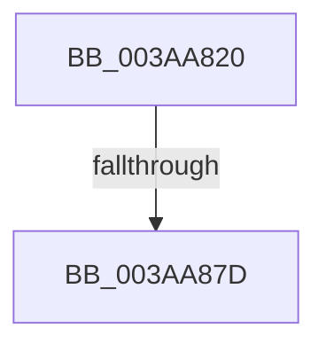

# SMKM_STORE&lt;SM_TRAITS&gt;::SmStDirectRead

- RVA: `0x003AA820`–`0x003AA889` (길이 `105` bytes)
- VA: `0x00000001403AA820`
- 실행 섹션: `.text`
- PDB 이름 있음: `예`; PDB Function 태그: `아니요`
- unwind 정보 RVA: `0x0008B7D8`
- 디코드: `21`개 명령, `105/105` bytes 표시
- 미해석 바이트: `0` (있으면 어셈블리에 `.byte`로 보존)

> 이 문서는 커널 이미지의 기계어와 PDB 기호를 분석해 생성했습니다. 4번과 5번은 함수 원형과 자료형을 바이너리 사용 방식에서 추정한 C 해석이며 원본 소스 복구 결과는 아닙니다.

## 1. Dependencies

- 직접 호출 지점: **0**; 고유 호출 대상: **0**
- 직접 호출자로 확인된 함수: **1**
- RIP 상대 이미지 참조: **1**

### Outgoing calls
- 직접 디코드된 call 명령이 없습니다.

### Direct callers
- [SMKM_STORE&lt;SM_TRAITS&gt;::SmStWorkItemQueue](../31/SMKM_STORE_SM_TRAITS_SmStWorkItemQueue_function_00317A34.md) at `0x00317BE3`

### Static image references
- `0x003AA82B` → RVA `0x00E0A740` (`.data`; read)

## 2. Other-region calls and transfers

- 다른 실행 섹션으로 향하는 call: **0**
- call이 아닌 외부 분기/꼬리 이동: **1**
  - `0x003AA877` → [sub_003AA913 + 0x21](Unknown_function_003AA913.md) (`tail-transfer`)

## 3. Assembly (complete function range)

```asm
003AA820  40 53                           push rbx
003AA822  55                              push rbp
003AA823  57                              push rdi
003AA824  48 81 EC B0 00 00 00            sub rsp, 0xb0
003AA82B  48 8B 05 0E FF A5 00            mov rax, qword ptr [rip + 0xa5ff0e]
003AA832  48 33 C4                        xor rax, rsp
003AA835  48 89 84 24 A0 00 00 00         mov qword ptr [rsp + 0xa0], rax
003AA83D  0F 57 C0                        xorps xmm0, xmm0
003AA840  33 DB                           xor ebx, ebx
003AA842  0F 11 44 24 70                  movups xmmword ptr [rsp + 0x70], xmm0
003AA847  48 8B EA                        mov rbp, rdx
003AA84A  48 8B F9                        mov rdi, rcx
003AA84D  0F 11 84 24 80 00 00 00         movups xmmword ptr [rsp + 0x80], xmm0
003AA855  0F 11 84 24 90 00 00 00         movups xmmword ptr [rsp + 0x90], xmm0
003AA85D  0F 11 44 24 30                  movups xmmword ptr [rsp + 0x30], xmm0
003AA862  0F 11 44 24 40                  movups xmmword ptr [rsp + 0x40], xmm0
003AA867  65 48 8B 04 25 88 01 00 00      mov rax, qword ptr gs:[0x188]
003AA870  80 B8 4A 02 00 00 01            cmp byte ptr [rax + 0x24a], 1
003AA877  0F 84 B7 00 00 00               je 0x1403aa934
003AA87D  48 8B 89 00 1D 00 00            mov rcx, qword ptr [rcx + 0x1d00]
003AA884  48 8D 54 24 70                  lea rdx, [rsp + 0x70]
```

## 4. C-style interpretation (structured pseudocode)

```c
__int64 __fastcall SMKM_STORE_SM_TRAITS___SmStDirectRead(__int64 a1, __int64 a2)
{
    __int64 result;
    __int64 v_rbx;
    __int64 v_rsp;
    unsigned __int64 v_stack_m28;
    unsigned __int64 v_stack_m38;
    unsigned __int64 v_stack_m48;
    unsigned __int64 v_stack_m58;
    unsigned __int64 v_stack_m88;
    unsigned __int64 v_stack_m98;

    v_rsp = (v_rsp) - (176);
    result = (*(unsigned __int64 *)(v_rip + 10878734)) ^ (v_rsp);
    v_stack_m28 = result;
    v_rbx = 0;
    v_stack_m58 = v_xmm0;
    v_stack_m48 = v_xmm0;
    v_stack_m38 = v_xmm0;
    v_stack_m98 = v_xmm0;
    v_stack_m88 = v_xmm0;
    return *(unsigned __int64 *)(gs_base + (0 + 392));
}
```

## 5. (Beta) C Style

```c
int64_t SMKM_STORE_SM_TRAITS___SmStDirectRead(void *Arg1, int64_t Arg2)
{
    uint8_t *arg1 = (uint8_t *)Arg1;

    int64_t result;
    int64_t local_rbx;
    int64_t local_rsp;
    uint64_t v_stack_m28;
    uint64_t v_stack_m38;
    uint64_t v_stack_m48;
    uint64_t v_stack_m58;
    uint64_t v_stack_m88;
    uint64_t v_stack_m98;

    local_rsp = (local_rsp) - (176);
    result = (*(uint64_t *)(v_rip + 0xA5FF0E)) ^ (local_rsp);
    v_stack_m28 = result;
    local_rbx = 0;
    v_stack_m58 = v_xmm0;
    v_stack_m48 = v_xmm0;
    v_stack_m38 = v_xmm0;
    v_stack_m98 = v_xmm0;
    v_stack_m88 = v_xmm0;
    return *(uint64_t *)(gs_base + (0 + 0x188));
}
```

### 관측된 메모리 오프셋

구조체 형식이 확인되지 않은 접근은 인자 기준의 오프셋으로만 기록했습니다.

| 기준 인자 | 오프셋 표현 | 폭 (bit) | 접근 |
|---|---:|---:|---|
| `Arg1` | `+ 0x1D00` | `64` | `R` |

## 6. Execution-region graph

[열기: 2D/3D 그래프와 함수 탐색 컨트롤 패널](../../../control-panel.html?section=text&rva=0x003AA820&view=graph)

- 2D 그래프는 위에서 아래로 흐르고, 3D 그래프는 빈 공간을 드래그해 회전합니다. Shift+드래그는 이동, 휠은 확대·축소, 함수 노드 선택은 대상 보고서 이동입니다.

### Static fallback


