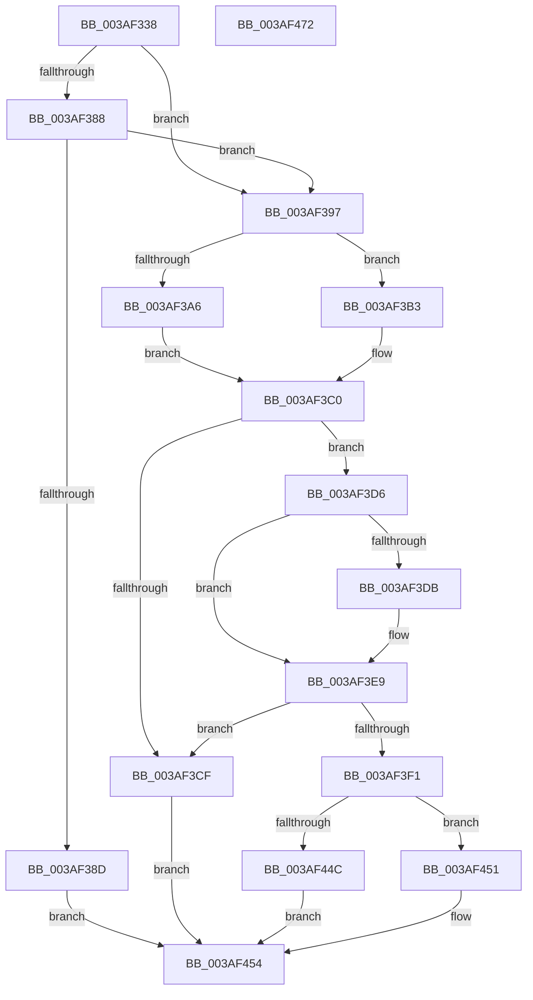

# SMKM_STORE&lt;SM_TRAITS&gt;::SmStReleaseVirtualRegion

- RVA: `0x003AF338`–`0x003AF473` (길이 `315` bytes)
- VA: `0x00000001403AF338`
- 실행 섹션: `.text`
- PDB 이름 있음: `예`; PDB Function 태그: `아니요`
- unwind 정보 RVA: `0x0008C11C`
- 디코드: `92`개 명령, `315/315` bytes 표시
- 미해석 바이트: `0` (있으면 어셈블리에 `.byte`로 보존)

> 이 문서는 커널 이미지의 기계어와 PDB 기호를 분석해 생성했습니다. 4번과 5번은 함수 원형과 자료형을 바이너리 사용 방식에서 추정한 C 해석이며 원본 소스 복구 결과는 아닙니다.

## 1. Dependencies

- 직접 호출 지점: **4**; 고유 호출 대상: **4**
- 직접 호출자로 확인된 함수: **2**
- RIP 상대 이미지 참조: **0**

### Outgoing calls
- `0x003AF3BB` → [SMKM_STORE<SM_TRAITS>::SmStCheckLockInProgressRegionComplete](../3B/SMKM_STORE_SM_TRAITS_SmStCheckLockInProgressRegionComplete_function_003B1B74.md) (function, `0x003B1B74`)
- `0x003AF3C6` → [SMKM_STORE<SM_TRAITS>::SmStIsRegionBusy](../43/SMKM_STORE_SM_TRAITS_SmStIsRegionBusy_function_0043DB80.md) (function, `0x0043DB80`)
- `0x003AF3E4` → [MmStoreDecommitVirtualMemory](../47/MmStoreDecommitVirtualMemory_function_00474BF0.md) (function, `0x00474BF0`)
- `0x003AF440` → [SMKM_STORE<SM_TRAITS>::SmStHelperSendCommand](../3B/SMKM_STORE_SM_TRAITS_SmStHelperSendCommand_function_003B0530.md) (function, `0x003B0530`)

### Direct callers
- [ST_STORE&lt;SM_TRAITS&gt;::StReleaseRegion](ST_STORE_SM_TRAITS_StReleaseRegion_function_003AF138.md) at `0x003AF195`
- [sub_006F84D2](../6F/Unknown_function_006F84D2.md) at `0x006F8528`

### Static image references
- 디코드된 RIP-relative 메모리 참조가 없습니다.

## 2. Other-region calls and transfers

- 다른 실행 섹션으로 향하는 call: **0**
- 별도 외부 분기/꼬리 이동을 확인하지 못했습니다.

## 3. Assembly (complete function range)

```asm
003AF338  48 89 5C 24 08                  mov qword ptr [rsp + 8], rbx
003AF33D  48 89 6C 24 10                  mov qword ptr [rsp + 0x10], rbp
003AF342  48 89 74 24 18                  mov qword ptr [rsp + 0x18], rsi
003AF347  57                              push rdi
003AF348  41 54                           push r12
003AF34A  41 55                           push r13
003AF34C  41 56                           push r14
003AF34E  41 57                           push r15
003AF350  48 83 EC 60                     sub rsp, 0x60
003AF354  48 8B 81 68 1B 00 00            mov rax, qword ptr [rcx + 0x1b68]
003AF35B  45 33 ED                        xor r13d, r13d
003AF35E  44 8B FA                        mov r15d, edx
003AF361  41 8B F8                        mov edi, r8d
003AF364  4C 8B F1                        mov r14, rcx
003AF367  4A 8D 1C F8                     lea rbx, [rax + r15*8]
003AF36B  48 B8 00 00 FF FF FF FF FF 7F   movabs rax, 0x7fffffffffff0000
003AF375  48 8B 2B                        mov rbp, qword ptr [rbx]
003AF378  44 8B A1 60 1B 00 00            mov r12d, dword ptr [rcx + 0x1b60]
003AF37F  48 23 E8                        and rbp, rax
003AF382  41 F6 C0 02                     test r8b, 2
003AF386  74 0F                           je 0x1403af397
003AF388  48 85 ED                        test rbp, rbp
003AF38B  75 0A                           jne 0x1403af397
003AF38D  B8 34 00 19 40                  mov eax, 0x40190034
003AF392  E9 BD 00 00 00                  jmp 0x1403af454
003AF397  0F B7 03                        movzx eax, word ptr [rbx]
003AF39A  BE 01 00 00 00                  mov esi, 1
003AF39F  66 0F BA E0 0E                  bt ax, 0xe
003AF3A4  73 0D                           jae 0x1403af3b3
003AF3A6  B8 FF BF FF FF                  mov eax, 0xffffbfff
003AF3AB  66 F0 21 03                     lock and word ptr [rbx], ax
003AF3AF  23 FE                           and edi, esi
003AF3B1  EB 0D                           jmp 0x1403af3c0
003AF3B3  23 FE                           and edi, esi
003AF3B5  48 8B D3                        mov rdx, rbx
003AF3B8  44 8B C7                        mov r8d, edi
003AF3BB  E8 B4 27 00 00                  call 0x1403b1b74
003AF3C0  41 8B D7                        mov edx, r15d
003AF3C3  49 8B CE                        mov rcx, r14
003AF3C6  E8 B5 E7 08 00                  call 0x14043db80
003AF3CB  85 C0                           test eax, eax
003AF3CD  74 07                           je 0x1403af3d6
003AF3CF  B8 AE 00 00 C0                  mov eax, 0xc00000ae
003AF3D4  EB 7E                           jmp 0x1403af454
003AF3D6  4C 39 2B                        cmp qword ptr [rbx], r13
003AF3D9  7C 0E                           jl 0x1403af3e9
003AF3DB  49 8B D4                        mov rdx, r12
003AF3DE  48 8B CD                        mov rcx, rbp
003AF3E1  41 8B F5                        mov esi, r13d
003AF3E4  E8 07 58 0C 00                  call 0x140474bf0
003AF3E9  0F B7 03                        movzx eax, word ptr [rbx]
003AF3EC  66 85 C0                        test ax, ax
003AF3EF  78 DE                           js 0x1403af3cf
003AF3F1  4C 8B 3B                        mov r15, qword ptr [rbx]
003AF3F4  4C 8D 44 24 20                  lea r8, [rsp + 0x20]
003AF3F9  33 C0                           xor eax, eax
003AF3FB  4C 89 2B                        mov qword ptr [rbx], r13
003AF3FE  0F 57 C0                        xorps xmm0, xmm0
003AF401  48 89 44 24 50                  mov qword ptr [rsp + 0x50], rax
003AF406  0F 11 44 24 20                  movups xmmword ptr [rsp + 0x20], xmm0
003AF40B  BA 03 00 00 00                  mov edx, 3
003AF410  49 8B CE                        mov rcx, r14
003AF413  66 0F 7E C0                     movd eax, xmm0
003AF417  0F 11 44 24 30                  movups xmmword ptr [rsp + 0x30], xmm0
003AF41C  48 89 6C 24 20                  mov qword ptr [rsp + 0x20], rbp
003AF421  83 E0 FE                        and eax, 0xfffffffe
003AF424  4C 89 64 24 28                  mov qword ptr [rsp + 0x28], r12
003AF429  0B C6                           or eax, esi
003AF42B  F7 DF                           neg edi
003AF42D  89 44 24 30                     mov dword ptr [rsp + 0x30], eax
003AF431  0F 11 44 24 40                  movups xmmword ptr [rsp + 0x40], xmm0
003AF436  45 1B C9                        sbb r9d, r9d
003AF439  44 23 CA                        and r9d, edx
003AF43C  41 83 C1 08                     add r9d, 8
003AF440  E8 EB 10 00 00                  call 0x1403b0530
003AF445  3D AE 00 00 C0                  cmp eax, 0xc00000ae
003AF44A  75 05                           jne 0x1403af451
003AF44C  4C 89 3B                        mov qword ptr [rbx], r15
003AF44F  EB 03                           jmp 0x1403af454
003AF451  41 8B C5                        mov eax, r13d
003AF454  4C 8D 5C 24 60                  lea r11, [rsp + 0x60]
003AF459  49 8B 5B 30                     mov rbx, qword ptr [r11 + 0x30]
003AF45D  49 8B 6B 38                     mov rbp, qword ptr [r11 + 0x38]
003AF461  49 8B 73 40                     mov rsi, qword ptr [r11 + 0x40]
003AF465  49 8B E3                        mov rsp, r11
003AF468  41 5F                           pop r15
003AF46A  41 5E                           pop r14
003AF46C  41 5D                           pop r13
003AF46E  41 5C                           pop r12
003AF470  5F                              pop rdi
003AF471  C3                              ret
003AF472  CC                              int3
```

## 4. C-style interpretation (structured pseudocode)

```c
__int64 __fastcall SMKM_STORE_SM_TRAITS___SmStReleaseVirtualRegion(__int64 a1, int a2, int a3, int a4)
{
    __int64 result;
    __int64 v_r13;
    __int64 v_rbp;
    __int64 v_rdi;
    __int64 v_rsi;
    __int64 v_rsp;
    unsigned __int64 v_stack_m28;
    unsigned __int64 v_stack_m38;
    unsigned __int64 v_stack_m48;
    unsigned __int64 v_stack_m58;
    unsigned __int64 v_stack_m60;
    unsigned __int64 v_stack_m68;
    unsigned __int64 v_stack_p10;
    unsigned __int64 v_stack_p18;
    unsigned __int64 v_stack_p8;

    v_stack_p8 = v_rbx;
    v_stack_p10 = v_rbp;
    v_stack_p18 = v_rsi;
    v_rsp = (v_rsp) - (96);
    v_r13 = 0;
    v_rbp = (*(unsigned __int64 *)(*(unsigned __int64 *)(a1 + 7016) + (unsigned int)(a2) * 8)) & (*(unsigned __int64 *)(a1 + 7016));
    if ((((unsigned __int8)(a3)) & (2)) == 0) goto loc_003AF397;
    if (v_rbp != 0) goto loc_003AF397;
    goto loc_003AF454;
loc_003AF397:
    if (condition_is_above_or_equal) goto loc_003AF3B3;
    v_rdi = (unsigned int)(((unsigned int)(a3)) & (1));
    goto loc_003AF3C0;
loc_003AF3B3:
    v_rdi = (unsigned int)((v_rdi) & (1));
    result = SMKM_STORE_SM_TRAITS___SmStCheckLockInProgressRegionComplete(a1, *(unsigned __int64 *)(a1 + 7016) + (unsigned int)(a2) * 8, (unsigned int)((unsigned int)(v_rdi)), a4);
loc_003AF3C0:
    result = SMKM_STORE_SM_TRAITS___SmStIsRegionBusy(a1, (unsigned int)((unsigned int)((unsigned int)(a2))), (unsigned int)((unsigned int)(v_rdi)), a4);
    if ((unsigned int)(result) == 0) goto loc_003AF3D6;
loc_003AF3CF:
    goto loc_003AF454;
loc_003AF3D6:
    result = (unsigned int)(0xC00000AEULL);
    v_rsi = 1;
    if ((*(unsigned __int64 *)(*(unsigned __int64 *)(a1 + 7016) + (unsigned int)(a2) * 8)) >= 0) {
        a2 = (unsigned int)(*(unsigned int *)(a1 + 7008));
        a1 = v_rbp;
        v_rsi = 0;
        result = MmStoreDecommitVirtualMemory(a1, a2, (unsigned int)((unsigned int)(v_rdi)), a4);
    }
    if (sign_flag) goto loc_003AF3CF;
    result = 0;
    *(unsigned __int64 *)(*(unsigned __int64 *)(a1 + 7016) + (unsigned int)(a2) * 8) = 0;
    v_stack_m38 = 0;
    v_stack_m68 = v_xmm0;
    v_stack_m58 = v_xmm0;
    v_stack_m68 = v_rbp;
    result = (unsigned int)((result) & (0xFFFFFFFEULL));
    v_stack_m60 = (unsigned int)(*(unsigned int *)(a1 + 7008));
    result = (unsigned int)((result) | ((unsigned int)(v_rsi)));
    v_rdi = (unsigned int)(-(v_rdi));
    v_stack_m58 = (unsigned int)(result);
    v_stack_m48 = v_xmm0;
    a4 = (unsigned int)((a4) & (3));
    a4 = (unsigned int)((a4) + (8));
    result = SMKM_STORE_SM_TRAITS___SmStHelperSendCommand(a1, 3, v_stack_m68, a4);
    if (((unsigned int)(result)) != 0xC00000AEULL) goto loc_003AF451;
    *(unsigned __int64 *)(*(unsigned __int64 *)(a1 + 7016) + (unsigned int)(a2) * 8) = *(unsigned __int64 *)(*(unsigned __int64 *)(a1 + 7016) + (unsigned int)(a2) * 8);
    goto loc_003AF454;
loc_003AF451:
loc_003AF454:
    return 0;
}
```

## 5. (Beta) C Style

```c
int64_t SMKM_STORE_SM_TRAITS___SmStReleaseVirtualRegion(void *Arg1, int32_t Arg2, int32_t Arg3, int32_t Arg4)
{
    uint8_t *arg1 = (uint8_t *)Arg1;

    int64_t result;
    int64_t local_r13;
    int64_t local_rbp;
    int64_t local_rdi;
    int64_t local_rsi;
    int64_t local_rsp;
    uint64_t v_stack_m28;
    uint64_t v_stack_m38;
    uint64_t v_stack_m48;
    uint64_t v_stack_m58;
    uint64_t v_stack_m60;
    uint64_t v_stack_m68;
    uint64_t v_stack_p10;
    uint64_t v_stack_p18;
    uint64_t v_stack_p8;

    v_stack_p8 = local_rbx;
    v_stack_p10 = local_rbp;
    v_stack_p18 = local_rsi;
    local_rsp = (local_rsp) - (96);
    local_r13 = 0;
    local_rbp = (*(uint64_t *)(*(uint64_t *)(arg1 + 0x1B68) + (uint32_t)(Arg2) * 8)) & (*(uint64_t *)(arg1 + 0x1B68));
    if ((((uint8_t)(Arg3)) & (2)) == 0) goto loc_003AF397;
    if (local_rbp != 0) goto loc_003AF397;
    goto loc_003AF454;
loc_003AF397:
    if (condition_is_above_or_equal) goto loc_003AF3B3;
    local_rdi = (uint32_t)(((uint32_t)(Arg3)) & (1));
    goto loc_003AF3C0;
loc_003AF3B3:
    local_rdi = (uint32_t)((local_rdi) & (1));
    result = SMKM_STORE_SM_TRAITS___SmStCheckLockInProgressRegionComplete(Arg1, *(uint64_t *)(arg1 + 0x1B68) + (uint32_t)(Arg2) * 8, (uint32_t)((uint32_t)(local_rdi)), Arg4);
loc_003AF3C0:
    result = SMKM_STORE_SM_TRAITS___SmStIsRegionBusy(Arg1, (uint32_t)((uint32_t)((uint32_t)(Arg2))), (uint32_t)((uint32_t)(local_rdi)), Arg4);
    if ((uint32_t)(result) == 0) goto loc_003AF3D6;
loc_003AF3CF:
    goto loc_003AF454;
loc_003AF3D6:
    result = (uint32_t)(0xC00000AEULL);
    local_rsi = 1;
    if ((*(uint64_t *)(*(uint64_t *)(arg1 + 0x1B68) + (uint32_t)(Arg2) * 8)) >= 0) {
        Arg2 = (uint32_t)(*(uint32_t *)(arg1 + 0x1B60));
        Arg1 = local_rbp;
        local_rsi = 0;
        result = MmStoreDecommitVirtualMemory(Arg1, Arg2, (uint32_t)((uint32_t)(local_rdi)), Arg4);
    }
    if (sign_flag) goto loc_003AF3CF;
    result = 0;
    *(uint64_t *)(*(uint64_t *)(arg1 + 0x1B68) + (uint32_t)(Arg2) * 8) = 0;
    v_stack_m38 = 0;
    v_stack_m68 = v_xmm0;
    v_stack_m58 = v_xmm0;
    v_stack_m68 = local_rbp;
    result = (uint32_t)((result) & (0xFFFFFFFEULL));
    v_stack_m60 = (uint32_t)(*(uint32_t *)(arg1 + 0x1B60));
    result = (uint32_t)((result) | ((uint32_t)(local_rsi)));
    local_rdi = (uint32_t)(-(local_rdi));
    v_stack_m58 = (uint32_t)(result);
    v_stack_m48 = v_xmm0;
    Arg4 = (uint32_t)((Arg4) & (3));
    Arg4 = (uint32_t)((Arg4) + (8));
    result = SMKM_STORE_SM_TRAITS___SmStHelperSendCommand(Arg1, 3, v_stack_m68, Arg4);
    if (((uint32_t)(result)) != 0xC00000AEULL) goto loc_003AF451;
    *(uint64_t *)(*(uint64_t *)(arg1 + 0x1B68) + (uint32_t)(Arg2) * 8) = *(uint64_t *)(*(uint64_t *)(arg1 + 0x1B68) + (uint32_t)(Arg2) * 8);
    goto loc_003AF454;
loc_003AF451:
loc_003AF454:
    return 0;
}
```

### 관측된 메모리 오프셋

구조체 형식이 확인되지 않은 접근은 인자 기준의 오프셋으로만 기록했습니다.

| 기준 인자 | 오프셋 표현 | 폭 (bit) | 접근 |
|---|---:|---:|---|
| `Arg1` | `+ 0x1B60` | `32` | `R` |
| `Arg1` | `+ 0x1B68` | `64` | `R` |

## 6. Execution-region graph

[열기: 2D/3D 그래프와 함수 탐색 컨트롤 패널](../../../control-panel.html?section=text&rva=0x003AF338&view=graph)

- 2D 그래프는 위에서 아래로 흐르고, 3D 그래프는 빈 공간을 드래그해 회전합니다. Shift+드래그는 이동, 휠은 확대·축소, 함수 노드 선택은 대상 보고서 이동입니다.

### Static fallback


