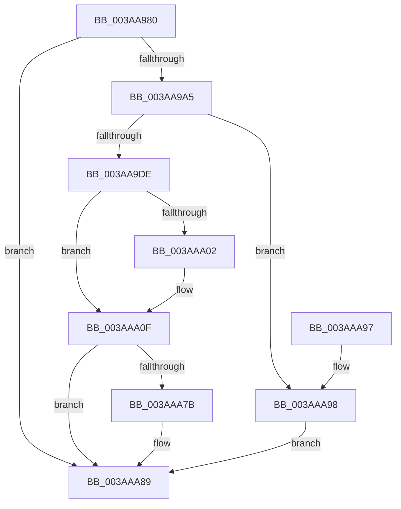

# ST_STORE&lt;SM_TRAITS&gt;::StAcquireReadContext

- RVA: `0x003AA980`–`0x003AAA9C` (길이 `284` bytes)
- VA: `0x00000001403AA980`
- 실행 섹션: `.text`
- PDB 이름 있음: `예`; PDB Function 태그: `아니요`
- unwind 정보 RVA: `0x00065BB8`
- 디코드: `64`개 명령, `284/284` bytes 표시
- 미해석 바이트: `0` (있으면 어셈블리에 `.byte`로 보존)

> 이 문서는 커널 이미지의 기계어와 PDB 기호를 분석해 생성했습니다. 4번과 5번은 함수 원형과 자료형을 바이너리 사용 방식에서 추정한 C 해석이며 원본 소스 복구 결과는 아닙니다.

## 1. Dependencies

- 직접 호출 지점: **3**; 고유 호출 대상: **3**
- 직접 호출자로 확인된 함수: **2**
- RIP 상대 이미지 참조: **0**

### Outgoing calls
- `0x003AA994` → [ExpInterlockedPopEntrySList](../6B/ExpInterlockedPopEntrySList_function_006BA570.md) (function, `0x006BA570`)
- `0x003AA9CD` → [ExAllocatePool2](../../poolcode/B8/ExAllocatePool2_function_00B820F0.md) (function, `0x00B820F0`)
- `0x003AA9E9` → [memset](../6C/memset_function_006C6C40.md) (function, `0x006C6C40`)

### Direct callers
- [SMKM_STORE&lt;SM_TRAITS&gt;::SmStReadThread](../20/SMKM_STORE_SM_TRAITS_SmStReadThread_function_00203230.md) at `0x0020327D`
- [sub_003AA889](Unknown_function_003AA889.md) at `0x003AA89E`

### Static image references
- 디코드된 RIP-relative 메모리 참조가 없습니다.

## 2. Other-region calls and transfers

- 다른 실행 섹션으로 향하는 call: **1**
  - `0x003AA9CD` → [ExAllocatePool2](../../poolcode/B8/ExAllocatePool2_function_00B820F0.md) (`.text` → `POOLCODE`)
- 별도 외부 분기/꼬리 이동을 확인하지 못했습니다.

## 3. Assembly (complete function range)

```asm
003AA980  48 89 5C 24 08                  mov qword ptr [rsp + 8], rbx
003AA985  57                              push rdi
003AA986  48 83 EC 20                     sub rsp, 0x20
003AA98A  48 8B F9                        mov rdi, rcx
003AA98D  48 81 C1 D0 12 00 00            add rcx, 0x12d0
003AA994  E8 D7 FB 30 00                  call 0x1406ba570
003AA999  48 8B D8                        mov rbx, rax
003AA99C  48 85 C0                        test rax, rax
003AA99F  0F 85 E4 00 00 00               jne 0x1403aaa89
003AA9A5  8B 8F B8 12 00 00               mov ecx, dword ptr [rdi + 0x12b8]
003AA9AB  41 B8 73 6D 53 74               mov r8d, 0x74536d73
003AA9B1  81 C1 30 03 00 00               add ecx, 0x330
003AA9B7  F7 87 58 03 00 00 00 00 02 00   test dword ptr [rdi + 0x358], 0x20000
003AA9C1  8D 91 00 10 00 00               lea edx, [rcx + 0x1000]
003AA9C7  0F 44 D1                        cmove edx, ecx
003AA9CA  8D 48 40                        lea ecx, [rax + 0x40]
003AA9CD  E8 1E 77 7D 00                  call 0x140b820f0
003AA9D2  48 8B D8                        mov rbx, rax
003AA9D5  48 85 C0                        test rax, rax
003AA9D8  0F 84 BA 00 00 00               je 0x1403aaa98
003AA9DE  33 D2                           xor edx, edx
003AA9E0  41 B8 C0 01 00 00               mov r8d, 0x1c0
003AA9E6  48 8B C8                        mov rcx, rax
003AA9E9  E8 52 C2 31 00                  call 0x1406c6c40
003AA9EE  48 8D 8B CF 01 00 00            lea rcx, [rbx + 0x1cf]
003AA9F5  48 83 E1 F0                     and rcx, 0xfffffffffffffff0
003AA9F9  83 BF B8 12 00 00 00            cmp dword ptr [rdi + 0x12b8], 0
003AAA00  74 0D                           je 0x1403aaa0f
003AAA02  48 89 4B 10                     mov qword ptr [rbx + 0x10], rcx
003AAA06  8B 87 B8 12 00 00               mov eax, dword ptr [rdi + 0x12b8]
003AAA0C  48 03 C8                        add rcx, rax
003AAA0F  48 83 C1 07                     add rcx, 7
003AAA13  48 83 E1 F8                     and rcx, 0xfffffffffffffff8
003AAA17  48 89 8B A8 01 00 00            mov qword ptr [rbx + 0x1a8], rcx
003AAA1E  48 8D 41 28                     lea rax, [rcx + 0x28]
003AAA22  48 8D 91 AF 00 00 00            lea rdx, [rcx + 0xaf]
003AAA29  48 83 E2 F8                     and rdx, 0xfffffffffffffff8
003AAA2D  48 89 93 B0 01 00 00            mov qword ptr [rbx + 0x1b0], rdx
003AAA34  48 83 61 08 00                  and qword ptr [rcx + 8], 0
003AAA39  48 83 61 10 00                  and qword ptr [rcx + 0x10], 0
003AAA3E  48 83 61 20 00                  and qword ptr [rcx + 0x20], 0
003AAA43  83 61 18 00                     and dword ptr [rcx + 0x18], 0
003AAA47  48 89 01                        mov qword ptr [rcx], rax
003AAA4A  B8 08 00 00 00                  mov eax, 8
003AAA4F  89 41 1C                        mov dword ptr [rcx + 0x1c], eax
003AAA52  48 8D 4A 28                     lea rcx, [rdx + 0x28]
003AAA56  48 83 62 08 00                  and qword ptr [rdx + 8], 0
003AAA5B  48 83 62 10 00                  and qword ptr [rdx + 0x10], 0
003AAA60  48 83 62 20 00                  and qword ptr [rdx + 0x20], 0
003AAA65  83 62 18 00                     and dword ptr [rdx + 0x18], 0
003AAA69  48 89 0A                        mov qword ptr [rdx], rcx
003AAA6C  89 42 1C                        mov dword ptr [rdx + 0x1c], eax
003AAA6F  F7 87 58 03 00 00 00 00 02 00   test dword ptr [rdi + 0x358], 0x20000
003AAA79  74 0E                           je 0x1403aaa89
003AAA7B  48 8D 8A A8 00 00 00            lea rcx, [rdx + 0xa8]
003AAA82  48 89 8B 98 01 00 00            mov qword ptr [rbx + 0x198], rcx
003AAA89  48 8B C3                        mov rax, rbx
003AAA8C  48 8B 5C 24 30                  mov rbx, qword ptr [rsp + 0x30]
003AAA91  48 83 C4 20                     add rsp, 0x20
003AAA95  5F                              pop rdi
003AAA96  C3                              ret
003AAA97  CC                              int3
003AAA98  33 DB                           xor ebx, ebx
003AAA9A  EB ED                           jmp 0x1403aaa89
```

## 4. C-style interpretation (structured pseudocode)

```c
__int64 __fastcall ST_STORE_SM_TRAITS___StAcquireReadContext(__int64 a1)
{
    __int64 result;
    __int64 v_rbx;
    __int64 v_rsp;
    unsigned __int64 v_stack_p8;

    v_stack_p8 = v_rbx;
    v_rsp = (v_rsp) - (32);
    a1 = (a1) + (0x12D0ULL);
    result = ExpInterlockedPopEntrySList(a1, a2, a3, a4);
    if (result != 0) goto loc_003AAA89;
    a1 = (unsigned int)(((unsigned int)(*(unsigned int *)(a1 + 4792))) + (816));
    a2 = a1 + 4096;
    if (((*(unsigned int *)(a1 + 856)) & (0x20000ULL)) == 0) { a2 = (unsigned int)(a1); }
    result = ExAllocatePool2(result + 64, a2, (unsigned int)(0x74536D73ULL), a4);
    if (result == 0) goto loc_003AAA98;
    a2 = 0;
    result = memset(result, a2, 448, a4);
    a1 = (result + 463) & (-16);
    if ((*(unsigned int *)(a1 + 4792)) != 0) {
        *(unsigned __int64 *)(result + 16) = a1;
        result = *(unsigned int *)(a1 + 4792);
        a1 = (a1) + (result);
    }
    a1 = (a1) + (7);
    a1 = (a1) & (-8);
    *(unsigned __int64 *)(result + 424) = a1;
    a2 = (a1 + 175) & (-8);
    *(unsigned __int64 *)(result + 432) = a2;
    *(unsigned __int64 *)(a1) = a1 + 40;
    *(unsigned int *)(a1 + 28) = 8;
    *(unsigned __int64 *)(a2) = a2 + 40;
    *(unsigned int *)(a2 + 28) = 8;
    if (((*(unsigned int *)(a1 + 856)) & (0x20000ULL)) != 0) {
        a1 = a2 + 168;
        *(unsigned __int64 *)(result + 408) = a1;
    }
    v_rsp = (v_rsp) + (32);
    return result;
loc_003AAA98:
    v_rbx = 0;
    goto loc_003AAA89;
}
```

## 5. (Beta) C Style

```c
int64_t ST_STORE_SM_TRAITS___StAcquireReadContext(void *Arg1)
{
    uint8_t *arg1 = (uint8_t *)Arg1;

    int64_t result;
    int64_t local_rbx;
    int64_t local_rsp;
    uint64_t v_stack_p8;

    v_stack_p8 = local_rbx;
    local_rsp = (local_rsp) - (32);
    Arg1 = (Arg1) + (0x12D0ULL);
    result = ExpInterlockedPopEntrySList(Arg1, a2, a3, a4);
    if (result != 0) goto loc_003AAA89;
    Arg1 = (uint32_t)(((uint32_t)(*(uint32_t *)(arg1 + 0x12B8))) + (816));
    a2 = Arg1 + 4096;
    if (((*(uint32_t *)(arg1 + 0x358)) & (0x20000ULL)) == 0) { a2 = (uint32_t)(Arg1); }
    result = ExAllocatePool2(result + 64, a2, (uint32_t)(0x74536D73ULL), a4);
    if (result == 0) goto loc_003AAA98;
    a2 = 0;
    result = memset(result, a2, 448, a4);
    Arg1 = (result + 463) & (-16);
    if ((*(uint32_t *)(arg1 + 0x12B8)) != 0) {
        *(void **)(result + 0x10) = Arg1;
        result = *(uint32_t *)(arg1 + 0x12B8);
        Arg1 = (Arg1) + (result);
    }
    Arg1 = (Arg1) + (7);
    Arg1 = (Arg1) & (-8);
    *(void **)(result + 0x1A8) = Arg1;
    a2 = (Arg1 + 175) & (-8);
    *(uint64_t *)(result + 0x1B0) = a2;
    *(void **)(arg1) = Arg1 + 40;
    *(uint32_t *)(arg1 + 0x1C) = 8;
    *(uint64_t *)(a2) = a2 + 40;
    *(uint32_t *)(a2 + 0x1C) = 8;
    if (((*(uint32_t *)(arg1 + 0x358)) & (0x20000ULL)) != 0) {
        Arg1 = a2 + 168;
        *(void **)(result + 0x198) = Arg1;
    }
    local_rsp = (local_rsp) + (32);
    return result;
loc_003AAA98:
    local_rbx = 0;
    goto loc_003AAA89;
}
```

### 관측된 메모리 오프셋

구조체 형식이 확인되지 않은 접근은 인자 기준의 오프셋으로만 기록했습니다.

| 기준 인자 | 오프셋 표현 | 폭 (bit) | 접근 |
|---|---:|---:|---|
| `Arg1` | `+ 0x358` | `32` | `R` |
| `Arg1` | `+ 0x12B8` | `32` | `R` |

## 6. Execution-region graph

[열기: 2D/3D 그래프와 함수 탐색 컨트롤 패널](../../../control-panel.html?section=text&rva=0x003AA980&view=graph)

- 2D 그래프는 위에서 아래로 흐르고, 3D 그래프는 빈 공간을 드래그해 회전합니다. Shift+드래그는 이동, 휠은 확대·축소, 함수 노드 선택은 대상 보고서 이동입니다.

### Static fallback


