# ST_STORE&lt;SM_TRAITS&gt;::StDmCleanup

- RVA: `0x003AF8D4`–`0x003AFC34` (길이 `864` bytes)
- VA: `0x00000001403AF8D4`
- 실행 섹션: `.text`
- PDB 이름 있음: `예`; PDB Function 태그: `아니요`
- unwind 정보 RVA: `0x0008C158`
- 디코드: `211`개 명령, `864/864` bytes 표시
- 미해석 바이트: `0` (있으면 어셈블리에 `.byte`로 보존)

> 이 문서는 커널 이미지의 기계어와 PDB 기호를 분석해 생성했습니다. 4번과 5번은 함수 원형과 자료형을 바이너리 사용 방식에서 추정한 C 해석이며 원본 소스 복구 결과는 아닙니다.

## 1. Dependencies

- 직접 호출 지점: **25**; 고유 호출 대상: **16**
- 직접 호출자로 확인된 함수: **2**
- RIP 상대 이미지 참조: **0**

### Outgoing calls
- `0x003AF902` → [SmHpChunkHeapProtect](SmHpChunkHeapProtect_function_003AFD8C.md) (function, `0x003AFD8C`)
- `0x003AF926` → [SmHpChunkHeapCleanup](SmHpChunkHeapCleanup_function_003AFD08.md) (function, `0x003AFD08`)
- `0x003AF93D` → [B_TREE<_SM_PAGE_KEY,ST_STORE<SM_TRAITS>::_ST_PAGE_ENTRY,4096,NP_CONTEXT,B_TREE_KEY_COMPARATOR<_SM_PAGE_KEY> >::BTreeSearchResultCleanup](B_TREE__SM_PAGE_KEY_ST_STORE_SM_TRAITS__ST_PAGE_ENTRY_4096_NP_CONTEXT_B_TREE_KEY_COMPARATOR__SM_PAGE_function_003AFC70.md) (function, `0x003AFC70`)
- `0x003AF94D` → [B_TREE<_SM_PAGE_KEY,ST_STORE<SM_TRAITS>::_ST_PAGE_ENTRY,4096,NP_CONTEXT,B_TREE_KEY_COMPARATOR<_SM_PAGE_KEY> >::BTreeNodeFree](B_TREE__SM_PAGE_KEY_ST_STORE_SM_TRAITS__ST_PAGE_ENTRY_4096_NP_CONTEXT_B_TREE_KEY_COMPARATOR__SM_PAGE_function_003AFED0.md) (function, `0x003AFED0`)
- `0x003AF960` → [B_TREE<unsigned long,ST_STORE<SM_TRAITS>::_ST_REGION_ENTRY,4096,NP_CONTEXT,ST_STORE<SM_TRAITS>::ST_REGION_ENTRY_COMPARATOR>::BTreeSearchResultCleanup](B_TREE_unsigned_long_ST_STORE_SM_TRAITS__ST_REGION_ENTRY_4096_NP_CONTEXT_ST_STORE_SM_TRAITS_ST_REGIO_function_003AC7E0.md) (function, `0x003AC7E0`)
- `0x003AF970` → [B_TREE<_SM_PAGE_KEY,ST_STORE<SM_TRAITS>::_ST_PAGE_ENTRY,4096,NP_CONTEXT,B_TREE_KEY_COMPARATOR<_SM_PAGE_KEY> >::BTreeNodeFree](B_TREE__SM_PAGE_KEY_ST_STORE_SM_TRAITS__ST_PAGE_ENTRY_4096_NP_CONTEXT_B_TREE_KEY_COMPARATOR__SM_PAGE_function_003AFED0.md) (function, `0x003AFED0`)
- `0x003AF989` → [B_TREE<unsigned long,ST_STORE<SM_TRAITS>::_ST_HASH_ENTRY,4096,NP_CONTEXT,ST_STORE<SM_TRAITS>::ST_HASH_ENTRY_COMPARATOR>::BTreeSearchResultDeref](B_TREE_unsigned_long_ST_STORE_SM_TRAITS__ST_HASH_ENTRY_4096_NP_CONTEXT_ST_STORE_SM_TRAITS_ST_HASH_EN_function_003AE310.md) (function, `0x003AE310`)
- `0x003AF9C1` → [NP_CONTEXT::NpCleanup](NP_CONTEXT_NpCleanup_function_003AFCB4.md) (function, `0x003AFCB4`)
- `0x003AF9D2` → [NP_CONTEXT::NpCleanup](NP_CONTEXT_NpCleanup_function_003AFCB4.md) (function, `0x003AFCB4`)
- `0x003AF9E3` → [NP_CONTEXT::NpCleanup](NP_CONTEXT_NpCleanup_function_003AFCB4.md) (function, `0x003AFCB4`)
- `0x003AFA20` → [ExFreePoolWithTag](../../poolcode/B8/ExFreePoolWithTag_function_00B82870.md) (function, `0x00B82870`)
- `0x003AFA33` → [ExFreePoolWithTag](../../poolcode/B8/ExFreePoolWithTag_function_00B82870.md) (function, `0x00B82870`)
- `0x003AFA85` → [ST_STORE<SM_TRAITS>::StDmInvalidateCurrentRegions](../3B/ST_STORE_SM_TRAITS_StDmInvalidateCurrentRegions_function_003B092C.md) (function, `0x003B092C`)
- `0x003AFAE3` → [ST_STORE<SM_TRAITS>::StStagingRegionCleanup](ST_STORE_SM_TRAITS_StStagingRegionCleanup_function_003AFC3C.md) (function, `0x003AFC3C`)
- `0x003AFB09` → [ExFreePoolWithTag](../../poolcode/B8/ExFreePoolWithTag_function_00B82870.md) (function, `0x00B82870`)
- `0x003AFB21` → [RtlNumberOfSetBits](../43/RtlNumberOfSetBits_function_00433F70.md) (function, `0x00433F70`)
- `0x003AFB37` → [ST_STORE<SM_TRAITS>::StDmLazyRegionsWorker](../49/ST_STORE_SM_TRAITS_StDmLazyRegionsWorker_function_0049FE78.md) (function, `0x0049FE78`)
- `0x003AFB41` → [B_TREE<unsigned long,ST_STORE<SM_TRAITS>::_ST_HASH_ENTRY,4096,NP_CONTEXT,ST_STORE<SM_TRAITS>::ST_HASH_ENTRY_COMPARATOR>::BTreeNodeFree](B_TREE_unsigned_long_ST_STORE_SM_TRAITS__ST_HASH_ENTRY_4096_NP_CONTEXT_ST_STORE_SM_TRAITS_ST_HASH_EN_function_003A99DC.md) (function, `0x003A99DC`)
- `0x003AFB4E` → [SmHpChunkFree](../26/SmHpChunkFree_function_00268D50.md) (function, `0x00268D50`)
- `0x003AFB71` → [ExFreePoolWithTag](../../poolcode/B8/ExFreePoolWithTag_function_00B82870.md) (function, `0x00B82870`)
- `0x003AFB83` → [SmHpChunkHeapInitialize](../46/SmHpChunkHeapInitialize_function_0046857C.md) (function, `0x0046857C`)
- `0x003AFBD2` → [ST_STORE<SM_TRAITS>::StDmpUpdateRegionState](ST_STORE_SM_TRAITS_StDmpUpdateRegionState_function_003AEFE0.md) (function, `0x003AEFE0`)
- `0x003AFC12` → [ExFreePoolWithTag](../../poolcode/B8/ExFreePoolWithTag_function_00B82870.md) (function, `0x00B82870`)
- `0x003AFC1E` → [ExFreePoolWithTag](../../poolcode/B8/ExFreePoolWithTag_function_00B82870.md) (function, `0x00B82870`)
- `0x003AFC2A` → [ExFreePoolWithTag](../../poolcode/B8/ExFreePoolWithTag_function_00B82870.md) (function, `0x00B82870`)

### Direct callers
- [ST_STORE&lt;SM_TRAITS&gt;::StCleanup](../3B/ST_STORE_SM_TRAITS_StCleanup_function_003B03B4.md) at `0x003B03CA`
- [ST_STORE&lt;SM_TRAITS&gt;::StCleanup](../3B/ST_STORE_SM_TRAITS_StCleanup_function_003B03B4.md) at `0x003B03D8`
- [ST_STORE&lt;SM_TRAITS&gt;::StEmptyStore](../4F/ST_STORE_SM_TRAITS_StEmptyStore_function_004FB4B0.md) at `0x004FB50A`
- [ST_STORE&lt;SM_TRAITS&gt;::StEmptyStore](../4F/ST_STORE_SM_TRAITS_StEmptyStore_function_004FB4B0.md) at `0x004FB51F`

### Static image references
- 디코드된 RIP-relative 메모리 참조가 없습니다.

## 2. Other-region calls and transfers

- 다른 실행 섹션으로 향하는 call: **7**
  - `0x003AFA20` → [ExFreePoolWithTag](../../poolcode/B8/ExFreePoolWithTag_function_00B82870.md) (`.text` → `POOLCODE`)
  - `0x003AFA33` → [ExFreePoolWithTag](../../poolcode/B8/ExFreePoolWithTag_function_00B82870.md) (`.text` → `POOLCODE`)
  - `0x003AFB09` → [ExFreePoolWithTag](../../poolcode/B8/ExFreePoolWithTag_function_00B82870.md) (`.text` → `POOLCODE`)
  - `0x003AFB71` → [ExFreePoolWithTag](../../poolcode/B8/ExFreePoolWithTag_function_00B82870.md) (`.text` → `POOLCODE`)
  - `0x003AFC12` → [ExFreePoolWithTag](../../poolcode/B8/ExFreePoolWithTag_function_00B82870.md) (`.text` → `POOLCODE`)
  - `0x003AFC1E` → [ExFreePoolWithTag](../../poolcode/B8/ExFreePoolWithTag_function_00B82870.md) (`.text` → `POOLCODE`)
  - `0x003AFC2A` → [ExFreePoolWithTag](../../poolcode/B8/ExFreePoolWithTag_function_00B82870.md) (`.text` → `POOLCODE`)
- 별도 외부 분기/꼬리 이동을 확인하지 못했습니다.

## 3. Assembly (complete function range)

```asm
003AF8D4  48 89 5C 24 10                  mov qword ptr [rsp + 0x10], rbx
003AF8D9  48 89 6C 24 18                  mov qword ptr [rsp + 0x18], rbp
003AF8DE  48 89 74 24 20                  mov qword ptr [rsp + 0x20], rsi
003AF8E3  57                              push rdi
003AF8E4  41 56                           push r14
003AF8E6  41 57                           push r15
003AF8E8  48 83 EC 20                     sub rsp, 0x20
003AF8EC  45 33 C0                        xor r8d, r8d
003AF8EF  48 8D 99 C0 00 00 00            lea rbx, [rcx + 0xc0]
003AF8F6  8B F2                           mov esi, edx
003AF8F8  48 8B F9                        mov rdi, rcx
003AF8FB  48 8B CB                        mov rcx, rbx
003AF8FE  41 8D 50 01                     lea edx, [r8 + 1]
003AF902  E8 85 04 00 00                  call 0x1403afd8c
003AF907  48 8B 97 F8 02 00 00            mov rdx, qword ptr [rdi + 0x2f8]
003AF90E  48 85 D2                        test rdx, rdx
003AF911  0F 85 34 02 00 00               jne 0x1403afb4b
003AF917  48 8B 87 D0 01 00 00            mov rax, qword ptr [rdi + 0x1d0]
003AF91E  48 8B CB                        mov rcx, rbx
003AF921  48 89 44 24 40                  mov qword ptr [rsp + 0x40], rax
003AF926  E8 DD 03 00 00                  call 0x1403afd08
003AF92B  85 F6                           test esi, esi
003AF92D  0F 85 48 02 00 00               jne 0x1403afb7b
003AF933  48 8D 57 18                     lea rdx, [rdi + 0x18]
003AF937  44 8B C6                        mov r8d, esi
003AF93A  48 8B CF                        mov rcx, rdi
003AF93D  E8 2E 03 00 00                  call 0x1403afc70
003AF942  48 8B 17                        mov rdx, qword ptr [rdi]
003AF945  48 85 D2                        test rdx, rdx
003AF948  74 08                           je 0x1403af952
003AF94A  48 8B CF                        mov rcx, rdi
003AF94D  E8 7E 05 00 00                  call 0x1403afed0
003AF952  4C 8D 77 40                     lea r14, [rdi + 0x40]
003AF956  44 8B C6                        mov r8d, esi
003AF959  49 8B CE                        mov rcx, r14
003AF95C  48 8D 57 58                     lea rdx, [rdi + 0x58]
003AF960  E8 7B CE FF FF                  call 0x1403ac7e0
003AF965  49 8B 16                        mov rdx, qword ptr [r14]
003AF968  48 85 D2                        test rdx, rdx
003AF96B  74 08                           je 0x1403af975
003AF96D  49 8B CE                        mov rcx, r14
003AF970  E8 5B 05 00 00                  call 0x1403afed0
003AF975  4C 8D BF 98 00 00 00            lea r15, [rdi + 0x98]
003AF97C  48 8D 9F 80 00 00 00            lea rbx, [rdi + 0x80]
003AF983  49 8B D7                        mov rdx, r15
003AF986  48 8B CB                        mov rcx, rbx
003AF989  E8 82 E9 FF FF                  call 0x1403ae310
003AF98E  41 83 7F 18 FF                  cmp dword ptr [r15 + 0x18], -1
003AF993  74 0C                           je 0x1403af9a1
003AF995  49 8B 0F                        mov rcx, qword ptr [r15]
003AF998  48 85 C9                        test rcx, rcx
003AF99B  0F 85 5E 01 00 00               jne 0x1403afaff
003AF9A1  48 8B 13                        mov rdx, qword ptr [rbx]
003AF9A4  48 85 D2                        test rdx, rdx
003AF9A7  0F 85 91 01 00 00               jne 0x1403afb3e
003AF9AD  85 F6                           test esi, esi
003AF9AF  0F 85 D8 01 00 00               jne 0x1403afb8d
003AF9B5  48 8D 9F D8 06 00 00            lea rbx, [rdi + 0x6d8]
003AF9BC  8B D6                           mov edx, esi
003AF9BE  48 8B CB                        mov rcx, rbx
003AF9C1  E8 EE 02 00 00                  call 0x1403afcb4
003AF9C6  48 8D AF 60 07 00 00            lea rbp, [rdi + 0x760]
003AF9CD  8B D6                           mov edx, esi
003AF9CF  48 8B CD                        mov rcx, rbp
003AF9D2  E8 DD 02 00 00                  call 0x1403afcb4
003AF9D7  4C 8D B7 E8 07 00 00            lea r14, [rdi + 0x7e8]
003AF9DE  8B D6                           mov edx, esi
003AF9E0  49 8B CE                        mov rcx, r14
003AF9E3  E8 CC 02 00 00                  call 0x1403afcb4
003AF9E8  85 F6                           test esi, esi
003AF9EA  0F 85 C0 01 00 00               jne 0x1403afbb0
003AF9F0  48 83 BF 78 05 00 00 00         cmp qword ptr [rdi + 0x578], 0
003AF9F8  0F 85 84 00 00 00               jne 0x1403afa82
003AF9FE  85 F6                           test esi, esi
003AFA00  75 66                           jne 0x1403afa68
003AFA02  48 8B 8F 90 05 00 00            mov rcx, qword ptr [rdi + 0x590]
003AFA09  48 85 C9                        test rcx, rcx
003AFA0C  0F 85 5D 01 00 00               jne 0x1403afb6f
003AFA12  48 8B 8F 50 03 00 00            mov rcx, qword ptr [rdi + 0x350]
003AFA19  48 85 C9                        test rcx, rcx
003AFA1C  74 07                           je 0x1403afa25
003AFA1E  33 D2                           xor edx, edx
003AFA20  E8 4B 2E 7D 00                  call 0x140b82870
003AFA25  48 8B 8F A8 05 00 00            mov rcx, qword ptr [rdi + 0x5a8]
003AFA2C  48 85 C9                        test rcx, rcx
003AFA2F  74 07                           je 0x1403afa38
003AFA31  33 D2                           xor edx, edx
003AFA33  E8 38 2E 7D 00                  call 0x140b82870
003AFA38  48 8B 8F 78 08 00 00            mov rcx, qword ptr [rdi + 0x878]
003AFA3F  48 85 C9                        test rcx, rcx
003AFA42  0F 85 C8 01 00 00               jne 0x1403afc10
003AFA48  48 8B 8F 80 08 00 00            mov rcx, qword ptr [rdi + 0x880]
003AFA4F  48 85 C9                        test rcx, rcx
003AFA52  0F 85 C4 01 00 00               jne 0x1403afc1c
003AFA58  48 8B 8F 88 08 00 00            mov rcx, qword ptr [rdi + 0x888]
003AFA5F  48 85 C9                        test rcx, rcx
003AFA62  0F 85 C0 01 00 00               jne 0x1403afc28
003AFA68  48 8B 5C 24 48                  mov rbx, qword ptr [rsp + 0x48]
003AFA6D  48 8B 6C 24 50                  mov rbp, qword ptr [rsp + 0x50]
003AFA72  48 8B 74 24 58                  mov rsi, qword ptr [rsp + 0x58]
003AFA77  48 83 C4 20                     add rsp, 0x20
003AFA7B  41 5F                           pop r15
003AFA7D  41 5E                           pop r14
003AFA7F  5F                              pop rdi
003AFA80  C3                              ret
003AFA81  CC                              int3
003AFA82  48 8B CF                        mov rcx, rdi
003AFA85  E8 A2 0E 00 00                  call 0x1403b092c
003AFA8A  33 DB                           xor ebx, ebx
003AFA8C  39 9F 14 03 00 00               cmp dword ptr [rdi + 0x314], ebx
003AFA92  74 25                           je 0x1403afab9
003AFA94  BD FF 1F 00 00                  mov ebp, 0x1fff
003AFA99  48 8B 87 78 05 00 00            mov rax, qword ptr [rdi + 0x578]
003AFAA0  44 0F B7 04 58                  movzx r8d, word ptr [rax + rbx*2]
003AFAA5  66 44 85 C5                     test bp, r8w
003AFAA9  0F 85 15 01 00 00               jne 0x1403afbc4
003AFAAF  FF C3                           inc ebx
003AFAB1  3B 9F 14 03 00 00               cmp ebx, dword ptr [rdi + 0x314]
003AFAB7  75 E0                           jne 0x1403afa99
003AFAB9  F7 87 08 03 00 00 00 00 02 00   test dword ptr [rdi + 0x308], 0x20000
003AFAC3  75 4E                           jne 0x1403afb13
003AFAC5  4C 8B B7 78 05 00 00            mov r14, qword ptr [rdi + 0x578]
003AFACC  48 8D 9F C8 05 00 00            lea rbx, [rdi + 0x5c8]
003AFAD3  BD 06 00 00 00                  mov ebp, 6
003AFAD8  85 F6                           test esi, esi
003AFADA  0F 85 FC 00 00 00               jne 0x1403afbdc
003AFAE0  48 8B D3                        mov rdx, rbx
003AFAE3  E8 54 01 00 00                  call 0x1403afc3c
003AFAE8  85 F6                           test esi, esi
003AFAEA  0F 85 0C 01 00 00               jne 0x1403afbfc
003AFAF0  48 83 C3 18                     add rbx, 0x18
003AFAF4  48 83 ED 01                     sub rbp, 1
003AFAF8  75 DE                           jne 0x1403afad8
003AFAFA  E9 FF FE FF FF                  jmp 0x1403af9fe
003AFAFF  85 F6                           test esi, esi
003AFB01  0F 85 9A FE FF FF               jne 0x1403af9a1
003AFB07  33 D2                           xor edx, edx
003AFB09  E8 62 2D 7D 00                  call 0x140b82870
003AFB0E  E9 8E FE FF FF                  jmp 0x1403af9a1
003AFB13  85 F6                           test esi, esi
003AFB15  75 AE                           jne 0x1403afac5
003AFB17  48 8D 9F 48 03 00 00            lea rbx, [rdi + 0x348]
003AFB1E  48 8B CB                        mov rcx, rbx
003AFB21  E8 4A 44 08 00                  call 0x140433f70
003AFB26  39 03                           cmp dword ptr [rbx], eax
003AFB28  74 9B                           je 0x1403afac5
003AFB2A  4C 8D 87 60 03 00 00            lea r8, [rdi + 0x360]
003AFB31  48 8B CF                        mov rcx, rdi
003AFB34  8D 56 01                        lea edx, [rsi + 1]
003AFB37  E8 3C 03 0F 00                  call 0x14049fe78
003AFB3C  EB 87                           jmp 0x1403afac5
003AFB3E  48 8B CB                        mov rcx, rbx
003AFB41  E8 96 9E FF FF                  call 0x1403a99dc
003AFB46  E9 62 FE FF FF                  jmp 0x1403af9ad
003AFB4B  48 8B CB                        mov rcx, rbx
003AFB4E  E8 FD 91 EB FF                  call 0x140268d50
003AFB53  85 F6                           test esi, esi
003AFB55  0F 84 BC FD FF FF               je 0x1403af917
003AFB5B  48 83 A7 F8 02 00 00 00         and qword ptr [rdi + 0x2f8], 0
003AFB63  83 A7 00 03 00 00 00            and dword ptr [rdi + 0x300], 0
003AFB6A  E9 A8 FD FF FF                  jmp 0x1403af917
003AFB6F  33 D2                           xor edx, edx
003AFB71  E8 FA 2C 7D 00                  call 0x140b82870
003AFB76  E9 97 FE FF FF                  jmp 0x1403afa12
003AFB7B  48 8D 54 24 40                  lea rdx, [rsp + 0x40]
003AFB80  48 8B CB                        mov rcx, rbx
003AFB83  E8 F4 89 0B 00                  call 0x14046857c
003AFB88  E9 A6 FD FF FF                  jmp 0x1403af933
003AFB8D  33 C0                           xor eax, eax
003AFB8F  0F 57 C0                        xorps xmm0, xmm0
003AFB92  0F 11 07                        movups xmmword ptr [rdi], xmm0
003AFB95  48 89 47 10                     mov qword ptr [rdi + 0x10], rax
003AFB99  0F 57 C9                        xorps xmm1, xmm1
003AFB9C  41 0F 11 0E                     movups xmmword ptr [r14], xmm1
003AFBA0  49 89 46 10                     mov qword ptr [r14 + 0x10], rax
003AFBA4  0F 11 03                        movups xmmword ptr [rbx], xmm0
003AFBA7  48 89 43 10                     mov qword ptr [rbx + 0x10], rax
003AFBAB  E9 05 FE FF FF                  jmp 0x1403af9b5
003AFBB0  48 89 5F 10                     mov qword ptr [rdi + 0x10], rbx
003AFBB4  48 89 6F 50                     mov qword ptr [rdi + 0x50], rbp
003AFBB8  4C 89 B7 90 00 00 00            mov qword ptr [rdi + 0x90], r14
003AFBBF  E9 2C FE FF FF                  jmp 0x1403af9f0
003AFBC4  44 23 C5                        and r8d, ebp
003AFBC7  45 33 C9                        xor r9d, r9d
003AFBCA  41 F7 D8                        neg r8d
003AFBCD  8B D3                           mov edx, ebx
003AFBCF  48 8B CF                        mov rcx, rdi
003AFBD2  E8 09 F4 FF FF                  call 0x1403aefe0
003AFBD7  E9 D3 FE FF FF                  jmp 0x1403afaaf
003AFBDC  8B 03                           mov eax, dword ptr [rbx]
003AFBDE  83 F8 FF                        cmp eax, -1
003AFBE1  0F 84 F9 FE FF FF               je 0x1403afae0
003AFBE7  B9 00 40 00 00                  mov ecx, 0x4000
003AFBEC  66 41 39 0C 46                  cmp word ptr [r14 + rax*2], cx
003AFBF1  0F 83 F9 FE FF FF               jae 0x1403afaf0
003AFBF7  E9 E4 FE FF FF                  jmp 0x1403afae0
003AFBFC  33 C0                           xor eax, eax
003AFBFE  0F 57 C0                        xorps xmm0, xmm0
003AFC01  0F 11 03                        movups xmmword ptr [rbx], xmm0
003AFC04  48 89 43 10                     mov qword ptr [rbx + 0x10], rax
003AFC08  83 0B FF                        or dword ptr [rbx], 0xffffffff
003AFC0B  E9 E0 FE FF FF                  jmp 0x1403afaf0
003AFC10  33 D2                           xor edx, edx
003AFC12  E8 59 2C 7D 00                  call 0x140b82870
003AFC17  E9 2C FE FF FF                  jmp 0x1403afa48
003AFC1C  33 D2                           xor edx, edx
003AFC1E  E8 4D 2C 7D 00                  call 0x140b82870
003AFC23  E9 30 FE FF FF                  jmp 0x1403afa58
003AFC28  33 D2                           xor edx, edx
003AFC2A  E8 41 2C 7D 00                  call 0x140b82870
003AFC2F  E9 34 FE FF FF                  jmp 0x1403afa68
```

## 4. C-style interpretation (structured pseudocode)

```c
__int64 __fastcall ST_STORE_SM_TRAITS___StDmCleanup(__int64 a1, int a2, int a3, int a4)
{
    __int64 result;
    __int64 v_rbp;
    __int64 v_rbx;
    __int64 v_rsp;
    unsigned __int64 v_stack_p10;
    unsigned __int64 v_stack_p18;
    unsigned __int64 v_stack_p20;
    unsigned __int64 v_stack_p40;
    unsigned __int64 v_stack_p8;

    v_stack_p10 = v_rbx;
    v_stack_p18 = v_rbp;
    v_stack_p20 = v_rsi;
    v_rsp = (v_rsp) - (32);
    a3 = 0;
    result = SmHpChunkHeapProtect(a1 + 192, a3 + 1, a3, a4);
    if (*(unsigned __int64 *)(a1 + 760) != 0) goto loc_003AFB4B;
loc_003AF917:
    v_stack_p8 = *(unsigned __int64 *)(a1 + 464);
    result = SmHpChunkHeapCleanup(a1 + 192, *(unsigned __int64 *)(a1 + 760), a3, a4);
    if ((unsigned int)((unsigned int)(a2)) != 0) goto loc_003AFB7B;
loc_003AF933:
    result = B_TREE__SM_PAGE_KEY_ST_STORE_SM_TRAITS____ST_PAGE_ENTRY_4096_NP_CONTEXT_B_TREE_KEY_COMPARATOR__SM_PA(a1, a1 + 24, (unsigned int)((unsigned int)((unsigned int)(a2))), a4);
    if (*(unsigned __int64 *)(a1) != 0) {
        a1 = a1;
        result = B_TREE__SM_PAGE_KEY_ST_STORE_SM_TRAITS____ST_PAGE_ENTRY_4096_NP_CONTEXT_B_TREE_KEY_COMPARATOR__SM_PA(a1, *(unsigned __int64 *)(a1), (unsigned int)((unsigned int)((unsigned int)(a2))), a4);
    }
    result = B_TREE_unsigned_long_ST_STORE_SM_TRAITS____ST_REGION_ENTRY_4096_NP_CONTEXT_ST_STORE_SM_TRAITS___ST_R(a1 + 64, a1 + 88, (unsigned int)((unsigned int)((unsigned int)(a2))), a4);
    if (*(unsigned __int64 *)(a1 + 64) != 0) {
        a1 = a1 + 64;
        result = B_TREE__SM_PAGE_KEY_ST_STORE_SM_TRAITS____ST_PAGE_ENTRY_4096_NP_CONTEXT_B_TREE_KEY_COMPARATOR__SM_PA(a1, *(unsigned __int64 *)(a1 + 64), (unsigned int)((unsigned int)((unsigned int)(a2))), a4);
    }
    result = B_TREE_unsigned_long_ST_STORE_SM_TRAITS____ST_HASH_ENTRY_4096_NP_CONTEXT_ST_STORE_SM_TRAITS___ST_HAS(a1 + 128, a1 + 152, (unsigned int)((unsigned int)((unsigned int)(a2))), a4);
    if ((*(unsigned int *)(a1 + 152 + 24)) == -1) goto loc_003AF9A1;
    if (*(unsigned __int64 *)(a1 + 152) != 0) goto loc_003AFAFF;
loc_003AF9A1:
    if (*(unsigned __int64 *)(a1 + 128) != 0) goto loc_003AFB3E;
loc_003AF9AD:
    if ((unsigned int)((unsigned int)(a2)) != 0) goto loc_003AFB8D;
loc_003AF9B5:
    result = NP_CONTEXT__NpCleanup(a1 + 1752, (unsigned int)((unsigned int)((unsigned int)(a2))), (unsigned int)((unsigned int)((unsigned int)(a2))), a4);
    result = NP_CONTEXT__NpCleanup(a1 + 1888, (unsigned int)((unsigned int)((unsigned int)(a2))), (unsigned int)((unsigned int)((unsigned int)(a2))), a4);
    result = NP_CONTEXT__NpCleanup(a1 + 2024, (unsigned int)((unsigned int)((unsigned int)(a2))), (unsigned int)((unsigned int)((unsigned int)(a2))), a4);
    if ((unsigned int)((unsigned int)(a2)) != 0) goto loc_003AFBB0;
loc_003AF9F0:
    if ((*(unsigned __int64 *)(a1 + 1400)) != 0) goto loc_003AFA82;
loc_003AF9FE:
    if ((unsigned int)((unsigned int)(a2)) != 0) goto loc_003AFA68;
    if (*(unsigned __int64 *)(a1 + 1424) != 0) goto loc_003AFB6F;
loc_003AFA12:
    if (*(unsigned __int64 *)(a1 + 848) != 0) {
        a2 = 0;
        result = ExFreePoolWithTag(*(unsigned __int64 *)(a1 + 848), a2, (unsigned int)((unsigned int)((unsigned int)(a2))), a4);
    }
    if (*(unsigned __int64 *)(a1 + 1448) != 0) {
        a2 = 0;
        result = ExFreePoolWithTag(*(unsigned __int64 *)(a1 + 1448), a2, (unsigned int)((unsigned int)((unsigned int)(a2))), a4);
    }
    if (*(unsigned __int64 *)(a1 + 2168) != 0) goto loc_003AFC10;
loc_003AFA48:
    if (*(unsigned __int64 *)(a1 + 2176) != 0) goto loc_003AFC1C;
loc_003AFA58:
    if (*(unsigned __int64 *)(a1 + 2184) != 0) goto loc_003AFC28;
loc_003AFA68:
    v_rsp = (v_rsp) + (32);
    return result;
loc_003AFA82:
    result = ST_STORE_SM_TRAITS___StDmInvalidateCurrentRegions(a1, a2, (unsigned int)((unsigned int)((unsigned int)(a2))), a4);
    v_rbx = 0;
    if ((*(unsigned int *)(a1 + 788)) == 0) goto loc_003AFAB9;
loc_003AFA99:
    if ((((unsigned __int16)((unsigned int)(0x1FFFULL))) & ((unsigned __int16)(*(unsigned __int16 *)(*(unsigned __int64 *)(a1 + 1400) + v_rbx * 2)))) != 0) goto loc_003AFBC4;
loc_003AFAAF:
    v_rbx = (unsigned int)((v_rbx) + 1);
    if (((unsigned int)(v_rbx)) != (*(unsigned int *)(a1 + 788))) goto loc_003AFA99;
loc_003AFAB9:
    if (((*(unsigned int *)(a1 + 776)) & (0x20000ULL)) != 0) goto loc_003AFB13;
loc_003AFAC5:
loc_003AFAD8:
    if ((unsigned int)(v_stack_p20) != 0) goto loc_003AFBDC;
loc_003AFAE0:
    result = ST_STORE_SM_TRAITS___StStagingRegionCleanup(a1, a1 + 1480, *(unsigned __int16 *)(*(unsigned __int64 *)(a1 + 1400) + v_rbx * 2), a4);
    if ((unsigned int)(v_stack_p20) != 0) goto loc_003AFBFC;
loc_003AFAF0:
    v_rbx = (a1 + 1480) + (24);
    v_rbp = (6) - (1);
    if (condition_is_not_equal) goto loc_003AFAD8;
    goto loc_003AF9FE;
loc_003AFAFF:
    if ((unsigned int)(v_stack_p20) != 0) goto loc_003AF9A1;
    a2 = 0;
    result = ExFreePoolWithTag(a1, a2, *(unsigned __int16 *)(*(unsigned __int64 *)(a1 + 1400) + v_rbx * 2), a4);
    goto loc_003AF9A1;
loc_003AFB13:
    if ((unsigned int)(v_stack_p20) != 0) goto loc_003AFAC5;
    result = RtlNumberOfSetBits(a1 + 840, a2, *(unsigned __int16 *)(*(unsigned __int64 *)(a1 + 1400) + v_rbx * 2), a4);
    if ((*(unsigned int *)(a1 + 840)) == ((unsigned int)(result))) goto loc_003AFAC5;
    result = ST_STORE_SM_TRAITS___StDmLazyRegionsWorker(a1, v_stack_p20 + 1, a1 + 864, a4);
    goto loc_003AFAC5;
loc_003AFB3E:
    result = B_TREE_unsigned_long_ST_STORE_SM_TRAITS____ST_HASH_ENTRY_4096_NP_CONTEXT_ST_STORE_SM_TRAITS___ST_HAS(a1 + 840, v_stack_p20 + 1, a1 + 864, a4);
    goto loc_003AF9AD;
loc_003AFB4B:
    result = SmHpChunkFree(a1 + 840, v_stack_p20 + 1, a1 + 864, a4);
    if ((unsigned int)(v_stack_p20) == 0) goto loc_003AF917;
    goto loc_003AF917;
loc_003AFB6F:
    a2 = 0;
    result = ExFreePoolWithTag(a1 + 840, a2, a1 + 864, a4);
    goto loc_003AFA12;
loc_003AFB7B:
    result = SmHpChunkHeapInitialize(a1 + 840, v_stack_p40, a1 + 864, a4);
    goto loc_003AF933;
loc_003AFB8D:
    result = 0;
    *(unsigned __int64 *)(a1) = v_xmm0;
    *(unsigned __int64 *)(a1 + 16) = 0;
    *(unsigned __int64 *)(*(unsigned __int64 *)(a1 + 1400)) = v_xmm1;
    *(unsigned __int64 *)(*(unsigned __int64 *)(a1 + 1400) + 16) = 0;
    *(unsigned __int64 *)(a1 + 840) = v_xmm0;
    *(unsigned __int64 *)(a1 + 840 + 16) = 0;
    goto loc_003AF9B5;
loc_003AFBB0:
    *(unsigned __int64 *)(a1 + 16) = a1 + 840;
    *(unsigned __int64 *)(a1 + 80) = v_rbp;
    *(unsigned __int64 *)(a1 + 144) = *(unsigned __int64 *)(a1 + 1400);
    goto loc_003AF9F0;
loc_003AFBC4:
    a3 = (unsigned int)((a1 + 864) & ((unsigned int)(v_rbp)));
    a4 = 0;
    a3 = (unsigned int)(-(a3));
    result = ST_STORE_SM_TRAITS___StDmpUpdateRegionState(a1, (unsigned int)((unsigned int)(a1 + 840)), a3, a4);
    goto loc_003AFAAF;
loc_003AFBDC:
    if (((unsigned int)((unsigned int)(*(unsigned int *)(a1 + 840)))) == -1) goto loc_003AFAE0;
    if ((*(unsigned __int16 *)(*(unsigned __int64 *)(a1 + 1400) + (unsigned int)(*(unsigned int *)(a1 + 840)) * 2)) >= ((unsigned __int16)((unsigned int)(0x4000ULL)))) goto loc_003AFAF0;
    goto loc_003AFAE0;
loc_003AFBFC:
    result = 0;
    *(unsigned __int64 *)(a1 + 840) = v_xmm0;
    *(unsigned __int64 *)(a1 + 840 + 16) = 0;
    goto loc_003AFAF0;
loc_003AFC10:
    a2 = 0;
    result = ExFreePoolWithTag((unsigned int)(0x4000ULL), a2, a3, a4);
    goto loc_003AFA48;
loc_003AFC1C:
    a2 = 0;
    result = ExFreePoolWithTag((unsigned int)(0x4000ULL), a2, a3, a4);
    goto loc_003AFA58;
loc_003AFC28:
    a2 = 0;
    result = ExFreePoolWithTag((unsigned int)(0x4000ULL), a2, a3, a4);
    goto loc_003AFA68;
}
```

## 5. (Beta) C Style

```c
int64_t ST_STORE_SM_TRAITS___StDmCleanup(void *Arg1, int32_t Arg2, int32_t Arg3, int32_t Arg4)
{
    uint8_t *arg1 = (uint8_t *)Arg1;

    int64_t result;
    int64_t local_rbp;
    int64_t local_rbx;
    int64_t local_rsp;
    uint64_t v_stack_p10;
    uint64_t v_stack_p18;
    uint64_t v_stack_p20;
    uint64_t v_stack_p40;
    uint64_t v_stack_p8;

    v_stack_p10 = local_rbx;
    v_stack_p18 = local_rbp;
    v_stack_p20 = local_rsi;
    local_rsp = (local_rsp) - (32);
    Arg3 = 0;
    result = SmHpChunkHeapProtect(Arg1 + 192, Arg3 + 1, Arg3, Arg4);
    if (*(uint64_t *)(arg1 + 0x2F8) != 0) goto loc_003AFB4B;
loc_003AF917:
    v_stack_p8 = *(uint64_t *)(arg1 + 0x1D0);
    result = SmHpChunkHeapCleanup(Arg1 + 192, *(uint64_t *)(arg1 + 0x2F8), Arg3, Arg4);
    if ((uint32_t)((uint32_t)(Arg2)) != 0) goto loc_003AFB7B;
loc_003AF933:
    result = B_TREE__SM_PAGE_KEY_ST_STORE_SM_TRAITS____ST_PAGE_ENTRY_4096_NP_CONTEXT_B_TREE_KEY_COMPARATOR__SM_PA(Arg1, Arg1 + 24, (uint32_t)((uint32_t)((uint32_t)(Arg2))), Arg4);
    if (*(uint64_t *)(arg1) != 0) {
        Arg1 = Arg1;
        result = B_TREE__SM_PAGE_KEY_ST_STORE_SM_TRAITS____ST_PAGE_ENTRY_4096_NP_CONTEXT_B_TREE_KEY_COMPARATOR__SM_PA(Arg1, *(uint64_t *)(arg1), (uint32_t)((uint32_t)((uint32_t)(Arg2))), Arg4);
    }
    result = B_TREE_unsigned_long_ST_STORE_SM_TRAITS____ST_REGION_ENTRY_4096_NP_CONTEXT_ST_STORE_SM_TRAITS___ST_R(Arg1 + 64, Arg1 + 88, (uint32_t)((uint32_t)((uint32_t)(Arg2))), Arg4);
    if (*(uint64_t *)(arg1 + 0x40) != 0) {
        Arg1 = Arg1 + 64;
        result = B_TREE__SM_PAGE_KEY_ST_STORE_SM_TRAITS____ST_PAGE_ENTRY_4096_NP_CONTEXT_B_TREE_KEY_COMPARATOR__SM_PA(Arg1, *(uint64_t *)(arg1 + 0x40), (uint32_t)((uint32_t)((uint32_t)(Arg2))), Arg4);
    }
    result = B_TREE_unsigned_long_ST_STORE_SM_TRAITS____ST_HASH_ENTRY_4096_NP_CONTEXT_ST_STORE_SM_TRAITS___ST_HAS(Arg1 + 128, Arg1 + 152, (uint32_t)((uint32_t)((uint32_t)(Arg2))), Arg4);
    if ((*(uint32_t *)(arg1 + 0x98 + 0x18)) == -1) goto loc_003AF9A1;
    if (*(uint64_t *)(arg1 + 0x98) != 0) goto loc_003AFAFF;
loc_003AF9A1:
    if (*(uint64_t *)(arg1 + 0x80) != 0) goto loc_003AFB3E;
loc_003AF9AD:
    if ((uint32_t)((uint32_t)(Arg2)) != 0) goto loc_003AFB8D;
loc_003AF9B5:
    result = NP_CONTEXT__NpCleanup(Arg1 + 1752, (uint32_t)((uint32_t)((uint32_t)(Arg2))), (uint32_t)((uint32_t)((uint32_t)(Arg2))), Arg4);
    result = NP_CONTEXT__NpCleanup(Arg1 + 1888, (uint32_t)((uint32_t)((uint32_t)(Arg2))), (uint32_t)((uint32_t)((uint32_t)(Arg2))), Arg4);
    result = NP_CONTEXT__NpCleanup(Arg1 + 2024, (uint32_t)((uint32_t)((uint32_t)(Arg2))), (uint32_t)((uint32_t)((uint32_t)(Arg2))), Arg4);
    if ((uint32_t)((uint32_t)(Arg2)) != 0) goto loc_003AFBB0;
loc_003AF9F0:
    if ((*(uint64_t *)(arg1 + 0x578)) != 0) goto loc_003AFA82;
loc_003AF9FE:
    if ((uint32_t)((uint32_t)(Arg2)) != 0) goto loc_003AFA68;
    if (*(uint64_t *)(arg1 + 0x590) != 0) goto loc_003AFB6F;
loc_003AFA12:
    if (*(uint64_t *)(arg1 + 0x350) != 0) {
        Arg2 = 0;
        result = ExFreePoolWithTag(*(uint64_t *)(arg1 + 0x350), Arg2, (uint32_t)((uint32_t)((uint32_t)(Arg2))), Arg4);
    }
    if (*(uint64_t *)(arg1 + 0x5A8) != 0) {
        Arg2 = 0;
        result = ExFreePoolWithTag(*(uint64_t *)(arg1 + 0x5A8), Arg2, (uint32_t)((uint32_t)((uint32_t)(Arg2))), Arg4);
    }
    if (*(uint64_t *)(arg1 + 0x878) != 0) goto loc_003AFC10;
loc_003AFA48:
    if (*(uint64_t *)(arg1 + 0x880) != 0) goto loc_003AFC1C;
loc_003AFA58:
    if (*(uint64_t *)(arg1 + 0x888) != 0) goto loc_003AFC28;
loc_003AFA68:
    local_rsp = (local_rsp) + (32);
    return result;
loc_003AFA82:
    result = ST_STORE_SM_TRAITS___StDmInvalidateCurrentRegions(Arg1, Arg2, (uint32_t)((uint32_t)((uint32_t)(Arg2))), Arg4);
    local_rbx = 0;
    if ((*(uint32_t *)(arg1 + 0x314)) == 0) goto loc_003AFAB9;
loc_003AFA99:
    if ((((uint16_t)((uint32_t)(0x1FFFULL))) & ((uint16_t)(*(uint16_t *)(*(uint64_t *)(arg1 + 0x578) + local_rbx * 2)))) != 0) goto loc_003AFBC4;
loc_003AFAAF:
    local_rbx = (uint32_t)((local_rbx) + 1);
    if (((uint32_t)(local_rbx)) != (*(uint32_t *)(arg1 + 0x314))) goto loc_003AFA99;
loc_003AFAB9:
    if (((*(uint32_t *)(arg1 + 0x308)) & (0x20000ULL)) != 0) goto loc_003AFB13;
loc_003AFAC5:
loc_003AFAD8:
    if ((uint32_t)(v_stack_p20) != 0) goto loc_003AFBDC;
loc_003AFAE0:
    result = ST_STORE_SM_TRAITS___StStagingRegionCleanup(Arg1, Arg1 + 1480, *(uint16_t *)(*(uint64_t *)(arg1 + 0x578) + local_rbx * 2), Arg4);
    if ((uint32_t)(v_stack_p20) != 0) goto loc_003AFBFC;
loc_003AFAF0:
    local_rbx = (Arg1 + 1480) + (24);
    local_rbp = (6) - (1);
    if (condition_is_not_equal) goto loc_003AFAD8;
    goto loc_003AF9FE;
loc_003AFAFF:
    if ((uint32_t)(v_stack_p20) != 0) goto loc_003AF9A1;
    Arg2 = 0;
    result = ExFreePoolWithTag(Arg1, Arg2, *(uint16_t *)(*(uint64_t *)(arg1 + 0x578) + local_rbx * 2), Arg4);
    goto loc_003AF9A1;
loc_003AFB13:
    if ((uint32_t)(v_stack_p20) != 0) goto loc_003AFAC5;
    result = RtlNumberOfSetBits(Arg1 + 840, Arg2, *(uint16_t *)(*(uint64_t *)(arg1 + 0x578) + local_rbx * 2), Arg4);
    if ((*(uint32_t *)(arg1 + 0x348)) == ((uint32_t)(result))) goto loc_003AFAC5;
    result = ST_STORE_SM_TRAITS___StDmLazyRegionsWorker(Arg1, v_stack_p20 + 1, Arg1 + 864, Arg4);
    goto loc_003AFAC5;
loc_003AFB3E:
    result = B_TREE_unsigned_long_ST_STORE_SM_TRAITS____ST_HASH_ENTRY_4096_NP_CONTEXT_ST_STORE_SM_TRAITS___ST_HAS(Arg1 + 840, v_stack_p20 + 1, Arg1 + 864, Arg4);
    goto loc_003AF9AD;
loc_003AFB4B:
    result = SmHpChunkFree(Arg1 + 840, v_stack_p20 + 1, Arg1 + 864, Arg4);
    if ((uint32_t)(v_stack_p20) == 0) goto loc_003AF917;
    goto loc_003AF917;
loc_003AFB6F:
    Arg2 = 0;
    result = ExFreePoolWithTag(Arg1 + 840, Arg2, Arg1 + 864, Arg4);
    goto loc_003AFA12;
loc_003AFB7B:
    result = SmHpChunkHeapInitialize(Arg1 + 840, v_stack_p40, Arg1 + 864, Arg4);
    goto loc_003AF933;
loc_003AFB8D:
    result = 0;
    *(uint64_t *)(arg1) = v_xmm0;
    *(uint64_t *)(arg1 + 0x10) = 0;
    *(uint64_t *)(*(uint64_t *)(arg1 + 0x578)) = v_xmm1;
    *(uint64_t *)(*(uint64_t *)(arg1 + 0x578) + 0x10) = 0;
    *(uint64_t *)(arg1 + 0x348) = v_xmm0;
    *(uint64_t *)(arg1 + 0x348 + 0x10) = 0;
    goto loc_003AF9B5;
loc_003AFBB0:
    *(void **)(arg1 + 0x10) = Arg1 + 840;
    *(uint64_t *)(arg1 + 0x50) = local_rbp;
    *(uint64_t *)(arg1 + 0x90) = *(uint64_t *)(arg1 + 0x578);
    goto loc_003AF9F0;
loc_003AFBC4:
    Arg3 = (uint32_t)((Arg1 + 864) & ((uint32_t)(local_rbp)));
    Arg4 = 0;
    Arg3 = (uint32_t)(-(Arg3));
    result = ST_STORE_SM_TRAITS___StDmpUpdateRegionState(Arg1, (uint32_t)((uint32_t)(Arg1 + 840)), Arg3, Arg4);
    goto loc_003AFAAF;
loc_003AFBDC:
    if (((uint32_t)((uint32_t)(*(uint32_t *)(arg1 + 0x348)))) == -1) goto loc_003AFAE0;
    if ((*(uint16_t *)(*(uint64_t *)(arg1 + 0x578) + (uint32_t)(*(uint32_t *)(arg1 + 0x348)) * 2)) >= ((uint16_t)((uint32_t)(0x4000ULL)))) goto loc_003AFAF0;
    goto loc_003AFAE0;
loc_003AFBFC:
    result = 0;
    *(uint64_t *)(arg1 + 0x348) = v_xmm0;
    *(uint64_t *)(arg1 + 0x348 + 0x10) = 0;
    goto loc_003AFAF0;
loc_003AFC10:
    Arg2 = 0;
    result = ExFreePoolWithTag((uint32_t)(0x4000ULL), Arg2, Arg3, Arg4);
    goto loc_003AFA48;
loc_003AFC1C:
    Arg2 = 0;
    result = ExFreePoolWithTag((uint32_t)(0x4000ULL), Arg2, Arg3, Arg4);
    goto loc_003AFA58;
loc_003AFC28:
    Arg2 = 0;
    result = ExFreePoolWithTag((uint32_t)(0x4000ULL), Arg2, Arg3, Arg4);
    goto loc_003AFA68;
}
```

### 관측된 메모리 오프셋

구조체 형식이 확인되지 않은 접근은 인자 기준의 오프셋으로만 기록했습니다.

| 기준 인자 | 오프셋 표현 | 폭 (bit) | 접근 |
|---|---:|---:|---|
| `Arg1` | `+ 0x0` | `32` | `R` |
| `Arg1` | `+ 0x0` | `32` | `R/W` |
| `Arg1` | `+ 0x0` | `64` | `R` |
| `Arg1` | `+ 0x0` | `128` | `R` |
| `Arg1` | `+ 0x10` | `64` | `W` |
| `Arg1` | `+ 0x18` | `32` | `R` |
| `Arg1` | `+ 0x18` | `64` | `R` |
| `Arg1` | `+ 0x40` | `64` | `R` |
| `Arg1` | `+ 0x50` | `64` | `W` |
| `Arg1` | `+ 0x58` | `64` | `R` |
| `Arg1` | `+ 0x80` | `64` | `R` |
| `Arg1` | `+ 0x90` | `64` | `W` |
| `Arg1` | `+ 0x98` | `64` | `R` |
| `Arg1` | `+ 0xC0` | `64` | `R` |
| `Arg1` | `+ 0x1D0` | `64` | `R` |
| `Arg1` | `+ 0x2F8` | `64` | `R` |
| `Arg1` | `+ 0x2F8` | `64` | `R/W` |
| `Arg1` | `+ 0x300` | `32` | `R/W` |
| `Arg1` | `+ 0x308` | `32` | `R` |
| `Arg1` | `+ 0x314` | `32` | `R` |
| `Arg1` | `+ 0x348` | `64` | `R` |
| `Arg1` | `+ 0x350` | `64` | `R` |
| `Arg1` | `+ 0x360` | `64` | `R` |
| `Arg1` | `+ 0x578` | `64` | `R` |
| `Arg1` | `+ 0x590` | `64` | `R` |
| `Arg1` | `+ 0x5A8` | `64` | `R` |
| `Arg1` | `+ 0x5C8` | `64` | `R` |
| `Arg1` | `+ 0x6D8` | `64` | `R` |
| `Arg1` | `+ 0x760` | `64` | `R` |
| `Arg1` | `+ 0x7E8` | `64` | `R` |
| `Arg1` | `+ 0x878` | `64` | `R` |
| `Arg1` | `+ 0x880` | `64` | `R` |

추가 오프셋 1개는 표에서 생략했습니다.

## 6. Execution-region graph

[열기: 2D/3D 그래프와 함수 탐색 컨트롤 패널](../../../control-panel.html?section=text&rva=0x003AF8D4&view=graph)

- 2D 그래프는 위에서 아래로 흐르고, 3D 그래프는 빈 공간을 드래그해 회전합니다. Shift+드래그는 이동, 휠은 확대·축소, 함수 노드 선택은 대상 보고서 이동입니다.

### Static fallback

```mermaid
flowchart TD
  bb_003AF8D4[BB_003AF8D4]
  bb_003AF917[BB_003AF917]
  bb_003AF933[BB_003AF933]
  bb_003AF94A[BB_003AF94A]
  bb_003AF952[BB_003AF952]
  bb_003AF96D[BB_003AF96D]
  bb_003AF975[BB_003AF975]
  bb_003AF995[BB_003AF995]
  bb_003AF9A1[BB_003AF9A1]
  bb_003AF9AD[BB_003AF9AD]
  bb_003AF9B5[BB_003AF9B5]
  bb_003AF9F0[BB_003AF9F0]
  bb_003AF9FE[BB_003AF9FE]
  bb_003AFA02[BB_003AFA02]
  bb_003AFA12[BB_003AFA12]
  bb_003AFA1E[BB_003AFA1E]
  bb_003AFA25[BB_003AFA25]
  bb_003AFA31[BB_003AFA31]
  bb_003AFA38[BB_003AFA38]
  bb_003AFA48[BB_003AFA48]
  bb_003AFA58[BB_003AFA58]
  bb_003AFA68[BB_003AFA68]
  bb_003AFA81[BB_003AFA81]
  bb_003AFA82[BB_003AFA82]
  bb_003AFA94[BB_003AFA94]
  bb_003AFA99[BB_003AFA99]
  bb_003AFAAF[BB_003AFAAF]
  bb_003AFAB9[BB_003AFAB9]
  bb_003AFAC5[BB_003AFAC5]
  bb_003AFAD8[BB_003AFAD8]
  bb_003AFAE0[BB_003AFAE0]
  bb_003AFAF0[BB_003AFAF0]
  bb_003AFAFA[BB_003AFAFA]
  bb_003AFAFF[BB_003AFAFF]
  bb_003AFB07[BB_003AFB07]
  bb_003AFB13[BB_003AFB13]
  bb_003AFB17[BB_003AFB17]
  bb_003AFB2A[BB_003AFB2A]
  bb_003AFB3E[BB_003AFB3E]
  bb_003AFB4B[BB_003AFB4B]
  bb_003AFB5B[BB_003AFB5B]
  bb_003AFB6F[BB_003AFB6F]
  bb_003AFB7B[BB_003AFB7B]
  bb_003AFB8D[BB_003AFB8D]
  bb_003AFBB0[BB_003AFBB0]
  bb_003AFBC4[BB_003AFBC4]
  bb_003AFBDC[BB_003AFBDC]
  bb_003AFBE7[BB_003AFBE7]
  bb_003AFBF7[BB_003AFBF7]
  bb_003AFBFC[BB_003AFBFC]
  bb_003AFC10[BB_003AFC10]
  bb_003AFC1C[BB_003AFC1C]
  bb_003AFC28[BB_003AFC28]
  bb_003AF8D4 -->|branch| bb_003AFB4B
  bb_003AF8D4 -->|fallthrough| bb_003AF917
  bb_003AF917 -->|branch| bb_003AFB7B
  bb_003AF917 -->|fallthrough| bb_003AF933
  bb_003AF933 -->|branch| bb_003AF952
  bb_003AF933 -->|fallthrough| bb_003AF94A
  bb_003AF94A -->|flow| bb_003AF952
  bb_003AF952 -->|branch| bb_003AF975
  bb_003AF952 -->|fallthrough| bb_003AF96D
  bb_003AF96D -->|flow| bb_003AF975
  bb_003AF975 -->|branch| bb_003AF9A1
  bb_003AF975 -->|fallthrough| bb_003AF995
  bb_003AF995 -->|branch| bb_003AFAFF
  bb_003AF995 -->|fallthrough| bb_003AF9A1
  bb_003AF9A1 -->|branch| bb_003AFB3E
  bb_003AF9A1 -->|fallthrough| bb_003AF9AD
  bb_003AF9AD -->|branch| bb_003AFB8D
  bb_003AF9AD -->|fallthrough| bb_003AF9B5
  bb_003AF9B5 -->|branch| bb_003AFBB0
  bb_003AF9B5 -->|fallthrough| bb_003AF9F0
  bb_003AF9F0 -->|branch| bb_003AFA82
  bb_003AF9F0 -->|fallthrough| bb_003AF9FE
  bb_003AF9FE -->|branch| bb_003AFA68
  bb_003AF9FE -->|fallthrough| bb_003AFA02
  bb_003AFA02 -->|branch| bb_003AFB6F
  bb_003AFA02 -->|fallthrough| bb_003AFA12
  bb_003AFA12 -->|branch| bb_003AFA25
  bb_003AFA12 -->|fallthrough| bb_003AFA1E
  bb_003AFA1E -->|flow| bb_003AFA25
  bb_003AFA25 -->|branch| bb_003AFA38
  bb_003AFA25 -->|fallthrough| bb_003AFA31
  bb_003AFA31 -->|flow| bb_003AFA38
  bb_003AFA38 -->|branch| bb_003AFC10
  bb_003AFA38 -->|fallthrough| bb_003AFA48
  bb_003AFA48 -->|branch| bb_003AFC1C
  bb_003AFA48 -->|fallthrough| bb_003AFA58
  bb_003AFA58 -->|branch| bb_003AFC28
  bb_003AFA58 -->|fallthrough| bb_003AFA68
  bb_003AFA81 -->|flow| bb_003AFA82
  bb_003AFA82 -->|branch| bb_003AFAB9
  bb_003AFA82 -->|fallthrough| bb_003AFA94
  bb_003AFA94 -->|flow| bb_003AFA99
  bb_003AFA99 -->|branch| bb_003AFBC4
  bb_003AFA99 -->|fallthrough| bb_003AFAAF
  bb_003AFAAF -->|branch| bb_003AFA99
  bb_003AFAAF -->|fallthrough| bb_003AFAB9
  bb_003AFAB9 -->|branch| bb_003AFB13
  bb_003AFAB9 -->|fallthrough| bb_003AFAC5
  bb_003AFAC5 -->|flow| bb_003AFAD8
  bb_003AFAD8 -->|branch| bb_003AFBDC
  bb_003AFAD8 -->|fallthrough| bb_003AFAE0
  bb_003AFAE0 -->|branch| bb_003AFBFC
  bb_003AFAE0 -->|fallthrough| bb_003AFAF0
  bb_003AFAF0 -->|branch| bb_003AFAD8
  bb_003AFAF0 -->|fallthrough| bb_003AFAFA
  bb_003AFAFA -->|branch| bb_003AF9FE
  bb_003AFAFF -->|branch| bb_003AF9A1
  bb_003AFAFF -->|fallthrough| bb_003AFB07
  bb_003AFB07 -->|branch| bb_003AF9A1
  bb_003AFB13 -->|branch| bb_003AFAC5
  bb_003AFB13 -->|fallthrough| bb_003AFB17
  bb_003AFB17 -->|branch| bb_003AFAC5
  bb_003AFB17 -->|fallthrough| bb_003AFB2A
  bb_003AFB2A -->|branch| bb_003AFAC5
  bb_003AFB3E -->|branch| bb_003AF9AD
  bb_003AFB4B -->|branch| bb_003AF917
  bb_003AFB4B -->|fallthrough| bb_003AFB5B
  bb_003AFB5B -->|branch| bb_003AF917
  bb_003AFB6F -->|branch| bb_003AFA12
  bb_003AFB7B -->|branch| bb_003AF933
  bb_003AFB8D -->|branch| bb_003AF9B5
  bb_003AFBB0 -->|branch| bb_003AF9F0
  bb_003AFBC4 -->|branch| bb_003AFAAF
  bb_003AFBDC -->|branch| bb_003AFAE0
  bb_003AFBDC -->|fallthrough| bb_003AFBE7
  bb_003AFBE7 -->|branch| bb_003AFAF0
  bb_003AFBE7 -->|fallthrough| bb_003AFBF7
  bb_003AFBF7 -->|branch| bb_003AFAE0
  bb_003AFBFC -->|branch| bb_003AFAF0
  bb_003AFC10 -->|branch| bb_003AFA48
  bb_003AFC1C -->|branch| bb_003AFA58
  bb_003AFC28 -->|branch| bb_003AFA68
```


