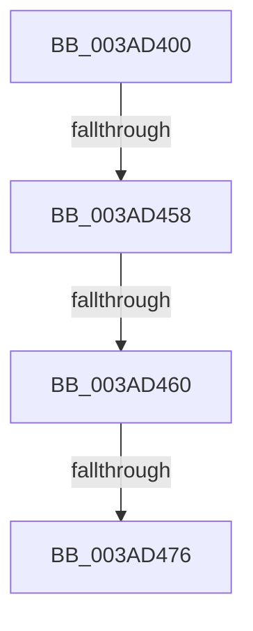

# ST_STORE&lt;SM_TRAITS&gt;::StDmPageRecordRemove

- RVA: `0x003AD400`–`0x003AD47D` (길이 `125` bytes)
- VA: `0x00000001403AD400`
- 실행 섹션: `.text`
- PDB 이름 있음: `예`; PDB Function 태그: `아니요`
- unwind 정보 RVA: `0x0008BC94`
- 디코드: `36`개 명령, `125/125` bytes 표시
- 미해석 바이트: `0` (있으면 어셈블리에 `.byte`로 보존)

> 이 문서는 커널 이미지의 기계어와 PDB 기호를 분석해 생성했습니다. 4번과 5번은 함수 원형과 자료형을 바이너리 사용 방식에서 추정한 C 해석이며 원본 소스 복구 결과는 아닙니다.

## 1. Dependencies

- 직접 호출 지점: **0**; 고유 호출 대상: **0**
- 직접 호출자로 확인된 함수: **2**
- RIP 상대 이미지 참조: **0**

### Outgoing calls
- 직접 디코드된 call 명령이 없습니다.

### Direct callers
- [ST_STORE&lt;SM_TRAITS&gt;::StDmPageRemove](../20/ST_STORE_SM_TRAITS_StDmPageRemove_function_002049A0.md) at `0x00204D61`
- [ST_STORE&lt;SM_TRAITS&gt;::StDmCombinePageRecords](../4E/ST_STORE_SM_TRAITS_StDmCombinePageRecords_function_004EBC80.md) at `0x004EBD02`

### Static image references
- 디코드된 RIP-relative 메모리 참조가 없습니다.

## 2. Other-region calls and transfers

- 다른 실행 섹션으로 향하는 call: **0**
- call이 아닌 외부 분기/꼬리 이동: **3**
  - `0x003AD452` → [sub_003ADA39](Unknown_function_003ADA39.md) (`tail-transfer`)
  - `0x003AD45A` → [sub_003ADA39](Unknown_function_003ADA39.md) (`tail-transfer`)
  - `0x003AD470` → [sub_003ADAC7](Unknown_function_003ADAC7.md) (`tail-transfer`)

## 3. Assembly (complete function range)

```asm
003AD400  48 89 54 24 10                  mov qword ptr [rsp + 0x10], rdx
003AD405  48 89 4C 24 08                  mov qword ptr [rsp + 8], rcx
003AD40A  53                              push rbx
003AD40B  55                              push rbp
003AD40C  56                              push rsi
003AD40D  57                              push rdi
003AD40E  41 56                           push r14
003AD410  41 57                           push r15
003AD412  48 83 EC 68                     sub rsp, 0x68
003AD416  48 8B D9                        mov rbx, rcx
003AD419  4C 8B D2                        mov r10, rdx
003AD41C  8B 89 D8 01 00 00               mov ecx, dword ptr [rcx + 0x1d8]
003AD422  49 81 E2 00 F0 FF FF            and r10, 0xfffffffffffff000
003AD429  49 03 CA                        add rcx, r10
003AD42C  8B C2                           mov eax, edx
003AD42E  2B C1                           sub eax, ecx
003AD430  4C 8B FA                        mov r15, rdx
003AD433  8B 8B C8 01 00 00               mov ecx, dword ptr [rbx + 0x1c8]
003AD439  33 D2                           xor edx, edx
003AD43B  F7 B3 D0 01 00 00               div dword ptr [rbx + 0x1d0]
003AD441  41 8B 72 10                     mov esi, dword ptr [r10 + 0x10]
003AD445  49 8B E8                        mov rbp, r8
003AD448  D3 E6                           shl esi, cl
003AD44A  03 F0                           add esi, eax
003AD44C  8B 43 70                        mov eax, dword ptr [rbx + 0x70]
003AD44F  83 F8 FF                        cmp eax, -1
003AD452  0F 84 E1 05 00 00               je 0x1403ada39
003AD458  85 C0                           test eax, eax
003AD45A  0F 84 D9 05 00 00               je 0x1403ada39
003AD460  FF C8                           dec eax
003AD462  48 C1 E0 04                     shl rax, 4
003AD466  48 03 43 58                     add rax, qword ptr [rbx + 0x58]
003AD46A  48 8B 40 08                     mov rax, qword ptr [rax + 8]
003AD46E  39 30                           cmp dword ptr [rax], esi
003AD470  0F 85 51 06 00 00               jne 0x1403adac7
003AD476  48 8D BB 98 00 00 00            lea rdi, [rbx + 0x98]
```

## 4. C-style interpretation (structured pseudocode)

```c
__int64 __fastcall ST_STORE_SM_TRAITS___StDmPageRecordRemove(__int64 a1, __int64 a2, __int64 a3)
{
    __int64 result;
    __int64 v_r10;
    __int64 v_rsi;
    __int64 v_rsp;
    unsigned __int64 v_stack_p10;
    unsigned __int64 v_stack_p8;

    v_stack_p10 = a2;
    v_stack_p8 = a1;
    v_rsp = (v_rsp) - (104);
    v_r10 = (a2) & (0xFFFFFFFFFFFFF000ULL);
    a1 = ((unsigned int)(*(unsigned int *)(a1 + 472))) + (v_r10);
    result = (unsigned int)(((unsigned int)((unsigned int)(a2))) - ((unsigned int)(a1)));
    a2 = 0;
    v_rsi = (unsigned int)(((unsigned int)(*(unsigned int *)(v_r10 + 16))) << ((unsigned __int8)((unsigned int)(*(unsigned int *)(a1 + 456)))));
    v_rsi = (unsigned int)((v_rsi) + ((unsigned int)(result)));
    result = (unsigned int)(((unsigned int)(*(unsigned int *)(a1 + 112))) - 1);
    result = (result) << (4);
    result = (result) + (*(unsigned __int64 *)(a1 + 88));
    return *(unsigned __int64 *)(result + 8);
}
```

## 5. (Beta) C Style

```c
int64_t ST_STORE_SM_TRAITS___StDmPageRecordRemove(void *Arg1, void *Arg2, int64_t Arg3)
{
    uint8_t *arg1 = (uint8_t *)Arg1;
    uint8_t *arg2 = (uint8_t *)Arg2;

    int64_t result;
    int64_t local_r10;
    int64_t local_rsi;
    int64_t local_rsp;
    uint64_t v_stack_p10;
    uint64_t v_stack_p8;

    v_stack_p10 = Arg2;
    v_stack_p8 = Arg1;
    local_rsp = (local_rsp) - (104);
    local_r10 = (Arg2) & (0xFFFFFFFFFFFFF000ULL);
    Arg1 = ((uint32_t)(*(uint32_t *)(arg1 + 0x1D8))) + (local_r10);
    result = (uint32_t)(((uint32_t)((uint32_t)(Arg2))) - ((uint32_t)(Arg1)));
    Arg2 = 0;
    local_rsi = (uint32_t)(((uint32_t)(*(uint32_t *)(local_r10 + 0x10))) << ((uint8_t)((uint32_t)(*(uint32_t *)(arg1 + 0x1C8)))));
    local_rsi = (uint32_t)((local_rsi) + ((uint32_t)(result)));
    result = (uint32_t)(((uint32_t)(*(uint32_t *)(arg1 + 0x70))) - 1);
    result = (result) << (4);
    result = (result) + (*(uint64_t *)(arg1 + 0x58));
    return *(uint64_t *)(result + 0x8);
}
```

### 관측된 메모리 오프셋

구조체 형식이 확인되지 않은 접근은 인자 기준의 오프셋으로만 기록했습니다.

| 기준 인자 | 오프셋 표현 | 폭 (bit) | 접근 |
|---|---:|---:|---|
| `Arg1` | `+ 0x58` | `64` | `R` |
| `Arg1` | `+ 0x70` | `32` | `R` |
| `Arg1` | `+ 0x98` | `64` | `R` |
| `Arg1` | `+ 0x1C8` | `32` | `R` |
| `Arg1` | `+ 0x1D0` | `32` | `R` |
| `Arg1` | `+ 0x1D8` | `32` | `R` |
| `Arg2` | `+ 0x10` | `32` | `R` |

## 6. Execution-region graph

[열기: 2D/3D 그래프와 함수 탐색 컨트롤 패널](../../../control-panel.html?section=text&rva=0x003AD400&view=graph)

- 2D 그래프는 위에서 아래로 흐르고, 3D 그래프는 빈 공간을 드래그해 회전합니다. Shift+드래그는 이동, 휠은 확대·축소, 함수 노드 선택은 대상 보고서 이동입니다.

### Static fallback


