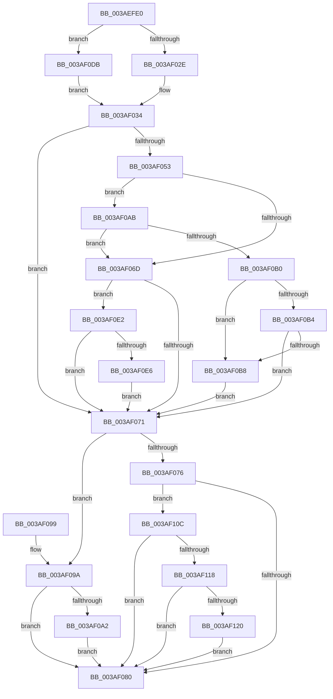

# ST_STORE&lt;SM_TRAITS&gt;::StDmpUpdateRegionState

- RVA: `0x003AEFE0`–`0x003AF12F` (길이 `335` bytes)
- VA: `0x00000001403AEFE0`
- 실행 섹션: `.text`
- PDB 이름 있음: `예`; PDB Function 태그: `아니요`
- unwind 정보 RVA: `0x0008C0BC`
- 디코드: `91`개 명령, `335/335` bytes 표시
- 미해석 바이트: `0` (있으면 어셈블리에 `.byte`로 보존)

> 이 문서는 커널 이미지의 기계어와 PDB 기호를 분석해 생성했습니다. 4번과 5번은 함수 원형과 자료형을 바이너리 사용 방식에서 추정한 C 해석이며 원본 소스 복구 결과는 아닙니다.

## 1. Dependencies

- 직접 호출 지점: **1**; 고유 호출 대상: **1**
- 직접 호출자로 확인된 함수: **3**
- RIP 상대 이미지 참조: **0**

### Outgoing calls
- `0x003AF125` → [ST_STORE<SM_TRAITS>::StReleaseRegion](ST_STORE_SM_TRAITS_StReleaseRegion_function_003AF138.md) (function, `0x003AF138`)

### Direct callers
- [ST_STORE&lt;SM_TRAITS&gt;::StDmCleanup](ST_STORE_SM_TRAITS_StDmCleanup_function_003AF8D4.md) at `0x003AFBD2`
- [ST_STORE&lt;SM_TRAITS&gt;::StCompactRegions](../4A/ST_STORE_SM_TRAITS_StCompactRegions_function_004A48E0.md) at `0x004A4E04`
- [ST_STORE&lt;SM_TRAITS&gt;::StCompactRegions](../4A/ST_STORE_SM_TRAITS_StCompactRegions_function_004A48E0.md) at `0x004A4E14`
- [sub_004EBF65](../4E/Unknown_function_004EBF65.md) at `0x004EC038`

### Static image references
- 디코드된 RIP-relative 메모리 참조가 없습니다.

## 2. Other-region calls and transfers

- 다른 실행 섹션으로 향하는 call: **0**
- 별도 외부 분기/꼬리 이동을 확인하지 못했습니다.

## 3. Assembly (complete function range)

```asm
003AEFE0  48 89 5C 24 08                  mov qword ptr [rsp + 8], rbx
003AEFE5  48 89 6C 24 10                  mov qword ptr [rsp + 0x10], rbp
003AEFEA  48 89 74 24 18                  mov qword ptr [rsp + 0x18], rsi
003AEFEF  57                              push rdi
003AEFF0  41 56                           push r14
003AEFF2  41 57                           push r15
003AEFF4  48 83 EC 20                     sub rsp, 0x20
003AEFF8  48 8B 81 78 05 00 00            mov rax, qword ptr [rcx + 0x578]
003AEFFF  41 BF FF 1F 00 00               mov r15d, 0x1fff
003AF005  8B F2                           mov esi, edx
003AF007  41 8B E9                        mov ebp, r9d
003AF00A  44 0F B7 14 70                  movzx r10d, word ptr [rax + rsi*2]
003AF00F  48 8D 1C 70                     lea rbx, [rax + rsi*2]
003AF013  41 0F B7 FA                     movzx edi, r10w
003AF017  44 8B F2                        mov r14d, edx
003AF01A  66 41 23 FF                     and di, r15w
003AF01E  4C 8B D9                        mov r11, rcx
003AF021  80 B9 08 03 00 00 00            cmp byte ptr [rcx + 0x308], 0
003AF028  0F 85 AD 00 00 00               jne 0x1403af0db
003AF02E  41 8B C2                        mov eax, r10d
003AF031  C1 E8 0D                        shr eax, 0xd
003AF034  66 45 03 D0                     add r10w, r8w
003AF038  66 44 89 13                     mov word ptr [rbx], r10w
003AF03C  44 01 84 C1 9C 08 00 00         add dword ptr [rcx + rax*8 + 0x89c], r8d
003AF044  48 03 C0                        add rax, rax
003AF047  48 8D 14 C1                     lea rdx, [rcx + rax*8]
003AF04B  39 B2 58 06 00 00               cmp dword ptr [rdx + 0x658], esi
003AF051  74 1E                           je 0x1403af071
003AF053  41 8B 83 28 03 00 00            mov eax, dword ptr [r11 + 0x328]
003AF05A  0F B7 0B                        movzx ecx, word ptr [rbx]
003AF05D  FF C0                           inc eax
003AF05F  D1 E8                           shr eax, 1
003AF061  41 23 CF                        and ecx, r15d
003AF064  44 0F B7 CF                     movzx r9d, di
003AF068  44 3B C8                        cmp r9d, eax
003AF06B  72 3E                           jb 0x1403af0ab
003AF06D  3B C8                           cmp ecx, eax
003AF06F  72 71                           jb 0x1403af0e2
003AF071  45 85 C0                        test r8d, r8d
003AF074  7F 24                           jg 0x1403af09a
003AF076  66 44 85 3B                     test word ptr [rbx], r15w
003AF07A  0F 84 8C 00 00 00               je 0x1403af10c
003AF080  48 8B 5C 24 40                  mov rbx, qword ptr [rsp + 0x40]
003AF085  48 8B 6C 24 48                  mov rbp, qword ptr [rsp + 0x48]
003AF08A  48 8B 74 24 50                  mov rsi, qword ptr [rsp + 0x50]
003AF08F  48 83 C4 20                     add rsp, 0x20
003AF093  41 5F                           pop r15
003AF095  41 5E                           pop r14
003AF097  5F                              pop rdi
003AF098  C3                              ret
003AF099  CC                              int3
003AF09A  3B B2 58 06 00 00               cmp esi, dword ptr [rdx + 0x658]
003AF0A0  75 DE                           jne 0x1403af080
003AF0A2  44 01 82 5C 06 00 00            add dword ptr [rdx + 0x65c], r8d
003AF0A9  EB D5                           jmp 0x1403af080
003AF0AB  45 85 C9                        test r9d, r9d
003AF0AE  74 BD                           je 0x1403af06d
003AF0B0  3B C8                           cmp ecx, eax
003AF0B2  73 04                           jae 0x1403af0b8
003AF0B4  85 C9                           test ecx, ecx
003AF0B6  75 B9                           jne 0x1403af071
003AF0B8  41 FF 8B B0 05 00 00            dec dword ptr [r11 + 0x5b0]
003AF0BF  8B C6                           mov eax, esi
003AF0C1  49 C1 EE 03                     shr r14, 3
003AF0C5  83 E0 07                        and eax, 7
003AF0C8  4D 03 B3 A8 05 00 00            add r14, qword ptr [r11 + 0x5a8]
003AF0CF  41 0F BE 0E                     movsx ecx, byte ptr [r14]
003AF0D3  0F AB C1                        bts ecx, eax
003AF0D6  41 88 0E                        mov byte ptr [r14], cl
003AF0D9  EB 96                           jmp 0x1403af071
003AF0DB  33 C0                           xor eax, eax
003AF0DD  E9 52 FF FF FF                  jmp 0x1403af034
003AF0E2  85 C9                           test ecx, ecx
003AF0E4  74 8B                           je 0x1403af071
003AF0E6  49 C1 EE 03                     shr r14, 3
003AF0EA  8B C6                           mov eax, esi
003AF0EC  4D 03 B3 A8 05 00 00            add r14, qword ptr [r11 + 0x5a8]
003AF0F3  83 E0 07                        and eax, 7
003AF0F6  41 0F BE 0E                     movsx ecx, byte ptr [r14]
003AF0FA  0F B3 C1                        btr ecx, eax
003AF0FD  41 88 0E                        mov byte ptr [r14], cl
003AF100  41 FF 83 B0 05 00 00            inc dword ptr [r11 + 0x5b0]
003AF107  E9 65 FF FF FF                  jmp 0x1403af071
003AF10C  3B B2 58 06 00 00               cmp esi, dword ptr [rdx + 0x658]
003AF112  0F 84 68 FF FF FF               je 0x1403af080
003AF118  85 ED                           test ebp, ebp
003AF11A  0F 85 60 FF FF FF               jne 0x1403af080
003AF120  8B D6                           mov edx, esi
003AF122  49 8B CB                        mov rcx, r11
003AF125  E8 0E 00 00 00                  call 0x1403af138
003AF12A  E9 51 FF FF FF                  jmp 0x1403af080
```

## 4. C-style interpretation (structured pseudocode)

```c
__int64 __fastcall ST_STORE_SM_TRAITS___StDmpUpdateRegionState(__int64 a1, int a2, int a3, int a4)
{
    __int64 result;
    __int64 v_r10;
    __int64 v_r14;
    __int64 v_rdi;
    __int64 v_rsp;
    unsigned __int64 v_stack_p10;
    unsigned __int64 v_stack_p18;
    unsigned __int64 v_stack_p8;

    v_stack_p8 = v_rbx;
    v_stack_p10 = v_rbp;
    v_stack_p18 = v_rsi;
    v_rsp = (v_rsp) - (32);
    v_rdi = (unsigned __int16)(((unsigned __int16)(*(unsigned __int16 *)(*(unsigned __int64 *)(a1 + 1400) + (unsigned int)(a2) * 2))) & ((unsigned __int16)((unsigned int)(0x1FFFULL))));
    if ((*(unsigned __int8 *)(a1 + 776)) != 0) goto loc_003AF0DB;
    result = (unsigned int)(((unsigned int)((unsigned int)(*(unsigned __int16 *)(*(unsigned __int64 *)(a1 + 1400) + (unsigned int)(a2) * 2)))) >> (13));
loc_003AF034:
    v_r10 = (unsigned __int16)((*(unsigned __int16 *)(*(unsigned __int64 *)(a1 + 1400) + (unsigned int)(a2) * 2)) + ((unsigned __int16)(a3)));
    *(unsigned __int16 *)(*(unsigned __int64 *)(a1 + 1400) + (unsigned int)(a2) * 2) = (unsigned __int16)(v_r10);
    result = (result) + (result);
    if ((*(unsigned int *)(a1 + result * 8 + 1624)) == ((unsigned int)((unsigned int)(a2)))) goto loc_003AF071;
    result = (unsigned int)(((unsigned int)(*(unsigned int *)(a1 + 808))) + 1);
    result = (unsigned int)((result) >> (1));
    a1 = (unsigned int)((*(unsigned __int16 *)(*(unsigned __int64 *)(a1 + 1400) + (unsigned int)(a2) * 2)) & ((unsigned int)((unsigned int)(0x1FFFULL))));
    if (((unsigned int)((unsigned __int16)(v_rdi))) < ((unsigned int)(result))) goto loc_003AF0AB;
loc_003AF06D:
    if (((unsigned int)(a1)) < ((unsigned int)(result))) goto loc_003AF0E2;
loc_003AF071:
    if (condition_is_greater) goto loc_003AF09A;
    if (((*(unsigned __int16 *)(*(unsigned __int64 *)(a1 + 1400) + (unsigned int)(a2) * 2)) & ((unsigned __int16)((unsigned int)(0x1FFFULL)))) == 0) goto loc_003AF10C;
loc_003AF080:
    v_rsp = (v_rsp) + (32);
    return result;
loc_003AF09A:
    if (((unsigned int)(v_stack_p18)) != (*(unsigned int *)(a1 + result * 8 + 1624))) goto loc_003AF080;
    goto loc_003AF080;
loc_003AF0AB:
    if ((unsigned int)((unsigned __int16)(v_rdi)) == 0) goto loc_003AF06D;
    if (((unsigned int)(a1)) >= ((unsigned int)(result))) goto loc_003AF0B8;
    if ((unsigned int)(a1) != 0) goto loc_003AF071;
loc_003AF0B8:
    v_r14 = ((unsigned int)(a2)) >> (3);
    result = (unsigned int)(((unsigned int)((unsigned int)(v_stack_p18))) & (7));
    v_r14 = (v_r14) + (*(unsigned __int64 *)(a1 + 1448));
    *(unsigned __int8 *)(v_r14) = (unsigned __int8)((__int8)(*(unsigned __int8 *)(v_r14)));
    goto loc_003AF071;
loc_003AF0DB:
    result = 0;
    goto loc_003AF034;
loc_003AF0E2:
    if ((unsigned int)((__int8)(*(unsigned __int8 *)(v_r14))) == 0) goto loc_003AF071;
    v_r14 = (v_r14) >> (3);
    v_r14 = (v_r14) + (*(unsigned __int64 *)(a1 + 1448));
    result = (unsigned int)(((unsigned int)((unsigned int)(v_stack_p18))) & (7));
    *(unsigned __int8 *)(v_r14) = (unsigned __int8)((__int8)(*(unsigned __int8 *)(v_r14)));
    goto loc_003AF071;
loc_003AF10C:
    if (((unsigned int)(v_stack_p18)) == (*(unsigned int *)(a1 + result * 8 + 1624))) goto loc_003AF080;
    if ((unsigned int)(v_stack_p10) != 0) goto loc_003AF080;
    result = ST_STORE_SM_TRAITS___StReleaseRegion(a1, (unsigned int)((unsigned int)(v_stack_p18)), a3, (unsigned __int16)(v_rdi));
    goto loc_003AF080;
}
```

## 5. (Beta) C Style

```c
int64_t ST_STORE_SM_TRAITS___StDmpUpdateRegionState(void *Arg1, int32_t Arg2, int32_t Arg3, int32_t Arg4)
{
    uint8_t *arg1 = (uint8_t *)Arg1;

    int64_t result;
    int64_t local_r10;
    int64_t local_r14;
    int64_t local_rdi;
    int64_t local_rsp;
    uint64_t v_stack_p10;
    uint64_t v_stack_p18;
    uint64_t v_stack_p8;

    v_stack_p8 = local_rbx;
    v_stack_p10 = local_rbp;
    v_stack_p18 = local_rsi;
    local_rsp = (local_rsp) - (32);
    local_rdi = (uint16_t)(((uint16_t)(*(uint16_t *)(*(uint64_t *)(arg1 + 0x578) + (uint32_t)(Arg2) * 2))) & ((uint16_t)((uint32_t)(0x1FFFULL))));
    if ((*(uint8_t *)(arg1 + 0x308)) != 0) goto loc_003AF0DB;
    result = (uint32_t)(((uint32_t)((uint32_t)(*(uint16_t *)(*(uint64_t *)(arg1 + 0x578) + (uint32_t)(Arg2) * 2)))) >> (13));
loc_003AF034:
    local_r10 = (uint16_t)((*(uint16_t *)(*(uint64_t *)(arg1 + 0x578) + (uint32_t)(Arg2) * 2)) + ((uint16_t)(Arg3)));
    *(uint16_t *)(*(uint64_t *)(arg1 + 0x578) + (uint32_t)(Arg2) * 2) = (uint16_t)(local_r10);
    result = (result) + (result);
    if ((*(uint32_t *)(arg1 + result * 8 + 0x658)) == ((uint32_t)((uint32_t)(Arg2)))) goto loc_003AF071;
    result = (uint32_t)(((uint32_t)(*(uint32_t *)(arg1 + 0x328))) + 1);
    result = (uint32_t)((result) >> (1));
    Arg1 = (uint32_t)((*(uint16_t *)(*(uint64_t *)(arg1 + 0x578) + (uint32_t)(Arg2) * 2)) & ((uint32_t)((uint32_t)(0x1FFFULL))));
    if (((uint32_t)((uint16_t)(local_rdi))) < ((uint32_t)(result))) goto loc_003AF0AB;
loc_003AF06D:
    if (((uint32_t)(Arg1)) < ((uint32_t)(result))) goto loc_003AF0E2;
loc_003AF071:
    if (condition_is_greater) goto loc_003AF09A;
    if (((*(uint16_t *)(*(uint64_t *)(arg1 + 0x578) + (uint32_t)(Arg2) * 2)) & ((uint16_t)((uint32_t)(0x1FFFULL)))) == 0) goto loc_003AF10C;
loc_003AF080:
    local_rsp = (local_rsp) + (32);
    return result;
loc_003AF09A:
    if (((uint32_t)(v_stack_p18)) != (*(uint32_t *)(arg1 + result * 8 + 0x658))) goto loc_003AF080;
    goto loc_003AF080;
loc_003AF0AB:
    if ((uint32_t)((uint16_t)(local_rdi)) == 0) goto loc_003AF06D;
    if (((uint32_t)(Arg1)) >= ((uint32_t)(result))) goto loc_003AF0B8;
    if ((uint32_t)(Arg1) != 0) goto loc_003AF071;
loc_003AF0B8:
    local_r14 = ((uint32_t)(Arg2)) >> (3);
    result = (uint32_t)(((uint32_t)((uint32_t)(v_stack_p18))) & (7));
    local_r14 = (local_r14) + (*(uint64_t *)(arg1 + 0x5A8));
    *(uint8_t *)(local_r14) = (uint8_t)((int8_t)(*(uint8_t *)(local_r14)));
    goto loc_003AF071;
loc_003AF0DB:
    result = 0;
    goto loc_003AF034;
loc_003AF0E2:
    if ((uint32_t)((int8_t)(*(uint8_t *)(local_r14))) == 0) goto loc_003AF071;
    local_r14 = (local_r14) >> (3);
    local_r14 = (local_r14) + (*(uint64_t *)(arg1 + 0x5A8));
    result = (uint32_t)(((uint32_t)((uint32_t)(v_stack_p18))) & (7));
    *(uint8_t *)(local_r14) = (uint8_t)((int8_t)(*(uint8_t *)(local_r14)));
    goto loc_003AF071;
loc_003AF10C:
    if (((uint32_t)(v_stack_p18)) == (*(uint32_t *)(arg1 + result * 8 + 0x658))) goto loc_003AF080;
    if ((uint32_t)(v_stack_p10) != 0) goto loc_003AF080;
    result = ST_STORE_SM_TRAITS___StReleaseRegion(Arg1, (uint32_t)((uint32_t)(v_stack_p18)), Arg3, (uint16_t)(local_rdi));
    goto loc_003AF080;
}
```

### 관측된 메모리 오프셋

구조체 형식이 확인되지 않은 접근은 인자 기준의 오프셋으로만 기록했습니다.

| 기준 인자 | 오프셋 표현 | 폭 (bit) | 접근 |
|---|---:|---:|---|
| `Arg1` | `+ 0x0 + rax*8` | `64` | `R` |
| `Arg1` | `+ 0x308` | `8` | `R` |
| `Arg1` | `+ 0x328` | `32` | `R` |
| `Arg1` | `+ 0x578` | `64` | `R` |
| `Arg1` | `+ 0x5A8` | `64` | `R` |
| `Arg1` | `+ 0x5B0` | `32` | `R/W` |
| `Arg1` | `+ 0x658` | `32` | `R` |
| `Arg1` | `+ 0x65C` | `32` | `R/W` |
| `Arg1` | `+ 0x89C + rax*8` | `32` | `R/W` |

## 6. Execution-region graph

[열기: 2D/3D 그래프와 함수 탐색 컨트롤 패널](../../../control-panel.html?section=text&rva=0x003AEFE0&view=graph)

- 2D 그래프는 위에서 아래로 흐르고, 3D 그래프는 빈 공간을 드래그해 회전합니다. Shift+드래그는 이동, 휠은 확대·축소, 함수 노드 선택은 대상 보고서 이동입니다.

### Static fallback


