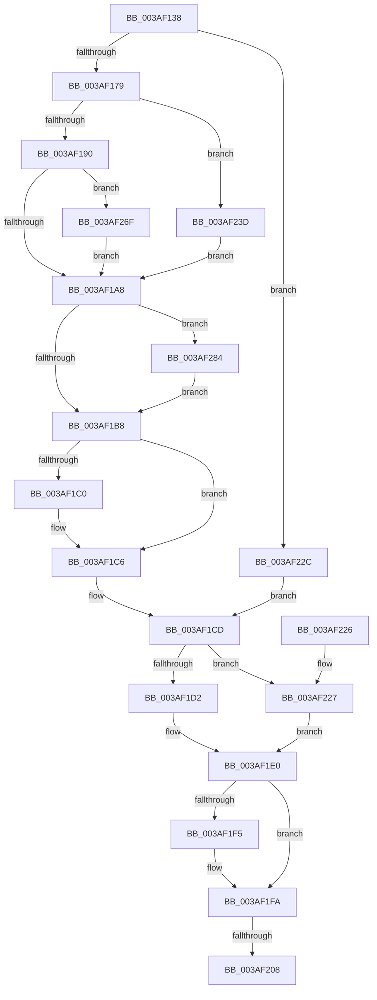

# ST_STORE&lt;SM_TRAITS&gt;::StReleaseRegion

- RVA: `0x003AF138`–`0x003AF2BB` (길이 `387` bytes)
- VA: `0x00000001403AF138`
- 실행 섹션: `.text`
- PDB 이름 있음: `예`; PDB Function 태그: `예`
- unwind 정보 RVA: `0x0008C0D8`
- 디코드: `99`개 명령, `387/387` bytes 표시
- 미해석 바이트: `0` (있으면 어셈블리에 `.byte`로 보존)

> 이 문서는 커널 이미지의 기계어와 PDB 기호를 분석해 생성했습니다. 4번과 5번은 함수 원형과 자료형을 바이너리 사용 방식에서 추정한 C 해석이며 원본 소스 복구 결과는 아닙니다.

## 1. Dependencies

- 직접 호출 지점: **6**; 고유 호출 대상: **6**
- 직접 호출자로 확인된 함수: **5**
- RIP 상대 이미지 참조: **0**

### Outgoing calls
- `0x003AF195` → [SMKM_STORE<SM_TRAITS>::SmStReleaseVirtualRegion](SMKM_STORE_SM_TRAITS_SmStReleaseVirtualRegion_function_003AF338.md) (function, `0x003AF338`)
- `0x003AF1AA` → [SmEtwEnabled](SmEtwEnabled_function_003AF2D0.md) (function, `0x003AF2D0`)
- `0x003AF254` → [MiFreePagesFromMdl](../3F/MiFreePagesFromMdl_function_003F8300.md) (function, `0x003F8300`)
- `0x003AF25E` → [ExFreePoolWithTag](../../poolcode/B8/ExFreePoolWithTag_function_00B82870.md) (function, `0x00B82870`)
- `0x003AF27A` → [ST_STORE<SM_TRAITS>::StDmUpdateRegionLazyCleanup](../4B/ST_STORE_SM_TRAITS_StDmUpdateRegionLazyCleanup_function_004BC8DC.md) (function, `0x004BC8DC`)
- `0x003AF2B1` → [SmEtwLogRegionOp](../60/SmEtwLogRegionOp_function_0060F38C.md) (function, `0x0060F38C`)

### Direct callers
- [sub_003ADA42](Unknown_function_003ADA42.md) at `0x003ADA55`
- [ST_STORE&lt;SM_TRAITS&gt;::StDmpUpdateRegionState](ST_STORE_SM_TRAITS_StDmpUpdateRegionState_function_003AEFE0.md) at `0x003AF125`
- [ST_STORE&lt;SM_TRAITS&gt;::StDmCurrentRegionSet](../3B/ST_STORE_SM_TRAITS_StDmCurrentRegionSet_function_003B1130.md) at `0x003B1249`
- [ST_STORE&lt;SM_TRAITS&gt;::StCompactionPerformInMem](../41/ST_STORE_SM_TRAITS_StCompactionPerformInMem_function_004111D8.md) at `0x004113E0`
- [ST_STORE&lt;SM_TRAITS&gt;::StMapAndLockRegion](../4E/ST_STORE_SM_TRAITS_StMapAndLockRegion_function_004EC090.md) at `0x004EC253`

### Static image references
- 디코드된 RIP-relative 메모리 참조가 없습니다.

## 2. Other-region calls and transfers

- 다른 실행 섹션으로 향하는 call: **1**
  - `0x003AF25E` → [ExFreePoolWithTag](../../poolcode/B8/ExFreePoolWithTag_function_00B82870.md) (`.text` → `POOLCODE`)
- call이 아닌 외부 분기/꼬리 이동: **1**
  - `0x003AF202` → [sub_006E6FD2](../6E/Unknown_function_006E6FD2.md) (`tail-transfer`)

## 3. Assembly (complete function range)

```asm
003AF138  48 8B C4                        mov rax, rsp
003AF13B  48 89 58 08                     mov qword ptr [rax + 8], rbx
003AF13F  48 89 68 18                     mov qword ptr [rax + 0x18], rbp
003AF143  48 89 70 20                     mov qword ptr [rax + 0x20], rsi
003AF147  57                              push rdi
003AF148  41 54                           push r12
003AF14A  41 55                           push r13
003AF14C  41 56                           push r14
003AF14E  41 57                           push r15
003AF150  48 83 EC 40                     sub rsp, 0x40
003AF154  45 33 E4                        xor r12d, r12d
003AF157  8B EA                           mov ebp, edx
003AF159  4C 8D B9 08 03 00 00            lea r15, [rcx + 0x308]
003AF160  44 89 60 10                     mov dword ptr [rax + 0x10], r12d
003AF164  48 8B F1                        mov rsi, rcx
003AF167  44 8B F2                        mov r14d, edx
003AF16A  41 BD FF 1F 00 00               mov r13d, 0x1fff
003AF170  45 38 27                        cmp byte ptr [r15], r12b
003AF173  0F 85 B3 00 00 00               jne 0x1403af22c
003AF179  48 8B B9 20 03 00 00            mov rdi, qword ptr [rcx + 0x320]
003AF180  45 33 C0                        xor r8d, r8d
003AF183  F6 87 95 1A 00 00 04            test byte ptr [rdi + 0x1a95], 4
003AF18A  0F 84 AD 00 00 00               je 0x1403af23d
003AF190  8B D5                           mov edx, ebp
003AF192  48 8B CF                        mov rcx, rdi
003AF195  E8 9E 01 00 00                  call 0x1403af338
003AF19A  41 8B DE                        mov ebx, r14d
003AF19D  3D AE 00 00 C0                  cmp eax, 0xc00000ae
003AF1A2  0F 84 C7 00 00 00               je 0x1403af26f
003AF1A8  33 C9                           xor ecx, ecx
003AF1AA  E8 21 01 00 00                  call 0x1403af2d0
003AF1AF  48 85 C0                        test rax, rax
003AF1B2  0F 85 CC 00 00 00               jne 0x1403af284
003AF1B8  3B AE B4 05 00 00               cmp ebp, dword ptr [rsi + 0x5b4]
003AF1BE  73 06                           jae 0x1403af1c6
003AF1C0  89 AE B4 05 00 00               mov dword ptr [rsi + 0x5b4], ebp
003AF1C6  48 8D 96 08 03 00 00            lea rdx, [rsi + 0x308]
003AF1CD  45 38 27                        cmp byte ptr [r15], r12b
003AF1D0  75 55                           jne 0x1403af227
003AF1D2  48 8B 86 78 05 00 00            mov rax, qword ptr [rsi + 0x578]
003AF1D9  0F B7 0C 68                     movzx ecx, word ptr [rax + rbp*2]
003AF1DD  C1 E9 0D                        shr ecx, 0xd
003AF1E0  8B C1                           mov eax, ecx
003AF1E2  FF 8C C6 98 08 00 00            dec dword ptr [rsi + rax*8 + 0x898]
003AF1E9  48 8B 8E 78 05 00 00            mov rcx, qword ptr [rsi + 0x578]
003AF1F0  44 38 22                        cmp byte ptr [rdx], r12b
003AF1F3  75 05                           jne 0x1403af1fa
003AF1F5  66 44 21 2C 69                  and word ptr [rcx + rbp*2], r13w
003AF1FA  8B 86 40 03 00 00               mov eax, dword ptr [rsi + 0x340]
003AF200  A8 04                           test al, 4
003AF202  0F 85 CA 7D 33 00               jne 0x1406e6fd2
003AF208  4C 8D 5C 24 40                  lea r11, [rsp + 0x40]
003AF20D  49 8B 5B 30                     mov rbx, qword ptr [r11 + 0x30]
003AF211  49 8B 6B 40                     mov rbp, qword ptr [r11 + 0x40]
003AF215  49 8B 73 48                     mov rsi, qword ptr [r11 + 0x48]
003AF219  49 8B E3                        mov rsp, r11
003AF21C  41 5F                           pop r15
003AF21E  41 5E                           pop r14
003AF220  41 5D                           pop r13
003AF222  41 5C                           pop r12
003AF224  5F                              pop rdi
003AF225  C3                              ret
003AF226  CC                              int3
003AF227  41 8B CC                        mov ecx, r12d
003AF22A  EB B4                           jmp 0x1403af1e0
003AF22C  48 8B 81 88 05 00 00            mov rax, qword ptr [rcx + 0x588]
003AF233  49 8B D7                        mov rdx, r15
003AF236  44 88 64 05 00                  mov byte ptr [rbp + rax], r12b
003AF23B  EB 90                           jmp 0x1403af1cd
003AF23D  48 8B BF 68 1B 00 00            mov rdi, qword ptr [rdi + 0x1b68]
003AF244  45 33 C9                        xor r9d, r9d
003AF247  33 D2                           xor edx, edx
003AF249  48 8B 1C EF                     mov rbx, qword ptr [rdi + rbp*8]
003AF24D  48 83 E3 F8                     and rbx, 0xfffffffffffffff8
003AF251  48 8B CB                        mov rcx, rbx
003AF254  E8 A7 90 04 00                  call 0x1403f8300
003AF259  33 D2                           xor edx, edx
003AF25B  48 8B CB                        mov rcx, rbx
003AF25E  E8 0D 36 7D 00                  call 0x140b82870
003AF263  4C 89 24 EF                     mov qword ptr [rdi + rbp*8], r12
003AF267  49 8B DE                        mov rbx, r14
003AF26A  E9 39 FF FF FF                  jmp 0x1403af1a8
003AF26F  41 B8 01 00 00 00               mov r8d, 1
003AF275  8B D5                           mov edx, ebp
003AF277  48 8B CE                        mov rcx, rsi
003AF27A  E8 5D D6 10 00                  call 0x1404bc8dc
003AF27F  E9 24 FF FF FF                  jmp 0x1403af1a8
003AF284  48 8B 8E 78 05 00 00            mov rcx, qword ptr [rsi + 0x578]
003AF28B  44 8B CD                        mov r9d, ebp
003AF28E  66 44 89 64 24 30               mov word ptr [rsp + 0x30], r12w
003AF294  4C 8B C6                        mov r8, rsi
003AF297  0F B7 14 59                     movzx edx, word ptr [rcx + rbx*2]
003AF29B  48 8B C8                        mov rcx, rax
003AF29E  66 41 23 D5                     and dx, r13w
003AF2A2  66 89 54 24 28                  mov word ptr [rsp + 0x28], dx
003AF2A7  BA 05 00 00 00                  mov edx, 5
003AF2AC  44 89 64 24 20                  mov dword ptr [rsp + 0x20], r12d
003AF2B1  E8 D6 00 26 00                  call 0x14060f38c
003AF2B6  E9 FD FE FF FF                  jmp 0x1403af1b8
```

## 4. C-style interpretation (structured pseudocode)

```c
__int64 __fastcall ST_STORE_SM_TRAITS___StReleaseRegion(__int64 a1, int a2, int a3, int a4)
{
    __int64 result;
    __int64 v_r12;
    __int64 v_rbx;
    __int64 v_rsp;
    unsigned __int16 v_stack_m10;
    unsigned __int16 v_stack_m18;
    unsigned int v_stack_m20;
    unsigned __int64 v_stack_m28;

    *(unsigned __int64 *)(v_rsp + 8) = v_rbx;
    *(unsigned __int64 *)(v_rsp + 24) = v_rbp;
    *(unsigned __int64 *)(v_rsp + 32) = v_rsi;
    v_rsp = (v_rsp) - (64);
    v_r12 = 0;
    *(unsigned int *)(v_rsp + 16) = 0;
    if ((*(unsigned __int8 *)(a1 + 776)) != 0) goto loc_003AF22C;
    a3 = 0;
    if (((*(unsigned __int8 *)(*(unsigned __int64 *)(a1 + 800) + 6805)) & (4)) == 0) goto loc_003AF23D;
    result = SMKM_STORE_SM_TRAITS___SmStReleaseVirtualRegion(*(unsigned __int64 *)(a1 + 800), (unsigned int)((unsigned int)((unsigned int)(a2))), a3, a4);
    if (((unsigned int)(result)) == 0xC00000AEULL) goto loc_003AF26F;
loc_003AF1A8:
    a1 = 0;
    result = SmEtwEnabled(a1, (unsigned int)((unsigned int)((unsigned int)(a2))), a3, a4);
    if (result != 0) goto loc_003AF284;
loc_003AF1B8:
    if (((unsigned int)((unsigned int)(a2))) < (*(unsigned int *)(a1 + 1460))) {
        *(unsigned int *)(a1 + 1460) = (unsigned int)((unsigned int)(a2));
    }
loc_003AF1CD:
    if ((*(unsigned __int8 *)(a1 + 776)) != 0) goto loc_003AF227;
    a1 = (unsigned int)((*(unsigned __int16 *)(*(unsigned __int64 *)(a1 + 1400) + (unsigned int)(a2) * 2)) >> (13));
loc_003AF1E0:
    if ((*(unsigned __int8 *)(a1 + 776)) == 0) {
    }
    return (unsigned int)(*(unsigned int *)(a1 + 832));
loc_003AF227:
    goto loc_003AF1E0;
loc_003AF22C:
    *(unsigned __int8 *)(*(unsigned __int64 *)(v_stack_m28 + 64) + *(unsigned __int64 *)(0 + 1416) * 1) = 0;
    goto loc_003AF1CD;
loc_003AF23D:
    a4 = 0;
    a2 = 0;
    v_rbx = (*(unsigned __int64 *)(*(unsigned __int64 *)(*(unsigned __int64 *)(a1 + 800) + 7016) + *(unsigned __int64 *)(v_stack_m28 + 64) * 8)) & (-8);
    result = MiFreePagesFromMdl(v_rbx, a2, a3, a4);
    a2 = 0;
    result = ExFreePoolWithTag(v_rbx, a2, a3, a4);
    *(unsigned __int64 *)(*(unsigned __int64 *)(*(unsigned __int64 *)(a1 + 800) + 7016) + *(unsigned __int64 *)(v_stack_m28 + 64) * 8) = 0;
    goto loc_003AF1A8;
loc_003AF26F:
    result = ST_STORE_SM_TRAITS___StDmUpdateRegionLazyCleanup(*(unsigned __int64 *)(v_stack_m28 + 72), (unsigned int)((unsigned int)(*(unsigned __int64 *)(v_stack_m28 + 64))), 1, a4);
    goto loc_003AF1A8;
loc_003AF284:
    v_stack_m10 = 0;
    a2 = (unsigned __int16)((*(unsigned __int16 *)(*(unsigned __int64 *)(*(unsigned __int64 *)(v_stack_m28 + 72) + 1400) + (unsigned int)(a2) * 2)) & ((unsigned __int16)((unsigned int)(0x1FFFULL))));
    v_stack_m18 = (unsigned __int16)(a2);
    v_stack_m20 = 0;
    result = SmEtwLogRegionOp(result, 5, *(unsigned __int64 *)(v_stack_m28 + 72), (unsigned int)((unsigned int)(*(unsigned __int64 *)(v_stack_m28 + 64))));
    goto loc_003AF1B8;
}
```

## 5. (Beta) C Style

```c
int64_t ST_STORE_SM_TRAITS___StReleaseRegion(void *Arg1, void *Arg2, int32_t Arg3, int32_t Arg4)
{
    uint8_t *arg1 = (uint8_t *)Arg1;
    uint8_t *arg2 = (uint8_t *)Arg2;

    int64_t result;
    int64_t local_r12;
    int64_t local_rbx;
    int64_t local_rsp;
    uint16_t v_stack_m10;
    uint16_t v_stack_m18;
    uint32_t v_stack_m20;
    uint64_t v_stack_m28;

    *(uint64_t *)(local_rsp + 0x8) = local_rbx;
    *(uint64_t *)(local_rsp + 0x18) = local_rbp;
    *(uint64_t *)(local_rsp + 0x20) = local_rsi;
    local_rsp = (local_rsp) - (64);
    local_r12 = 0;
    *(uint32_t *)(local_rsp + 0x10) = 0;
    if ((*(uint8_t *)(arg1 + 0x308)) != 0) goto loc_003AF22C;
    Arg3 = 0;
    if (((*(uint8_t *)(*(uint64_t *)(arg1 + 0x320) + 0x1A95)) & (4)) == 0) goto loc_003AF23D;
    result = SMKM_STORE_SM_TRAITS___SmStReleaseVirtualRegion(*(uint64_t *)(arg1 + 0x320), (uint32_t)((uint32_t)((uint32_t)(Arg2))), Arg3, Arg4);
    if (((uint32_t)(result)) == 0xC00000AEULL) goto loc_003AF26F;
loc_003AF1A8:
    Arg1 = 0;
    result = SmEtwEnabled(Arg1, (uint32_t)((uint32_t)((uint32_t)(Arg2))), Arg3, Arg4);
    if (result != 0) goto loc_003AF284;
loc_003AF1B8:
    if (((uint32_t)((uint32_t)(Arg2))) < (*(uint32_t *)(arg1 + 0x5B4))) {
        *(uint32_t *)(arg1 + 0x5B4) = (uint32_t)((uint32_t)(Arg2));
    }
loc_003AF1CD:
    if ((*(uint8_t *)(arg1 + 0x308)) != 0) goto loc_003AF227;
    Arg1 = (uint32_t)((*(uint16_t *)(*(uint64_t *)(arg1 + 0x578) + (uint32_t)(arg2) * 2)) >> (13));
loc_003AF1E0:
    if ((*(uint8_t *)(arg1 + 0x308)) == 0) {
    }
    return (uint32_t)(*(uint32_t *)(arg1 + 0x340));
loc_003AF227:
    goto loc_003AF1E0;
loc_003AF22C:
    *(uint8_t *)(*(uint64_t *)(v_stack_m28 + 0x40) + *(uint64_t *)(0 + 0x588) * 1) = 0;
    goto loc_003AF1CD;
loc_003AF23D:
    Arg4 = 0;
    Arg2 = 0;
    local_rbx = (*(uint64_t *)(*(uint64_t *)(*(uint64_t *)(arg1 + 0x320) + 0x1B68) + *(uint64_t *)(v_stack_m28 + 0x40) * 8)) & (-8);
    result = MiFreePagesFromMdl(local_rbx, Arg2, Arg3, Arg4);
    Arg2 = 0;
    result = ExFreePoolWithTag(local_rbx, Arg2, Arg3, Arg4);
    *(uint64_t *)(*(uint64_t *)(*(uint64_t *)(arg1 + 0x320) + 0x1B68) + *(uint64_t *)(v_stack_m28 + 0x40) * 8) = 0;
    goto loc_003AF1A8;
loc_003AF26F:
    result = ST_STORE_SM_TRAITS___StDmUpdateRegionLazyCleanup(*(uint64_t *)(v_stack_m28 + 0x48), (uint32_t)((uint32_t)(*(uint64_t *)(v_stack_m28 + 0x40))), 1, Arg4);
    goto loc_003AF1A8;
loc_003AF284:
    v_stack_m10 = 0;
    Arg2 = (uint16_t)((*(uint16_t *)(*(uint64_t *)(*(uint64_t *)(v_stack_m28 + 0x48) + 0x578) + (uint32_t)(arg2) * 2)) & ((uint16_t)((uint32_t)(0x1FFFULL))));
    v_stack_m18 = (uint16_t)(Arg2);
    v_stack_m20 = 0;
    result = SmEtwLogRegionOp(result, 5, *(uint64_t *)(v_stack_m28 + 0x48), (uint32_t)((uint32_t)(*(uint64_t *)(v_stack_m28 + 0x40))));
    goto loc_003AF1B8;
}
```

### 관측된 메모리 오프셋

구조체 형식이 확인되지 않은 접근은 인자 기준의 오프셋으로만 기록했습니다.

| 기준 인자 | 오프셋 표현 | 폭 (bit) | 접근 |
|---|---:|---:|---|
| `Arg1` | `+ 0x0` | `8` | `R` |
| `Arg1` | `+ 0x308` | `64` | `R` |
| `Arg1` | `+ 0x320` | `64` | `R` |
| `Arg1` | `+ 0x340` | `32` | `R` |
| `Arg1` | `+ 0x578` | `64` | `R` |
| `Arg1` | `+ 0x588` | `64` | `R` |
| `Arg1` | `+ 0x5B4` | `32` | `R` |
| `Arg1` | `+ 0x5B4` | `32` | `W` |
| `Arg1` | `+ 0x898 + rax*8` | `32` | `R/W` |
| `Arg2` | `+ 0x0 + rax*1` | `8` | `W` |

## 6. Execution-region graph

[열기: 2D/3D 그래프와 함수 탐색 컨트롤 패널](../../../control-panel.html?section=text&rva=0x003AF138&view=graph)

- 2D 그래프는 위에서 아래로 흐르고, 3D 그래프는 빈 공간을 드래그해 회전합니다. Shift+드래그는 이동, 휠은 확대·축소, 함수 노드 선택은 대상 보고서 이동입니다.

### Static fallback


