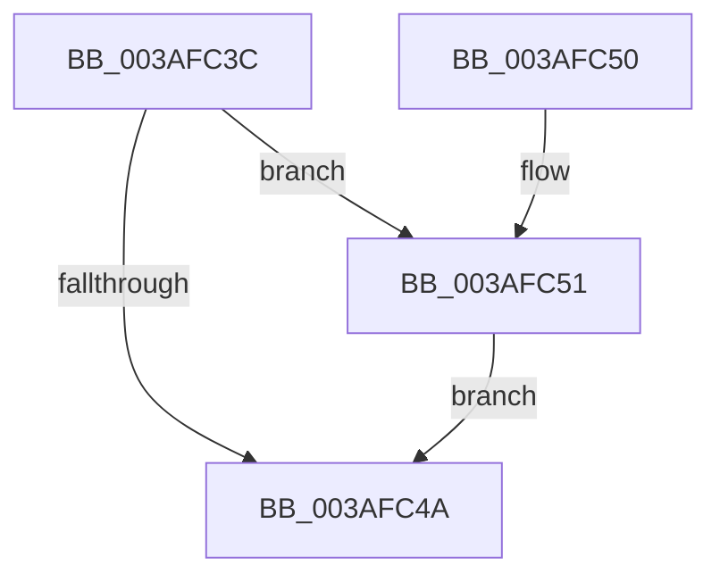

# ST_STORE&lt;SM_TRAITS&gt;::StStagingRegionCleanup

- RVA: `0x003AFC3C`–`0x003AFC69` (길이 `45` bytes)
- VA: `0x00000001403AFC3C`
- 실행 섹션: `.text`
- PDB 이름 있음: `예`; PDB Function 태그: `아니요`
- unwind 정보 RVA: `0x0008C174`
- 디코드: `16`개 명령, `45/45` bytes 표시
- 미해석 바이트: `0` (있으면 어셈블리에 `.byte`로 보존)

> 이 문서는 커널 이미지의 기계어와 PDB 기호를 분석해 생성했습니다. 4번과 5번은 함수 원형과 자료형을 바이너리 사용 방식에서 추정한 C 해석이며 원본 소스 복구 결과는 아닙니다.

## 1. Dependencies

- 직접 호출 지점: **2**; 고유 호출 대상: **1**
- 직접 호출자로 확인된 함수: **3**
- RIP 상대 이미지 참조: **0**

### Outgoing calls
- `0x003AFC57` → [ExFreePoolWithTag](../../poolcode/B8/ExFreePoolWithTag_function_00B82870.md) (function, `0x00B82870`)
- `0x003AFC62` → [ExFreePoolWithTag](../../poolcode/B8/ExFreePoolWithTag_function_00B82870.md) (function, `0x00B82870`)

### Direct callers
- [ST_STORE&lt;SM_TRAITS&gt;::StDmCleanup](ST_STORE_SM_TRAITS_StDmCleanup_function_003AF8D4.md) at `0x003AFAE3`
- [ST_STORE&lt;SM_TRAITS&gt;::StDmDeviceIoCompletion](../4B/ST_STORE_SM_TRAITS_StDmDeviceIoCompletion_function_004BBB70.md) at `0x004BBCF5`
- [ST_STORE&lt;SM_TRAITS&gt;::StDmRegionRemove](../60/ST_STORE_SM_TRAITS_StDmRegionRemove_function_0060E314.md) at `0x0060E3BA`

### Static image references
- 디코드된 RIP-relative 메모리 참조가 없습니다.

## 2. Other-region calls and transfers

- 다른 실행 섹션으로 향하는 call: **2**
  - `0x003AFC57` → [ExFreePoolWithTag](../../poolcode/B8/ExFreePoolWithTag_function_00B82870.md) (`.text` → `POOLCODE`)
  - `0x003AFC62` → [ExFreePoolWithTag](../../poolcode/B8/ExFreePoolWithTag_function_00B82870.md) (`.text` → `POOLCODE`)
- 별도 외부 분기/꼬리 이동을 확인하지 못했습니다.

## 3. Assembly (complete function range)

```asm
003AFC3C  40 53                           push rbx
003AFC3E  48 83 EC 20                     sub rsp, 0x20
003AFC42  83 3A FF                        cmp dword ptr [rdx], -1
003AFC45  48 8B DA                        mov rbx, rdx
003AFC48  75 07                           jne 0x1403afc51
003AFC4A  48 83 C4 20                     add rsp, 0x20
003AFC4E  5B                              pop rbx
003AFC4F  C3                              ret
003AFC50  CC                              int3
003AFC51  48 8B 4B 08                     mov rcx, qword ptr [rbx + 8]
003AFC55  33 D2                           xor edx, edx
003AFC57  E8 14 2C 7D 00                  call 0x140b82870
003AFC5C  48 8B 4B 10                     mov rcx, qword ptr [rbx + 0x10]
003AFC60  33 D2                           xor edx, edx
003AFC62  E8 09 2C 7D 00                  call 0x140b82870
003AFC67  EB E1                           jmp 0x1403afc4a
```

## 4. C-style interpretation (structured pseudocode)

```c
__int64 __fastcall ST_STORE_SM_TRAITS___StStagingRegionCleanup(__int64 a1, __int64 a2)
{
    __int64 result;
    __int64 v_rsp;

    v_rsp = (v_rsp) - (32);
    if ((*(unsigned int *)(a2)) != -1) goto loc_003AFC51;
loc_003AFC4A:
    v_rsp = (v_rsp) + (32);
    return result;
loc_003AFC51:
    a2 = 0;
    result = ExFreePoolWithTag(*(unsigned __int64 *)(a2 + 8), a2, a3, a4);
    a2 = 0;
    result = ExFreePoolWithTag(*(unsigned __int64 *)(a2 + 16), a2, a3, a4);
    goto loc_003AFC4A;
}
```

## 5. (Beta) C Style

```c
int64_t ST_STORE_SM_TRAITS___StStagingRegionCleanup(int64_t Arg1, void *Arg2)
{
    uint8_t *arg2 = (uint8_t *)Arg2;

    int64_t result;
    int64_t local_rsp;

    local_rsp = (local_rsp) - (32);
    if ((*(uint32_t *)(arg2)) != -1) goto loc_003AFC51;
loc_003AFC4A:
    local_rsp = (local_rsp) + (32);
    return result;
loc_003AFC51:
    Arg2 = 0;
    result = ExFreePoolWithTag(*(uint64_t *)(arg2 + 0x8), Arg2, a3, a4);
    Arg2 = 0;
    result = ExFreePoolWithTag(*(uint64_t *)(arg2 + 0x10), Arg2, a3, a4);
    goto loc_003AFC4A;
}
```

### 관측된 메모리 오프셋

구조체 형식이 확인되지 않은 접근은 인자 기준의 오프셋으로만 기록했습니다.

| 기준 인자 | 오프셋 표현 | 폭 (bit) | 접근 |
|---|---:|---:|---|
| `Arg2` | `+ 0x0` | `32` | `R` |
| `Arg2` | `+ 0x8` | `64` | `R` |
| `Arg2` | `+ 0x10` | `64` | `R` |

## 6. Execution-region graph

[열기: 2D/3D 그래프와 함수 탐색 컨트롤 패널](../../../control-panel.html?section=text&rva=0x003AFC3C&view=graph)

- 2D 그래프는 위에서 아래로 흐르고, 3D 그래프는 빈 공간을 드래그해 회전합니다. Shift+드래그는 이동, 휠은 확대·축소, 함수 노드 선택은 대상 보고서 이동입니다.

### Static fallback


