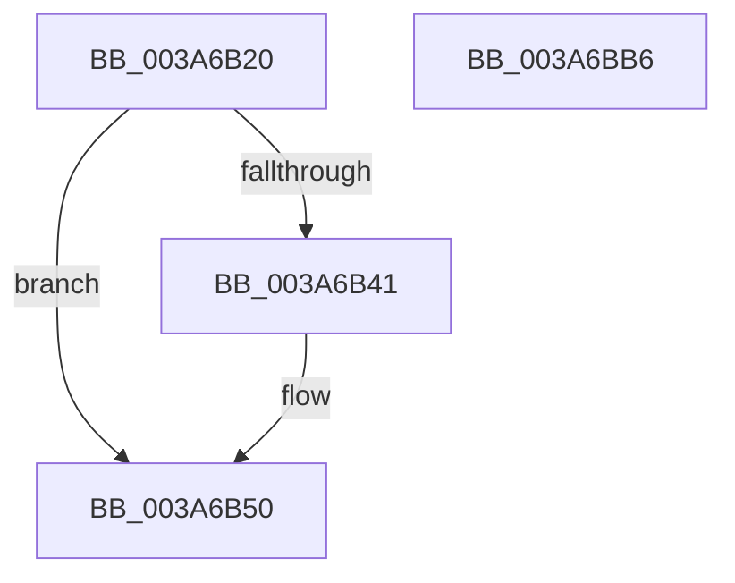

# SeAccessCheckFromStateEx

- RVA: `0x003A6B20`–`0x003A6BB7` (길이 `151` bytes)
- VA: `0x00000001403A6B20`
- 실행 섹션: `.text`
- PDB 이름 있음: `예`; PDB Function 태그: `아니요`
- unwind 정보 RVA: `0x0007F678`
- 디코드: `32`개 명령, `151/151` bytes 표시
- 미해석 바이트: `0` (있으면 어셈블리에 `.byte`로 보존)

> 이 문서는 커널 이미지의 기계어와 PDB 기호를 분석해 생성했습니다. 4번과 5번은 함수 원형과 자료형을 바이너리 사용 방식에서 추정한 C 해석이며 원본 소스 복구 결과는 아닙니다.

## 1. Dependencies

- 직접 호출 지점: **1**; 고유 호출 대상: **1**
- 직접 호출자로 확인된 함수: **0**
- RIP 상대 이미지 참조: **0**

### Outgoing calls
- `0x003A6BA9` → [SeAccessCheckWithHint](SeAccessCheckWithHint_function_003A6C30.md) (function, `0x003A6C30`)

### Direct callers
- 이 함수 시작 RVA로 연결되는 직접 call은 확인되지 않았습니다. 간접 호출은 완전히 역산할 수 없습니다.

### Static image references
- 디코드된 RIP-relative 메모리 참조가 없습니다.

## 2. Other-region calls and transfers

- 다른 실행 섹션으로 향하는 call: **0**
- 별도 외부 분기/꼬리 이동을 확인하지 못했습니다.

## 3. Assembly (complete function range)

```asm
003A6B20  4C 8B DC                        mov r11, rsp
003A6B23  48 81 EC 88 00 00 00            sub rsp, 0x88
003A6B2A  33 C0                           xor eax, eax
003A6B2C  49 89 53 E8                     mov qword ptr [r11 - 0x18], rdx
003A6B30  49 89 43 D8                     mov qword ptr [r11 - 0x28], rax
003A6B34  49 89 43 E0                     mov qword ptr [r11 - 0x20], rax
003A6B38  49 89 43 F0                     mov qword ptr [r11 - 0x10], rax
003A6B3C  4D 85 C0                        test r8, r8
003A6B3F  74 0F                           je 0x1403a6b50
003A6B41  41 8B 80 C4 00 00 00            mov eax, dword ptr [r8 + 0xc4]
003A6B48  4D 89 43 D8                     mov qword ptr [r11 - 0x28], r8
003A6B4C  89 44 24 68                     mov dword ptr [rsp + 0x68], eax
003A6B50  48 8B 84 24 D8 00 00 00         mov rax, qword ptr [rsp + 0xd8]
003A6B58  4C 8D 44 24 60                  lea r8, [rsp + 0x60]
003A6B5D  48 89 44 24 50                  mov qword ptr [rsp + 0x50], rax
003A6B62  33 D2                           xor edx, edx
003A6B64  48 8B 84 24 D0 00 00 00         mov rax, qword ptr [rsp + 0xd0]
003A6B6C  48 89 44 24 48                  mov qword ptr [rsp + 0x48], rax
003A6B71  8A 84 24 C8 00 00 00            mov al, byte ptr [rsp + 0xc8]
003A6B78  88 44 24 40                     mov byte ptr [rsp + 0x40], al
003A6B7C  48 8B 84 24 C0 00 00 00         mov rax, qword ptr [rsp + 0xc0]
003A6B84  48 89 44 24 38                  mov qword ptr [rsp + 0x38], rax
003A6B89  48 8B 84 24 B8 00 00 00         mov rax, qword ptr [rsp + 0xb8]
003A6B91  48 89 44 24 30                  mov qword ptr [rsp + 0x30], rax
003A6B96  8B 84 24 B0 00 00 00            mov eax, dword ptr [rsp + 0xb0]
003A6B9D  89 44 24 28                     mov dword ptr [rsp + 0x28], eax
003A6BA1  44 89 4C 24 20                  mov dword ptr [rsp + 0x20], r9d
003A6BA6  41 B1 01                        mov r9b, 1
003A6BA9  E8 82 00 00 00                  call 0x1403a6c30
003A6BAE  48 81 C4 88 00 00 00            add rsp, 0x88
003A6BB5  C3                              ret
003A6BB6  CC                              int3
```

## 4. C-style interpretation (structured pseudocode)

```c
__int64 __fastcall SeAccessCheckFromStateEx(__int64 a1, __int64 a2, __int64 a3, int a4, unsigned int a5, __int64 a6, __int64 a7, unsigned __int8 a8, __int64 a9, __int64 a10)
{
    __int64 result;
    __int64 v_rsp;
    unsigned int v_stack_m20;
    unsigned __int64 v_stack_m28;
    unsigned __int64 v_stack_m38;
    unsigned __int64 v_stack_m40;
    unsigned __int8 v_stack_m48;
    unsigned __int64 v_stack_m50;
    unsigned __int64 v_stack_m58;
    unsigned int v_stack_m60;
    unsigned int v_stack_m68;

    v_rsp = (v_rsp) - (136);
    result = 0;
    *(unsigned __int64 *)(v_rsp - 24) = a2;
    *(unsigned __int64 *)(v_rsp - 40) = 0;
    *(unsigned __int64 *)(v_rsp - 32) = 0;
    *(unsigned __int64 *)(v_rsp - 16) = 0;
    if (a3 != 0) {
        result = *(unsigned int *)(a3 + 196);
        *(unsigned __int64 *)(v_rsp - 40) = a3;
        v_stack_m20 = (unsigned int)(result);
    }
    v_stack_m38 = a10;
    a2 = 0;
    v_stack_m40 = a9;
    v_stack_m48 = a8;
    v_stack_m50 = a7;
    v_stack_m58 = a6;
    v_stack_m60 = (unsigned int)((unsigned int)(a5));
    v_stack_m68 = a4;
    result = SeAccessCheckWithHint(a1, a2, v_stack_m28, 1);
    v_rsp = (v_rsp) + (136);
    return result;
}
```

## 5. (Beta) C Style

```c
int64_t SeAccessCheckFromStateEx(int64_t Arg1, int64_t Arg2, int64_t Arg3, int32_t Arg4, uint32_t Arg5, int64_t Arg6, int64_t Arg7, uint8_t Arg8, int64_t Arg9, int64_t Arg10)
{
    int64_t result;
    int64_t local_rsp;
    uint32_t v_stack_m20;
    uint64_t v_stack_m28;
    uint64_t v_stack_m38;
    uint64_t v_stack_m40;
    uint8_t v_stack_m48;
    uint64_t v_stack_m50;
    uint64_t v_stack_m58;
    uint32_t v_stack_m60;
    uint32_t v_stack_m68;

    local_rsp = (local_rsp) - (136);
    result = 0;
    *(uint64_t *)(local_rsp - 0x18) = Arg2;
    *(uint64_t *)(local_rsp - 0x28) = 0;
    *(uint64_t *)(local_rsp - 0x20) = 0;
    *(uint64_t *)(local_rsp - 0x10) = 0;
    if (Arg3 != 0) {
        result = *(uint32_t *)(Arg3 + 0xC4);
        *(uint64_t *)(local_rsp - 0x28) = Arg3;
        v_stack_m20 = (uint32_t)(result);
    }
    v_stack_m38 = Arg10;
    Arg2 = 0;
    v_stack_m40 = Arg9;
    v_stack_m48 = Arg8;
    v_stack_m50 = Arg7;
    v_stack_m58 = Arg6;
    v_stack_m60 = (uint32_t)((uint32_t)(Arg5));
    v_stack_m68 = Arg4;
    result = SeAccessCheckWithHint(Arg1, Arg2, v_stack_m28, 1);
    local_rsp = (local_rsp) + (136);
    return result;
}
```

## 6. Execution-region graph

[열기: 2D/3D 그래프와 함수 탐색 컨트롤 패널](../../../control-panel.html?section=text&rva=0x003A6B20&view=graph)

- 2D 그래프는 위에서 아래로 흐르고, 3D 그래프는 빈 공간을 드래그해 회전합니다. Shift+드래그는 이동, 휠은 확대·축소, 함수 노드 선택은 대상 보고서 이동입니다.

### Static fallback


