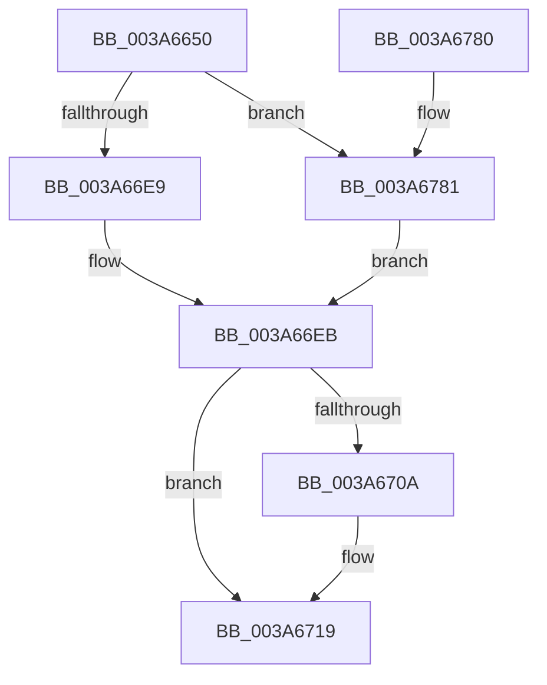

# SeAccessCheckFromState

- RVA: `0x003A6650`–`0x003A6796` (길이 `326` bytes)
- VA: `0x00000001403A6650`
- 실행 섹션: `.text`
- PDB 이름 있음: `예`; PDB Function 태그: `아니요`
- unwind 정보 RVA: `0x00089B34`
- 디코드: `81`개 명령, `326/326` bytes 표시
- 미해석 바이트: `0` (있으면 어셈블리에 `.byte`로 보존)

> 이 문서는 커널 이미지의 기계어와 PDB 기호를 분석해 생성했습니다. 4번과 5번은 함수 원형과 자료형을 바이너리 사용 방식에서 추정한 C 해석이며 원본 소스 복구 결과는 아닙니다.

## 1. Dependencies

- 직접 호출 지점: **6**; 고유 호출 대상: **4**
- 직접 호출자로 확인된 함수: **2**
- RIP 상대 이미지 참조: **1**

### Outgoing calls
- `0x003A66B9` → [memset](../6C/memset_function_006C6C40.md) (function, `0x006C6C40`)
- `0x003A66CA` → [memset](../6C/memset_function_006C6C40.md) (function, `0x006C6C40`)
- `0x003A66D9` → [SepTokenFromAccessInformation](SepTokenFromAccessInformation_function_003A67A0.md) (function, `0x003A67A0`)
- `0x003A6758` → [SeAccessCheckWithHint](SeAccessCheckWithHint_function_003A6C30.md) (function, `0x003A6C30`)
- `0x003A6767` → [_security_check_cookie](../6A/_security_check_cookie_function_006AC640.md) (function, `0x006AC640`)
- `0x003A6788` → [SepTokenFromAccessInformation](SepTokenFromAccessInformation_function_003A67A0.md) (function, `0x003A67A0`)

### Direct callers
- [EtwpAccessCheckFromState](../../page/8C/EtwpAccessCheckFromState_function_008C0350.md) at `0x008C046A`
- [CmpCheckAdminAccess](../../page/9A/CmpCheckAdminAccess_function_009A87A0.md) at `0x009A8862`

### Static image references
- `0x003A666C` → RVA `0x00E0A740` (`.data`; read)

## 2. Other-region calls and transfers

- 다른 실행 섹션으로 향하는 call: **0**
- 별도 외부 분기/꼬리 이동을 확인하지 못했습니다.

## 3. Assembly (complete function range)

```asm
003A6650  40 55                           push rbp
003A6652  53                              push rbx
003A6653  56                              push rsi
003A6654  57                              push rdi
003A6655  41 54                           push r12
003A6657  41 55                           push r13
003A6659  41 56                           push r14
003A665B  41 57                           push r15
003A665D  48 8D AC 24 B8 F4 FF FF         lea rbp, [rsp - 0xb48]
003A6665  48 81 EC 48 0C 00 00            sub rsp, 0xc48
003A666C  48 8B 05 CD 40 A6 00            mov rax, qword ptr [rip + 0xa640cd]
003A6673  48 33 C4                        xor rax, rsp
003A6676  48 89 85 30 0B 00 00            mov qword ptr [rbp + 0xb30], rax
003A667D  48 8B 85 D8 0B 00 00            mov rax, qword ptr [rbp + 0xbd8]
003A6684  49 8B F8                        mov rdi, r8
003A6687  4C 8B BD B8 0B 00 00            mov r15, qword ptr [rbp + 0xbb8]
003A668E  48 8B DA                        mov rbx, rdx
003A6691  4C 8B A5 C0 0B 00 00            mov r12, qword ptr [rbp + 0xbc0]
003A6698  48 8B F1                        mov rsi, rcx
003A669B  4C 8B AD D0 0B 00 00            mov r13, qword ptr [rbp + 0xbd0]
003A66A2  48 8D 8D 60 05 00 00            lea rcx, [rbp + 0x560]
003A66A9  33 D2                           xor edx, edx
003A66AB  48 89 44 24 60                  mov qword ptr [rsp + 0x60], rax
003A66B0  41 B8 C8 05 00 00               mov r8d, 0x5c8
003A66B6  45 8B F1                        mov r14d, r9d
003A66B9  E8 82 05 32 00                  call 0x1406c6c40
003A66BE  33 D2                           xor edx, edx
003A66C0  48 8D 4D 90                     lea rcx, [rbp - 0x70]
003A66C4  41 B8 C8 05 00 00               mov r8d, 0x5c8
003A66CA  E8 71 05 32 00                  call 0x1406c6c40
003A66CF  48 8D 95 60 05 00 00            lea rdx, [rbp + 0x560]
003A66D6  48 8B CB                        mov rcx, rbx
003A66D9  E8 C2 00 00 00                  call 0x1403a67a0
003A66DE  33 DB                           xor ebx, ebx
003A66E0  48 85 FF                        test rdi, rdi
003A66E3  0F 85 98 00 00 00               jne 0x1403a6781
003A66E9  8B C3                           mov eax, ebx
003A66EB  48 89 5C 24 68                  mov qword ptr [rsp + 0x68], rbx
003A66F0  48 8D 8D 60 05 00 00            lea rcx, [rbp + 0x560]
003A66F7  48 89 4C 24 78                  mov qword ptr [rsp + 0x78], rcx
003A66FC  48 89 5C 24 70                  mov qword ptr [rsp + 0x70], rbx
003A6701  48 89 5D 80                     mov qword ptr [rbp - 0x80], rbx
003A6705  48 85 C0                        test rax, rax
003A6708  74 0F                           je 0x1403a6719
003A670A  48 89 44 24 68                  mov qword ptr [rsp + 0x68], rax
003A670F  8B 80 C4 00 00 00               mov eax, dword ptr [rax + 0xc4]
003A6715  89 44 24 70                     mov dword ptr [rsp + 0x70], eax
003A6719  48 8B 44 24 60                  mov rax, qword ptr [rsp + 0x60]
003A671E  4C 8D 44 24 68                  lea r8, [rsp + 0x68]
003A6723  48 89 44 24 50                  mov qword ptr [rsp + 0x50], rax
003A6728  41 B1 01                        mov r9b, 1
003A672B  8A 85 C8 0B 00 00               mov al, byte ptr [rbp + 0xbc8]
003A6731  33 D2                           xor edx, edx
003A6733  4C 89 6C 24 48                  mov qword ptr [rsp + 0x48], r13
003A6738  48 8B CE                        mov rcx, rsi
003A673B  88 44 24 40                     mov byte ptr [rsp + 0x40], al
003A673F  8B 85 B0 0B 00 00               mov eax, dword ptr [rbp + 0xbb0]
003A6745  4C 89 64 24 38                  mov qword ptr [rsp + 0x38], r12
003A674A  4C 89 7C 24 30                  mov qword ptr [rsp + 0x30], r15
003A674F  89 44 24 28                     mov dword ptr [rsp + 0x28], eax
003A6753  44 89 74 24 20                  mov dword ptr [rsp + 0x20], r14d
003A6758  E8 D3 04 00 00                  call 0x1403a6c30
003A675D  48 8B 8D 30 0B 00 00            mov rcx, qword ptr [rbp + 0xb30]
003A6764  48 33 CC                        xor rcx, rsp
003A6767  E8 D4 5E 30 00                  call 0x1406ac640
003A676C  48 81 C4 48 0C 00 00            add rsp, 0xc48
003A6773  41 5F                           pop r15
003A6775  41 5E                           pop r14
003A6777  41 5D                           pop r13
003A6779  41 5C                           pop r12
003A677B  5F                              pop rdi
003A677C  5E                              pop rsi
003A677D  5B                              pop rbx
003A677E  5D                              pop rbp
003A677F  C3                              ret
003A6780  CC                              int3
003A6781  48 8D 55 90                     lea rdx, [rbp - 0x70]
003A6785  48 8B CF                        mov rcx, rdi
003A6788  E8 13 00 00 00                  call 0x1403a67a0
003A678D  48 8D 45 90                     lea rax, [rbp - 0x70]
003A6791  E9 55 FF FF FF                  jmp 0x1403a66eb
```

## 4. C-style interpretation (structured pseudocode)

```c
__int64 __fastcall SeAccessCheckFromState(__int64 a1, __int64 a2, __int64 a3, int a4, unsigned int a5, __int64 a6, __int64 a7, unsigned __int8 a8, __int64 a9, __int64 a10)
{
    __int64 result;
    __int64 v_rbx;
    __int64 v_rsp;
    unsigned __int64 v_stack_m58;
    unsigned __int64 v_stack_m628;
    unsigned __int64 v_stack_mB88;
    unsigned __int64 v_stack_mBF8;
    unsigned __int64 v_stack_mC08;
    unsigned __int64 v_stack_mC10;
    unsigned __int64 v_stack_mC18;
    unsigned __int64 v_stack_mC20;
    unsigned __int64 v_stack_mC28;
    unsigned __int64 v_stack_mC38;
    unsigned __int64 v_stack_mC40;
    unsigned __int8 v_stack_mC48;
    unsigned __int64 v_stack_mC50;
    unsigned __int64 v_stack_mC58;
    unsigned int v_stack_mC60;
    unsigned int v_stack_mC68;

    v_rsp = (v_rsp) - (0xC48ULL);
    result = (*(unsigned __int64 *)(v_rip + 10895565)) ^ (v_rsp);
    v_stack_m58 = result;
    a2 = 0;
    v_stack_mC28 = a10;
    result = memset(v_stack_m628, a2, (unsigned int)(0x5C8ULL), a4);
    a2 = 0;
    result = memset(v_stack_mBF8, a2, (unsigned int)(0x5C8ULL), a4);
    result = SepTokenFromAccessInformation(0, v_stack_m628, (unsigned int)(0x5C8ULL), a4);
    v_rbx = 0;
    if (a3 != 0) goto loc_003A6781;
loc_003A66EB:
    v_stack_mC20 = 0;
    v_stack_mC10 = v_stack_m628;
    v_stack_mC18 = 0;
    v_stack_mC08 = 0;
    result = 0;
    if (0 != 0) {
        v_stack_mC20 = 0;
        result = *(unsigned int *)(0 + 196);
        v_stack_mC18 = (unsigned int)(result);
    }
    v_stack_mC38 = v_stack_mC28;
    a2 = 0;
    v_stack_mC40 = a9;
    v_stack_mC48 = a8;
    v_stack_mC50 = a7;
    v_stack_mC58 = a6;
    v_stack_mC60 = (unsigned int)((unsigned int)(a5));
    v_stack_mC68 = (unsigned int)((unsigned int)(a4));
    result = SeAccessCheckWithHint(a1, a2, v_stack_mC20, 1);
    a1 = (v_stack_m58) ^ (v_rsp);
    result = _security_check_cookie(a1, a2, v_stack_mC20, 1);
    v_rsp = (v_rsp) + (0xC48ULL);
    return result;
loc_003A6781:
    result = SepTokenFromAccessInformation(a3, v_stack_mBF8, v_stack_mC20, 1);
    goto loc_003A66EB;
}
```

## 5. (Beta) C Style

```c
int64_t SeAccessCheckFromState(int64_t Arg1, int64_t Arg2, int64_t Arg3, int32_t Arg4, uint32_t Arg5, int64_t Arg6, int64_t Arg7, uint8_t Arg8, int64_t Arg9, int64_t Arg10)
{
    int64_t result;
    int64_t local_rbx;
    int64_t local_rsp;
    uint64_t v_stack_m58;
    uint64_t v_stack_m628;
    uint64_t v_stack_mB88;
    uint64_t v_stack_mBF8;
    uint64_t v_stack_mC08;
    uint64_t v_stack_mC10;
    uint64_t v_stack_mC18;
    uint64_t v_stack_mC20;
    uint64_t v_stack_mC28;
    uint64_t v_stack_mC38;
    uint64_t v_stack_mC40;
    uint8_t v_stack_mC48;
    uint64_t v_stack_mC50;
    uint64_t v_stack_mC58;
    uint32_t v_stack_mC60;
    uint32_t v_stack_mC68;

    local_rsp = (local_rsp) - (0xC48ULL);
    result = (*(uint64_t *)(v_rip + 0xA640CD)) ^ (local_rsp);
    v_stack_m58 = result;
    Arg2 = 0;
    v_stack_mC28 = Arg10;
    result = memset(v_stack_m628, Arg2, (uint32_t)(0x5C8ULL), Arg4);
    Arg2 = 0;
    result = memset(v_stack_mBF8, Arg2, (uint32_t)(0x5C8ULL), Arg4);
    result = SepTokenFromAccessInformation(0, v_stack_m628, (uint32_t)(0x5C8ULL), Arg4);
    local_rbx = 0;
    if (Arg3 != 0) goto loc_003A6781;
loc_003A66EB:
    v_stack_mC20 = 0;
    v_stack_mC10 = v_stack_m628;
    v_stack_mC18 = 0;
    v_stack_mC08 = 0;
    result = 0;
    if (0 != 0) {
        v_stack_mC20 = 0;
        result = *(uint32_t *)(0 + 0xC4);
        v_stack_mC18 = (uint32_t)(result);
    }
    v_stack_mC38 = v_stack_mC28;
    Arg2 = 0;
    v_stack_mC40 = Arg9;
    v_stack_mC48 = Arg8;
    v_stack_mC50 = Arg7;
    v_stack_mC58 = Arg6;
    v_stack_mC60 = (uint32_t)((uint32_t)(Arg5));
    v_stack_mC68 = (uint32_t)((uint32_t)(Arg4));
    result = SeAccessCheckWithHint(Arg1, Arg2, v_stack_mC20, 1);
    Arg1 = (v_stack_m58) ^ (local_rsp);
    result = _security_check_cookie(Arg1, Arg2, v_stack_mC20, 1);
    local_rsp = (local_rsp) + (0xC48ULL);
    return result;
loc_003A6781:
    result = SepTokenFromAccessInformation(Arg3, v_stack_mBF8, v_stack_mC20, 1);
    goto loc_003A66EB;
}
```

## 6. Execution-region graph

[열기: 2D/3D 그래프와 함수 탐색 컨트롤 패널](../../../control-panel.html?section=text&rva=0x003A6650&view=graph)

- 2D 그래프는 위에서 아래로 흐르고, 3D 그래프는 빈 공간을 드래그해 회전합니다. Shift+드래그는 이동, 휠은 확대·축소, 함수 노드 선택은 대상 보고서 이동입니다.

### Static fallback


