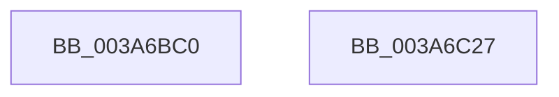

# SeAccessCheck

- RVA: `0x003A6BC0`–`0x003A6C28` (길이 `104` bytes)
- VA: `0x00000001403A6BC0`
- 실행 섹션: `.text`
- PDB 이름 있음: `예`; PDB Function 태그: `아니요`
- unwind 정보 RVA: `0x0006E590`
- 디코드: `21`개 명령, `104/104` bytes 표시
- 미해석 바이트: `0` (있으면 어셈블리에 `.byte`로 보존)

> 이 문서는 커널 이미지의 기계어와 PDB 기호를 분석해 생성했습니다. 4번과 5번은 함수 원형과 자료형을 바이너리 사용 방식에서 추정한 C 해석이며 원본 소스 복구 결과는 아닙니다.

## 1. Dependencies

- 직접 호출 지점: **1**; 고유 호출 대상: **1**
- 직접 호출자로 확인된 함수: **48**
- RIP 상대 이미지 참조: **0**

### Outgoing calls
- `0x003A6C1D` → [SeAccessCheckWithHint](SeAccessCheckWithHint_function_003A6C30.md) (function, `0x003A6C30`)

### Direct callers
- [IopCreateSecurityCheck](IopCreateSecurityCheck_function_003A5DA0.md) at `0x003A5E59`
- [SeComputeCreatorDeniedRights](SeComputeCreatorDeniedRights_function_003A6080.md) at `0x003A6408`
- [SeComputeCreatorDeniedRights](SeComputeCreatorDeniedRights_function_003A6080.md) at `0x003A646A`
- [SeIsSystemContext](../60/SeIsSystemContext_function_006095B8.md) at `0x00609621`
- [WdipAccessCheck](../64/WdipAccessCheck_function_0064E084.md) at `0x0064E292`
- [CmpCheckHivePrimaryFileReadWriteAccess](../66/CmpCheckHivePrimaryFileReadWriteAccess_function_0066AD0C.md) at `0x0066AD8B`
- [PiAuCheckTokenMembership](../../page/73/PiAuCheckTokenMembership_function_00731348.md) at `0x007314A7`
- [PspCheckJobAccessState](../../page/78/PspCheckJobAccessState_function_00784D94.md) at `0x00784E27`
- [PspIumVerifyParentSd](../../page/78/PspIumVerifyParentSd_function_00787D04.md) at `0x00787D8B`
- [NtSetUuidSeed](../../page/7D/NtSetUuidSeed_function_007D0DD0.md) at `0x007D101C`
- [CMFCheckAccess](../../page/7D/CMFCheckAccess_function_007D28B4.md) at `0x007D2A79`
- [CmUpdateFeatureConfiguration](../../page/7E/CmUpdateFeatureConfiguration_function_007E5C10.md) at `0x007E5CA1`
- [CmUpdateFeatureUsageSubscription](../../page/7E/CmUpdateFeatureUsageSubscription_function_007E5E78.md) at `0x007E5EF9`
- [ObpCreateHandle](../../page/86/ObpCreateHandle_function_0086B950.md) at `0x0086BBAF`
- [ObpGrantAccess](../../page/86/ObpGrantAccess_function_0086F250.md) at `0x0086F3C6`
- [sub_0086FA65](../../page/86/Unknown_function_0086FA65.md) at `0x0086FBCC`
- [CmpCheckOpenAccessOnKeyBody](../../page/87/CmpCheckOpenAccessOnKeyBody_function_00870000.md) at `0x008702CA`
- [ObCheckObjectAccess](../../page/87/ObCheckObjectAccess_function_00872260.md) at `0x008723C0`
- [IopParseDevice](../../page/89/IopParseDevice_function_0089E510.md) at `0x0089EB0C`
- [IopParseDevice](../../page/89/IopParseDevice_function_0089E510.md) at `0x008A0090`
- [IopParseDevice](../../page/89/IopParseDevice_function_0089E510.md) at `0x008A03E5`
- [EtwpCheckLoggerControlAccess](../../page/8C/EtwpCheckLoggerControlAccess_function_008C0AE0.md) at `0x008C0B6A`
- [EtwpFindOrCreateGuidEntry](../../page/8C/EtwpFindOrCreateGuidEntry_function_008C1B70.md) at `0x008C1CFC`
- [sub_008C2328](../../page/8C/Unknown_function_008C2328.md) at `0x008C2492`
- [ObpCheckObjectReference](../../page/8C/ObpCheckObjectReference_function_008C6084.md) at `0x008C613E`
- [ObCheckCreateObjectAccess](../../page/8C/ObCheckCreateObjectAccess_function_008C6340.md) at `0x008C640C`
- [EtwpAccessCheck](../../page/8C/EtwpAccessCheck_function_008C6C2C.md) at `0x008C6CA9`
- [ObpCheckTraverseAccess](../../page/8C/ObpCheckTraverseAccess_function_008C6CE4.md) at `0x008C6DC0`
- [CmpCheckCreateAccess](../../page/8C/CmpCheckCreateAccess_function_008C6E8C.md) at `0x008C6F0D`
- [CmpNotifyTriggerCheck](../../page/8C/CmpNotifyTriggerCheck_function_008C74A4.md) at `0x008C7547`
- [PiPnpRtlApplyMandatoryFilters](../../page/8E/PiPnpRtlApplyMandatoryFilters_function_008E5C80.md) at `0x008E5D6F`
- [sub_008E6883](../../page/8E/Unknown_function_008E6883.md) at `0x008E697D`
- [sub_008E6A55](../../page/8E/Unknown_function_008E6A55.md) at `0x008E6B8A`
- [PiAuIsLocalSystem](../../page/8E/PiAuIsLocalSystem_function_008E6D34.md) at `0x008E6DDD`
- [PiCMValidateDeviceInstance](../../page/8E/PiCMValidateDeviceInstance_function_008E799C.md) at `0x008E7B90`
- [NtDeleteWnfStateName](../../page/90/NtDeleteWnfStateName_function_00908E60.md) at `0x00909022`
- [NtDeleteWnfStateName](../../page/90/NtDeleteWnfStateName_function_00908E60.md) at `0x009091DE`
- [NtQueryWnfStateData](../../page/90/NtQueryWnfStateData_function_00909DF0.md) at `0x0090A42F`
- [ExpNtUpdateWnfStateData](../../page/90/ExpNtUpdateWnfStateData_function_0090A7A0.md) at `0x0090AD45`
- [ExpWnfCheckCrossScopeAccess](../../page/90/ExpWnfCheckCrossScopeAccess_function_0090CA94.md) at `0x0090CB49`
- [RtlpNewSecurityObject](../../page/92/RtlpNewSecurityObject_function_0092AB50.md) at `0x0092C695`
- [CmpCheckKeySecurityDescriptorAccess](../../page/94/CmpCheckKeySecurityDescriptorAccess_function_0094715C.md) at `0x0094727A`
- [PiAuDoesClientHaveAccess](../../page/96/PiAuDoesClientHaveAccess_function_00962940.md) at `0x009629CE`
- [sub_00968AF6](../../page/96/Unknown_function_00968AF6.md) at `0x00969AAA`
- [sub_00968AF6](../../page/96/Unknown_function_00968AF6.md) at `0x0096A00E`
- [ExpWnfCheckCallerAccess](../../page/9D/ExpWnfCheckCallerAccess_function_009D57C0.md) at `0x009D5837`
- [ExpWnfValidatePubSubPreconditions](../../page/9E/ExpWnfValidatePubSubPreconditions_function_009E6E00.md) at `0x009E6E92`
- [PiAuVerifyAccessToObject](../../page/9E/PiAuVerifyAccessToObject_function_009E92D0.md) at `0x009E938A`
- [ExIsRestrictedCaller](../../page/A2/ExIsRestrictedCaller_function_00A217E8.md) at `0x00A2189A`
- [SeIsAppContainerOrIdentifyLevelContext](../../page/A2/SeIsAppContainerOrIdentifyLevelContext_function_00A21A74.md) at `0x00A21B02`
- [AlpcpCheckConnectionSecurity](../../page/A2/AlpcpCheckConnectionSecurity_function_00A227A0.md) at `0x00A228F2`
- [PopBootStatAccessCheck](../../page/AC/PopBootStatAccessCheck_function_00AC0814.md) at `0x00AC08D6`
- [VfUtilIsLocalSystem](../../pagevrfy/B9/VfUtilIsLocalSystem_function_00B933F4.md) at `0x00B9347A`

### Static image references
- 디코드된 RIP-relative 메모리 참조가 없습니다.

## 2. Other-region calls and transfers

- 다른 실행 섹션으로 향하는 call: **0**
- 별도 외부 분기/꼬리 이동을 확인하지 못했습니다.

## 3. Assembly (complete function range)

```asm
003A6BC0  48 83 EC 68                     sub rsp, 0x68
003A6BC4  48 8B 84 24 B8 00 00 00         mov rax, qword ptr [rsp + 0xb8]
003A6BCC  48 89 44 24 50                  mov qword ptr [rsp + 0x50], rax
003A6BD1  48 8B 84 24 B0 00 00 00         mov rax, qword ptr [rsp + 0xb0]
003A6BD9  48 89 44 24 48                  mov qword ptr [rsp + 0x48], rax
003A6BDE  0F B6 84 24 A8 00 00 00         movzx eax, byte ptr [rsp + 0xa8]
003A6BE6  88 44 24 40                     mov byte ptr [rsp + 0x40], al
003A6BEA  48 8B 84 24 A0 00 00 00         mov rax, qword ptr [rsp + 0xa0]
003A6BF2  48 89 44 24 38                  mov qword ptr [rsp + 0x38], rax
003A6BF7  48 8B 84 24 98 00 00 00         mov rax, qword ptr [rsp + 0x98]
003A6BFF  48 89 44 24 30                  mov qword ptr [rsp + 0x30], rax
003A6C04  8B 84 24 90 00 00 00            mov eax, dword ptr [rsp + 0x90]
003A6C0B  89 44 24 28                     mov dword ptr [rsp + 0x28], eax
003A6C0F  44 89 4C 24 20                  mov dword ptr [rsp + 0x20], r9d
003A6C14  45 0F B6 C8                     movzx r9d, r8b
003A6C18  4C 8B C2                        mov r8, rdx
003A6C1B  33 D2                           xor edx, edx
003A6C1D  E8 0E 00 00 00                  call 0x1403a6c30
003A6C22  48 83 C4 68                     add rsp, 0x68
003A6C26  C3                              ret
003A6C27  CC                              int3
```

## 4. C-style interpretation (structured pseudocode)

```c
__int64 __fastcall SeAccessCheck(__int64 a1, __int64 a2, unsigned __int8 a3, int a4, unsigned int a5, __int64 a6, __int64 a7, unsigned __int8 a8, __int64 a9, __int64 a10)
{
    __int64 result;
    __int64 v_rsp;
    unsigned __int64 v_stack_m18;
    unsigned __int64 v_stack_m20;
    unsigned __int8 v_stack_m28;
    unsigned __int64 v_stack_m30;
    unsigned __int64 v_stack_m38;
    unsigned int v_stack_m40;
    unsigned int v_stack_m48;

    v_rsp = (v_rsp) - (104);
    v_stack_m18 = a10;
    v_stack_m20 = a9;
    v_stack_m28 = a8;
    v_stack_m30 = a7;
    v_stack_m38 = a6;
    v_stack_m40 = (unsigned int)((unsigned int)(a5));
    v_stack_m48 = a4;
    a2 = 0;
    result = SeAccessCheckWithHint(a1, a2, a2, a3);
    v_rsp = (v_rsp) + (104);
    return result;
}
```

## 5. (Beta) C Style

```c
int64_t SeAccessCheck(int64_t Arg1, int64_t Arg2, uint8_t Arg3, int32_t Arg4, uint32_t Arg5, int64_t Arg6, int64_t Arg7, uint8_t Arg8, int64_t Arg9, int64_t Arg10)
{
    int64_t result;
    int64_t local_rsp;
    uint64_t v_stack_m18;
    uint64_t v_stack_m20;
    uint8_t v_stack_m28;
    uint64_t v_stack_m30;
    uint64_t v_stack_m38;
    uint32_t v_stack_m40;
    uint32_t v_stack_m48;

    local_rsp = (local_rsp) - (104);
    v_stack_m18 = Arg10;
    v_stack_m20 = Arg9;
    v_stack_m28 = Arg8;
    v_stack_m30 = Arg7;
    v_stack_m38 = Arg6;
    v_stack_m40 = (uint32_t)((uint32_t)(Arg5));
    v_stack_m48 = Arg4;
    Arg2 = 0;
    result = SeAccessCheckWithHint(Arg1, Arg2, Arg2, Arg3);
    local_rsp = (local_rsp) + (104);
    return result;
}
```

## 6. Execution-region graph

[열기: 2D/3D 그래프와 함수 탐색 컨트롤 패널](../../../control-panel.html?section=text&rva=0x003A6BC0&view=graph)

- 2D 그래프는 위에서 아래로 흐르고, 3D 그래프는 빈 공간을 드래그해 회전합니다. Shift+드래그는 이동, 휠은 확대·축소, 함수 노드 선택은 대상 보고서 이동입니다.

### Static fallback


