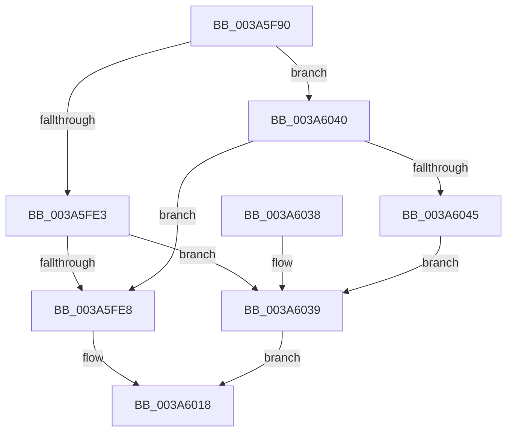

# SeQuerySecurityAttributesTokenAccessInformation

- RVA: `0x003A5F90`–`0x003A6047` (길이 `183` bytes)
- VA: `0x00000001403A5F90`
- 실행 섹션: `.text`
- PDB 이름 있음: `예`; PDB Function 태그: `아니요`
- unwind 정보 RVA: `0x00089AF8`
- 디코드: `52`개 명령, `183/183` bytes 표시
- 미해석 바이트: `0` (있으면 어셈블리에 `.byte`로 보존)

> 이 문서는 커널 이미지의 기계어와 PDB 기호를 분석해 생성했습니다. 4번과 5번은 함수 원형과 자료형을 바이너리 사용 방식에서 추정한 C 해석이며 원본 소스 복구 결과는 아닙니다.

## 1. Dependencies

- 직접 호출 지점: **4**; 고유 호출 대상: **4**
- 직접 호출자로 확인된 함수: **0**
- RIP 상대 이미지 참조: **1**

### Outgoing calls
- `0x003A5FD3` → [memset](../6C/memset_function_006C6C40.md) (function, `0x006C6C40`)
- `0x003A5FF0` → [SepTokenFromAccessInformation](SepTokenFromAccessInformation_function_003A67A0.md) (function, `0x003A67A0`)
- `0x003A6013` → [SepInternalQuerySecurityAttributesTokenEx](SepInternalQuerySecurityAttributesTokenEx_function_003A77B0.md) (function, `0x003A77B0`)
- `0x003A6023` → [_security_check_cookie](../6A/_security_check_cookie_function_006AC640.md) (function, `0x006AC640`)

### Direct callers
- 이 함수 시작 RVA로 연결되는 직접 call은 확인되지 않았습니다. 간접 호출은 완전히 역산할 수 없습니다.

### Static image references
- `0x003A5FA0` → RVA `0x00E0A740` (`.data`; read)

## 2. Other-region calls and transfers

- 다른 실행 섹션으로 향하는 call: **0**
- 별도 외부 분기/꼬리 이동을 확인하지 못했습니다.

## 3. Assembly (complete function range)

```asm
003A5F90  40 53                           push rbx
003A5F92  55                              push rbp
003A5F93  56                              push rsi
003A5F94  57                              push rdi
003A5F95  41 56                           push r14
003A5F97  41 57                           push r15
003A5F99  48 81 EC 28 06 00 00            sub rsp, 0x628
003A5FA0  48 8B 05 99 47 A6 00            mov rax, qword ptr [rip + 0xa64799]
003A5FA7  48 33 C4                        xor rax, rsp
003A5FAA  48 89 84 24 10 06 00 00         mov qword ptr [rsp + 0x610], rax
003A5FB2  4C 8B BC 24 88 06 00 00         mov r15, qword ptr [rsp + 0x688]
003A5FBA  45 8B F0                        mov r14d, r8d
003A5FBD  48 8B EA                        mov rbp, rdx
003A5FC0  48 8B F1                        mov rsi, rcx
003A5FC3  33 D2                           xor edx, edx
003A5FC5  48 8D 4C 24 40                  lea rcx, [rsp + 0x40]
003A5FCA  41 B8 C8 05 00 00               mov r8d, 0x5c8
003A5FD0  49 8B D9                        mov rbx, r9
003A5FD3  E8 68 0C 32 00                  call 0x1406c6c40
003A5FD8  8B BC 24 80 06 00 00            mov edi, dword ptr [rsp + 0x680]
003A5FDF  85 FF                           test edi, edi
003A5FE1  74 5D                           je 0x1403a6040
003A5FE3  48 85 DB                        test rbx, rbx
003A5FE6  74 51                           je 0x1403a6039
003A5FE8  48 8D 54 24 40                  lea rdx, [rsp + 0x40]
003A5FED  48 8B CE                        mov rcx, rsi
003A5FF0  E8 AB 07 00 00                  call 0x1403a67a0
003A5FF5  4C 89 7C 24 38                  mov qword ptr [rsp + 0x38], r15
003A5FFA  48 8D 4C 24 40                  lea rcx, [rsp + 0x40]
003A5FFF  89 7C 24 30                     mov dword ptr [rsp + 0x30], edi
003A6003  45 8B CE                        mov r9d, r14d
003A6006  48 89 5C 24 28                  mov qword ptr [rsp + 0x28], rbx
003A600B  4C 8B C5                        mov r8, rbp
003A600E  C6 44 24 20 00                  mov byte ptr [rsp + 0x20], 0
003A6013  E8 98 17 00 00                  call 0x1403a77b0
003A6018  48 8B 8C 24 10 06 00 00         mov rcx, qword ptr [rsp + 0x610]
003A6020  48 33 CC                        xor rcx, rsp
003A6023  E8 18 66 30 00                  call 0x1406ac640
003A6028  48 81 C4 28 06 00 00            add rsp, 0x628
003A602F  41 5F                           pop r15
003A6031  41 5E                           pop r14
003A6033  5F                              pop rdi
003A6034  5E                              pop rsi
003A6035  5D                              pop rbp
003A6036  5B                              pop rbx
003A6037  C3                              ret
003A6038  CC                              int3
003A6039  B8 0D 00 00 C0                  mov eax, 0xc000000d
003A603E  EB D8                           jmp 0x1403a6018
003A6040  48 85 DB                        test rbx, rbx
003A6043  74 A3                           je 0x1403a5fe8
003A6045  EB F2                           jmp 0x1403a6039
```

## 4. C-style interpretation (structured pseudocode)

```c
__int64 __fastcall SeQuerySecurityAttributesTokenAccessInformation(__int64 a1, __int64 a2, int a3, __int64 a4, unsigned int a5, __int64 a6)
{
    __int64 result;
    __int64 v_rsp;
    unsigned __int64 v_stack_m48;
    unsigned __int64 v_stack_m618;
    unsigned __int64 v_stack_m620;
    unsigned int v_stack_m628;
    unsigned __int64 v_stack_m630;
    unsigned __int8 v_stack_m638;

    v_rsp = (v_rsp) - (0x628ULL);
    result = (*(unsigned __int64 *)(v_rip + 10897305)) ^ (v_rsp);
    v_stack_m48 = result;
    a2 = 0;
    result = memset(v_stack_m618, a2, (unsigned int)(0x5C8ULL), a4);
    if ((unsigned int)((unsigned int)(a5)) == 0) goto loc_003A6040;
    if (a4 == 0) goto loc_003A6039;
loc_003A5FE8:
    result = SepTokenFromAccessInformation(a1, v_stack_m618, (unsigned int)(0x5C8ULL), a4);
    v_stack_m620 = a6;
    v_stack_m628 = (unsigned int)((unsigned int)(a5));
    v_stack_m630 = a4;
    v_stack_m638 = 0;
    result = SepInternalQuerySecurityAttributesTokenEx(v_stack_m618, v_stack_m618, 0, (unsigned int)((unsigned int)((unsigned int)(a3))));
loc_003A6018:
    a1 = (v_stack_m48) ^ (v_rsp);
    result = _security_check_cookie(a1, v_stack_m618, 0, (unsigned int)((unsigned int)((unsigned int)(a3))));
    v_rsp = (v_rsp) + (0x628ULL);
    return result;
loc_003A6039:
    goto loc_003A6018;
loc_003A6040:
    if (a4 == 0) goto loc_003A5FE8;
    goto loc_003A6039;
}
```

## 5. (Beta) C Style

```c
int64_t SeQuerySecurityAttributesTokenAccessInformation(int64_t Arg1, int64_t Arg2, int32_t Arg3, int64_t Arg4, uint32_t Arg5, int64_t Arg6)
{
    int64_t result;
    int64_t local_rsp;
    uint64_t v_stack_m48;
    uint64_t v_stack_m618;
    uint64_t v_stack_m620;
    uint32_t v_stack_m628;
    uint64_t v_stack_m630;
    uint8_t v_stack_m638;

    local_rsp = (local_rsp) - (0x628ULL);
    result = (*(uint64_t *)(v_rip + 0xA64799)) ^ (local_rsp);
    v_stack_m48 = result;
    Arg2 = 0;
    result = memset(v_stack_m618, Arg2, (uint32_t)(0x5C8ULL), Arg4);
    if ((uint32_t)((uint32_t)(Arg5)) == 0) goto loc_003A6040;
    if (Arg4 == 0) goto loc_003A6039;
loc_003A5FE8:
    result = SepTokenFromAccessInformation(Arg1, v_stack_m618, (uint32_t)(0x5C8ULL), Arg4);
    v_stack_m620 = Arg6;
    v_stack_m628 = (uint32_t)((uint32_t)(Arg5));
    v_stack_m630 = Arg4;
    v_stack_m638 = 0;
    result = SepInternalQuerySecurityAttributesTokenEx(v_stack_m618, v_stack_m618, 0, (uint32_t)((uint32_t)((uint32_t)(Arg3))));
loc_003A6018:
    Arg1 = (v_stack_m48) ^ (local_rsp);
    result = _security_check_cookie(Arg1, v_stack_m618, 0, (uint32_t)((uint32_t)((uint32_t)(Arg3))));
    local_rsp = (local_rsp) + (0x628ULL);
    return result;
loc_003A6039:
    goto loc_003A6018;
loc_003A6040:
    if (Arg4 == 0) goto loc_003A5FE8;
    goto loc_003A6039;
}
```

## 6. Execution-region graph

[열기: 2D/3D 그래프와 함수 탐색 컨트롤 패널](../../../control-panel.html?section=text&rva=0x003A5F90&view=graph)

- 2D 그래프는 위에서 아래로 흐르고, 3D 그래프는 빈 공간을 드래그해 회전합니다. Shift+드래그는 이동, 휠은 확대·축소, 함수 노드 선택은 대상 보고서 이동입니다.

### Static fallback


