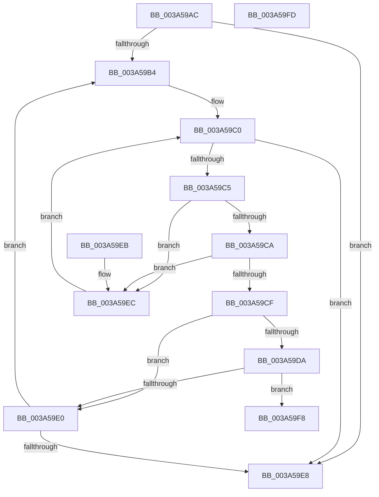

# SepGetScopedPolicySid

- RVA: `0x003A59AC`–`0x003A59FE` (길이 `82` bytes)
- VA: `0x00000001403A59AC`
- 실행 섹션: `.text`
- PDB 이름 있음: `예`; PDB Function 태그: `아니요`
- unwind 정보 RVA: `0x000DB714`
- 디코드: `31`개 명령, `82/82` bytes 표시
- 미해석 바이트: `0` (있으면 어셈블리에 `.byte`로 보존)

> 이 문서는 커널 이미지의 기계어와 PDB 기호를 분석해 생성했습니다. 4번과 5번은 함수 원형과 자료형을 바이너리 사용 방식에서 추정한 C 해석이며 원본 소스 복구 결과는 아닙니다.

## 1. Dependencies

- 직접 호출 지점: **0**; 고유 호출 대상: **0**
- 직접 호출자로 확인된 함수: **5**
- RIP 상대 이미지 참조: **0**

### Outgoing calls
- 직접 디코드된 call 명령이 없습니다.

### Direct callers
- [SeComputeCreatorDeniedRights](SeComputeCreatorDeniedRights_function_003A6080.md) at `0x003A620C`
- [SeAccessCheckWithHint](SeAccessCheckWithHint_function_003A6C30.md) at `0x003A6FF0`
- [SeAccessCheckByType](../44/SeAccessCheckByType_function_00440BC8.md) at `0x00441836`
- [SepCommonAccessCheckEx](../47/SepCommonAccessCheckEx_function_0047602C.md) at `0x00476669`
- [SepAccessCheckAndAuditAlarm](../../page/A1/SepAccessCheckAndAuditAlarm_function_00A1AF4C.md) at `0x00A1BBF0`

### Static image references
- 디코드된 RIP-relative 메모리 참조가 없습니다.

## 2. Other-region calls and transfers

- 다른 실행 섹션으로 향하는 call: **0**
- 별도 외부 분기/꼬리 이동을 확인하지 못했습니다.

## 3. Assembly (complete function range)

```asm
003A59AC  45 33 C0                        xor r8d, r8d
003A59AF  48 85 C9                        test rcx, rcx
003A59B2  74 34                           je 0x1403a59e8
003A59B4  44 0F B7 51 04                  movzx r10d, word ptr [rcx + 4]
003A59B9  48 8D 51 08                     lea rdx, [rcx + 8]
003A59BD  45 33 C9                        xor r9d, r9d
003A59C0  45 3B CA                        cmp r9d, r10d
003A59C3  73 23                           jae 0x1403a59e8
003A59C5  45 3B C8                        cmp r9d, r8d
003A59C8  72 22                           jb 0x1403a59ec
003A59CA  80 3A 13                        cmp byte ptr [rdx], 0x13
003A59CD  75 1D                           jne 0x1403a59ec
003A59CF  45 8B C1                        mov r8d, r9d
003A59D2  4C 8B CA                        mov r9, rdx
003A59D5  48 85 D2                        test rdx, rdx
003A59D8  74 06                           je 0x1403a59e0
003A59DA  F6 42 01 08                     test byte ptr [rdx + 1], 8
003A59DE  74 18                           je 0x1403a59f8
003A59E0  41 FF C0                        inc r8d
003A59E3  4D 85 C9                        test r9, r9
003A59E6  75 CC                           jne 0x1403a59b4
003A59E8  33 C0                           xor eax, eax
003A59EA  C3                              ret
003A59EB  CC                              int3
003A59EC  0F B7 42 02                     movzx eax, word ptr [rdx + 2]
003A59F0  41 FF C1                        inc r9d
003A59F3  48 03 D0                        add rdx, rax
003A59F6  EB C8                           jmp 0x1403a59c0
003A59F8  48 8D 42 08                     lea rax, [rdx + 8]
003A59FC  C3                              ret
003A59FD  CC                              int3
```

## 4. C-style interpretation (structured pseudocode)

```c
__int64 __fastcall SepGetScopedPolicySid(__int64 a1, __int64 a2, int a3, int a4)
{
    __int64 result;

    a3 = 0;
    if (a1 == 0) goto loc_003A59E8;
loc_003A59B4:
    a4 = 0;
loc_003A59C0:
    if (0 >= ((unsigned int)(*(unsigned __int16 *)(a1 + 4)))) goto loc_003A59E8;
    if (0 < 0) goto loc_003A59EC;
    if ((*(unsigned __int8 *)(a1 + 8)) != 19) goto loc_003A59EC;
    if (a1 + 8 == 0) goto loc_003A59E0;
    if (((*(unsigned __int8 *)(a1 + 8 + 1)) & (8)) == 0) goto loc_003A59F8;
loc_003A59E0:
    a3 = (unsigned int)((0) + 1);
    if (a1 + 8 != 0) goto loc_003A59B4;
loc_003A59E8:
    result = 0;
    return result;
loc_003A59EC:
    a4 = (unsigned int)((a1 + 8) + 1);
    a2 = (a1 + 8) + (*(unsigned __int16 *)(a1 + 8 + 2));
    goto loc_003A59C0;
loc_003A59F8:
    return a2 + 8;
}
```

## 5. (Beta) C Style

```c
int64_t SepGetScopedPolicySid(int64_t Arg1, int64_t Arg2, int32_t Arg3, int32_t Arg4)
{
    int64_t result;

    Arg3 = 0;
    if (Arg1 == 0) goto loc_003A59E8;
loc_003A59B4:
    Arg4 = 0;
loc_003A59C0:
    if (0 >= ((uint32_t)(*(uint16_t *)(Arg1 + 0x4)))) goto loc_003A59E8;
    if (0 < 0) goto loc_003A59EC;
    if ((*(uint8_t *)(Arg1 + 0x8)) != 19) goto loc_003A59EC;
    if (Arg1 + 8 == 0) goto loc_003A59E0;
    if (((*(uint8_t *)(Arg1 + 0x8 + 0x1)) & (8)) == 0) goto loc_003A59F8;
loc_003A59E0:
    Arg3 = (uint32_t)((0) + 1);
    if (Arg1 + 8 != 0) goto loc_003A59B4;
loc_003A59E8:
    result = 0;
    return result;
loc_003A59EC:
    Arg4 = (uint32_t)((Arg1 + 8) + 1);
    Arg2 = (Arg1 + 8) + (*(uint16_t *)(Arg1 + 0x8 + 0x2));
    goto loc_003A59C0;
loc_003A59F8:
    return Arg2 + 8;
}
```

## 6. Execution-region graph

[열기: 2D/3D 그래프와 함수 탐색 컨트롤 패널](../../../control-panel.html?section=text&rva=0x003A59AC&view=graph)

- 2D 그래프는 위에서 아래로 흐르고, 3D 그래프는 빈 공간을 드래그해 회전합니다. Shift+드래그는 이동, 휠은 확대·축소, 함수 노드 선택은 대상 보고서 이동입니다.

### Static fallback


