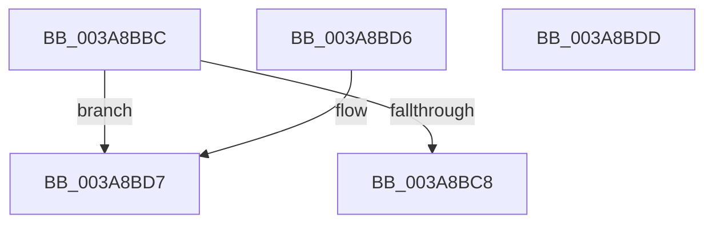

# SepInternalFillNoAttribs

- RVA: `0x003A8BBC`–`0x003A8BDE` (길이 `34` bytes)
- VA: `0x00000001403A8BBC`
- 실행 섹션: `.text`
- PDB 이름 있음: `예`; PDB Function 태그: `아니요`
- unwind 정보 RVA: `0x000DB714`
- 디코드: `12`개 명령, `34/34` bytes 표시
- 미해석 바이트: `0` (있으면 어셈블리에 `.byte`로 보존)

> 이 문서는 커널 이미지의 기계어와 PDB 기호를 분석해 생성했습니다. 4번과 5번은 함수 원형과 자료형을 바이너리 사용 방식에서 추정한 C 해석이며 원본 소스 복구 결과는 아닙니다.

## 1. Dependencies

- 직접 호출 지점: **0**; 고유 호출 대상: **0**
- 직접 호출자로 확인된 함수: **1**
- RIP 상대 이미지 참조: **0**

### Outgoing calls
- 직접 디코드된 call 명령이 없습니다.

### Direct callers
- [sub_003A7C07](Unknown_function_003A7C07.md) at `0x003A7C88`

### Static image references
- 디코드된 RIP-relative 메모리 참조가 없습니다.

## 2. Other-region calls and transfers

- 다른 실행 섹션으로 향하는 call: **0**
- 별도 외부 분기/꼬리 이동을 확인하지 못했습니다.

## 3. Assembly (complete function range)

```asm
003A8BBC  41 C7 00 10 00 00 00            mov dword ptr [r8], 0x10
003A8BC3  83 FA 10                        cmp edx, 0x10
003A8BC6  72 0F                           jb 0x1403a8bd7
003A8BC8  0F 57 C0                        xorps xmm0, xmm0
003A8BCB  33 C0                           xor eax, eax
003A8BCD  0F 11 01                        movups xmmword ptr [rcx], xmm0
003A8BD0  66 C7 01 01 00                  mov word ptr [rcx], 1
003A8BD5  C3                              ret
003A8BD6  CC                              int3
003A8BD7  B8 23 00 00 C0                  mov eax, 0xc0000023
003A8BDC  C3                              ret
003A8BDD  CC                              int3
```

## 4. C-style interpretation (structured pseudocode)

```c
__int64 __fastcall SepInternalFillNoAttribs(__int64 a1, int a2, __int64 a3)
{
    __int64 result;

    *(unsigned int *)(a3) = 16;
    if (a2 < 16) goto loc_003A8BD7;
    result = 0;
    *(unsigned __int64 *)(a1) = v_xmm0;
    *(unsigned __int16 *)(a1) = 1;
    return result;
loc_003A8BD7:
    return (unsigned int)(0xC0000023ULL);
}
```

## 5. (Beta) C Style

```c
int64_t SepInternalFillNoAttribs(void *Arg1, int32_t Arg2, void *Arg3)
{
    uint8_t *arg1 = (uint8_t *)Arg1;
    uint8_t *arg3 = (uint8_t *)Arg3;

    int64_t result;

    *(uint32_t *)(arg3) = 16;
    if (Arg2 < 16) goto loc_003A8BD7;
    result = 0;
    *(uint64_t *)(arg1) = v_xmm0;
    *(uint16_t *)(arg1) = 1;
    return result;
loc_003A8BD7:
    return (uint32_t)(0xC0000023ULL);
}
```

### 관측된 메모리 오프셋

구조체 형식이 확인되지 않은 접근은 인자 기준의 오프셋으로만 기록했습니다.

| 기준 인자 | 오프셋 표현 | 폭 (bit) | 접근 |
|---|---:|---:|---|
| `Arg1` | `+ 0x0` | `16` | `W` |
| `Arg1` | `+ 0x0` | `128` | `R` |
| `Arg3` | `+ 0x0` | `32` | `W` |

## 6. Execution-region graph

[열기: 2D/3D 그래프와 함수 탐색 컨트롤 패널](../../../control-panel.html?section=text&rva=0x003A8BBC&view=graph)

- 2D 그래프는 위에서 아래로 흐르고, 3D 그래프는 빈 공간을 드래그해 회전합니다. Shift+드래그는 이동, 휠은 확대·축소, 함수 노드 선택은 대상 보고서 이동입니다.

### Static fallback


