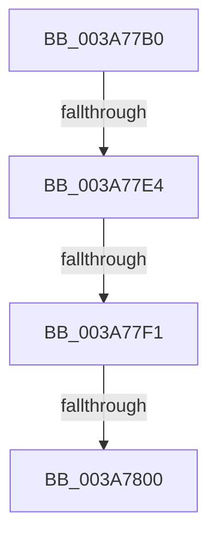

# SepInternalQuerySecurityAttributesTokenEx

- RVA: `0x003A77B0`–`0x003A7809` (길이 `89` bytes)
- VA: `0x00000001403A77B0`
- 실행 섹션: `.text`
- PDB 이름 있음: `예`; PDB Function 태그: `아니요`
- unwind 정보 RVA: `0x00089BA0`
- 디코드: `26`개 명령, `89/89` bytes 표시
- 미해석 바이트: `0` (있으면 어셈블리에 `.byte`로 보존)

> 이 문서는 커널 이미지의 기계어와 PDB 기호를 분석해 생성했습니다. 4번과 5번은 함수 원형과 자료형을 바이너리 사용 방식에서 추정한 C 해석이며 원본 소스 복구 결과는 아닙니다.

## 1. Dependencies

- 직접 호출 지점: **0**; 고유 호출 대상: **0**
- 직접 호출자로 확인된 함수: **4**
- RIP 상대 이미지 참조: **1**

### Outgoing calls
- 직접 디코드된 call 명령이 없습니다.

### Direct callers
- [SeQuerySecurityAttributesTokenAccessInformation](SeQuerySecurityAttributesTokenAccessInformation_function_003A5F90.md) at `0x003A6013`
- [NtQuerySecurityAttributesToken](../../page/97/NtQuerySecurityAttributesToken_function_00972C80.md) at `0x00972E7B`
- [NtQuerySecurityAttributesToken](../../page/97/NtQuerySecurityAttributesToken_function_00972C80.md) at `0x00972F31`
- [SeQuerySecurityAttributesToken](../../page/9F/SeQuerySecurityAttributesToken_function_009F6410.md) at `0x009F647F`
- [NtQueryInformationToken](../../page/AE/NtQueryInformationToken_function_00AECDD0.md) at `0x00AEFC49`

### Static image references
- `0x003A77F1` → RVA `0x00E08960` (`.data`; read)

## 2. Other-region calls and transfers

- 다른 실행 섹션으로 향하는 call: **0**
- call이 아닌 외부 분기/꼬리 이동: **4**
  - `0x003A77E2` → [sub_003A7809](Unknown_function_003A7809.md) (`tail-transfer`)
  - `0x003A77EB` → [sub_003A7AB1](Unknown_function_003A7AB1.md) (`tail-transfer`)
  - `0x003A77FE` → [sub_003A7809](Unknown_function_003A7809.md) (`tail-transfer`)
  - `0x003A7803` → [sub_003A7B8C](Unknown_function_003A7B8C.md) (`tail-transfer`)

## 3. Assembly (complete function range)

```asm
003A77B0  48 8B C4                        mov rax, rsp
003A77B3  44 89 48 20                     mov dword ptr [rax + 0x20], r9d
003A77B7  88 50 10                        mov byte ptr [rax + 0x10], dl
003A77BA  53                              push rbx
003A77BB  55                              push rbp
003A77BC  56                              push rsi
003A77BD  57                              push rdi
003A77BE  41 54                           push r12
003A77C0  41 56                           push r14
003A77C2  48 83 EC 48                     sub rsp, 0x48
003A77C6  33 DB                           xor ebx, ebx
003A77C8  41 8B F9                        mov edi, r9d
003A77CB  F7 81 C8 00 00 00 00 00 02 00   test dword ptr [rcx + 0xc8], 0x20000
003A77D5  4D 8B E0                        mov r12, r8
003A77D8  48 8B F1                        mov rsi, rcx
003A77DB  48 89 58 08                     mov qword ptr [rax + 8], rbx
003A77DF  89 58 10                        mov dword ptr [rax + 0x10], ebx
003A77E2  75 25                           jne 0x1403a7809
003A77E4  38 9C 24 A0 00 00 00            cmp byte ptr [rsp + 0xa0], bl
003A77EB  0F 85 C0 02 00 00               jne 0x1403a7ab1
003A77F1  48 8B 05 68 11 A6 00            mov rax, qword ptr [rip + 0xa61168]
003A77F8  8B 50 10                        mov edx, dword ptr [rax + 0x10]
003A77FB  F6 C2 01                        test dl, 1
003A77FE  74 09                           je 0x1403a7809
003A7800  4D 85 C0                        test r8, r8
003A7803  0F 85 83 03 00 00               jne 0x1403a7b8c
```

## 4. C-style interpretation (structured pseudocode)

```c
__int64 __fastcall SepInternalQuerySecurityAttributesTokenEx(__int64 a1, unsigned __int8 a2, __int64 a3, int a4, unsigned __int8 a5)
{
    __int64 v_rbx;
    __int64 v_rsp;

    *(unsigned int *)(v_rsp + 32) = a4;
    *(unsigned __int8 *)(v_rsp + 16) = a2;
    v_rsp = (v_rsp) - (72);
    v_rbx = 0;
    *(unsigned __int64 *)(v_rsp + 8) = 0;
    *(unsigned int *)(v_rsp + 16) = 0;
}
```

## 5. (Beta) C Style

```c
int64_t SepInternalQuerySecurityAttributesTokenEx(void *Arg1, uint8_t Arg2, int64_t Arg3, int32_t Arg4, uint8_t Arg5)
{
    uint8_t *arg1 = (uint8_t *)Arg1;

    int64_t local_rbx;
    int64_t local_rsp;

    *(uint32_t *)(local_rsp + 0x20) = Arg4;
    *(uint8_t *)(local_rsp + 0x10) = Arg2;
    local_rsp = (local_rsp) - (72);
    local_rbx = 0;
    *(uint64_t *)(local_rsp + 0x8) = 0;
    *(uint32_t *)(local_rsp + 0x10) = 0;
}
```

### 관측된 메모리 오프셋

구조체 형식이 확인되지 않은 접근은 인자 기준의 오프셋으로만 기록했습니다.

| 기준 인자 | 오프셋 표현 | 폭 (bit) | 접근 |
|---|---:|---:|---|
| `Arg1` | `+ 0xC8` | `32` | `R` |

## 6. Execution-region graph

[열기: 2D/3D 그래프와 함수 탐색 컨트롤 패널](../../../control-panel.html?section=text&rva=0x003A77B0&view=graph)

- 2D 그래프는 위에서 아래로 흐르고, 3D 그래프는 빈 공간을 드래그해 회전합니다. Shift+드래그는 이동, 휠은 확대·축소, 함수 노드 선택은 대상 보고서 이동입니다.

### Static fallback


