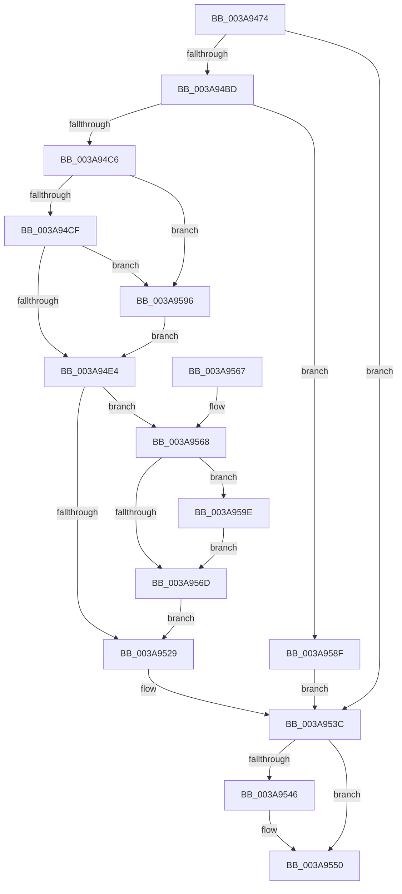

# SepInternalSetSecurityAttributesToken

- RVA: `0x003A9474`–`0x003A95A8` (길이 `308` bytes)
- VA: `0x00000001403A9474`
- 실행 섹션: `.text`
- PDB 이름 있음: `예`; PDB Function 태그: `아니요`
- unwind 정보 RVA: `0x00089F54`
- 디코드: `78`개 명령, `308/308` bytes 표시
- 미해석 바이트: `0` (있으면 어셈블리에 `.byte`로 보존)

> 이 문서는 커널 이미지의 기계어와 PDB 기호를 분석해 생성했습니다. 4번과 5번은 함수 원형과 자료형을 바이너리 사용 방식에서 추정한 C 해석이며 원본 소스 복구 결과는 아닙니다.

## 1. Dependencies

- 직접 호출 지점: **7**; 고유 호출 대상: **7**
- 직접 호출자로 확인된 함수: **2**
- RIP 상대 이미지 참조: **3**

### Outgoing calls
- `0x003A94B2` → [ObReferenceObjectByHandle](../../page/86/ObReferenceObjectByHandle_function_00868DB0.md) (function, `0x00868DB0`)
- `0x003A94D7` → [SepShouldSetDelinkFlags](../../page/A5/SepShouldSetDelinkFlags_function_00A5030C.md) (function, `0x00A5030C`)
- `0x003A9500` → [ExAcquireResourceExclusiveLite](../21/ExAcquireResourceExclusiveLite_function_00214E20.md) (function, `0x00214E20`)
- `0x003A951E` → [AuthzBasepSetSecurityAttributesToken](AuthzBasepSetSecurityAttributesToken_function_003A8D1C.md) (function, `0x003A8D1C`)
- `0x003A9532` → [ExReleaseResourceLite](../25/ExReleaseResourceLite_function_0025FA10.md) (function, `0x0025FA10`)
- `0x003A9537` → [KeLeaveCriticalRegion](../25/KeLeaveCriticalRegion_function_0025D8B0.md) (function, `0x0025D8B0`)
- `0x003A954B` → [ObfDereferenceObjectWithTag](../2F/ObfDereferenceObjectWithTag_function_002F78E0.md) (function, `0x002F78E0`)

### Direct callers
- [SeSetSecurityAttributesTokenEx](../60/SeSetSecurityAttributesTokenEx_function_00609C00.md) at `0x00609D7F`
- [SeSetSecurityAttributesToken](../../page/A7/SeSetSecurityAttributesToken_function_00A72140.md) at `0x00A7214F`

### Static image references
- `0x003A94A8` → RVA `0x00FD8020` (`PAGEDATA`; read)
- `0x003A956D` → RVA `0x00012D08` (`.rdata`; read)
- `0x003A9577` → RVA `0x00E0EBF0` (`.data`; read/write)

## 2. Other-region calls and transfers

- 다른 실행 섹션으로 향하는 call: **2**
  - `0x003A94B2` → [ObReferenceObjectByHandle](../../page/86/ObReferenceObjectByHandle_function_00868DB0.md) (`.text` → `PAGE`)
  - `0x003A94D7` → [SepShouldSetDelinkFlags](../../page/A5/SepShouldSetDelinkFlags_function_00A5030C.md) (`.text` → `PAGE`)
- 별도 외부 분기/꼬리 이동을 확인하지 못했습니다.

## 3. Assembly (complete function range)

```asm
003A9474  4C 8B DC                        mov r11, rsp
003A9477  49 89 5B 08                     mov qword ptr [r11 + 8], rbx
003A947B  49 89 6B 10                     mov qword ptr [r11 + 0x10], rbp
003A947F  49 89 73 18                     mov qword ptr [r11 + 0x18], rsi
003A9483  57                              push rdi
003A9484  48 83 EC 40                     sub rsp, 0x40
003A9488  49 83 63 E0 00                  and qword ptr [r11 - 0x20], 0
003A948D  49 8D 43 E8                     lea rax, [r11 - 0x18]
003A9491  49 83 63 E8 00                  and qword ptr [r11 - 0x18], 0
003A9496  49 8B D9                        mov rbx, r9
003A9499  44 8A CA                        mov r9b, dl
003A949C  49 89 43 D8                     mov qword ptr [r11 - 0x28], rax
003A94A0  41 8A E8                        mov bpl, r8b
003A94A3  BA 80 00 00 00                  mov edx, 0x80
003A94A8  4C 8B 05 71 EB C2 00            mov r8, qword ptr [rip + 0xc2eb71]
003A94AF  40 32 F6                        xor sil, sil
003A94B2  E8 F9 F8 4B 00                  call 0x140868db0
003A94B7  8B F8                           mov edi, eax
003A94B9  85 C0                           test eax, eax
003A94BB  78 7F                           js 0x1403a953c
003A94BD  48 85 DB                        test rbx, rbx
003A94C0  0F 84 C9 00 00 00               je 0x1403a958f
003A94C6  40 84 ED                        test bpl, bpl
003A94C9  0F 85 C7 00 00 00               jne 0x1403a9596
003A94CF  48 8B 54 24 70                  mov rdx, qword ptr [rsp + 0x70]
003A94D4  48 8B CB                        mov rcx, rbx
003A94D7  E8 30 6E 6A 00                  call 0x140a5030c
003A94DC  84 C0                           test al, al
003A94DE  0F 85 B2 00 00 00               jne 0x1403a9596
003A94E4  65 48 8B 04 25 88 01 00 00      mov rax, qword ptr gs:[0x188]
003A94ED  B2 01                           mov dl, 1
003A94EF  48 8B 6C 24 30                  mov rbp, qword ptr [rsp + 0x30]
003A94F4  66 FF 88 E4 01 00 00            dec word ptr [rax + 0x1e4]
003A94FB  90                              nop
003A94FC  48 8B 4D 30                     mov rcx, qword ptr [rbp + 0x30]
003A9500  E8 1B B9 E6 FF                  call 0x140214e20
003A9505  F0 83 0C 24 00                  lock or dword ptr [rsp], 0
003A950A  4C 8B 44 24 70                  mov r8, qword ptr [rsp + 0x70]
003A950F  48 8B D3                        mov rdx, rbx
003A9512  48 8B 5C 24 30                  mov rbx, qword ptr [rsp + 0x30]
003A9517  48 8B 8B 08 03 00 00            mov rcx, qword ptr [rbx + 0x308]
003A951E  E8 F9 F7 FF FF                  call 0x1403a8d1c
003A9523  8B F8                           mov edi, eax
003A9525  85 C0                           test eax, eax
003A9527  79 3F                           jns 0x1403a9568
003A9529  F0 83 0C 24 00                  lock or dword ptr [rsp], 0
003A952E  48 8B 4D 30                     mov rcx, qword ptr [rbp + 0x30]
003A9532  E8 D9 64 EB FF                  call 0x14025fa10
003A9537  E8 74 43 EB FF                  call 0x14025d8b0
003A953C  48 8B 4C 24 30                  mov rcx, qword ptr [rsp + 0x30]
003A9541  48 85 C9                        test rcx, rcx
003A9544  74 0A                           je 0x1403a9550
003A9546  BA 44 66 6C 74                  mov edx, 0x746c6644
003A954B  E8 90 E3 F4 FF                  call 0x1402f78e0
003A9550  48 8B 5C 24 50                  mov rbx, qword ptr [rsp + 0x50]
003A9555  8B C7                           mov eax, edi
003A9557  48 8B 6C 24 58                  mov rbp, qword ptr [rsp + 0x58]
003A955C  48 8B 74 24 60                  mov rsi, qword ptr [rsp + 0x60]
003A9561  48 83 C4 40                     add rsp, 0x40
003A9565  5F                              pop rdi
003A9566  C3                              ret
003A9567  CC                              int3
003A9568  40 84 F6                        test sil, sil
003A956B  75 31                           jne 0x1403a959e
003A956D  48 8B 15 94 97 C6 FF            mov rdx, qword ptr [rip - 0x39686c]
003A9574  48 8B C2                        mov rax, rdx
003A9577  F0 48 0F C1 05 70 56 A6 00      lock xadd qword ptr [rip + 0xa65670], rax
003A9580  48 03 C2                        add rax, rdx
003A9583  89 43 38                        mov dword ptr [rbx + 0x38], eax
003A9586  48 C1 E8 20                     shr rax, 0x20
003A958A  89 43 3C                        mov dword ptr [rbx + 0x3c], eax
003A958D  EB 9A                           jmp 0x1403a9529
003A958F  BF 0D 00 00 C0                  mov edi, 0xc000000d
003A9594  EB A6                           jmp 0x1403a953c
003A9596  40 B6 01                        mov sil, 1
003A9599  E9 46 FF FF FF                  jmp 0x1403a94e4
003A959E  0F BA AB C8 00 00 00 11         bts dword ptr [rbx + 0xc8], 0x11
003A95A6  EB C5                           jmp 0x1403a956d
```

## 4. C-style interpretation (structured pseudocode)

```c
__int64 __fastcall SepInternalSetSecurityAttributesToken(__int64 a1, unsigned __int8 a2, unsigned __int8 a3, __int64 a4, __int64 a5)
{
    __int64 result;
    __int64 v_rsi;
    __int64 v_rsp;
    unsigned __int64 v_stack_m18;
    unsigned int v_stack_m48;
    unsigned __int64 v_stack_p10;
    unsigned __int64 v_stack_p18;
    unsigned __int64 v_stack_p8;

    *(unsigned __int64 *)(v_rsp + 8) = v_rbx;
    *(unsigned __int64 *)(v_rsp + 16) = v_rbp;
    *(unsigned __int64 *)(v_rsp + 24) = v_rsi;
    v_rsp = (v_rsp) - (64);
    *(unsigned __int64 *)(v_rsp - 40) = v_rsp - 24;
    v_rsi = 0;
    result = ObReferenceObjectByHandle(a1, 128, *(unsigned __int64 *)(v_rip + 12774257), a2);
    if (sign_flag) goto loc_003A953C;
    if (a4 == 0) goto loc_003A958F;
    if (a3 != 0) goto loc_003A9596;
    result = SepShouldSetDelinkFlags(a4, a5, *(unsigned __int64 *)(v_rip + 12774257), a2);
    if ((unsigned __int8)(result) != 0) goto loc_003A9596;
loc_003A94E4:
    result = ExAcquireResourceExclusiveLite(*(unsigned __int64 *)(v_stack_m18 + 48), 1, *(unsigned __int64 *)(v_rip + 12774257), a2);
    result = AuthzBasepSetSecurityAttributesToken(*(unsigned __int64 *)(v_stack_m18 + 776), a4, a5, a2);
    if (!sign_flag) goto loc_003A9568;
loc_003A9529:
    result = ExReleaseResourceLite(*(unsigned __int64 *)(v_stack_m18 + 48), a4, a5, a2);
    result = KeLeaveCriticalRegion(*(unsigned __int64 *)(v_stack_m18 + 48), a4, a5, a2);
loc_003A953C:
    if (v_stack_m18 != 0) {
        a2 = 0x746C6644ULL;
        result = ObfDereferenceObjectWithTag(v_stack_m18, a2, a5, a2);
    }
    v_rsp = (v_rsp) + (64);
    return (unsigned int)((unsigned int)((unsigned int)((unsigned int)(result))));
loc_003A9568:
    if ((unsigned __int8)(v_stack_p18) != 0) goto loc_003A959E;
loc_003A956D:
    result = (*(unsigned __int64 *)(v_rip - 3762284)) + (*(unsigned __int64 *)(v_rip - 3762284));
    *(unsigned int *)(v_stack_p8 + 56) = (unsigned int)(result);
    result = (result) >> (32);
    *(unsigned int *)(v_stack_p8 + 60) = (unsigned int)(result);
    goto loc_003A9529;
loc_003A958F:
    goto loc_003A953C;
loc_003A9596:
    goto loc_003A94E4;
loc_003A959E:
    goto loc_003A956D;
}
```

## 5. (Beta) C Style

```c
int64_t SepInternalSetSecurityAttributesToken(int64_t Arg1, uint8_t Arg2, uint8_t Arg3, int64_t Arg4, int64_t Arg5)
{
    int64_t result;
    int64_t local_rsi;
    int64_t local_rsp;
    uint64_t v_stack_m18;
    uint32_t v_stack_m48;
    uint64_t v_stack_p10;
    uint64_t v_stack_p18;
    uint64_t v_stack_p8;

    *(uint64_t *)(local_rsp + 0x8) = local_rbx;
    *(uint64_t *)(local_rsp + 0x10) = local_rbp;
    *(uint64_t *)(local_rsp + 0x18) = local_rsi;
    local_rsp = (local_rsp) - (64);
    *(uint64_t *)(local_rsp - 0x28) = local_rsp - 24;
    local_rsi = 0;
    result = ObReferenceObjectByHandle(Arg1, 128, *(uint64_t *)(v_rip + 0xC2EB71), Arg2);
    if (sign_flag) goto loc_003A953C;
    if (Arg4 == 0) goto loc_003A958F;
    if (Arg3 != 0) goto loc_003A9596;
    result = SepShouldSetDelinkFlags(Arg4, Arg5, *(uint64_t *)(v_rip + 0xC2EB71), Arg2);
    if ((uint8_t)(result) != 0) goto loc_003A9596;
loc_003A94E4:
    result = ExAcquireResourceExclusiveLite(*(uint64_t *)(v_stack_m18 + 0x30), 1, *(uint64_t *)(v_rip + 0xC2EB71), Arg2);
    result = AuthzBasepSetSecurityAttributesToken(*(uint64_t *)(v_stack_m18 + 0x308), Arg4, Arg5, Arg2);
    if (!sign_flag) goto loc_003A9568;
loc_003A9529:
    result = ExReleaseResourceLite(*(uint64_t *)(v_stack_m18 + 0x30), Arg4, Arg5, Arg2);
    result = KeLeaveCriticalRegion(*(uint64_t *)(v_stack_m18 + 0x30), Arg4, Arg5, Arg2);
loc_003A953C:
    if (v_stack_m18 != 0) {
        Arg2 = 0x746C6644ULL;
        result = ObfDereferenceObjectWithTag(v_stack_m18, Arg2, Arg5, Arg2);
    }
    local_rsp = (local_rsp) + (64);
    return (uint32_t)((uint32_t)((uint32_t)((uint32_t)(result))));
loc_003A9568:
    if ((uint8_t)(v_stack_p18) != 0) goto loc_003A959E;
loc_003A956D:
    result = (*(uint64_t *)(v_rip - 0x39686C)) + (*(uint64_t *)(v_rip - 0x39686C));
    *(uint32_t *)(v_stack_p8 + 0x38) = (uint32_t)(result);
    result = (result) >> (32);
    *(uint32_t *)(v_stack_p8 + 0x3C) = (uint32_t)(result);
    goto loc_003A9529;
loc_003A958F:
    goto loc_003A953C;
loc_003A9596:
    goto loc_003A94E4;
loc_003A959E:
    goto loc_003A956D;
}
```

## 6. Execution-region graph

[열기: 2D/3D 그래프와 함수 탐색 컨트롤 패널](../../../control-panel.html?section=text&rva=0x003A9474&view=graph)

- 2D 그래프는 위에서 아래로 흐르고, 3D 그래프는 빈 공간을 드래그해 회전합니다. Shift+드래그는 이동, 휠은 확대·축소, 함수 노드 선택은 대상 보고서 이동입니다.

### Static fallback


