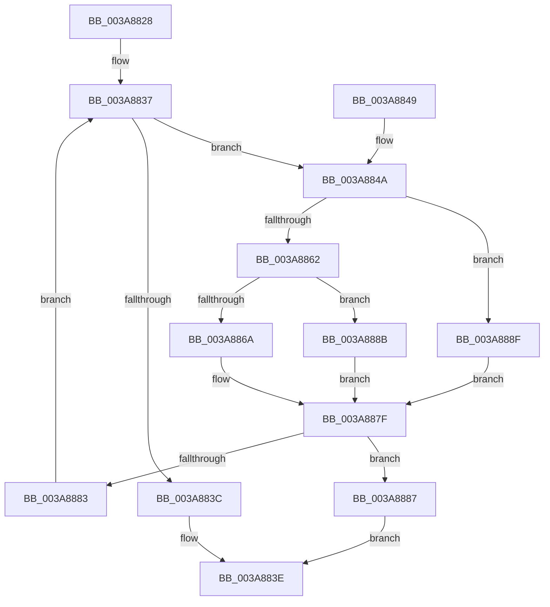

# SepPotentialGlobalTableAttribute

- RVA: `0x003A8828`–`0x003A889C` (길이 `116` bytes)
- VA: `0x00000001403A8828`
- 실행 섹션: `.text`
- PDB 이름 있음: `예`; PDB Function 태그: `아니요`
- unwind 정보 RVA: `0x00089E2C`
- 디코드: `41`개 명령, `116/116` bytes 표시
- 미해석 바이트: `0` (있으면 어셈블리에 `.byte`로 보존)

> 이 문서는 커널 이미지의 기계어와 PDB 기호를 분석해 생성했습니다. 4번과 5번은 함수 원형과 자료형을 바이너리 사용 방식에서 추정한 C 해석이며 원본 소스 복구 결과는 아닙니다.

## 1. Dependencies

- 직접 호출 지점: **2**; 고유 호출 대상: **2**
- 직접 호출자로 확인된 함수: **3**
- RIP 상대 이미지 참조: **1**

### Outgoing calls
- `0x003A8875` → [memcmp](../6C/memcmp_function_006C6B10.md) (function, `0x006C6B10`)
- `0x003A8895` → [RtlPrefixUnicodeString](../../page/8F/RtlPrefixUnicodeString_function_008F4F70.md) (function, `0x008F4F70`)

### Direct callers
- [AuthzBasepEvaluateAceCondition](../2F/AuthzBasepEvaluateAceCondition_function_002FEBD0.md) at `0x002FF40B`
- [sub_003A7B8C](Unknown_function_003A7B8C.md) at `0x003A7BA3`
- [SepShouldSetDelinkFlags](../../page/A5/SepShouldSetDelinkFlags_function_00A5030C.md) at `0x00A5033F`

### Static image references
- `0x003A884C` → RVA `0x00E08968` (`.data`; read)

## 2. Other-region calls and transfers

- 다른 실행 섹션으로 향하는 call: **1**
  - `0x003A8895` → [RtlPrefixUnicodeString](../../page/8F/RtlPrefixUnicodeString_function_008F4F70.md) (`.text` → `PAGE`)
- 별도 외부 분기/꼬리 이동을 확인하지 못했습니다.

## 3. Assembly (complete function range)

```asm
003A8828  48 89 5C 24 08                  mov qword ptr [rsp + 8], rbx
003A882D  57                              push rdi
003A882E  48 83 EC 20                     sub rsp, 0x20
003A8832  48 8B F9                        mov rdi, rcx
003A8835  33 DB                           xor ebx, ebx
003A8837  83 FB 01                        cmp ebx, 1
003A883A  72 0E                           jb 0x1403a884a
003A883C  32 C0                           xor al, al
003A883E  48 8B 5C 24 30                  mov rbx, qword ptr [rsp + 0x30]
003A8843  48 83 C4 20                     add rsp, 0x20
003A8847  5F                              pop rdi
003A8848  C3                              ret
003A8849  CC                              int3
003A884A  8B CB                           mov ecx, ebx
003A884C  48 8D 05 15 01 A6 00            lea rax, [rip + 0xa60115]
003A8853  48 C1 E1 04                     shl rcx, 4
003A8857  48 03 C8                        add rcx, rax
003A885A  44 0F 20 C0                     mov rax, cr8
003A885E  3C 02                           cmp al, 2
003A8860  72 2D                           jb 0x1403a888f
003A8862  0F B7 01                        movzx eax, word ptr [rcx]
003A8865  66 3B 07                        cmp ax, word ptr [rdi]
003A8868  77 21                           ja 0x1403a888b
003A886A  48 8B 57 08                     mov rdx, qword ptr [rdi + 8]
003A886E  44 8B C0                        mov r8d, eax
003A8871  48 8B 49 08                     mov rcx, qword ptr [rcx + 8]
003A8875  E8 96 E2 31 00                  call 0x1406c6b10
003A887A  85 C0                           test eax, eax
003A887C  0F 94 C0                        sete al
003A887F  84 C0                           test al, al
003A8881  75 04                           jne 0x1403a8887
003A8883  FF C3                           inc ebx
003A8885  EB B0                           jmp 0x1403a8837
003A8887  B0 01                           mov al, 1
003A8889  EB B3                           jmp 0x1403a883e
003A888B  32 C0                           xor al, al
003A888D  EB F0                           jmp 0x1403a887f
003A888F  41 B0 01                        mov r8b, 1
003A8892  48 8B D7                        mov rdx, rdi
003A8895  E8 D6 C6 54 00                  call 0x1408f4f70
003A889A  EB E3                           jmp 0x1403a887f
```

## 4. C-style interpretation (structured pseudocode)

```c
__int64 __fastcall SepPotentialGlobalTableAttribute(__int64 a1)
{
    __int64 result;
    __int64 v_rbx;
    __int64 v_rsp;
    unsigned __int64 v_stack_p8;

    v_stack_p8 = v_rbx;
    v_rsp = (v_rsp) - (32);
    v_rbx = 0;
loc_003A8837:
    if (0 < 1) goto loc_003A884A;
    result = 0;
loc_003A883E:
    v_rsp = (v_rsp) + (32);
    return result;
loc_003A884A:
    a1 = ((unsigned int)((unsigned int)(v_stack_p8))) << (4);
    a1 = (a1) + (v_rip + 10879253);
    if (((unsigned __int8)(v_cr8)) < 2) goto loc_003A888F;
    if (((unsigned __int16)(*(unsigned __int16 *)(a1))) > (*(unsigned __int16 *)(a1))) goto loc_003A888B;
    result = memcmp(*(unsigned __int64 *)(a1 + 8), *(unsigned __int64 *)(a1 + 8), (unsigned int)((unsigned int)(*(unsigned __int16 *)(a1))), a4);
    result = ((unsigned int)(result) == 0) ? 1 : 0;
loc_003A887F:
    if ((unsigned __int8)(result) != 0) goto loc_003A8887;
    v_rbx = (unsigned int)((v_stack_p8) + 1);
    goto loc_003A8837;
loc_003A8887:
    goto loc_003A883E;
loc_003A888B:
    result = 0;
    goto loc_003A887F;
loc_003A888F:
    result = RtlPrefixUnicodeString(*(unsigned __int64 *)(a1 + 8), a1, 1, a4);
    goto loc_003A887F;
}
```

## 5. (Beta) C Style

```c
int64_t SepPotentialGlobalTableAttribute(void *Arg1)
{
    uint8_t *arg1 = (uint8_t *)Arg1;

    int64_t result;
    int64_t local_rbx;
    int64_t local_rsp;
    uint64_t v_stack_p8;

    v_stack_p8 = local_rbx;
    local_rsp = (local_rsp) - (32);
    local_rbx = 0;
loc_003A8837:
    if (0 < 1) goto loc_003A884A;
    result = 0;
loc_003A883E:
    local_rsp = (local_rsp) + (32);
    return result;
loc_003A884A:
    Arg1 = ((uint32_t)((uint32_t)(v_stack_p8))) << (4);
    Arg1 = (Arg1) + (v_rip + 10879253);
    if (((uint8_t)(v_cr8)) < 2) goto loc_003A888F;
    if (((uint16_t)(*(uint16_t *)(arg1))) > (*(uint16_t *)(arg1))) goto loc_003A888B;
    result = memcmp(*(uint64_t *)(arg1 + 0x8), *(uint64_t *)(arg1 + 0x8), (uint32_t)((uint32_t)(*(uint16_t *)(arg1))), a4);
    result = ((uint32_t)(result) == 0) ? 1 : 0;
loc_003A887F:
    if ((uint8_t)(result) != 0) goto loc_003A8887;
    local_rbx = (uint32_t)((v_stack_p8) + 1);
    goto loc_003A8837;
loc_003A8887:
    goto loc_003A883E;
loc_003A888B:
    result = 0;
    goto loc_003A887F;
loc_003A888F:
    result = RtlPrefixUnicodeString(*(uint64_t *)(arg1 + 0x8), Arg1, 1, a4);
    goto loc_003A887F;
}
```

### 관측된 메모리 오프셋

구조체 형식이 확인되지 않은 접근은 인자 기준의 오프셋으로만 기록했습니다.

| 기준 인자 | 오프셋 표현 | 폭 (bit) | 접근 |
|---|---:|---:|---|
| `Arg1` | `+ 0x0` | `16` | `R` |
| `Arg1` | `+ 0x8` | `64` | `R` |

## 6. Execution-region graph

[열기: 2D/3D 그래프와 함수 탐색 컨트롤 패널](../../../control-panel.html?section=text&rva=0x003A8828&view=graph)

- 2D 그래프는 위에서 아래로 흐르고, 3D 그래프는 빈 공간을 드래그해 회전합니다. Shift+드래그는 이동, 휠은 확대·축소, 함수 노드 선택은 대상 보고서 이동입니다.

### Static fallback


