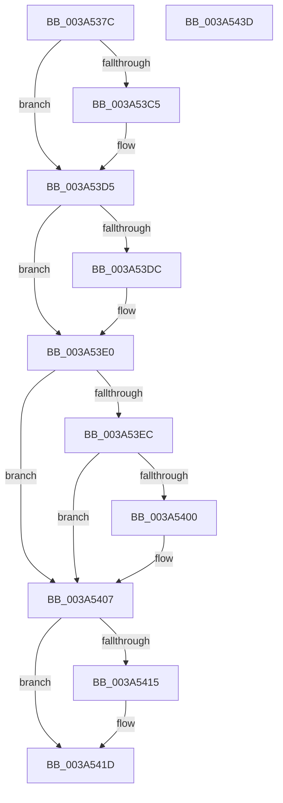

# SepRmReferenceCapTable

- RVA: `0x003A537C`–`0x003A543E` (길이 `194` bytes)
- VA: `0x00000001403A537C`
- 실행 섹션: `.text`
- PDB 이름 있음: `예`; PDB Function 태그: `아니요`
- unwind 정보 RVA: `0x0005FD94`
- 디코드: `51`개 명령, `194/194` bytes 표시
- 미해석 바이트: `0` (있으면 어셈블리에 `.byte`로 보존)

> 이 문서는 커널 이미지의 기계어와 PDB 기호를 분석해 생성했습니다. 4번과 5번은 함수 원형과 자료형을 바이너리 사용 방식에서 추정한 C 해석이며 원본 소스 복구 결과는 아닙니다.

## 1. Dependencies

- 직접 호출 지점: **5**; 고유 호출 대상: **5**
- 직접 호출자로 확인된 함수: **1**
- RIP 상대 이미지 참조: **2**

### Outgoing calls
- `0x003A53AB` → [KeAbPreAcquire](../21/KeAbPreAcquire_function_00210230.md) (function, `0x00210230`)
- `0x003A53D0` → [ExfAcquirePushLockSharedEx](../21/ExfAcquirePushLockSharedEx_function_0021044C.md) (function, `0x0021044C`)
- `0x003A5418` → [ExfReleasePushLockShared](../26/ExfReleasePushLockShared_function_00263440.md) (function, `0x00263440`)
- `0x003A5420` → [KeAbPostRelease](../2E/KeAbPostRelease_function_002E1600.md) (function, `0x002E1600`)
- `0x003A5425` → [KeLeaveCriticalRegion](../25/KeLeaveCriticalRegion_function_0025D8B0.md) (function, `0x0025D8B0`)

### Direct callers
- [SepRmReferenceFindCap](SepRmReferenceFindCap_function_003A58EC.md) at `0x003A5921`

### Static image references
- `0x003A5394` → RVA `0x00F04AD0` (`.data`; read)
- `0x003A53E0` → RVA `0x00FD80F8` (`PAGEDATA`; read)

## 2. Other-region calls and transfers

- 다른 실행 섹션으로 향하는 call: **0**
- 별도 외부 분기/꼬리 이동을 확인하지 못했습니다.

## 3. Assembly (complete function range)

```asm
003A537C  48 89 5C 24 10                  mov qword ptr [rsp + 0x10], rbx
003A5381  48 89 74 24 18                  mov qword ptr [rsp + 0x18], rsi
003A5386  57                              push rdi
003A5387  48 83 EC 20                     sub rsp, 0x20
003A538B  65 48 8B 04 25 88 01 00 00      mov rax, qword ptr gs:[0x188]
003A5394  48 8D 3D 35 F7 B5 00            lea rdi, [rip + 0xb5f735]
003A539B  45 33 C0                        xor r8d, r8d
003A539E  33 D2                           xor edx, edx
003A53A0  48 8B CF                        mov rcx, rdi
003A53A3  66 FF 88 E4 01 00 00            dec word ptr [rax + 0x1e4]
003A53AA  90                              nop
003A53AB  E8 80 AE E6 FF                  call 0x140210230
003A53B0  48 8B D8                        mov rbx, rax
003A53B3  BE 11 00 00 00                  mov esi, 0x11
003A53B8  33 C0                           xor eax, eax
003A53BA  F0 48 0F B1 35 0D F7 B5 00      lock cmpxchg qword ptr [rip + 0xb5f70d], rsi
003A53C3  74 10                           je 0x1403a53d5
003A53C5  4C 8B CF                        mov r9, rdi
003A53C8  4C 8B C3                        mov r8, rbx
003A53CB  33 D2                           xor edx, edx
003A53CD  48 8B CF                        mov rcx, rdi
003A53D0  E8 77 B0 E6 FF                  call 0x14021044c
003A53D5  33 D2                           xor edx, edx
003A53D7  48 85 DB                        test rbx, rbx
003A53DA  74 04                           je 0x1403a53e0
003A53DC  C6 43 0A 01                     mov byte ptr [rbx + 0xa], 1
003A53E0  48 8B 1D 11 2D C3 00            mov rbx, qword ptr [rip + 0xc32d11]
003A53E7  48 85 DB                        test rbx, rbx
003A53EA  74 1B                           je 0x1403a5407
003A53EC  B9 01 00 00 00                  mov ecx, 1
003A53F1  F0 48 0F C1 4B 28               lock xadd qword ptr [rbx + 0x28], rcx
003A53F7  48 FF C1                        inc rcx
003A53FA  48 83 F9 01                     cmp rcx, 1
003A53FE  7F 07                           jg 0x1403a5407
003A5400  B9 0E 00 00 00                  mov ecx, 0xe
003A5405  CD 29                           int 0x29
003A5407  48 8B C6                        mov rax, rsi
003A540A  F0 48 0F B1 15 BD F6 B5 00      lock cmpxchg qword ptr [rip + 0xb5f6bd], rdx
003A5413  74 08                           je 0x1403a541d
003A5415  48 8B CF                        mov rcx, rdi
003A5418  E8 23 E0 EB FF                  call 0x140263440
003A541D  48 8B CF                        mov rcx, rdi
003A5420  E8 DB C1 F3 FF                  call 0x1402e1600
003A5425  E8 86 84 EB FF                  call 0x14025d8b0
003A542A  48 8B 74 24 40                  mov rsi, qword ptr [rsp + 0x40]
003A542F  48 8B C3                        mov rax, rbx
003A5432  48 8B 5C 24 38                  mov rbx, qword ptr [rsp + 0x38]
003A5437  48 83 C4 20                     add rsp, 0x20
003A543B  5F                              pop rdi
003A543C  C3                              ret
003A543D  CC                              int3
```

## 4. C-style interpretation (structured pseudocode)

```c
__int64 __fastcall SepRmReferenceCapTable(__int64 a1, int a2, int a3)
{
    __int64 result;
    __int64 v_rsp;
    unsigned __int64 v_stack_p10;
    unsigned __int64 v_stack_p18;

    v_stack_p10 = v_rbx;
    v_stack_p18 = v_rsi;
    v_rsp = (v_rsp) - (32);
    a3 = 0;
    a2 = 0;
    result = KeAbPreAcquire(v_rip + 11925301, a2, a3, a4);
    result = 0;
    if (!(condition_is_equal)) {
        a4 = v_rip + 11925301;
        a3 = 0;
        a2 = 0;
        a1 = v_rip + 11925301;
        result = ExfAcquirePushLockSharedEx(a1, a2, a3, a4);
    }
    a2 = 0;
    if (result != 0) {
        *(unsigned __int8 *)(result + 10) = 1;
    }
    if (*(unsigned __int64 *)(v_rip + 12791057) == 0) goto loc_003A5407;
    a1 = (1) + 1;
    if (a1 <= 1) {
        a1 = 14;
    }
    result = 17;
    if (a1 != 1) {
        a1 = v_rip + 11925301;
        result = ExfReleasePushLockShared(a1, a2, a3, a4);
    }
    result = KeAbPostRelease(v_rip + 11925301, a2, a3, a4);
    result = KeLeaveCriticalRegion(v_rip + 11925301, a2, a3, a4);
    v_rsp = (v_rsp) + (32);
    return *(unsigned __int64 *)(v_rip + 12791057);
}
```

## 5. (Beta) C Style

```c
int64_t SepRmReferenceCapTable(int64_t Arg1, int32_t Arg2, int32_t Arg3)
{
    int64_t result;
    int64_t local_rsp;
    uint64_t v_stack_p10;
    uint64_t v_stack_p18;

    v_stack_p10 = local_rbx;
    v_stack_p18 = local_rsi;
    local_rsp = (local_rsp) - (32);
    Arg3 = 0;
    Arg2 = 0;
    result = KeAbPreAcquire(v_rip + 11925301, Arg2, Arg3, a4);
    result = 0;
    if (!(condition_is_equal)) {
        a4 = v_rip + 11925301;
        Arg3 = 0;
        Arg2 = 0;
        Arg1 = v_rip + 11925301;
        result = ExfAcquirePushLockSharedEx(Arg1, Arg2, Arg3, a4);
    }
    Arg2 = 0;
    if (result != 0) {
        *(uint8_t *)(result + 0xA) = 1;
    }
    if (*(uint64_t *)(v_rip + 0xC32D11) == 0) goto loc_003A5407;
    Arg1 = (1) + 1;
    if (Arg1 <= 1) {
        Arg1 = 14;
    }
    result = 17;
    if (Arg1 != 1) {
        Arg1 = v_rip + 11925301;
        result = ExfReleasePushLockShared(Arg1, Arg2, Arg3, a4);
    }
    result = KeAbPostRelease(v_rip + 11925301, Arg2, Arg3, a4);
    result = KeLeaveCriticalRegion(v_rip + 11925301, Arg2, Arg3, a4);
    local_rsp = (local_rsp) + (32);
    return *(uint64_t *)(v_rip + 0xC32D11);
}
```

## 6. Execution-region graph

[열기: 2D/3D 그래프와 함수 탐색 컨트롤 패널](../../../control-panel.html?section=text&rva=0x003A537C&view=graph)

- 2D 그래프는 위에서 아래로 흐르고, 3D 그래프는 빈 공간을 드래그해 회전합니다. Shift+드래그는 이동, 휠은 확대·축소, 함수 노드 선택은 대상 보고서 이동입니다.

### Static fallback


