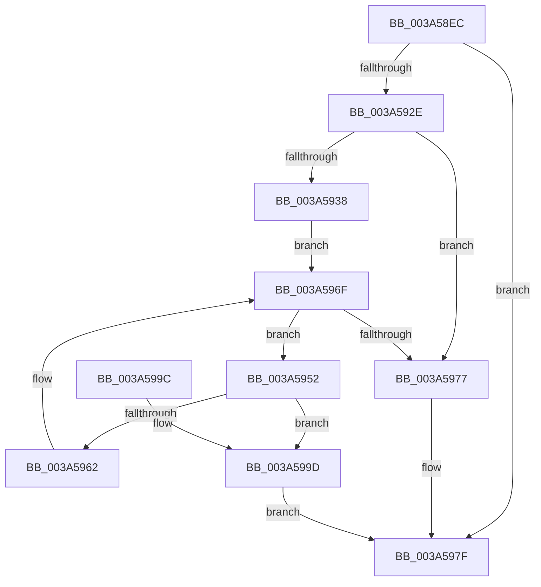

# SepRmReferenceFindCap

- RVA: `0x003A58EC`–`0x003A59A4` (길이 `184` bytes)
- VA: `0x00000001403A58EC`
- 실행 섹션: `.text`
- PDB 이름 있음: `예`; PDB Function 태그: `아니요`
- unwind 정보 RVA: `0x00089A98`
- 디코드: `54`개 명령, `184/184` bytes 표시
- 미해석 바이트: `0` (있으면 어셈블리에 `.byte`로 보존)

> 이 문서는 커널 이미지의 기계어와 PDB 기호를 분석해 생성했습니다. 4번과 5번은 함수 원형과 자료형을 바이너리 사용 방식에서 추정한 C 해석이며 원본 소스 복구 결과는 아닙니다.

## 1. Dependencies

- 직접 호출 지점: **6**; 고유 호출 대상: **6**
- 직접 호출자로 확인된 함수: **6**
- RIP 상대 이미지 참조: **1**

### Outgoing calls
- `0x003A5921` → [SepRmReferenceCapTable](SepRmReferenceCapTable_function_003A537C.md) (function, `0x003A537C`)
- `0x003A593B` → [SepComputeSidSignature](../../page/A9/SepComputeSidSignature_function_00A9097C.md) (function, `0x00A9097C`)
- `0x003A594B` → [RtlLookupEntryHashTable](../3F/RtlLookupEntryHashTable_function_003FAE50.md) (function, `0x003FAE50`)
- `0x003A5959` → [RtlEqualSid](../40/RtlEqualSid_function_00400AD0.md) (function, `0x00400AD0`)
- `0x003A596A` → [RtlGetNextEntryHashTable](../44/RtlGetNextEntryHashTable_function_00446C20.md) (function, `0x00446C20`)
- `0x003A597A` → [SepRmDereferenceCapTable](../4F/SepRmDereferenceCapTable_function_004F61A0.md) (function, `0x004F61A0`)

### Direct callers
- [SeComputeCreatorDeniedRights](SeComputeCreatorDeniedRights_function_003A6080.md) at `0x003A621E`
- [SeAccessCheckWithHint](SeAccessCheckWithHint_function_003A6C30.md) at `0x003A7001`
- [SeAccessCheckByType](../44/SeAccessCheckByType_function_00440BC8.md) at `0x0044184B`
- [SepCommonAccessCheckEx](../47/SepCommonAccessCheckEx_function_0047602C.md) at `0x0047667D`
- [SeRmReferenceFindCapName](../4D/SeRmReferenceFindCapName_function_004DDBA4.md) at `0x004DDC0A`
- [SepAccessCheckAndAuditAlarm](../../page/A1/SepAccessCheckAndAuditAlarm_function_00A1AF4C.md) at `0x00A1BC09`

### Static image references
- `0x003A592E` → RVA `0x00F04AC5` (`.data`; read)

## 2. Other-region calls and transfers

- 다른 실행 섹션으로 향하는 call: **1**
  - `0x003A593B` → [SepComputeSidSignature](../../page/A9/SepComputeSidSignature_function_00A9097C.md) (`.text` → `PAGE`)
- 별도 외부 분기/꼬리 이동을 확인하지 못했습니다.

## 3. Assembly (complete function range)

```asm
003A58EC  4C 8B DC                        mov r11, rsp
003A58EF  49 89 5B 08                     mov qword ptr [r11 + 8], rbx
003A58F3  49 89 6B 10                     mov qword ptr [r11 + 0x10], rbp
003A58F7  49 89 73 18                     mov qword ptr [r11 + 0x18], rsi
003A58FB  49 89 7B 20                     mov qword ptr [r11 + 0x20], rdi
003A58FF  41 56                           push r14
003A5901  48 83 EC 40                     sub rsp, 0x40
003A5905  33 C0                           xor eax, eax
003A5907  0F 57 C0                        xorps xmm0, xmm0
003A590A  48 21 02                        and qword ptr [rdx], rax
003A590D  4C 8B F2                        mov r14, rdx
003A5910  0F 11 44 24 20                  movups xmmword ptr [rsp + 0x20], xmm0
003A5915  49 89 43 E8                     mov qword ptr [r11 - 0x18], rax
003A5919  48 8B E9                        mov rbp, rcx
003A591C  BE 25 02 00 C0                  mov esi, 0xc0000225
003A5921  E8 56 FA FF FF                  call 0x1403a537c
003A5926  48 8B F8                        mov rdi, rax
003A5929  48 85 C0                        test rax, rax
003A592C  74 51                           je 0x1403a597f
003A592E  8A 05 91 F1 B5 00               mov al, byte ptr [rip + 0xb5f191]
003A5934  84 C0                           test al, al
003A5936  74 3F                           je 0x1403a5977
003A5938  48 8B CD                        mov rcx, rbp
003A593B  E8 3C B0 6E 00                  call 0x140a9097c
003A5940  48 8B D0                        mov rdx, rax
003A5943  4C 8D 44 24 20                  lea r8, [rsp + 0x20]
003A5948  48 8B CF                        mov rcx, rdi
003A594B  E8 00 55 05 00                  call 0x1403fae50
003A5950  EB 1D                           jmp 0x1403a596f
003A5952  48 8B 53 18                     mov rdx, qword ptr [rbx + 0x18]
003A5956  48 8B CD                        mov rcx, rbp
003A5959  E8 72 B1 05 00                  call 0x140400ad0
003A595E  3C 01                           cmp al, 1
003A5960  74 3B                           je 0x1403a599d
003A5962  48 8D 54 24 20                  lea rdx, [rsp + 0x20]
003A5967  48 8B CF                        mov rcx, rdi
003A596A  E8 B1 12 0A 00                  call 0x140446c20
003A596F  48 8B D8                        mov rbx, rax
003A5972  48 85 C0                        test rax, rax
003A5975  75 DB                           jne 0x1403a5952
003A5977  48 8B CF                        mov rcx, rdi
003A597A  E8 21 08 15 00                  call 0x1404f61a0
003A597F  48 8B 5C 24 50                  mov rbx, qword ptr [rsp + 0x50]
003A5984  8B C6                           mov eax, esi
003A5986  48 8B 74 24 60                  mov rsi, qword ptr [rsp + 0x60]
003A598B  48 8B 6C 24 58                  mov rbp, qword ptr [rsp + 0x58]
003A5990  48 8B 7C 24 68                  mov rdi, qword ptr [rsp + 0x68]
003A5995  48 83 C4 40                     add rsp, 0x40
003A5999  41 5E                           pop r14
003A599B  C3                              ret
003A599C  CC                              int3
003A599D  49 89 1E                        mov qword ptr [r14], rbx
003A59A0  33 F6                           xor esi, esi
003A59A2  EB DB                           jmp 0x1403a597f
```

## 4. C-style interpretation (structured pseudocode)

```c
__int64 __fastcall SepRmReferenceFindCap(__int64 a1, __int64 a2)
{
    __int64 result;
    __int64 v_rsi;
    __int64 v_rsp;
    unsigned __int64 v_stack_m28;
    unsigned __int64 v_stack_p10;
    unsigned __int64 v_stack_p18;
    unsigned __int64 v_stack_p20;
    unsigned __int64 v_stack_p8;

    *(unsigned __int64 *)(v_rsp + 8) = v_rbx;
    *(unsigned __int64 *)(v_rsp + 16) = v_rbp;
    *(unsigned __int64 *)(v_rsp + 24) = v_rsi;
    *(unsigned __int64 *)(v_rsp + 32) = v_rdi;
    v_rsp = (v_rsp) - (64);
    result = 0;
    v_stack_m28 = v_xmm0;
    *(unsigned __int64 *)(v_rsp - 24) = 0;
    result = SepRmReferenceCapTable(a1, a2, a3, a4);
    if (result == 0) goto loc_003A597F;
    if ((unsigned __int8)(*(unsigned __int8 *)(v_rip + 11923857)) == 0) goto loc_003A5977;
    result = SepComputeSidSignature(a1, a2, a3, a4);
    result = RtlLookupEntryHashTable(result, result, v_stack_m28, a4);
    goto loc_003A596F;
loc_003A5952:
    result = RtlEqualSid(a1, *(unsigned __int64 *)(v_rbx + 24), v_stack_m28, a4);
    if (((unsigned __int8)(result)) == 1) goto loc_003A599D;
    result = RtlGetNextEntryHashTable(result, v_stack_m28, v_stack_m28, a4);
loc_003A596F:
    if (result != 0) goto loc_003A5952;
loc_003A5977:
    result = SepRmDereferenceCapTable(result, v_stack_m28, v_stack_m28, a4);
loc_003A597F:
    v_rsp = (v_rsp) + (64);
    return (unsigned int)((unsigned int)((unsigned int)(0xC0000225ULL)));
loc_003A599D:
    *(unsigned __int64 *)(a2) = v_stack_p8;
    v_rsi = 0;
    goto loc_003A597F;
}
```

## 5. (Beta) C Style

```c
int64_t SepRmReferenceFindCap(int64_t Arg1, void *Arg2)
{
    uint8_t *arg2 = (uint8_t *)Arg2;

    int64_t result;
    int64_t local_rsi;
    int64_t local_rsp;
    uint64_t v_stack_m28;
    uint64_t v_stack_p10;
    uint64_t v_stack_p18;
    uint64_t v_stack_p20;
    uint64_t v_stack_p8;

    *(uint64_t *)(local_rsp + 0x8) = local_rbx;
    *(uint64_t *)(local_rsp + 0x10) = local_rbp;
    *(uint64_t *)(local_rsp + 0x18) = local_rsi;
    *(uint64_t *)(local_rsp + 0x20) = local_rdi;
    local_rsp = (local_rsp) - (64);
    result = 0;
    v_stack_m28 = v_xmm0;
    *(uint64_t *)(local_rsp - 0x18) = 0;
    result = SepRmReferenceCapTable(Arg1, Arg2, a3, a4);
    if (result == 0) goto loc_003A597F;
    if ((uint8_t)(*(uint8_t *)(v_rip + 0xB5F191)) == 0) goto loc_003A5977;
    result = SepComputeSidSignature(Arg1, Arg2, a3, a4);
    result = RtlLookupEntryHashTable(result, result, v_stack_m28, a4);
    goto loc_003A596F;
loc_003A5952:
    result = RtlEqualSid(Arg1, *(uint64_t *)(local_rbx + 0x18), v_stack_m28, a4);
    if (((uint8_t)(result)) == 1) goto loc_003A599D;
    result = RtlGetNextEntryHashTable(result, v_stack_m28, v_stack_m28, a4);
loc_003A596F:
    if (result != 0) goto loc_003A5952;
loc_003A5977:
    result = SepRmDereferenceCapTable(result, v_stack_m28, v_stack_m28, a4);
loc_003A597F:
    local_rsp = (local_rsp) + (64);
    return (uint32_t)((uint32_t)((uint32_t)(0xC0000225ULL)));
loc_003A599D:
    *(uint64_t *)(arg2) = v_stack_p8;
    local_rsi = 0;
    goto loc_003A597F;
}
```

### 관측된 메모리 오프셋

구조체 형식이 확인되지 않은 접근은 인자 기준의 오프셋으로만 기록했습니다.

| 기준 인자 | 오프셋 표현 | 폭 (bit) | 접근 |
|---|---:|---:|---|
| `Arg2` | `+ 0x0` | `64` | `R/W` |
| `Arg2` | `+ 0x0` | `64` | `W` |

## 6. Execution-region graph

[열기: 2D/3D 그래프와 함수 탐색 컨트롤 패널](../../../control-panel.html?section=text&rva=0x003A58EC&view=graph)

- 2D 그래프는 위에서 아래로 흐르고, 3D 그래프는 빈 공간을 드래그해 회전합니다. Shift+드래그는 이동, 휠은 확대·축소, 함수 노드 선택은 대상 보고서 이동입니다.

### Static fallback


