# SepTokenFromAccessInformation

- RVA: `0x003A67A0`–`0x003A6B17` (길이 `887` bytes)
- VA: `0x00000001403A67A0`
- 실행 섹션: `.text`
- PDB 이름 있음: `예`; PDB Function 태그: `아니요`
- unwind 정보 RVA: `0x00089B58`
- 디코드: `234`개 명령, `887/887` bytes 표시
- 미해석 바이트: `0` (있으면 어셈블리에 `.byte`로 보존)

> 이 문서는 커널 이미지의 기계어와 PDB 기호를 분석해 생성했습니다. 4번과 5번은 함수 원형과 자료형을 바이너리 사용 방식에서 추정한 C 해석이며 원본 소스 복구 결과는 아닙니다.

## 1. Dependencies

- 직접 호출 지점: **4**; 고유 호출 대상: **1**
- 직접 호출자로 확인된 함수: **3**
- RIP 상대 이미지 참조: **0**

### Outgoing calls
- `0x003A67CD` → [memset](../6C/memset_function_006C6C40.md) (function, `0x006C6C40`)
- `0x003A6897` → [memset](../6C/memset_function_006C6C40.md) (function, `0x006C6C40`)
- `0x003A68E2` → [memset](../6C/memset_function_006C6C40.md) (function, `0x006C6C40`)
- `0x003A692D` → [memset](../6C/memset_function_006C6C40.md) (function, `0x006C6C40`)

### Direct callers
- [SeQuerySecurityAttributesTokenAccessInformation](SeQuerySecurityAttributesTokenAccessInformation_function_003A5F90.md) at `0x003A5FF0`
- [SeTokenFromAccessInformation](SeTokenFromAccessInformation_function_003A6050.md) at `0x003A605E`
- [SeAccessCheckFromState](SeAccessCheckFromState_function_003A6650.md) at `0x003A66D9`
- [SeAccessCheckFromState](SeAccessCheckFromState_function_003A6650.md) at `0x003A6788`

### Static image references
- 디코드된 RIP-relative 메모리 참조가 없습니다.

## 2. Other-region calls and transfers

- 다른 실행 섹션으로 향하는 call: **0**
- 별도 외부 분기/꼬리 이동을 확인하지 못했습니다.

## 3. Assembly (complete function range)

```asm
003A67A0  48 89 5C 24 08                  mov qword ptr [rsp + 8], rbx
003A67A5  48 89 6C 24 10                  mov qword ptr [rsp + 0x10], rbp
003A67AA  48 89 74 24 18                  mov qword ptr [rsp + 0x18], rsi
003A67AF  57                              push rdi
003A67B0  41 54                           push r12
003A67B2  41 55                           push r13
003A67B4  41 56                           push r14
003A67B6  41 57                           push r15
003A67B8  48 83 EC 20                     sub rsp, 0x20
003A67BC  48 8B DA                        mov rbx, rdx
003A67BF  4C 8B F9                        mov r15, rcx
003A67C2  48 8B CB                        mov rcx, rbx
003A67C5  33 D2                           xor edx, edx
003A67C7  41 B8 C8 05 00 00               mov r8d, 0x5c8
003A67CD  E8 6E 04 32 00                  call 0x1406c6c40
003A67D2  49 8B 47 18                     mov rax, qword ptr [r15 + 0x18]
003A67D6  48 89 43 18                     mov qword ptr [rbx + 0x18], rax
003A67DA  41 8B 47 20                     mov eax, dword ptr [r15 + 0x20]
003A67DE  89 83 C0 00 00 00               mov dword ptr [rbx + 0xc0], eax
003A67E4  83 F8 02                        cmp eax, 2
003A67E7  75 0A                           jne 0x1403a67f3
003A67E9  41 8B 47 24                     mov eax, dword ptr [r15 + 0x24]
003A67ED  89 83 C4 00 00 00               mov dword ptr [rbx + 0xc4], eax
003A67F3  49 8B 4F 10                     mov rcx, qword ptr [r15 + 0x10]
003A67F7  33 ED                           xor ebp, ebp
003A67F9  8B 01                           mov eax, dword ptr [rcx]
003A67FB  48 89 6B 40                     mov qword ptr [rbx + 0x40], rbp
003A67FF  48 89 6B 48                     mov qword ptr [rbx + 0x48], rbp
003A6803  48 89 6B 50                     mov qword ptr [rbx + 0x50], rbp
003A6807  85 C0                           test eax, eax
003A6809  74 4C                           je 0x1403a6857
003A680B  48 83 C1 0C                     add rcx, 0xc
003A680F  44 8B C0                        mov r8d, eax
003A6812  8B 51 F8                        mov edx, dword ptr [rcx - 8]
003A6815  8D 42 FE                        lea eax, [rdx - 2]
003A6818  83 F8 22                        cmp eax, 0x22
003A681B  77 30                           ja 0x1403a684d
003A681D  48 8B 43 40                     mov rax, qword ptr [rbx + 0x40]
003A6821  48 0F AB D0                     bts rax, rdx
003A6825  48 89 43 40                     mov qword ptr [rbx + 0x40], rax
003A6829  8B 01                           mov eax, dword ptr [rcx]
003A682B  A8 02                           test al, 2
003A682D  74 0C                           je 0x1403a683b
003A682F  48 8B 43 48                     mov rax, qword ptr [rbx + 0x48]
003A6833  48 0F AB D0                     bts rax, rdx
003A6837  48 89 43 48                     mov qword ptr [rbx + 0x48], rax
003A683B  8B 01                           mov eax, dword ptr [rcx]
003A683D  A8 01                           test al, 1
003A683F  74 0C                           je 0x1403a684d
003A6841  48 8B 43 50                     mov rax, qword ptr [rbx + 0x50]
003A6845  48 0F AB D0                     bts rax, rdx
003A6849  48 89 43 50                     mov qword ptr [rbx + 0x50], rax
003A684D  48 83 C1 0C                     add rcx, 0xc
003A6851  49 83 E8 01                     sub r8, 1
003A6855  75 BB                           jne 0x1403a6812
003A6857  49 8B 07                        mov rax, qword ptr [r15]
003A685A  4C 8D B3 E8 00 00 00            lea r14, [rbx + 0xe8]
003A6861  BF 01 00 00 00                  mov edi, 1
003A6866  8B 08                           mov ecx, dword ptr [rax]
003A6868  89 4B 7C                        mov dword ptr [rbx + 0x7c], ecx
003A686B  44 8D 6F 3F                     lea r13d, [rdi + 0x3f]
003A686F  49 8B 07                        mov rax, qword ptr [r15]
003A6872  48 8B 48 08                     mov rcx, qword ptr [rax + 8]
003A6876  48 89 8B 98 00 00 00            mov qword ptr [rbx + 0x98], rcx
003A687D  49 8B 07                        mov rax, qword ptr [r15]
003A6880  44 8B 20                        mov r12d, dword ptr [rax]
003A6883  48 8B 70 08                     mov rsi, qword ptr [rax + 8]
003A6887  4D 85 F6                        test r14, r14
003A688A  74 19                           je 0x1403a68a5
003A688C  33 D2                           xor edx, edx
003A688E  41 B8 10 01 00 00               mov r8d, 0x110
003A6894  49 8B CE                        mov rcx, r14
003A6897  E8 A4 03 32 00                  call 0x1406c6c40
003A689C  48 85 F6                        test rsi, rsi
003A689F  0F 85 35 01 00 00               jne 0x1403a69da
003A68A5  49 8B 47 08                     mov rax, qword ptr [r15 + 8]
003A68A9  4C 8D B3 F8 01 00 00            lea r14, [rbx + 0x1f8]
003A68B0  8B 08                           mov ecx, dword ptr [rax]
003A68B2  89 8B 80 00 00 00               mov dword ptr [rbx + 0x80], ecx
003A68B8  49 8B 47 08                     mov rax, qword ptr [r15 + 8]
003A68BC  48 8B 48 08                     mov rcx, qword ptr [rax + 8]
003A68C0  48 89 8B A0 00 00 00            mov qword ptr [rbx + 0xa0], rcx
003A68C7  49 8B 47 08                     mov rax, qword ptr [r15 + 8]
003A68CB  44 8B 20                        mov r12d, dword ptr [rax]
003A68CE  48 8B 70 08                     mov rsi, qword ptr [rax + 8]
003A68D2  4D 85 F6                        test r14, r14
003A68D5  74 19                           je 0x1403a68f0
003A68D7  33 D2                           xor edx, edx
003A68D9  41 B8 10 01 00 00               mov r8d, 0x110
003A68DF  49 8B CE                        mov rcx, r14
003A68E2  E8 59 03 32 00                  call 0x1406c6c40
003A68E7  48 85 F6                        test rsi, rsi
003A68EA  0F 85 56 01 00 00               jne 0x1403a6a46
003A68F0  49 8B 47 40                     mov rax, qword ptr [r15 + 0x40]
003A68F4  4C 8D B3 28 03 00 00            lea r14, [rbx + 0x328]
003A68FB  8B 08                           mov ecx, dword ptr [rax]
003A68FD  89 8B 20 03 00 00               mov dword ptr [rbx + 0x320], ecx
003A6903  49 8B 47 40                     mov rax, qword ptr [r15 + 0x40]
003A6907  48 8B 48 08                     mov rcx, qword ptr [rax + 8]
003A690B  48 89 8B 18 03 00 00            mov qword ptr [rbx + 0x318], rcx
003A6912  49 8B 47 40                     mov rax, qword ptr [r15 + 0x40]
003A6916  44 8B 20                        mov r12d, dword ptr [rax]
003A6919  48 8B 70 08                     mov rsi, qword ptr [rax + 8]
003A691D  4D 85 F6                        test r14, r14
003A6920  74 19                           je 0x1403a693b
003A6922  33 D2                           xor edx, edx
003A6924  41 B8 10 01 00 00               mov r8d, 0x110
003A692A  49 8B CE                        mov rcx, r14
003A692D  E8 0E 03 32 00                  call 0x1406c6c40
003A6932  48 85 F6                        test rsi, rsi
003A6935  0F 85 6B 01 00 00               jne 0x1403a6aa6
003A693B  49 8B 47 38                     mov rax, qword ptr [r15 + 0x38]
003A693F  48 85 C0                        test rax, rax
003A6942  74 07                           je 0x1403a694b
003A6944  48 89 83 10 03 00 00            mov qword ptr [rbx + 0x310], rax
003A694B  49 8B 47 48                     mov rax, qword ptr [r15 + 0x48]
003A694F  48 85 C0                        test rax, rax
003A6952  74 07                           je 0x1403a695b
003A6954  48 89 83 50 04 00 00            mov qword ptr [rbx + 0x450], rax
003A695B  41 8B 47 2C                     mov eax, dword ptr [r15 + 0x2c]
003A695F  8B 53 7C                        mov edx, dword ptr [rbx + 0x7c]
003A6962  89 83 C8 00 00 00               mov dword ptr [rbx + 0xc8], eax
003A6968  C7 83 D0 00 00 00 FF FF FF FF   mov dword ptr [rbx + 0xd0], 0xffffffff
003A6972  41 8B 47 28                     mov eax, dword ptr [r15 + 0x28]
003A6976  89 83 D4 00 00 00               mov dword ptr [rbx + 0xd4], eax
003A697C  85 D2                           test edx, edx
003A697E  74 20                           je 0x1403a69a0
003A6980  48 8B 8B 98 00 00 00            mov rcx, qword ptr [rbx + 0x98]
003A6987  48 83 C1 08                     add rcx, 8
003A698B  0F 1F 44 00 00                  nop dword ptr [rax + rax]
003A6990  8B 01                           mov eax, dword ptr [rcx]
003A6992  A8 40                           test al, 0x40
003A6994  75 33                           jne 0x1403a69c9
003A6996  FF C5                           inc ebp
003A6998  48 83 C1 10                     add rcx, 0x10
003A699C  3B EA                           cmp ebp, edx
003A699E  72 F0                           jb 0x1403a6990
003A69A0  49 8B 47 50                     mov rax, qword ptr [r15 + 0x50]
003A69A4  48 8B 6C 24 58                  mov rbp, qword ptr [rsp + 0x58]
003A69A9  48 8B 74 24 60                  mov rsi, qword ptr [rsp + 0x60]
003A69AE  48 89 83 08 03 00 00            mov qword ptr [rbx + 0x308], rax
003A69B5  48 8B 5C 24 50                  mov rbx, qword ptr [rsp + 0x50]
003A69BA  48 83 C4 20                     add rsp, 0x20
003A69BE  41 5F                           pop r15
003A69C0  41 5E                           pop r14
003A69C2  41 5D                           pop r13
003A69C4  41 5C                           pop r12
003A69C6  5F                              pop rdi
003A69C7  C3                              ret
003A69C8  CC                              int3
003A69C9  83 BB D0 00 00 00 FF            cmp dword ptr [rbx + 0xd0], -1
003A69D0  75 C4                           jne 0x1403a6996
003A69D2  89 AB D0 00 00 00               mov dword ptr [rbx + 0xd0], ebp
003A69D8  EB BC                           jmp 0x1403a6996
003A69DA  45 85 E4                        test r12d, r12d
003A69DD  0F 84 C2 FE FF FF               je 0x1403a68a5
003A69E3  49 89 76 08                     mov qword ptr [r14 + 8], rsi
003A69E7  45 89 26                        mov dword ptr [r14], r12d
003A69EA  45 3B E5                        cmp r12d, r13d
003A69ED  0F 87 14 01 00 00               ja 0x1403a6b07
003A69F3  45 85 E4                        test r12d, r12d
003A69F6  0F 84 A9 FE FF FF               je 0x1403a68a5
003A69FC  4C 8B C7                        mov r8, rdi
003A69FF  45 8B CC                        mov r9d, r12d
003A6A02  0F 1F 40 00                     nop dword ptr [rax]
003A6A06  66 66 0F 1F 84 00 00 00 00 00   nop word ptr [rax + rax]
003A6A10  48 8B 0E                        mov rcx, qword ptr [rsi]
003A6A13  48 8D 76 10                     lea rsi, [rsi + 0x10]
003A6A17  0F B6 41 01                     movzx eax, byte ptr [rcx + 1]
003A6A1B  0F B6 54 81 04                  movzx edx, byte ptr [rcx + rax*4 + 4]
003A6A20  48 8B C2                        mov rax, rdx
003A6A23  83 E0 0F                        and eax, 0xf
003A6A26  4D 09 44 C6 10                  or qword ptr [r14 + rax*8 + 0x10], r8
003A6A2B  8B C2                           mov eax, edx
003A6A2D  48 C1 E8 04                     shr rax, 4
003A6A31  4D 09 84 C6 90 00 00 00         or qword ptr [r14 + rax*8 + 0x90], r8
003A6A39  49 D1 C0                        rol r8, 1
003A6A3C  4C 2B CF                        sub r9, rdi
003A6A3F  75 CF                           jne 0x1403a6a10
003A6A41  E9 5F FE FF FF                  jmp 0x1403a68a5
003A6A46  45 85 E4                        test r12d, r12d
003A6A49  0F 84 A1 FE FF FF               je 0x1403a68f0
003A6A4F  49 89 76 08                     mov qword ptr [r14 + 8], rsi
003A6A53  45 89 26                        mov dword ptr [r14], r12d
003A6A56  45 3B E5                        cmp r12d, r13d
003A6A59  0F 87 B0 00 00 00               ja 0x1403a6b0f
003A6A5F  45 85 E4                        test r12d, r12d
003A6A62  0F 84 88 FE FF FF               je 0x1403a68f0
003A6A68  4C 8B C7                        mov r8, rdi
003A6A6B  45 8B CC                        mov r9d, r12d
003A6A6E  66 90                           nop
003A6A70  48 8B 0E                        mov rcx, qword ptr [rsi]
003A6A73  48 8D 76 10                     lea rsi, [rsi + 0x10]
003A6A77  0F B6 41 01                     movzx eax, byte ptr [rcx + 1]
003A6A7B  0F B6 54 81 04                  movzx edx, byte ptr [rcx + rax*4 + 4]
003A6A80  48 8B C2                        mov rax, rdx
003A6A83  83 E0 0F                        and eax, 0xf
003A6A86  4D 09 44 C6 10                  or qword ptr [r14 + rax*8 + 0x10], r8
003A6A8B  8B C2                           mov eax, edx
003A6A8D  48 C1 E8 04                     shr rax, 4
003A6A91  4D 09 84 C6 90 00 00 00         or qword ptr [r14 + rax*8 + 0x90], r8
003A6A99  49 D1 C0                        rol r8, 1
003A6A9C  4C 2B CF                        sub r9, rdi
003A6A9F  75 CF                           jne 0x1403a6a70
003A6AA1  E9 4A FE FF FF                  jmp 0x1403a68f0
003A6AA6  45 85 E4                        test r12d, r12d
003A6AA9  0F 84 8C FE FF FF               je 0x1403a693b
003A6AAF  49 89 76 08                     mov qword ptr [r14 + 8], rsi
003A6AB3  45 89 26                        mov dword ptr [r14], r12d
003A6AB6  45 3B E5                        cmp r12d, r13d
003A6AB9  77 0C                           ja 0x1403a6ac7
003A6ABB  45 8B EC                        mov r13d, r12d
003A6ABE  45 85 E4                        test r12d, r12d
003A6AC1  0F 84 74 FE FF FF               je 0x1403a693b
003A6AC7  45 8B C5                        mov r8d, r13d
003A6ACA  66 0F 1F 44 00 00               nop word ptr [rax + rax]
003A6AD0  48 8B 0E                        mov rcx, qword ptr [rsi]
003A6AD3  48 8D 76 10                     lea rsi, [rsi + 0x10]
003A6AD7  0F B6 41 01                     movzx eax, byte ptr [rcx + 1]
003A6ADB  0F B6 54 81 04                  movzx edx, byte ptr [rcx + rax*4 + 4]
003A6AE0  48 8B C2                        mov rax, rdx
003A6AE3  83 E0 0F                        and eax, 0xf
003A6AE6  49 09 7C C6 10                  or qword ptr [r14 + rax*8 + 0x10], rdi
003A6AEB  8B C2                           mov eax, edx
003A6AED  48 C1 E8 04                     shr rax, 4
003A6AF1  49 09 BC C6 90 00 00 00         or qword ptr [r14 + rax*8 + 0x90], rdi
003A6AF9  48 D1 C7                        rol rdi, 1
003A6AFC  49 83 E8 01                     sub r8, 1
003A6B00  75 CE                           jne 0x1403a6ad0
003A6B02  E9 34 FE FF FF                  jmp 0x1403a693b
003A6B07  45 8B E5                        mov r12d, r13d
003A6B0A  E9 ED FE FF FF                  jmp 0x1403a69fc
003A6B0F  45 8B E5                        mov r12d, r13d
003A6B12  E9 51 FF FF FF                  jmp 0x1403a6a68
```

## 4. C-style interpretation (structured pseudocode)

```c
__int64 __fastcall SepTokenFromAccessInformation(__int64 a1, __int64 a2)
{
    __int64 result;
    __int64 v_rbp;
    __int64 v_rsp;
    unsigned __int64 v_stack_p10;
    unsigned __int64 v_stack_p18;
    unsigned __int64 v_stack_p8;

    v_stack_p8 = v_rbx;
    v_stack_p10 = v_rbp;
    v_stack_p18 = v_rsi;
    v_rsp = (v_rsp) - (32);
    a2 = 0;
    result = memset(a2, a2, (unsigned int)(0x5C8ULL), a4);
    *(unsigned __int64 *)(a2 + 24) = *(unsigned __int64 *)(a1 + 24);
    *(unsigned int *)(a2 + 192) = (unsigned int)((unsigned int)(*(unsigned int *)(a1 + 32)));
    result = (unsigned int)(*(unsigned int *)(a1 + 32));
    if (((unsigned int)((unsigned int)(*(unsigned int *)(a1 + 32)))) == 2) {
        result = *(unsigned int *)(a1 + 36);
        *(unsigned int *)(a2 + 196) = (unsigned int)(result);
    }
    v_rbp = 0;
    *(unsigned __int64 *)(a2 + 64) = 0;
    *(unsigned __int64 *)(a2 + 72) = 0;
    *(unsigned __int64 *)(a2 + 80) = 0;
    if ((unsigned int)((unsigned int)(*(unsigned int *)(*(unsigned __int64 *)(a1 + 16)))) == 0) goto loc_003A6857;
    a1 = (*(unsigned __int64 *)(a1 + 16)) + (12);
loc_003A6812:
    if (((unsigned int)((unsigned int)(*(unsigned int *)(a1 - 8)) - 2)) > 34) goto loc_003A684D;
    *(unsigned __int64 *)(a2 + 64) = *(unsigned __int64 *)(a2 + 64);
    result = (unsigned int)(*(unsigned int *)(a1));
    if ((((unsigned __int8)((unsigned int)(*(unsigned int *)(a1)))) & (2)) != 0) {
        result = *(unsigned __int64 *)(a2 + 72);
        *(unsigned __int64 *)(a2 + 72) = result;
    }
    result = (unsigned int)(*(unsigned int *)(a1));
    if ((((unsigned __int8)((unsigned int)(*(unsigned int *)(a1)))) & (1)) != 0) {
        result = *(unsigned __int64 *)(a2 + 80);
        *(unsigned __int64 *)(a2 + 80) = result;
    }
    a1 = (a1) + (12);
    a3 = ((unsigned int)((unsigned int)((unsigned int)(*(unsigned int *)(*(unsigned __int64 *)(a1 + 16)))))) - (1);
    if (condition_is_not_equal) goto loc_003A6812;
loc_003A6857:
    *(unsigned int *)(a2 + 124) = (unsigned int)((unsigned int)(*(unsigned int *)(*(unsigned __int64 *)(a1))));
    *(unsigned __int64 *)(a2 + 152) = *(unsigned __int64 *)(*(unsigned __int64 *)(a1) + 8);
    if (a2 + 232 == 0) goto loc_003A68A5;
    a2 = 0;
    result = memset(a2 + 232, a2, 272, a4);
    if (*(unsigned __int64 *)(*(unsigned __int64 *)(a1) + 8) != 0) goto loc_003A69DA;
loc_003A68A5:
    *(unsigned int *)(a2 + 128) = (unsigned int)((unsigned int)(*(unsigned int *)(*(unsigned __int64 *)(a1 + 8))));
    *(unsigned __int64 *)(a2 + 160) = *(unsigned __int64 *)(*(unsigned __int64 *)(a1 + 8) + 8);
    if (a2 + 504 == 0) goto loc_003A68F0;
    a2 = 0;
    result = memset(a2 + 504, a2, 272, a4);
    if (*(unsigned __int64 *)(*(unsigned __int64 *)(a1 + 8) + 8) != 0) goto loc_003A6A46;
loc_003A68F0:
    *(unsigned int *)(a2 + 800) = (unsigned int)((unsigned int)(*(unsigned int *)(*(unsigned __int64 *)(a1 + 64))));
    *(unsigned __int64 *)(a2 + 792) = *(unsigned __int64 *)(*(unsigned __int64 *)(a1 + 64) + 8);
    if (a2 + 808 == 0) goto loc_003A693B;
    a2 = 0;
    result = memset(a2 + 808, a2, 272, a4);
    if (*(unsigned __int64 *)(*(unsigned __int64 *)(a1 + 64) + 8) != 0) goto loc_003A6AA6;
loc_003A693B:
    if (*(unsigned __int64 *)(a1 + 56) != 0) {
        *(unsigned __int64 *)(a2 + 784) = *(unsigned __int64 *)(a1 + 56);
    }
    if (*(unsigned __int64 *)(a1 + 72) != 0) {
        *(unsigned __int64 *)(a2 + 1104) = *(unsigned __int64 *)(a1 + 72);
    }
    *(unsigned int *)(a2 + 200) = (unsigned int)((unsigned int)(*(unsigned int *)(a1 + 44)));
    *(unsigned int *)(a2 + 208) = 0xFFFFFFFFULL;
    *(unsigned int *)(a2 + 212) = (unsigned int)((unsigned int)(*(unsigned int *)(a1 + 40)));
    if ((unsigned int)((unsigned int)(*(unsigned int *)(a2 + 124))) == 0) goto loc_003A69A0;
    a1 = (*(unsigned __int64 *)(a2 + 152)) + (8);
loc_003A6990:
    if ((((unsigned __int8)((unsigned int)(*(unsigned int *)(a1)))) & (64)) != 0) goto loc_003A69C9;
loc_003A6996:
    v_rbp = (unsigned int)((v_rbp) + 1);
    a1 = (a1) + (16);
    if (((unsigned int)(v_rbp)) < ((unsigned int)((unsigned int)(*(unsigned int *)(a2 + 124))))) goto loc_003A6990;
loc_003A69A0:
    *(unsigned __int64 *)(a2 + 776) = *(unsigned __int64 *)(a1 + 80);
    v_rsp = (v_rsp) + (32);
    return *(unsigned __int64 *)(a1 + 80);
loc_003A69C9:
    if ((*(unsigned int *)(v_stack_p8 + 208)) != -1) goto loc_003A6996;
    *(unsigned int *)(v_stack_p8 + 208) = (unsigned int)(v_stack_p10);
    goto loc_003A6996;
loc_003A69DA:
    if ((unsigned int)((unsigned int)(*(unsigned int *)(*(unsigned __int64 *)(a1 + 64)))) == 0) goto loc_003A68A5;
    *(unsigned __int64 *)(a2 + 808 + 8) = v_stack_p18;
    *(unsigned int *)(a2 + 808) = (unsigned int)((unsigned int)(*(unsigned int *)(*(unsigned __int64 *)(a1 + 64))));
    if (((unsigned int)((unsigned int)(*(unsigned int *)(*(unsigned __int64 *)(a1 + 64))))) > ((unsigned int)(1 + 63))) goto loc_003A6B07;
    if ((unsigned int)((unsigned int)(*(unsigned int *)(*(unsigned __int64 *)(a1 + 64)))) == 0) goto loc_003A68A5;
loc_003A69FC:
loc_003A6A10:
    result = (unsigned int)((*(unsigned __int8 *)(*(unsigned __int64 *)(v_stack_p18) + *(unsigned __int8 *)(*(unsigned __int64 *)(v_stack_p18) + 1) * 4 + 4)) & (15));
    result = ((unsigned int)((unsigned int)(*(unsigned __int8 *)(*(unsigned __int64 *)(v_stack_p18) + *(unsigned __int8 *)(*(unsigned __int64 *)(v_stack_p18) + 1) * 4 + 4)))) >> (4);
    a4 = ((unsigned int)((unsigned int)((unsigned int)(*(unsigned int *)(*(unsigned __int64 *)(a1 + 64)))))) - (1);
    if (condition_is_not_equal) goto loc_003A6A10;
    goto loc_003A68A5;
loc_003A6A46:
    if ((unsigned int)((unsigned int)(*(unsigned int *)(*(unsigned __int64 *)(a1 + 64)))) == 0) goto loc_003A68F0;
    *(unsigned __int64 *)(a2 + 808 + 8) = v_stack_p18 + 16;
    *(unsigned int *)(a2 + 808) = (unsigned int)((unsigned int)(*(unsigned int *)(*(unsigned __int64 *)(a1 + 64))));
    if (((unsigned int)((unsigned int)(*(unsigned int *)(*(unsigned __int64 *)(a1 + 64))))) > ((unsigned int)(1 + 63))) goto loc_003A6B0F;
    if ((unsigned int)((unsigned int)(*(unsigned int *)(*(unsigned __int64 *)(a1 + 64)))) == 0) goto loc_003A68F0;
loc_003A6A68:
loc_003A6A70:
    result = (unsigned int)((*(unsigned __int8 *)(*(unsigned __int64 *)(v_stack_p18 + 16) + *(unsigned __int8 *)(*(unsigned __int64 *)(v_stack_p18 + 16) + 1) * 4 + 4)) & (15));
    result = ((unsigned int)((unsigned int)(*(unsigned __int8 *)(*(unsigned __int64 *)(v_stack_p18 + 16) + *(unsigned __int8 *)(*(unsigned __int64 *)(v_stack_p18 + 16) + 1) * 4 + 4)))) >> (4);
    a4 = ((unsigned int)((unsigned int)((unsigned int)(*(unsigned int *)(*(unsigned __int64 *)(a1 + 64)))))) - (1);
    if (condition_is_not_equal) goto loc_003A6A70;
    goto loc_003A68F0;
loc_003A6AA6:
    if ((unsigned int)((unsigned int)(*(unsigned int *)(*(unsigned __int64 *)(a1 + 64)))) == 0) goto loc_003A693B;
    *(unsigned __int64 *)(a2 + 808 + 8) = v_stack_p18 + 16 + 16;
    *(unsigned int *)(a2 + 808) = (unsigned int)((unsigned int)(*(unsigned int *)(*(unsigned __int64 *)(a1 + 64))));
    if (((unsigned int)((unsigned int)(*(unsigned int *)(*(unsigned __int64 *)(a1 + 64))))) > ((unsigned int)(1 + 63))) goto loc_003A6AC7;
    if ((unsigned int)((unsigned int)(*(unsigned int *)(*(unsigned __int64 *)(a1 + 64)))) == 0) goto loc_003A693B;
loc_003A6AC7:
loc_003A6AD0:
    result = (unsigned int)((*(unsigned __int8 *)(*(unsigned __int64 *)(v_stack_p18 + 16 + 16) + *(unsigned __int8 *)(*(unsigned __int64 *)(v_stack_p18 + 16 + 16) + 1) * 4 + 4)) & (15));
    result = ((unsigned int)((unsigned int)(*(unsigned __int8 *)(*(unsigned __int64 *)(v_stack_p18 + 16 + 16) + *(unsigned __int8 *)(*(unsigned __int64 *)(v_stack_p18 + 16 + 16) + 1) * 4 + 4)))) >> (4);
    a3 = ((unsigned int)((unsigned int)((unsigned int)((unsigned int)((unsigned int)(*(unsigned int *)(*(unsigned __int64 *)(a1 + 64)))))))) - (1);
    if (condition_is_not_equal) goto loc_003A6AD0;
    goto loc_003A693B;
loc_003A6B07:
    goto loc_003A69FC;
loc_003A6B0F:
    goto loc_003A6A68;
}
```

## 5. (Beta) C Style

```c
int64_t SepTokenFromAccessInformation(void *Arg1, void *Arg2)
{
    uint8_t *arg1 = (uint8_t *)Arg1;
    uint8_t *arg2 = (uint8_t *)Arg2;

    int64_t result;
    int64_t local_rbp;
    int64_t local_rsp;
    uint64_t v_stack_p10;
    uint64_t v_stack_p18;
    uint64_t v_stack_p8;

    v_stack_p8 = local_rbx;
    v_stack_p10 = local_rbp;
    v_stack_p18 = local_rsi;
    local_rsp = (local_rsp) - (32);
    Arg2 = 0;
    result = memset(Arg2, Arg2, (uint32_t)(0x5C8ULL), a4);
    *(uint64_t *)(arg2 + 0x18) = *(uint64_t *)(arg1 + 0x18);
    *(uint32_t *)(arg2 + 0xC0) = (uint32_t)((uint32_t)(*(uint32_t *)(arg1 + 0x20)));
    result = (uint32_t)(*(uint32_t *)(arg1 + 0x20));
    if (((uint32_t)((uint32_t)(*(uint32_t *)(arg1 + 0x20)))) == 2) {
        result = *(uint32_t *)(arg1 + 0x24);
        *(uint32_t *)(arg2 + 0xC4) = (uint32_t)(result);
    }
    local_rbp = 0;
    *(uint64_t *)(arg2 + 0x40) = 0;
    *(uint64_t *)(arg2 + 0x48) = 0;
    *(uint64_t *)(arg2 + 0x50) = 0;
    if ((uint32_t)((uint32_t)(*(uint32_t *)(*(uint64_t *)(arg1 + 0x10)))) == 0) goto loc_003A6857;
    Arg1 = (*(uint64_t *)(arg1 + 0x10)) + (12);
loc_003A6812:
    if (((uint32_t)((uint32_t)(*(uint32_t *)(arg1 - 0x8)) - 2)) > 34) goto loc_003A684D;
    *(uint64_t *)(arg2 + 0x40) = *(uint64_t *)(arg2 + 0x40);
    result = (uint32_t)(*(uint32_t *)(arg1));
    if ((((uint8_t)((uint32_t)(*(uint32_t *)(arg1)))) & (2)) != 0) {
        result = *(uint64_t *)(arg2 + 0x48);
        *(uint64_t *)(arg2 + 0x48) = result;
    }
    result = (uint32_t)(*(uint32_t *)(arg1));
    if ((((uint8_t)((uint32_t)(*(uint32_t *)(arg1)))) & (1)) != 0) {
        result = *(uint64_t *)(arg2 + 0x50);
        *(uint64_t *)(arg2 + 0x50) = result;
    }
    Arg1 = (Arg1) + (12);
    a3 = ((uint32_t)((uint32_t)((uint32_t)(*(uint32_t *)(*(uint64_t *)(arg1 + 0x10)))))) - (1);
    if (condition_is_not_equal) goto loc_003A6812;
loc_003A6857:
    *(uint32_t *)(arg2 + 0x7C) = (uint32_t)((uint32_t)(*(uint32_t *)(*(uint64_t *)(arg1))));
    *(uint64_t *)(arg2 + 0x98) = *(uint64_t *)(*(uint64_t *)(arg1) + 0x8);
    if (Arg2 + 232 == 0) goto loc_003A68A5;
    Arg2 = 0;
    result = memset(Arg2 + 232, Arg2, 272, a4);
    if (*(uint64_t *)(*(uint64_t *)(arg1) + 0x8) != 0) goto loc_003A69DA;
loc_003A68A5:
    *(uint32_t *)(arg2 + 0x80) = (uint32_t)((uint32_t)(*(uint32_t *)(*(uint64_t *)(arg1 + 0x8))));
    *(uint64_t *)(arg2 + 0xA0) = *(uint64_t *)(*(uint64_t *)(arg1 + 0x8) + 0x8);
    if (Arg2 + 504 == 0) goto loc_003A68F0;
    Arg2 = 0;
    result = memset(Arg2 + 504, Arg2, 272, a4);
    if (*(uint64_t *)(*(uint64_t *)(arg1 + 0x8) + 0x8) != 0) goto loc_003A6A46;
loc_003A68F0:
    *(uint32_t *)(arg2 + 0x320) = (uint32_t)((uint32_t)(*(uint32_t *)(*(uint64_t *)(arg1 + 0x40))));
    *(uint64_t *)(arg2 + 0x318) = *(uint64_t *)(*(uint64_t *)(arg1 + 0x40) + 0x8);
    if (Arg2 + 808 == 0) goto loc_003A693B;
    Arg2 = 0;
    result = memset(Arg2 + 808, Arg2, 272, a4);
    if (*(uint64_t *)(*(uint64_t *)(arg1 + 0x40) + 0x8) != 0) goto loc_003A6AA6;
loc_003A693B:
    if (*(uint64_t *)(arg1 + 0x38) != 0) {
        *(uint64_t *)(arg2 + 0x310) = *(uint64_t *)(arg1 + 0x38);
    }
    if (*(uint64_t *)(arg1 + 0x48) != 0) {
        *(uint64_t *)(arg2 + 0x450) = *(uint64_t *)(arg1 + 0x48);
    }
    *(uint32_t *)(arg2 + 0xC8) = (uint32_t)((uint32_t)(*(uint32_t *)(arg1 + 0x2C)));
    *(uint32_t *)(arg2 + 0xD0) = 0xFFFFFFFFULL;
    *(uint32_t *)(arg2 + 0xD4) = (uint32_t)((uint32_t)(*(uint32_t *)(arg1 + 0x28)));
    if ((uint32_t)((uint32_t)(*(uint32_t *)(arg2 + 0x7C))) == 0) goto loc_003A69A0;
    Arg1 = (*(uint64_t *)(arg2 + 0x98)) + (8);
loc_003A6990:
    if ((((uint8_t)((uint32_t)(*(uint32_t *)(arg1)))) & (64)) != 0) goto loc_003A69C9;
loc_003A6996:
    local_rbp = (uint32_t)((local_rbp) + 1);
    Arg1 = (Arg1) + (16);
    if (((uint32_t)(local_rbp)) < ((uint32_t)((uint32_t)(*(uint32_t *)(arg2 + 0x7C))))) goto loc_003A6990;
loc_003A69A0:
    *(uint64_t *)(arg2 + 0x308) = *(uint64_t *)(arg1 + 0x50);
    local_rsp = (local_rsp) + (32);
    return *(uint64_t *)(arg1 + 0x50);
loc_003A69C9:
    if ((*(uint32_t *)(v_stack_p8 + 0xD0)) != -1) goto loc_003A6996;
    *(uint32_t *)(v_stack_p8 + 0xD0) = (uint32_t)(v_stack_p10);
    goto loc_003A6996;
loc_003A69DA:
    if ((uint32_t)((uint32_t)(*(uint32_t *)(*(uint64_t *)(arg1 + 0x40)))) == 0) goto loc_003A68A5;
    *(uint64_t *)(arg2 + 0x328 + 0x8) = v_stack_p18;
    *(uint32_t *)(arg2 + 0x328) = (uint32_t)((uint32_t)(*(uint32_t *)(*(uint64_t *)(arg1 + 0x40))));
    if (((uint32_t)((uint32_t)(*(uint32_t *)(*(uint64_t *)(arg1 + 0x40))))) > ((uint32_t)(1 + 63))) goto loc_003A6B07;
    if ((uint32_t)((uint32_t)(*(uint32_t *)(*(uint64_t *)(arg1 + 0x40)))) == 0) goto loc_003A68A5;
loc_003A69FC:
loc_003A6A10:
    result = (uint32_t)((*(uint8_t *)(*(uint64_t *)(v_stack_p18) + *(uint8_t *)(*(uint64_t *)(v_stack_p18) + 0x1) * 4 + 0x4)) & (15));
    result = ((uint32_t)((uint32_t)(*(uint8_t *)(*(uint64_t *)(v_stack_p18) + *(uint8_t *)(*(uint64_t *)(v_stack_p18) + 0x1) * 4 + 0x4)))) >> (4);
    a4 = ((uint32_t)((uint32_t)((uint32_t)(*(uint32_t *)(*(uint64_t *)(arg1 + 0x40)))))) - (1);
    if (condition_is_not_equal) goto loc_003A6A10;
    goto loc_003A68A5;
loc_003A6A46:
    if ((uint32_t)((uint32_t)(*(uint32_t *)(*(uint64_t *)(arg1 + 0x40)))) == 0) goto loc_003A68F0;
    *(uint64_t *)(arg2 + 0x328 + 0x8) = v_stack_p18 + 16;
    *(uint32_t *)(arg2 + 0x328) = (uint32_t)((uint32_t)(*(uint32_t *)(*(uint64_t *)(arg1 + 0x40))));
    if (((uint32_t)((uint32_t)(*(uint32_t *)(*(uint64_t *)(arg1 + 0x40))))) > ((uint32_t)(1 + 63))) goto loc_003A6B0F;
    if ((uint32_t)((uint32_t)(*(uint32_t *)(*(uint64_t *)(arg1 + 0x40)))) == 0) goto loc_003A68F0;
loc_003A6A68:
loc_003A6A70:
    result = (uint32_t)((*(uint8_t *)(*(uint64_t *)(v_stack_p18 + 0x10) + *(uint8_t *)(*(uint64_t *)(v_stack_p18 + 0x10) + 0x1) * 4 + 0x4)) & (15));
    result = ((uint32_t)((uint32_t)(*(uint8_t *)(*(uint64_t *)(v_stack_p18 + 0x10) + *(uint8_t *)(*(uint64_t *)(v_stack_p18 + 0x10) + 0x1) * 4 + 0x4)))) >> (4);
    a4 = ((uint32_t)((uint32_t)((uint32_t)(*(uint32_t *)(*(uint64_t *)(arg1 + 0x40)))))) - (1);
    if (condition_is_not_equal) goto loc_003A6A70;
    goto loc_003A68F0;
loc_003A6AA6:
    if ((uint32_t)((uint32_t)(*(uint32_t *)(*(uint64_t *)(arg1 + 0x40)))) == 0) goto loc_003A693B;
    *(uint64_t *)(arg2 + 0x328 + 0x8) = v_stack_p18 + 16 + 16;
    *(uint32_t *)(arg2 + 0x328) = (uint32_t)((uint32_t)(*(uint32_t *)(*(uint64_t *)(arg1 + 0x40))));
    if (((uint32_t)((uint32_t)(*(uint32_t *)(*(uint64_t *)(arg1 + 0x40))))) > ((uint32_t)(1 + 63))) goto loc_003A6AC7;
    if ((uint32_t)((uint32_t)(*(uint32_t *)(*(uint64_t *)(arg1 + 0x40)))) == 0) goto loc_003A693B;
loc_003A6AC7:
loc_003A6AD0:
    result = (uint32_t)((*(uint8_t *)(*(uint64_t *)(v_stack_p18 + 0x10 + 0x10) + *(uint8_t *)(*(uint64_t *)(v_stack_p18 + 0x10 + 0x10) + 0x1) * 4 + 0x4)) & (15));
    result = ((uint32_t)((uint32_t)(*(uint8_t *)(*(uint64_t *)(v_stack_p18 + 0x10 + 0x10) + *(uint8_t *)(*(uint64_t *)(v_stack_p18 + 0x10 + 0x10) + 0x1) * 4 + 0x4)))) >> (4);
    a3 = ((uint32_t)((uint32_t)((uint32_t)((uint32_t)((uint32_t)(*(uint32_t *)(*(uint64_t *)(arg1 + 0x40)))))))) - (1);
    if (condition_is_not_equal) goto loc_003A6AD0;
    goto loc_003A693B;
loc_003A6B07:
    goto loc_003A69FC;
loc_003A6B0F:
    goto loc_003A6A68;
}
```

### 관측된 메모리 오프셋

구조체 형식이 확인되지 않은 접근은 인자 기준의 오프셋으로만 기록했습니다.

| 기준 인자 | 오프셋 표현 | 폭 (bit) | 접근 |
|---|---:|---:|---|
| `Arg1` | `+ 0x0` | `64` | `R` |
| `Arg1` | `+ 0x8` | `64` | `R` |
| `Arg1` | `+ 0x10` | `64` | `R` |
| `Arg1` | `+ 0x18` | `64` | `R` |
| `Arg1` | `+ 0x20` | `32` | `R` |
| `Arg1` | `+ 0x24` | `32` | `R` |
| `Arg1` | `+ 0x28` | `32` | `R` |
| `Arg1` | `+ 0x2C` | `32` | `R` |
| `Arg1` | `+ 0x38` | `64` | `R` |
| `Arg1` | `+ 0x40` | `64` | `R` |
| `Arg1` | `+ 0x48` | `64` | `R` |
| `Arg1` | `+ 0x50` | `64` | `R` |
| `Arg2` | `+ 0x18` | `64` | `W` |
| `Arg2` | `+ 0x40` | `64` | `R` |
| `Arg2` | `+ 0x40` | `64` | `W` |
| `Arg2` | `+ 0x48` | `64` | `R` |
| `Arg2` | `+ 0x48` | `64` | `W` |
| `Arg2` | `+ 0x50` | `64` | `R` |
| `Arg2` | `+ 0x50` | `64` | `W` |
| `Arg2` | `+ 0x7C` | `32` | `R` |
| `Arg2` | `+ 0x7C` | `32` | `W` |
| `Arg2` | `+ 0x80` | `32` | `W` |
| `Arg2` | `+ 0x98` | `64` | `R` |
| `Arg2` | `+ 0x98` | `64` | `W` |
| `Arg2` | `+ 0xA0` | `64` | `W` |
| `Arg2` | `+ 0xC0` | `32` | `W` |
| `Arg2` | `+ 0xC4` | `32` | `W` |
| `Arg2` | `+ 0xC8` | `32` | `W` |
| `Arg2` | `+ 0xD0` | `32` | `R` |
| `Arg2` | `+ 0xD0` | `32` | `W` |
| `Arg2` | `+ 0xD4` | `32` | `W` |
| `Arg2` | `+ 0xE8` | `64` | `R` |

추가 오프셋 7개는 표에서 생략했습니다.

## 6. Execution-region graph

[열기: 2D/3D 그래프와 함수 탐색 컨트롤 패널](../../../control-panel.html?section=text&rva=0x003A67A0&view=graph)

- 2D 그래프는 위에서 아래로 흐르고, 3D 그래프는 빈 공간을 드래그해 회전합니다. Shift+드래그는 이동, 휠은 확대·축소, 함수 노드 선택은 대상 보고서 이동입니다.

### Static fallback

```mermaid
flowchart TD
  bb_003A67A0[BB_003A67A0]
  bb_003A67E9[BB_003A67E9]
  bb_003A67F3[BB_003A67F3]
  bb_003A680B[BB_003A680B]
  bb_003A6812[BB_003A6812]
  bb_003A681D[BB_003A681D]
  bb_003A682F[BB_003A682F]
  bb_003A683B[BB_003A683B]
  bb_003A6841[BB_003A6841]
  bb_003A684D[BB_003A684D]
  bb_003A6857[BB_003A6857]
  bb_003A688C[BB_003A688C]
  bb_003A68A5[BB_003A68A5]
  bb_003A68D7[BB_003A68D7]
  bb_003A68F0[BB_003A68F0]
  bb_003A6922[BB_003A6922]
  bb_003A693B[BB_003A693B]
  bb_003A6944[BB_003A6944]
  bb_003A694B[BB_003A694B]
  bb_003A6954[BB_003A6954]
  bb_003A695B[BB_003A695B]
  bb_003A6980[BB_003A6980]
  bb_003A6990[BB_003A6990]
  bb_003A6996[BB_003A6996]
  bb_003A69A0[BB_003A69A0]
  bb_003A69C8[BB_003A69C8]
  bb_003A69C9[BB_003A69C9]
  bb_003A69D2[BB_003A69D2]
  bb_003A69DA[BB_003A69DA]
  bb_003A69E3[BB_003A69E3]
  bb_003A69F3[BB_003A69F3]
  bb_003A69FC[BB_003A69FC]
  bb_003A6A10[BB_003A6A10]
  bb_003A6A41[BB_003A6A41]
  bb_003A6A46[BB_003A6A46]
  bb_003A6A4F[BB_003A6A4F]
  bb_003A6A5F[BB_003A6A5F]
  bb_003A6A68[BB_003A6A68]
  bb_003A6A70[BB_003A6A70]
  bb_003A6AA1[BB_003A6AA1]
  bb_003A6AA6[BB_003A6AA6]
  bb_003A6AAF[BB_003A6AAF]
  bb_003A6ABB[BB_003A6ABB]
  bb_003A6AC7[BB_003A6AC7]
  bb_003A6AD0[BB_003A6AD0]
  bb_003A6B02[BB_003A6B02]
  bb_003A6B07[BB_003A6B07]
  bb_003A6B0F[BB_003A6B0F]
  bb_003A67A0 -->|branch| bb_003A67F3
  bb_003A67A0 -->|fallthrough| bb_003A67E9
  bb_003A67E9 -->|flow| bb_003A67F3
  bb_003A67F3 -->|branch| bb_003A6857
  bb_003A67F3 -->|fallthrough| bb_003A680B
  bb_003A680B -->|flow| bb_003A6812
  bb_003A6812 -->|branch| bb_003A684D
  bb_003A6812 -->|fallthrough| bb_003A681D
  bb_003A681D -->|branch| bb_003A683B
  bb_003A681D -->|fallthrough| bb_003A682F
  bb_003A682F -->|flow| bb_003A683B
  bb_003A683B -->|branch| bb_003A684D
  bb_003A683B -->|fallthrough| bb_003A6841
  bb_003A6841 -->|flow| bb_003A684D
  bb_003A684D -->|branch| bb_003A6812
  bb_003A684D -->|fallthrough| bb_003A6857
  bb_003A6857 -->|branch| bb_003A68A5
  bb_003A6857 -->|fallthrough| bb_003A688C
  bb_003A688C -->|branch| bb_003A69DA
  bb_003A688C -->|fallthrough| bb_003A68A5
  bb_003A68A5 -->|branch| bb_003A68F0
  bb_003A68A5 -->|fallthrough| bb_003A68D7
  bb_003A68D7 -->|branch| bb_003A6A46
  bb_003A68D7 -->|fallthrough| bb_003A68F0
  bb_003A68F0 -->|branch| bb_003A693B
  bb_003A68F0 -->|fallthrough| bb_003A6922
  bb_003A6922 -->|branch| bb_003A6AA6
  bb_003A6922 -->|fallthrough| bb_003A693B
  bb_003A693B -->|branch| bb_003A694B
  bb_003A693B -->|fallthrough| bb_003A6944
  bb_003A6944 -->|flow| bb_003A694B
  bb_003A694B -->|branch| bb_003A695B
  bb_003A694B -->|fallthrough| bb_003A6954
  bb_003A6954 -->|flow| bb_003A695B
  bb_003A695B -->|branch| bb_003A69A0
  bb_003A695B -->|fallthrough| bb_003A6980
  bb_003A6980 -->|flow| bb_003A6990
  bb_003A6990 -->|branch| bb_003A69C9
  bb_003A6990 -->|fallthrough| bb_003A6996
  bb_003A6996 -->|branch| bb_003A6990
  bb_003A6996 -->|fallthrough| bb_003A69A0
  bb_003A69C8 -->|flow| bb_003A69C9
  bb_003A69C9 -->|branch| bb_003A6996
  bb_003A69C9 -->|fallthrough| bb_003A69D2
  bb_003A69D2 -->|branch| bb_003A6996
  bb_003A69DA -->|branch| bb_003A68A5
  bb_003A69DA -->|fallthrough| bb_003A69E3
  bb_003A69E3 -->|branch| bb_003A6B07
  bb_003A69E3 -->|fallthrough| bb_003A69F3
  bb_003A69F3 -->|branch| bb_003A68A5
  bb_003A69F3 -->|fallthrough| bb_003A69FC
  bb_003A69FC -->|flow| bb_003A6A10
  bb_003A6A10 -->|branch| bb_003A6A10
  bb_003A6A10 -->|fallthrough| bb_003A6A41
  bb_003A6A41 -->|branch| bb_003A68A5
  bb_003A6A46 -->|branch| bb_003A68F0
  bb_003A6A46 -->|fallthrough| bb_003A6A4F
  bb_003A6A4F -->|branch| bb_003A6B0F
  bb_003A6A4F -->|fallthrough| bb_003A6A5F
  bb_003A6A5F -->|branch| bb_003A68F0
  bb_003A6A5F -->|fallthrough| bb_003A6A68
  bb_003A6A68 -->|flow| bb_003A6A70
  bb_003A6A70 -->|branch| bb_003A6A70
  bb_003A6A70 -->|fallthrough| bb_003A6AA1
  bb_003A6AA1 -->|branch| bb_003A68F0
  bb_003A6AA6 -->|branch| bb_003A693B
  bb_003A6AA6 -->|fallthrough| bb_003A6AAF
  bb_003A6AAF -->|branch| bb_003A6AC7
  bb_003A6AAF -->|fallthrough| bb_003A6ABB
  bb_003A6ABB -->|branch| bb_003A693B
  bb_003A6ABB -->|fallthrough| bb_003A6AC7
  bb_003A6AC7 -->|flow| bb_003A6AD0
  bb_003A6AD0 -->|branch| bb_003A6AD0
  bb_003A6AD0 -->|fallthrough| bb_003A6B02
  bb_003A6B02 -->|branch| bb_003A693B
  bb_003A6B07 -->|branch| bb_003A69FC
  bb_003A6B0F -->|branch| bb_003A6A68
```


