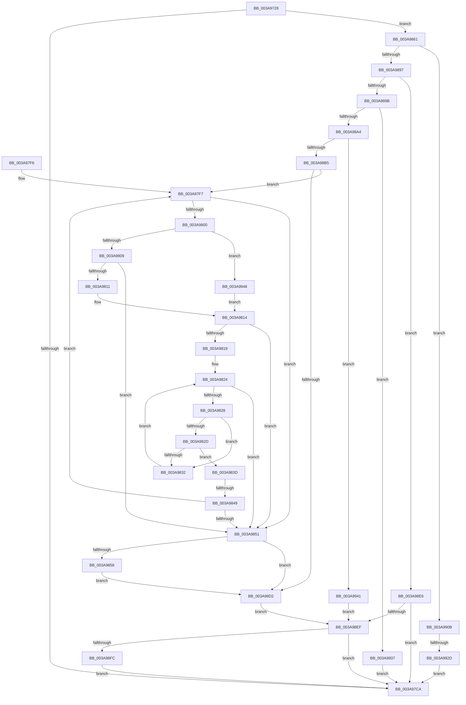

# SepVerifyDesktopAppxPackageName

- RVA: `0x003A9728`–`0x003A9951` (길이 `553` bytes)
- VA: `0x00000001403A9728`
- 실행 섹션: `.text`
- PDB 이름 있음: `예`; PDB Function 태그: `예`
- unwind 정보 RVA: `0x00089FC0`
- 디코드: `149`개 명령, `553/553` bytes 표시
- 미해석 바이트: `0` (있으면 어셈블리에 `.byte`로 보존)

> 이 문서는 커널 이미지의 기계어와 PDB 기호를 분석해 생성했습니다. 4번과 5번은 함수 원형과 자료형을 바이너리 사용 방식에서 추정한 C 해석이며 원본 소스 복구 결과는 아닙니다.

## 1. Dependencies

- 직접 호출 지점: **10**; 고유 호출 대상: **9**
- 직접 호출자로 확인된 함수: **1**
- RIP 상대 이미지 참조: **2**

### Outgoing calls
- `0x003A9791` → [wcslen](../50/wcslen_function_00501BA0.md) (function, `0x00501BA0`)
- `0x003A97BD` → [SeSecurityAttributePresent](../21/SeSecurityAttributePresent_function_00213660.md) (function, `0x00213660`)
- `0x003A97D6` → [_security_check_cookie](../6A/_security_check_cookie_function_006AC640.md) (function, `0x006AC640`)
- `0x003A9889` → [SeQuerySecurityAttributesToken](../../page/9F/SeQuerySecurityAttributesToken_function_009F6410.md) (function, `0x009F6410`)
- `0x003A98A4` → [AuthzBasepAllocateSecurityAttributesList](../30/AuthzBasepAllocateSecurityAttributesList_function_003013F4.md) (function, `0x003013F4`)
- `0x003A98C0` → [AuthzBasepSetSecurityAttributesToken](AuthzBasepSetSecurityAttributesToken_function_003A8D1C.md) (function, `0x003A8D1C`)
- `0x003A98D5` → [AuthzBasepFreeSecurityAttributesList](../30/AuthzBasepFreeSecurityAttributesList_function_00301230.md) (function, `0x00301230`)
- `0x003A98DF` → [ExFreePoolWithTag](../../poolcode/B8/ExFreePoolWithTag_function_00B82870.md) (function, `0x00B82870`)
- `0x003A9901` → [ExFreePoolWithTag](../../poolcode/B8/ExFreePoolWithTag_function_00B82870.md) (function, `0x00B82870`)
- `0x003A991C` → [ExAllocatePool2](../../poolcode/B8/ExAllocatePool2_function_00B820F0.md) (function, `0x00B820F0`)

### Direct callers
- [SepVerifyDesktopAppxImage](../60/SepVerifyDesktopAppxImage_function_0060885C.md) at `0x006089FF`

### Static image references
- `0x003A9747` → RVA `0x00E0A740` (`.data`; read)
- `0x003A9767` → RVA `0x006CD230` (` ?? ::FNODOBFM::`string'`; read)

## 2. Other-region calls and transfers

- 다른 실행 섹션으로 향하는 call: **4**
  - `0x003A9889` → [SeQuerySecurityAttributesToken](../../page/9F/SeQuerySecurityAttributesToken_function_009F6410.md) (`.text` → `PAGE`)
  - `0x003A98DF` → [ExFreePoolWithTag](../../poolcode/B8/ExFreePoolWithTag_function_00B82870.md) (`.text` → `POOLCODE`)
  - `0x003A9901` → [ExFreePoolWithTag](../../poolcode/B8/ExFreePoolWithTag_function_00B82870.md) (`.text` → `POOLCODE`)
  - `0x003A991C` → [ExAllocatePool2](../../poolcode/B8/ExAllocatePool2_function_00B820F0.md) (`.text` → `POOLCODE`)
- call이 아닌 외부 분기/꼬리 이동: **2**
  - `0x003A9843` → [sub_006E6B3A + 0x2B](../6E/Unknown_function_006E6B3A.md) (`tail-transfer`)
  - `0x003A9927` → [sub_006E6B3A](../6E/Unknown_function_006E6B3A.md) (`tail-transfer`)

## 3. Assembly (complete function range)

```asm
003A9728  48 89 5C 24 20                  mov qword ptr [rsp + 0x20], rbx
003A972D  55                              push rbp
003A972E  56                              push rsi
003A972F  57                              push rdi
003A9730  41 54                           push r12
003A9732  41 55                           push r13
003A9734  41 56                           push r14
003A9736  41 57                           push r15
003A9738  48 8D AC 24 60 FE FF FF         lea rbp, [rsp - 0x1a0]
003A9740  48 81 EC A0 02 00 00            sub rsp, 0x2a0
003A9747  48 8B 05 F2 0F A6 00            mov rax, qword ptr [rip + 0xa60ff2]
003A974E  48 33 C4                        xor rax, rsp
003A9751  48 89 85 90 01 00 00            mov qword ptr [rbp + 0x190], rax
003A9758  45 33 F6                        xor r14d, r14d
003A975B  4C 89 45 80                     mov qword ptr [rbp - 0x80], r8
003A975F  4C 8B E1                        mov r12, rcx
003A9762  44 89 74 24 64                  mov dword ptr [rsp + 0x64], r14d
003A9767  48 8D 0D C2 3A 32 00            lea rcx, [rip + 0x323ac2]
003A976E  44 89 74 24 60                  mov dword ptr [rsp + 0x60], r14d
003A9773  4C 8B EA                        mov r13, rdx
003A9776  45 88 30                        mov byte ptr [r8], r14b
003A9779  41 8D 7E 02                     lea edi, [r14 + 2]
003A977D  44 89 74 24 74                  mov dword ptr [rsp + 0x74], r14d
003A9782  89 7C 24 68                     mov dword ptr [rsp + 0x68], edi
003A9786  45 8B FE                        mov r15d, r14d
003A9789  41 8B DE                        mov ebx, r14d
003A978C  48 89 4C 24 78                  mov qword ptr [rsp + 0x78], rcx
003A9791  E8 0A 84 15 00                  call 0x140501ba0
003A9796  48 03 C0                        add rax, rax
003A9799  48 8D 54 24 70                  lea rdx, [rsp + 0x70]
003A979E  48 3D FE FF 00 00               cmp rax, 0xfffe
003A97A4  B9 FC FF 00 00                  mov ecx, 0xfffc
003A97A9  48 0F 43 C1                     cmovae rax, rcx
003A97AD  49 8B CC                        mov rcx, r12
003A97B0  66 89 44 24 70                  mov word ptr [rsp + 0x70], ax
003A97B5  66 03 C7                        add ax, di
003A97B8  66 89 44 24 72                  mov word ptr [rsp + 0x72], ax
003A97BD  E8 9E 9E E6 FF                  call 0x140213660
003A97C2  84 C0                           test al, al
003A97C4  0F 85 97 00 00 00               jne 0x1403a9861
003A97CA  8B C3                           mov eax, ebx
003A97CC  48 8B 8D 90 01 00 00            mov rcx, qword ptr [rbp + 0x190]
003A97D3  48 33 CC                        xor rcx, rsp
003A97D6  E8 65 2E 30 00                  call 0x1406ac640
003A97DB  48 8B 9C 24 F8 02 00 00         mov rbx, qword ptr [rsp + 0x2f8]
003A97E3  48 81 C4 A0 02 00 00            add rsp, 0x2a0
003A97EA  41 5F                           pop r15
003A97EC  41 5E                           pop r14
003A97EE  41 5D                           pop r13
003A97F0  41 5C                           pop r12
003A97F2  5F                              pop rdi
003A97F3  5E                              pop rsi
003A97F4  5D                              pop rbp
003A97F5  C3                              ret
003A97F6  CC                              int3
003A97F7  41 0F B7 45 02                  movzx eax, word ptr [r13 + 2]
003A97FC  A8 04                           test al, 4
003A97FE  74 51                           je 0x1403a9851
003A9800  66 85 C0                        test ax, ax
003A9803  0F 89 3F 01 00 00               jns 0x1403a9948
003A9809  41 8B 45 10                     mov eax, dword ptr [r13 + 0x10]
003A980D  85 C0                           test eax, eax
003A980F  74 40                           je 0x1403a9851
003A9811  49 03 C5                        add rax, r13
003A9814  48 85 C0                        test rax, rax
003A9817  74 38                           je 0x1403a9851
003A9819  0F B7 50 04                     movzx edx, word ptr [rax + 4]
003A981D  48 8D 78 08                     lea rdi, [rax + 8]
003A9821  41 8B C8                        mov ecx, r8d
003A9824  3B CA                           cmp ecx, edx
003A9826  73 29                           jae 0x1403a9851
003A9828  41 3B CF                        cmp ecx, r15d
003A982B  72 05                           jb 0x1403a9832
003A982D  80 3F 09                        cmp byte ptr [rdi], 9
003A9830  74 0B                           je 0x1403a983d
003A9832  0F B7 47 02                     movzx eax, word ptr [rdi + 2]
003A9836  FF C1                           inc ecx
003A9838  48 03 F8                        add rdi, rax
003A983B  EB E7                           jmp 0x1403a9824
003A983D  44 8B F9                        mov r15d, ecx
003A9840  48 85 FF                        test rdi, rdi
003A9843  0F 85 1C D3 33 00               jne 0x1406e6b65
003A9849  41 FF C7                        inc r15d
003A984C  48 85 FF                        test rdi, rdi
003A984F  75 A6                           jne 0x1403a97f7
003A9851  83 7C 24 64 01                  cmp dword ptr [rsp + 0x64], 1
003A9856  75 7A                           jne 0x1403a98d2
003A9858  48 8B 45 80                     mov rax, qword ptr [rbp - 0x80]
003A985C  C6 00 01                        mov byte ptr [rax], 1
003A985F  EB 71                           jmp 0x1403a98d2
003A9861  48 8D 44 24 60                  lea rax, [rsp + 0x60]
003A9866  41 B8 01 00 00 00               mov r8d, 1
003A986C  48 89 44 24 28                  mov qword ptr [rsp + 0x28], rax
003A9871  4C 8D 4D 90                     lea r9, [rbp - 0x70]
003A9875  48 8D 54 24 70                  lea rdx, [rsp + 0x70]
003A987A  C7 44 24 20 00 02 00 00         mov dword ptr [rsp + 0x20], 0x200
003A9882  49 8B CC                        mov rcx, r12
003A9885  48 8D 75 90                     lea rsi, [rbp - 0x70]
003A9889  E8 82 CB 64 00                  call 0x1409f6410
003A988E  8B D8                           mov ebx, eax
003A9890  3D 23 00 00 C0                  cmp eax, 0xc0000023
003A9895  74 74                           je 0x1403a990b
003A9897  85 DB                           test ebx, ebx
003A9899  78 4B                           js 0x1403a98e6
003A989B  48 85 F6                        test rsi, rsi
003A989E  0F 84 93 00 00 00               je 0x1403a9937
003A98A4  E8 4B 7B F5 FF                  call 0x1403013f4
003A98A9  4C 8B F0                        mov r14, rax
003A98AC  48 85 C0                        test rax, rax
003A98AF  0F 84 8C 00 00 00               je 0x1403a9941
003A98B5  4C 8B C6                        mov r8, rsi
003A98B8  48 8D 54 24 68                  lea rdx, [rsp + 0x68]
003A98BD  48 8B C8                        mov rcx, rax
003A98C0  E8 57 F4 FF FF                  call 0x1403a8d1c
003A98C5  45 33 C0                        xor r8d, r8d
003A98C8  8B D8                           mov ebx, eax
003A98CA  85 C0                           test eax, eax
003A98CC  0F 89 25 FF FF FF               jns 0x1403a97f7
003A98D2  49 8B CE                        mov rcx, r14
003A98D5  E8 56 79 F5 FF                  call 0x140301230
003A98DA  33 D2                           xor edx, edx
003A98DC  49 8B CE                        mov rcx, r14
003A98DF  E8 8C 8F 7D 00                  call 0x140b82870
003A98E4  EB 09                           jmp 0x1403a98ef
003A98E6  48 85 F6                        test rsi, rsi
003A98E9  0F 84 DB FE FF FF               je 0x1403a97ca
003A98EF  48 8D 45 90                     lea rax, [rbp - 0x70]
003A98F3  48 3B F0                        cmp rsi, rax
003A98F6  0F 84 CE FE FF FF               je 0x1403a97ca
003A98FC  33 D2                           xor edx, edx
003A98FE  48 8B CE                        mov rcx, rsi
003A9901  E8 6A 8F 7D 00                  call 0x140b82870
003A9906  E9 BF FE FF FF                  jmp 0x1403a97ca
003A990B  8B 5C 24 60                     mov ebx, dword ptr [rsp + 0x60]
003A990F  B9 00 01 00 00                  mov ecx, 0x100
003A9914  8B D3                           mov edx, ebx
003A9916  41 B8 53 65 20 20               mov r8d, 0x20206553
003A991C  E8 CF 87 7D 00                  call 0x140b820f0
003A9921  48 8B F0                        mov rsi, rax
003A9924  48 85 C0                        test rax, rax
003A9927  0F 85 0D D2 33 00               jne 0x1406e6b3a
003A992D  BB 17 00 00 C0                  mov ebx, 0xc0000017
003A9932  E9 93 FE FF FF                  jmp 0x1403a97ca
003A9937  BB 0B 09 00 C0                  mov ebx, 0xc000090b
003A993C  E9 89 FE FF FF                  jmp 0x1403a97ca
003A9941  BB 9A 00 00 C0                  mov ebx, 0xc000009a
003A9946  EB A7                           jmp 0x1403a98ef
003A9948  49 8B 45 20                     mov rax, qword ptr [r13 + 0x20]
003A994C  E9 C3 FE FF FF                  jmp 0x1403a9814
```

## 4. C-style interpretation (structured pseudocode)

```c
__int64 __fastcall SepVerifyDesktopAppxPackageName(__int64 a1, __int64 a2, __int64 a3)
{
    __int64 result;
    __int64 v_r14;
    __int64 v_r15;
    __int64 v_rdi;
    __int64 v_rsp;
    unsigned __int64 v_stack_m1D8;
    unsigned __int64 v_stack_m248;
    unsigned __int64 v_stack_m258;
    unsigned __int64 v_stack_m260;
    unsigned int v_stack_m264;
    unsigned __int16 v_stack_m266;
    unsigned __int64 v_stack_m268;
    unsigned int v_stack_m270;
    unsigned int v_stack_m274;
    unsigned int v_stack_m278;
    unsigned __int64 v_stack_m48;
    unsigned __int64 v_stack_p20;
    unsigned __int64 v_stack_p28;
    unsigned __int64 v_stack_p60;
    unsigned int v_stack_p64;
    unsigned __int64 v_stack_p68;
    unsigned __int64 v_stack_p70;

    v_stack_p20 = v_rbx;
    v_rsp = (v_rsp) - (672);
    result = (*(unsigned __int64 *)(v_rip + 10883058)) ^ (v_rsp);
    v_stack_m48 = result;
    v_r14 = 0;
    v_stack_m258 = a3;
    v_stack_m274 = 0;
    v_stack_m278 = 0;
    *(unsigned __int8 *)(a3) = 0;
    v_stack_m264 = 0;
    v_stack_m270 = (unsigned int)(v_r14 + 2);
    v_stack_m260 = v_rip + 3291842;
    result = wcslen(v_rip + 3291842, a2, a3, a4);
    result = (result) + (result);
    if (result >= 0xFFFEULL) { result = (unsigned int)(0xFFFCULL); }
    v_stack_m268 = (unsigned __int16)(result);
    result = (unsigned __int16)((result) + ((unsigned __int16)(v_r14 + 2)));
    v_stack_m266 = (unsigned __int16)(result);
    result = SeSecurityAttributePresent(a1, v_stack_m268, a3, a4);
    if ((unsigned __int8)(result) != 0) goto loc_003A9861;
loc_003A97CA:
    a1 = (v_stack_m48) ^ (v_rsp);
    result = _security_check_cookie(a1, v_stack_m268, a3, a4);
    v_rsp = (v_rsp) + (672);
    return result;
loc_003A97F7:
    if ((((unsigned __int8)(*(unsigned __int16 *)(a2 + 2))) & (4)) == 0) goto loc_003A9851;
    if (!sign_flag) goto loc_003A9948;
    if ((unsigned int)((unsigned int)(*(unsigned int *)(a2 + 16))) == 0) goto loc_003A9851;
    result = ((unsigned int)(*(unsigned int *)(a2 + 16))) + (a2);
loc_003A9814:
    if (result == 0) goto loc_003A9851;
loc_003A9824:
    if (((unsigned int)((unsigned int)((unsigned int)(a3)))) >= ((unsigned int)(*(unsigned __int16 *)(result + 4)))) goto loc_003A9851;
    if (((unsigned int)((unsigned int)((unsigned int)(a3)))) < 0) goto loc_003A9832;
    if ((*(unsigned __int8 *)(result + 8)) == 9) goto loc_003A983D;
loc_003A9832:
    a1 = (unsigned int)(((unsigned int)((unsigned int)(a3))) + 1);
    v_rdi = (result + 8) + (*(unsigned __int16 *)(result + 8 + 2));
    goto loc_003A9824;
loc_003A983D:
    v_r15 = (unsigned int)(((unsigned int)((unsigned int)(a1))) + 1);
    if (v_rdi != 0) goto loc_003A97F7;
loc_003A9851:
    if (v_stack_p64 != 1) goto loc_003A98D2;
    *(unsigned __int8 *)(v_stack_m258) = 1;
    goto loc_003A98D2;
loc_003A9861:
    v_stack_p28 = v_stack_p60;
    v_stack_p20 = 512;
    result = SeQuerySecurityAttributesToken(a1, v_stack_p70, 1, v_stack_m248);
    if (((unsigned int)(result)) == 0xC0000023ULL) goto loc_003A990B;
    if (sign_flag) goto loc_003A98E6;
    if (v_stack_m248 == 0) goto loc_003A9937;
    result = AuthzBasepAllocateSecurityAttributesList(a1, v_stack_p70, 1, v_stack_m248);
    if (result == 0) goto loc_003A9941;
    result = AuthzBasepSetSecurityAttributesToken(result, v_stack_p68, v_stack_m248, v_stack_m248);
    a3 = 0;
    if (!sign_flag) goto loc_003A97F7;
loc_003A98D2:
    result = AuthzBasepFreeSecurityAttributesList(result, v_stack_p68, a3, v_stack_m248);
    a2 = 0;
    result = ExFreePoolWithTag(result, a2, a3, v_stack_m248);
    goto loc_003A98EF;
loc_003A98E6:
    if (v_stack_m248 == 0) goto loc_003A97CA;
loc_003A98EF:
    if (v_stack_m248 == v_stack_m248) goto loc_003A97CA;
    a2 = 0;
    result = ExFreePoolWithTag(v_stack_m248, a2, a3, v_stack_m248);
    goto loc_003A97CA;
loc_003A990B:
    result = ExAllocatePool2(256, (unsigned int)((unsigned int)((unsigned int)(v_stack_p60))), (unsigned int)(0x20206553ULL), v_stack_m248);
    goto loc_003A97CA;
loc_003A9937:
    goto loc_003A97CA;
loc_003A9941:
    goto loc_003A98EF;
loc_003A9948:
    goto loc_003A9814;
}
```

## 5. (Beta) C Style

```c
int64_t SepVerifyDesktopAppxPackageName(int64_t Arg1, void *Arg2, void *Arg3)
{
    uint8_t *arg2 = (uint8_t *)Arg2;
    uint8_t *arg3 = (uint8_t *)Arg3;

    int64_t result;
    int64_t local_r14;
    int64_t local_r15;
    int64_t local_rdi;
    int64_t local_rsp;
    uint64_t v_stack_m1D8;
    uint64_t v_stack_m248;
    uint64_t v_stack_m258;
    uint64_t v_stack_m260;
    uint32_t v_stack_m264;
    uint16_t v_stack_m266;
    uint64_t v_stack_m268;
    uint32_t v_stack_m270;
    uint32_t v_stack_m274;
    uint32_t v_stack_m278;
    uint64_t v_stack_m48;
    uint64_t v_stack_p20;
    uint64_t v_stack_p28;
    uint64_t v_stack_p60;
    uint32_t v_stack_p64;
    uint64_t v_stack_p68;
    uint64_t v_stack_p70;

    v_stack_p20 = local_rbx;
    local_rsp = (local_rsp) - (672);
    result = (*(uint64_t *)(v_rip + 0xA60FF2)) ^ (local_rsp);
    v_stack_m48 = result;
    local_r14 = 0;
    v_stack_m258 = Arg3;
    v_stack_m274 = 0;
    v_stack_m278 = 0;
    *(uint8_t *)(arg3) = 0;
    v_stack_m264 = 0;
    v_stack_m270 = (uint32_t)(local_r14 + 2);
    v_stack_m260 = v_rip + 3291842;
    result = wcslen(v_rip + 3291842, Arg2, Arg3, a4);
    result = (result) + (result);
    if (result >= 0xFFFEULL) { result = (uint32_t)(0xFFFCULL); }
    v_stack_m268 = (uint16_t)(result);
    result = (uint16_t)((result) + ((uint16_t)(local_r14 + 2)));
    v_stack_m266 = (uint16_t)(result);
    result = SeSecurityAttributePresent(Arg1, v_stack_m268, Arg3, a4);
    if ((uint8_t)(result) != 0) goto loc_003A9861;
loc_003A97CA:
    Arg1 = (v_stack_m48) ^ (local_rsp);
    result = _security_check_cookie(Arg1, v_stack_m268, Arg3, a4);
    local_rsp = (local_rsp) + (672);
    return result;
loc_003A97F7:
    if ((((uint8_t)(*(uint16_t *)(arg2 + 0x2))) & (4)) == 0) goto loc_003A9851;
    if (!sign_flag) goto loc_003A9948;
    if ((uint32_t)((uint32_t)(*(uint32_t *)(arg2 + 0x10))) == 0) goto loc_003A9851;
    result = ((uint32_t)(*(uint32_t *)(arg2 + 0x10))) + (Arg2);
loc_003A9814:
    if (result == 0) goto loc_003A9851;
loc_003A9824:
    if (((uint32_t)((uint32_t)((uint32_t)(Arg3)))) >= ((uint32_t)(*(uint16_t *)(result + 0x4)))) goto loc_003A9851;
    if (((uint32_t)((uint32_t)((uint32_t)(Arg3)))) < 0) goto loc_003A9832;
    if ((*(uint8_t *)(result + 0x8)) == 9) goto loc_003A983D;
loc_003A9832:
    Arg1 = (uint32_t)(((uint32_t)((uint32_t)(Arg3))) + 1);
    local_rdi = (result + 8) + (*(uint16_t *)(result + 0x8 + 0x2));
    goto loc_003A9824;
loc_003A983D:
    local_r15 = (uint32_t)(((uint32_t)((uint32_t)(Arg1))) + 1);
    if (local_rdi != 0) goto loc_003A97F7;
loc_003A9851:
    if (v_stack_p64 != 1) goto loc_003A98D2;
    *(uint8_t *)(v_stack_m258) = 1;
    goto loc_003A98D2;
loc_003A9861:
    v_stack_p28 = v_stack_p60;
    v_stack_p20 = 512;
    result = SeQuerySecurityAttributesToken(Arg1, v_stack_p70, 1, v_stack_m248);
    if (((uint32_t)(result)) == 0xC0000023ULL) goto loc_003A990B;
    if (sign_flag) goto loc_003A98E6;
    if (v_stack_m248 == 0) goto loc_003A9937;
    result = AuthzBasepAllocateSecurityAttributesList(Arg1, v_stack_p70, 1, v_stack_m248);
    if (result == 0) goto loc_003A9941;
    result = AuthzBasepSetSecurityAttributesToken(result, v_stack_p68, v_stack_m248, v_stack_m248);
    Arg3 = 0;
    if (!sign_flag) goto loc_003A97F7;
loc_003A98D2:
    result = AuthzBasepFreeSecurityAttributesList(result, v_stack_p68, Arg3, v_stack_m248);
    Arg2 = 0;
    result = ExFreePoolWithTag(result, Arg2, Arg3, v_stack_m248);
    goto loc_003A98EF;
loc_003A98E6:
    if (v_stack_m248 == 0) goto loc_003A97CA;
loc_003A98EF:
    if (v_stack_m248 == v_stack_m248) goto loc_003A97CA;
    Arg2 = 0;
    result = ExFreePoolWithTag(v_stack_m248, Arg2, Arg3, v_stack_m248);
    goto loc_003A97CA;
loc_003A990B:
    result = ExAllocatePool2(256, (uint32_t)((uint32_t)((uint32_t)(v_stack_p60))), (uint32_t)(0x20206553ULL), v_stack_m248);
    goto loc_003A97CA;
loc_003A9937:
    goto loc_003A97CA;
loc_003A9941:
    goto loc_003A98EF;
loc_003A9948:
    goto loc_003A9814;
}
```

### 관측된 메모리 오프셋

구조체 형식이 확인되지 않은 접근은 인자 기준의 오프셋으로만 기록했습니다.

| 기준 인자 | 오프셋 표현 | 폭 (bit) | 접근 |
|---|---:|---:|---|
| `Arg2` | `+ 0x2` | `16` | `R` |
| `Arg2` | `+ 0x10` | `32` | `R` |
| `Arg2` | `+ 0x20` | `64` | `R` |
| `Arg3` | `+ 0x0` | `8` | `W` |

## 6. Execution-region graph

[열기: 2D/3D 그래프와 함수 탐색 컨트롤 패널](../../../control-panel.html?section=text&rva=0x003A9728&view=graph)

- 2D 그래프는 위에서 아래로 흐르고, 3D 그래프는 빈 공간을 드래그해 회전합니다. Shift+드래그는 이동, 휠은 확대·축소, 함수 노드 선택은 대상 보고서 이동입니다.

### Static fallback


