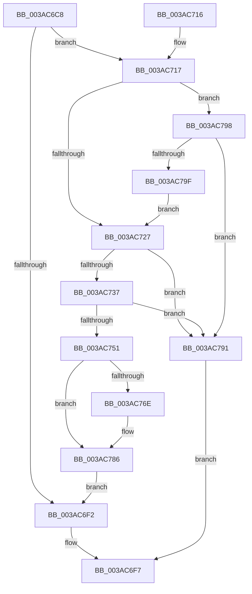

# SmArrayGrow

- RVA: `0x003AC6C8`–`0x003AC7A1` (길이 `217` bytes)
- VA: `0x00000001403AC6C8`
- 실행 섹션: `.text`
- PDB 이름 있음: `예`; PDB Function 태그: `아니요`
- unwind 정보 RVA: `0x0008BB64`
- 디코드: `69`개 명령, `217/217` bytes 표시
- 미해석 바이트: `0` (있으면 어셈블리에 `.byte`로 보존)

> 이 문서는 커널 이미지의 기계어와 PDB 기호를 분석해 생성했습니다. 4번과 5번은 함수 원형과 자료형을 바이너리 사용 방식에서 추정한 C 해석이며 원본 소스 복구 결과는 아닙니다.

## 1. Dependencies

- 직접 호출 지점: **4**; 고유 호출 대상: **4**
- 직접 호출자로 확인된 함수: **15**
- RIP 상대 이미지 참조: **0**

### Outgoing calls
- `0x003AC744` → [ExAllocatePool2](../../poolcode/B8/ExAllocatePool2_function_00B820F0.md) (function, `0x00B820F0`)
- `0x003AC765` → [memset](../6C/memset_function_006C6C40.md) (function, `0x006C6C40`)
- `0x003AC777` → [memcpy](../6C/memcpy_function_006C6840.md) (function, `0x006C6840`)
- `0x003AC781` → [ExFreePoolWithTag](../../poolcode/B8/ExFreePoolWithTag_function_00B82870.md) (function, `0x00B82870`)

### Direct callers
- [B_TREE&lt;_SM_PAGE_KEY,SMKM_STORE_MGR&lt;SM_TRAITS&gt;::SMKM_FRONTEND_ENTRY,4096,B_TREE_DUMMY_NODE_POOL,B_TREE_KEY_COMPARATOR&lt;_SM_PAGE_KEY&gt; &gt;::BTreeInsert](../26/B_TREE__SM_PAGE_KEY_SMKM_STORE_MGR_SM_TRAITS_SMKM_FRONTEND_ENTRY_4096_B_TREE_DUMMY_NODE_POOL_B_TREE__function_002663C0.md) at `0x0026655F`
- [sub_0026678D](../26/Unknown_function_0026678D.md) at `0x00266790`
- [B_TREE&lt;_SM_PAGE_KEY,SMKM_STORE_MGR&lt;SM_TRAITS&gt;::SMKM_FRONTEND_ENTRY,4096,B_TREE_DUMMY_NODE_POOL,B_TREE_KEY_COMPARATOR&lt;_SM_PAGE_KEY&gt; &gt;::BTreeSearchKey](../26/B_TREE__SM_PAGE_KEY_SMKM_STORE_MGR_SM_TRAITS_SMKM_FRONTEND_ENTRY_4096_B_TREE_DUMMY_NODE_POOL_B_TREE__function_00266E10.md) at `0x00266FC3`
- [sub_002DFB71](../2D/Unknown_function_002DFB71.md) at `0x002DFB8F`
- [SMKM_STORE_MGR&lt;SM_TRAITS&gt;::SmFeAddComplete](../2D/SMKM_STORE_MGR_SM_TRAITS_SmFeAddComplete_function_002DFEE0.md) at `0x002E02D3`
- [sub_002E0736](../2E/Unknown_function_002E0736.md) at `0x002E075C`
- [sub_003AB8D3](Unknown_function_003AB8D3.md) at `0x003AB8E4`
- [sub_003ABE86](Unknown_function_003ABE86.md) at `0x003ABE89`
- [ST_STORE&lt;SM_TRAITS&gt;::StDmpSinglePageLookup](ST_STORE_SM_TRAITS_StDmpSinglePageLookup_function_003ABFF0.md) at `0x003AC39A`
- [B_TREE&lt;_SM_PAGE_KEY,ST_STORE&lt;SM_TRAITS&gt;::_ST_PAGE_ENTRY,4096,NP_CONTEXT,B_TREE_KEY_COMPARATOR&lt;_SM_PAGE_KEY&gt; &gt;::BTreeSearchKey](B_TREE__SM_PAGE_KEY_ST_STORE_SM_TRAITS__ST_PAGE_ENTRY_4096_NP_CONTEXT_B_TREE_KEY_COMPARATOR__SM_PAGE_function_003AC3C0.md) at `0x003AC5B1`
- [sub_003ACB3C](Unknown_function_003ACB3C.md) at `0x003ACB57`
- [sub_003AD8D4](Unknown_function_003AD8D4.md) at `0x003AD8F3`
- [sub_003AE796](Unknown_function_003AE796.md) at `0x003AE7A7`
- [SMKM_STORE&lt;SM_TRAITS&gt;::SmStOutSwapStore](../49/SMKM_STORE_SM_TRAITS_SmStOutSwapStore_function_00496C84.md) at `0x00496E7D`
- [SmKmStoreFileGetExtents](../../page/7A/SmKmStoreFileGetExtents_function_007A971C.md) at `0x007A98BE`

### Static image references
- 디코드된 RIP-relative 메모리 참조가 없습니다.

## 2. Other-region calls and transfers

- 다른 실행 섹션으로 향하는 call: **2**
  - `0x003AC744` → [ExAllocatePool2](../../poolcode/B8/ExAllocatePool2_function_00B820F0.md) (`.text` → `POOLCODE`)
  - `0x003AC781` → [ExFreePoolWithTag](../../poolcode/B8/ExFreePoolWithTag_function_00B82870.md) (`.text` → `POOLCODE`)
- 별도 외부 분기/꼬리 이동을 확인하지 못했습니다.

## 3. Assembly (complete function range)

```asm
003AC6C8  48 8B C4                        mov rax, rsp
003AC6CB  48 89 58 08                     mov qword ptr [rax + 8], rbx
003AC6CF  48 89 68 10                     mov qword ptr [rax + 0x10], rbp
003AC6D3  48 89 70 18                     mov qword ptr [rax + 0x18], rsi
003AC6D7  48 89 78 20                     mov qword ptr [rax + 0x20], rdi
003AC6DB  41 54                           push r12
003AC6DD  41 56                           push r14
003AC6DF  41 57                           push r15
003AC6E1  48 83 EC 20                     sub rsp, 0x20
003AC6E5  41 8B 38                        mov edi, dword ptr [r8]
003AC6E8  4D 8B F1                        mov r14, r9
003AC6EB  4D 8B F8                        mov r15, r8
003AC6EE  3B CF                           cmp ecx, edi
003AC6F0  73 25                           jae 0x1403ac717
003AC6F2  B8 01 00 00 00                  mov eax, 1
003AC6F7  48 8B 5C 24 40                  mov rbx, qword ptr [rsp + 0x40]
003AC6FC  48 8B 6C 24 48                  mov rbp, qword ptr [rsp + 0x48]
003AC701  48 8B 74 24 50                  mov rsi, qword ptr [rsp + 0x50]
003AC706  48 8B 7C 24 58                  mov rdi, qword ptr [rsp + 0x58]
003AC70B  48 83 C4 20                     add rsp, 0x20
003AC70F  41 5F                           pop r15
003AC711  41 5E                           pop r14
003AC713  41 5C                           pop r12
003AC715  C3                              ret
003AC716  CC                              int3
003AC717  03 FF                           add edi, edi
003AC719  B8 08 00 00 00                  mov eax, 8
003AC71E  3B F8                           cmp edi, eax
003AC720  0F 42 F8                        cmovb edi, eax
003AC723  3B CF                           cmp ecx, edi
003AC725  73 71                           jae 0x1403ac798
003AC727  8B F7                           mov esi, edi
003AC729  B8 FF FF FF FF                  mov eax, 0xffffffff
003AC72E  48 C1 E6 04                     shl rsi, 4
003AC732  48 3B F0                        cmp rsi, rax
003AC735  77 5A                           ja 0x1403ac791
003AC737  8B D6                           mov edx, esi
003AC739  B9 40 00 00 00                  mov ecx, 0x40
003AC73E  41 B8 73 6D 41 72               mov r8d, 0x72416d73
003AC744  E8 A7 59 7D 00                  call 0x140b820f0
003AC749  48 8B E8                        mov rbp, rax
003AC74C  48 85 C0                        test rax, rax
003AC74F  74 40                           je 0x1403ac791
003AC751  41 8B 1F                        mov ebx, dword ptr [r15]
003AC754  33 D2                           xor edx, edx
003AC756  C1 E3 04                        shl ebx, 4
003AC759  2B F3                           sub esi, ebx
003AC75B  44 8B E3                        mov r12d, ebx
003AC75E  44 8B C6                        mov r8d, esi
003AC761  48 8D 0C 03                     lea rcx, [rbx + rax]
003AC765  E8 D6 A4 31 00                  call 0x1406c6c40
003AC76A  85 DB                           test ebx, ebx
003AC76C  74 18                           je 0x1403ac786
003AC76E  49 8B 16                        mov rdx, qword ptr [r14]
003AC771  45 8B C4                        mov r8d, r12d
003AC774  48 8B CD                        mov rcx, rbp
003AC777  E8 C4 A0 31 00                  call 0x1406c6840
003AC77C  49 8B 0E                        mov rcx, qword ptr [r14]
003AC77F  33 D2                           xor edx, edx
003AC781  E8 EA 60 7D 00                  call 0x140b82870
003AC786  49 89 2E                        mov qword ptr [r14], rbp
003AC789  41 89 3F                        mov dword ptr [r15], edi
003AC78C  E9 61 FF FF FF                  jmp 0x1403ac6f2
003AC791  33 C0                           xor eax, eax
003AC793  E9 5F FF FF FF                  jmp 0x1403ac6f7
003AC798  8D 79 08                        lea edi, [rcx + 8]
003AC79B  3B F9                           cmp edi, ecx
003AC79D  72 F2                           jb 0x1403ac791
003AC79F  EB 86                           jmp 0x1403ac727
```

## 4. C-style interpretation (structured pseudocode)

```c
__int64 __fastcall SmArrayGrow(int a1, __int64 a2, __int64 a3, __int64 a4)
{
    __int64 result;
    __int64 v_rbx;
    __int64 v_rdi;
    __int64 v_rsi;
    __int64 v_rsp;
    unsigned __int64 v_stack_p10;
    unsigned __int64 v_stack_p18;
    unsigned __int64 v_stack_p20;
    unsigned __int64 v_stack_p8;

    *(unsigned __int64 *)(v_rsp + 8) = v_rbx;
    *(unsigned __int64 *)(v_rsp + 16) = v_rbp;
    *(unsigned __int64 *)(v_rsp + 24) = v_rsi;
    *(unsigned __int64 *)(v_rsp + 32) = v_rdi;
    v_rsp = (v_rsp) - (32);
    if (a1 >= ((unsigned int)((unsigned int)(*(unsigned int *)(a3))))) goto loc_003AC717;
loc_003AC6F2:
loc_003AC6F7:
    v_rsp = (v_rsp) + (32);
    return 1;
loc_003AC717:
    v_rdi = (unsigned int)((v_stack_p20) + ((unsigned int)(v_stack_p20)));
    if (((unsigned int)(v_rdi)) < 8) { v_rdi = 8; }
    if (a1 >= ((unsigned int)(v_rdi))) goto loc_003AC798;
loc_003AC727:
    v_rsi = ((unsigned int)((unsigned int)(v_rdi))) << (4);
    if (v_rsi > ((unsigned int)(0xFFFFFFFFULL))) goto loc_003AC791;
    result = ExAllocatePool2(64, (unsigned int)((unsigned int)(v_rsi)), (unsigned int)(0x72416D73ULL), a4);
    if (result == 0) goto loc_003AC791;
    a2 = 0;
    v_rbx = (unsigned int)(((unsigned int)(*(unsigned int *)(a3))) << (4));
    v_rsi = (unsigned int)((v_rsi) - ((unsigned int)(v_rbx)));
    result = memset(v_rbx + result * 1, a2, (unsigned int)((unsigned int)(v_rsi)), a4);
    if ((unsigned int)(v_rbx) != 0) {
        a2 = *(unsigned __int64 *)(a4);
        a3 = (unsigned int)((unsigned int)((unsigned int)(v_rbx)));
        a1 = result;
        result = memcpy(a1, a2, a3, a4);
        a1 = *(unsigned __int64 *)(a4);
        a2 = 0;
        result = ExFreePoolWithTag(a1, a2, a3, a4);
    }
    *(unsigned __int64 *)(a4) = result;
    *(unsigned int *)(a3) = (unsigned int)(v_rdi);
    goto loc_003AC6F2;
loc_003AC791:
    result = 0;
    goto loc_003AC6F7;
loc_003AC798:
    if (((unsigned int)(a1 + 8)) < a1) goto loc_003AC791;
    goto loc_003AC727;
}
```

## 5. (Beta) C Style

```c
int64_t SmArrayGrow(int32_t Arg1, int64_t Arg2, void *Arg3, void *Arg4)
{
    uint8_t *arg3 = (uint8_t *)Arg3;
    uint8_t *arg4 = (uint8_t *)Arg4;

    int64_t result;
    int64_t local_rbx;
    int64_t local_rdi;
    int64_t local_rsi;
    int64_t local_rsp;
    uint64_t v_stack_p10;
    uint64_t v_stack_p18;
    uint64_t v_stack_p20;
    uint64_t v_stack_p8;

    *(uint64_t *)(local_rsp + 0x8) = local_rbx;
    *(uint64_t *)(local_rsp + 0x10) = local_rbp;
    *(uint64_t *)(local_rsp + 0x18) = local_rsi;
    *(uint64_t *)(local_rsp + 0x20) = local_rdi;
    local_rsp = (local_rsp) - (32);
    if (Arg1 >= ((uint32_t)((uint32_t)(*(uint32_t *)(arg3))))) goto loc_003AC717;
loc_003AC6F2:
loc_003AC6F7:
    local_rsp = (local_rsp) + (32);
    return 1;
loc_003AC717:
    local_rdi = (uint32_t)((v_stack_p20) + ((uint32_t)(v_stack_p20)));
    if (((uint32_t)(local_rdi)) < 8) { local_rdi = 8; }
    if (Arg1 >= ((uint32_t)(local_rdi))) goto loc_003AC798;
loc_003AC727:
    local_rsi = ((uint32_t)((uint32_t)(local_rdi))) << (4);
    if (local_rsi > ((uint32_t)(0xFFFFFFFFULL))) goto loc_003AC791;
    result = ExAllocatePool2(64, (uint32_t)((uint32_t)(local_rsi)), (uint32_t)(0x72416D73ULL), Arg4);
    if (result == 0) goto loc_003AC791;
    Arg2 = 0;
    local_rbx = (uint32_t)(((uint32_t)(*(uint32_t *)(arg3))) << (4));
    local_rsi = (uint32_t)((local_rsi) - ((uint32_t)(local_rbx)));
    result = memset(local_rbx + result * 1, Arg2, (uint32_t)((uint32_t)(local_rsi)), Arg4);
    if ((uint32_t)(local_rbx) != 0) {
        Arg2 = *(uint64_t *)(arg4);
        Arg3 = (uint32_t)((uint32_t)((uint32_t)(local_rbx)));
        Arg1 = result;
        result = memcpy(Arg1, Arg2, Arg3, Arg4);
        Arg1 = *(uint64_t *)(arg4);
        Arg2 = 0;
        result = ExFreePoolWithTag(Arg1, Arg2, Arg3, Arg4);
    }
    *(uint64_t *)(arg4) = result;
    *(uint32_t *)(arg3) = (uint32_t)(local_rdi);
    goto loc_003AC6F2;
loc_003AC791:
    result = 0;
    goto loc_003AC6F7;
loc_003AC798:
    if (((uint32_t)(Arg1 + 8)) < Arg1) goto loc_003AC791;
    goto loc_003AC727;
}
```

### 관측된 메모리 오프셋

구조체 형식이 확인되지 않은 접근은 인자 기준의 오프셋으로만 기록했습니다.

| 기준 인자 | 오프셋 표현 | 폭 (bit) | 접근 |
|---|---:|---:|---|
| `Arg3` | `+ 0x0` | `32` | `R` |
| `Arg3` | `+ 0x0` | `32` | `W` |
| `Arg4` | `+ 0x0` | `64` | `R` |
| `Arg4` | `+ 0x0` | `64` | `W` |

## 6. Execution-region graph

[열기: 2D/3D 그래프와 함수 탐색 컨트롤 패널](../../../control-panel.html?section=text&rva=0x003AC6C8&view=graph)

- 2D 그래프는 위에서 아래로 흐르고, 3D 그래프는 빈 공간을 드래그해 회전합니다. Shift+드래그는 이동, 휠은 확대·축소, 함수 노드 선택은 대상 보고서 이동입니다.

### Static fallback


