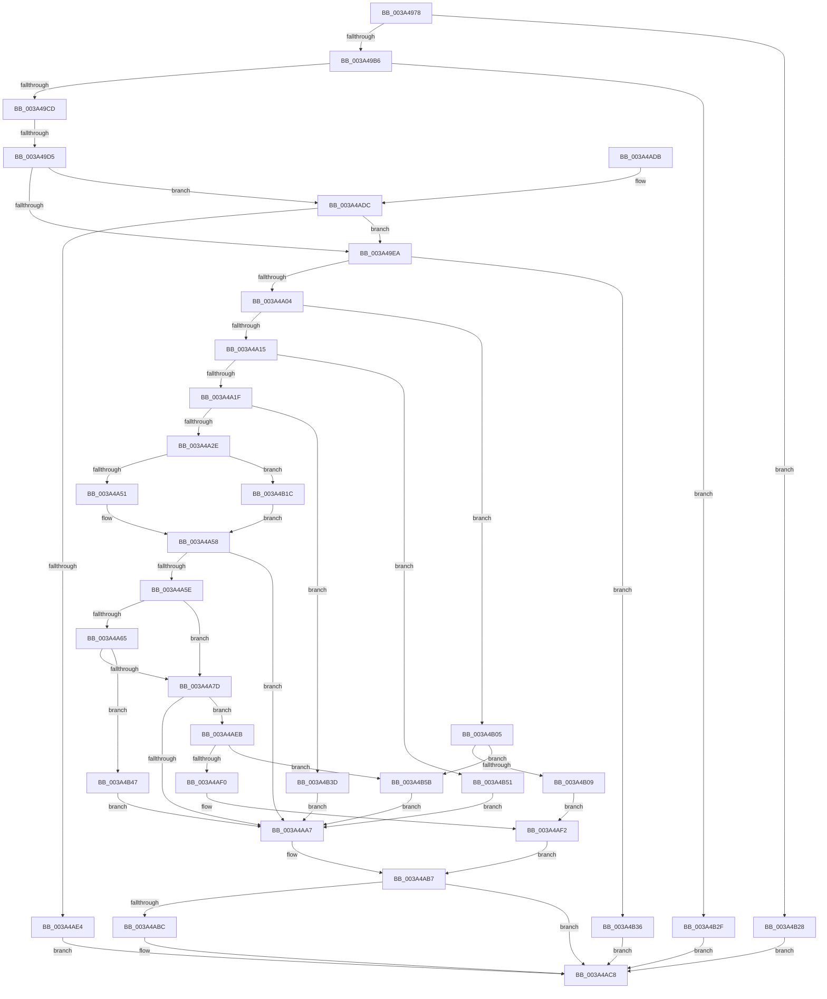

# SmDecompressBuffer

- RVA: `0x003A4978`–`0x003A4B65` (길이 `493` bytes)
- VA: `0x00000001403A4978`
- 실행 섹션: `.text`
- PDB 이름 있음: `예`; PDB Function 태그: `예`
- unwind 정보 RVA: `0x00089998`
- 디코드: `144`개 명령, `493/493` bytes 표시
- 미해석 바이트: `0` (있으면 어셈블리에 `.byte`로 보존)

> 이 문서는 커널 이미지의 기계어와 PDB 기호를 분석해 생성했습니다. 4번과 5번은 함수 원형과 자료형을 바이너리 사용 방식에서 추정한 C 해석이며 원본 소스 복구 결과는 아닙니다.

## 1. Dependencies

- 직접 호출 지점: **8**; 고유 호출 대상: **4**
- 직접 호출자로 확인된 함수: **1**
- RIP 상대 이미지 참조: **2**

### Outgoing calls
- `0x003A49F3` → [guard_dispatch_icall](../6B/guard_dispatch_icall_function_006BAAD0.md) (function, `0x006BAAD0`)
- `0x003A4A53` → [RtlCompressWorkSpaceSizeLZNT1](../../pagelk/B7/RtlCompressWorkSpaceSizeLZNT1_function_00B789B0.md) (function, `0x00B789B0`)
- `0x003A4A6C` → [guard_dispatch_icall](../6B/guard_dispatch_icall_function_006BAAD0.md) (function, `0x006BAAD0`)
- `0x003A4A9C` → [RtlDecompressBufferEx](RtlDecompressBufferEx_function_003A4C60.md) (function, `0x003A4C60`)
- `0x003A4AB2` → [guard_dispatch_icall](../6B/guard_dispatch_icall_function_006BAAD0.md) (function, `0x006BAAD0`)
- `0x003A4AC3` → [guard_dispatch_icall](../6B/guard_dispatch_icall_function_006BAAD0.md) (function, `0x006BAAD0`)
- `0x003A4B12` → [memcpy](../6C/memcpy_function_006C6840.md) (function, `0x006C6840`)
- `0x003A4B1E` → [guard_dispatch_icall](../6B/guard_dispatch_icall_function_006BAAD0.md) (function, `0x006BAAD0`)

### Direct callers
- [PfSnGetPrefetchInstructions](../../page/8A/PfSnGetPrefetchInstructions_function_008AEBE4.md) at `0x008AEE3D`

### Static image references
- `0x003A4A2E` → RVA `0x00002060` (`.rdata`; read)
- `0x003A4A3D` → RVA `0x00B789B0` (`RtlCompressWorkSpaceSizeLZNT1`; read)

## 2. Other-region calls and transfers

- 다른 실행 섹션으로 향하는 call: **1**
  - `0x003A4A53` → [RtlCompressWorkSpaceSizeLZNT1](../../pagelk/B7/RtlCompressWorkSpaceSizeLZNT1_function_00B789B0.md) (`.text` → `PAGELK`)
- call이 아닌 외부 분기/꼬리 이동: **1**
  - `0x003A49CF` → [sub_006E6614](../6E/Unknown_function_006E6614.md) (`tail-transfer`)

## 3. Assembly (complete function range)

```asm
003A4978  4C 89 4C 24 20                  mov qword ptr [rsp + 0x20], r9
003A497D  4C 89 44 24 18                  mov qword ptr [rsp + 0x18], r8
003A4982  55                              push rbp
003A4983  53                              push rbx
003A4984  56                              push rsi
003A4985  57                              push rdi
003A4986  41 54                           push r12
003A4988  41 55                           push r13
003A498A  41 56                           push r14
003A498C  41 57                           push r15
003A498E  48 8B EC                        mov rbp, rsp
003A4991  48 83 EC 58                     sub rsp, 0x58
003A4995  33 DB                           xor ebx, ebx
003A4997  8B F2                           mov esi, edx
003A4999  4C 8B F1                        mov r14, rcx
003A499C  89 5D 48                        mov dword ptr [rbp + 0x48], ebx
003A499F  89 5D 50                        mov dword ptr [rbp + 0x50], ebx
003A49A2  44 8B FB                        mov r15d, ebx
003A49A5  89 5D E8                        mov dword ptr [rbp - 0x18], ebx
003A49A8  4C 8B E1                        mov r12, rcx
003A49AB  8D 53 08                        lea edx, [rbx + 8]
003A49AE  3B F2                           cmp esi, edx
003A49B0  0F 82 72 01 00 00               jb 0x1403a4b28
003A49B6  8B 09                           mov ecx, dword ptr [rcx]
003A49B8  83 C6 F8                        add esi, -8
003A49BB  8B C1                           mov eax, ecx
003A49BD  25 FF FF FF 00                  and eax, 0xffffff
003A49C2  3D 4D 41 4D 00                  cmp eax, 0x4d414d
003A49C7  0F 85 62 01 00 00               jne 0x1403a4b2f
003A49CD  85 C9                           test ecx, ecx
003A49CF  0F 88 3F 1C 34 00               js 0x1406e6614
003A49D5  4C 03 F2                        add r14, rdx
003A49D8  48 8B 45 68                     mov rax, qword ptr [rbp + 0x68]
003A49DC  41 8B 7C 24 04                  mov edi, dword ptr [r12 + 4]
003A49E1  48 85 C0                        test rax, rax
003A49E4  0F 85 F2 00 00 00               jne 0x1403a4adc
003A49EA  48 8B 45 70                     mov rax, qword ptr [rbp + 0x70]
003A49EE  8B CF                           mov ecx, edi
003A49F0  48 8B 00                        mov rax, qword ptr [rax]
003A49F3  E8 D8 60 31 00                  call 0x1406baad0
003A49F8  4C 8B E8                        mov r13, rax
003A49FB  48 85 C0                        test rax, rax
003A49FE  0F 84 32 01 00 00               je 0x1403a4b36
003A4A04  41 8A 44 24 03                  mov al, byte ptr [r12 + 3]
003A4A09  24 7F                           and al, 0x7f
003A4A0B  44 0F B6 E0                     movzx r12d, al
003A4A0F  0F 84 F0 00 00 00               je 0x1403a4b05
003A4A15  41 83 FC 01                     cmp r12d, 1
003A4A19  0F 84 32 01 00 00               je 0x1403a4b51
003A4A1F  B8 08 00 00 00                  mov eax, 8
003A4A24  66 44 3B E0                     cmp r12w, ax
003A4A28  0F 87 0F 01 00 00               ja 0x1403a4b3d
003A4A2E  48 8D 0D 2B D6 C5 FF            lea rcx, [rip - 0x3a29d5]
003A4A35  4A 8B 04 E1                     mov rax, qword ptr [rcx + r12*8]
003A4A39  4C 8D 45 50                     lea r8, [rbp + 0x50]
003A4A3D  48 8D 0D 6C 3F 7D 00            lea rcx, [rip + 0x7d3f6c]
003A4A44  48 8D 55 E8                     lea rdx, [rbp - 0x18]
003A4A48  48 3B C1                        cmp rax, rcx
003A4A4B  0F 85 CB 00 00 00               jne 0x1403a4b1c
003A4A51  33 C9                           xor ecx, ecx
003A4A53  E8 58 3F 7D 00                  call 0x140b789b0
003A4A58  8B D8                           mov ebx, eax
003A4A5A  85 C0                           test eax, eax
003A4A5C  78 49                           js 0x1403a4aa7
003A4A5E  8B 4D 50                        mov ecx, dword ptr [rbp + 0x50]
003A4A61  85 C9                           test ecx, ecx
003A4A63  74 18                           je 0x1403a4a7d
003A4A65  48 8B 45 70                     mov rax, qword ptr [rbp + 0x70]
003A4A69  48 8B 00                        mov rax, qword ptr [rax]
003A4A6C  E8 5F 60 31 00                  call 0x1406baad0
003A4A71  4C 8B F8                        mov r15, rax
003A4A74  48 85 C0                        test rax, rax
003A4A77  0F 84 CA 00 00 00               je 0x1403a4b47
003A4A7D  48 8D 45 48                     lea rax, [rbp + 0x48]
003A4A81  4C 89 7C 24 30                  mov qword ptr [rsp + 0x30], r15
003A4A86  48 89 44 24 28                  mov qword ptr [rsp + 0x28], rax
003A4A8B  4D 8B CE                        mov r9, r14
003A4A8E  44 8B C7                        mov r8d, edi
003A4A91  89 74 24 20                     mov dword ptr [rsp + 0x20], esi
003A4A95  49 8B D5                        mov rdx, r13
003A4A98  41 0F B7 CC                     movzx ecx, r12w
003A4A9C  E8 BF 01 00 00                  call 0x1403a4c60
003A4AA1  8B D8                           mov ebx, eax
003A4AA3  85 C0                           test eax, eax
003A4AA5  79 44                           jns 0x1403a4aeb
003A4AA7  48 8B 7D 70                     mov rdi, qword ptr [rbp + 0x70]
003A4AAB  49 8B CD                        mov rcx, r13
003A4AAE  48 8B 47 08                     mov rax, qword ptr [rdi + 8]
003A4AB2  E8 19 60 31 00                  call 0x1406baad0
003A4AB7  4D 85 FF                        test r15, r15
003A4ABA  74 0C                           je 0x1403a4ac8
003A4ABC  48 8B 47 08                     mov rax, qword ptr [rdi + 8]
003A4AC0  49 8B CF                        mov rcx, r15
003A4AC3  E8 08 60 31 00                  call 0x1406baad0
003A4AC8  8B C3                           mov eax, ebx
003A4ACA  48 83 C4 58                     add rsp, 0x58
003A4ACE  41 5F                           pop r15
003A4AD0  41 5E                           pop r14
003A4AD2  41 5D                           pop r13
003A4AD4  41 5C                           pop r12
003A4AD6  5F                              pop rdi
003A4AD7  5E                              pop rsi
003A4AD8  5B                              pop rbx
003A4AD9  5D                              pop rbp
003A4ADA  C3                              ret
003A4ADB  CC                              int3
003A4ADC  3B 38                           cmp edi, dword ptr [rax]
003A4ADE  0F 86 06 FF FF FF               jbe 0x1403a49ea
003A4AE4  BB 04 09 00 C0                  mov ebx, 0xc0000904
003A4AE9  EB DD                           jmp 0x1403a4ac8
003A4AEB  3B 7D 48                        cmp edi, dword ptr [rbp + 0x48]
003A4AEE  75 6B                           jne 0x1403a4b5b
003A4AF0  33 DB                           xor ebx, ebx
003A4AF2  48 8B 45 58                     mov rax, qword ptr [rbp + 0x58]
003A4AF6  4C 89 28                        mov qword ptr [rax], r13
003A4AF9  48 8B 45 60                     mov rax, qword ptr [rbp + 0x60]
003A4AFD  89 38                           mov dword ptr [rax], edi
003A4AFF  48 8B 7D 70                     mov rdi, qword ptr [rbp + 0x70]
003A4B03  EB B2                           jmp 0x1403a4ab7
003A4B05  3B F7                           cmp esi, edi
003A4B07  75 52                           jne 0x1403a4b5b
003A4B09  4C 8B C7                        mov r8, rdi
003A4B0C  49 8B D6                        mov rdx, r14
003A4B0F  49 8B CD                        mov rcx, r13
003A4B12  E8 29 1D 32 00                  call 0x1406c6840
003A4B17  89 7D 48                        mov dword ptr [rbp + 0x48], edi
003A4B1A  EB D6                           jmp 0x1403a4af2
003A4B1C  33 C9                           xor ecx, ecx
003A4B1E  E8 AD 5F 31 00                  call 0x1406baad0
003A4B23  E9 30 FF FF FF                  jmp 0x1403a4a58
003A4B28  BB 42 02 00 C0                  mov ebx, 0xc0000242
003A4B2D  EB 99                           jmp 0x1403a4ac8
003A4B2F  BB 98 00 00 C0                  mov ebx, 0xc0000098
003A4B34  EB 92                           jmp 0x1403a4ac8
003A4B36  BB 9A 00 00 C0                  mov ebx, 0xc000009a
003A4B3B  EB 8B                           jmp 0x1403a4ac8
003A4B3D  BB 5F 02 00 C0                  mov ebx, 0xc000025f
003A4B42  E9 60 FF FF FF                  jmp 0x1403a4aa7
003A4B47  BB 9A 00 00 C0                  mov ebx, 0xc000009a
003A4B4C  E9 56 FF FF FF                  jmp 0x1403a4aa7
003A4B51  BB 0D 00 00 C0                  mov ebx, 0xc000000d
003A4B56  E9 4C FF FF FF                  jmp 0x1403a4aa7
003A4B5B  BB 42 02 00 C0                  mov ebx, 0xc0000242
003A4B60  E9 42 FF FF FF                  jmp 0x1403a4aa7
```

## 4. C-style interpretation (structured pseudocode)

```c
__int64 __fastcall SmDecompressBuffer(__int64 a1, int a2, __int64 a3, __int64 a4, __int64 a5, __int64 a6)
{
    __int64 result;
    __int64 v_r14;
    __int64 v_rbx;
    __int64 v_rsi;
    __int64 v_rsp;
    unsigned int v_stack_m58;
    unsigned __int64 v_stack_m68;
    unsigned __int64 v_stack_m70;
    unsigned int v_stack_m78;
    unsigned int v_stack_p10;
    unsigned __int64 v_stack_p18;
    unsigned __int64 v_stack_p20;
    unsigned int v_stack_p8;

    v_stack_p20 = a4;
    v_stack_p18 = a3;
    v_rsp = (v_rsp) - (88);
    v_rbx = 0;
    v_stack_p8 = 0;
    v_stack_p10 = 0;
    v_stack_m58 = 0;
    if (((unsigned int)((unsigned int)(a2))) < ((unsigned int)(v_rbx + 8))) goto loc_003A4B28;
    v_rsi = (unsigned int)(((unsigned int)(a2)) + (-8));
    result = (unsigned int)(((unsigned int)((unsigned int)((unsigned int)(*(unsigned int *)(a1))))) & (0xFFFFFFULL));
    if (((unsigned int)(result)) != 0x4D414DULL) goto loc_003A4B2F;
    v_r14 = (a1) + (v_rbx + 8);
    if (a5 != 0) goto loc_003A4ADC;
loc_003A49EA:
    result = guard_dispatch_icall((unsigned int)((unsigned int)((unsigned int)(*(unsigned int *)(a1 + 4)))), v_rbx + 8, a3, a4);
    if (result == 0) goto loc_003A4B36;
    result = (unsigned __int8)((*(unsigned __int8 *)(a1 + 3)) & (127));
    if (condition_is_equal) goto loc_003A4B05;
    if (((unsigned int)((unsigned __int8)(result))) == 1) goto loc_003A4B51;
    if (((unsigned __int16)((unsigned __int8)(result))) > 8) goto loc_003A4B3D;
    if ((*(unsigned __int64 *)(v_rip - 3811797 + (unsigned __int8)(result) * 8)) != (v_rip + 8208236)) goto loc_003A4B1C;
    a1 = 0;
    result = RtlCompressWorkSpaceSizeLZNT1(a1, v_stack_m58, v_stack_p10, a4);
loc_003A4A58:
    if (sign_flag) goto loc_003A4AA7;
    if ((unsigned int)((unsigned int)(v_stack_p10)) == 0) goto loc_003A4A7D;
    result = guard_dispatch_icall((unsigned int)(v_stack_p10), v_stack_m58, v_stack_p10, a4);
    if (result == 0) goto loc_003A4B47;
loc_003A4A7D:
    v_stack_m68 = result;
    v_stack_m70 = v_stack_p8;
    v_stack_m78 = (unsigned int)(v_rsi);
    result = RtlDecompressBufferEx((unsigned __int16)((unsigned __int8)(result)), result, (unsigned int)((unsigned int)((unsigned int)(*(unsigned int *)(a1 + 4)))), v_r14);
    if (!sign_flag) goto loc_003A4AEB;
loc_003A4AA7:
    result = guard_dispatch_icall(result, result, (unsigned int)((unsigned int)((unsigned int)(*(unsigned int *)(a1 + 4)))), v_r14);
loc_003A4AB7:
    if (result != 0) {
        result = *(unsigned __int64 *)(a6 + 8);
        a1 = result;
        result = guard_dispatch_icall(a1, result, (unsigned int)((unsigned int)((unsigned int)(*(unsigned int *)(a1 + 4)))), v_r14);
    }
    v_rsp = (v_rsp) + (88);
    return (unsigned int)((unsigned int)((unsigned int)((unsigned int)(result))));
loc_003A4ADC:
    if (((unsigned int)(a6)) <= (*(unsigned int *)((unsigned int)((unsigned int)((unsigned int)((unsigned int)(result))))))) goto loc_003A49EA;
    goto loc_003A4AC8;
loc_003A4AEB:
    if (((unsigned int)(a6)) != v_stack_p8) goto loc_003A4B5B;
    v_rbx = 0;
loc_003A4AF2:
    *(unsigned __int64 *)(v_stack_p18) = result;
    *(unsigned int *)(v_stack_p20) = (unsigned int)(a6);
    goto loc_003A4AB7;
loc_003A4B05:
    if (((unsigned int)(v_rsi)) != ((unsigned int)(a6))) goto loc_003A4B5B;
    result = memcpy(result, v_r14, a6, v_r14);
    v_stack_p8 = (unsigned int)(a6);
    goto loc_003A4AF2;
loc_003A4B1C:
    a1 = 0;
    result = guard_dispatch_icall(a1, v_r14, a6, v_r14);
    goto loc_003A4A58;
loc_003A4B28:
    goto loc_003A4AC8;
loc_003A4B2F:
    goto loc_003A4AC8;
loc_003A4B36:
    goto loc_003A4AC8;
loc_003A4B3D:
    goto loc_003A4AA7;
loc_003A4B47:
    goto loc_003A4AA7;
loc_003A4B51:
    goto loc_003A4AA7;
loc_003A4B5B:
    goto loc_003A4AA7;
}
```

## 5. (Beta) C Style

```c
int64_t SmDecompressBuffer(void *Arg1, int32_t Arg2, int64_t Arg3, int64_t Arg4, int64_t Arg5, void *Arg6)
{
    uint8_t *arg1 = (uint8_t *)Arg1;
    uint8_t *arg6 = (uint8_t *)Arg6;

    int64_t result;
    int64_t local_r14;
    int64_t local_rbx;
    int64_t local_rsi;
    int64_t local_rsp;
    uint32_t v_stack_m58;
    uint64_t v_stack_m68;
    uint64_t v_stack_m70;
    uint32_t v_stack_m78;
    uint32_t v_stack_p10;
    uint64_t v_stack_p18;
    uint64_t v_stack_p20;
    uint32_t v_stack_p8;

    v_stack_p20 = Arg4;
    v_stack_p18 = Arg3;
    local_rsp = (local_rsp) - (88);
    local_rbx = 0;
    v_stack_p8 = 0;
    v_stack_p10 = 0;
    v_stack_m58 = 0;
    if (((uint32_t)((uint32_t)(Arg2))) < ((uint32_t)(local_rbx + 8))) goto loc_003A4B28;
    local_rsi = (uint32_t)(((uint32_t)(Arg2)) + (-8));
    result = (uint32_t)(((uint32_t)((uint32_t)((uint32_t)(*(uint32_t *)(arg1))))) & (0xFFFFFFULL));
    if (((uint32_t)(result)) != 0x4D414DULL) goto loc_003A4B2F;
    local_r14 = (Arg1) + (local_rbx + 8);
    if (Arg5 != 0) goto loc_003A4ADC;
loc_003A49EA:
    result = guard_dispatch_icall((uint32_t)((uint32_t)((uint32_t)(*(uint32_t *)(arg1 + 0x4)))), local_rbx + 8, Arg3, Arg4);
    if (result == 0) goto loc_003A4B36;
    result = (uint8_t)((*(uint8_t *)(arg1 + 0x3)) & (127));
    if (condition_is_equal) goto loc_003A4B05;
    if (((uint32_t)((uint8_t)(result))) == 1) goto loc_003A4B51;
    if (((uint16_t)((uint8_t)(result))) > 8) goto loc_003A4B3D;
    if ((*(uint64_t *)(v_rip - 0x3A29D5 + (uint8_t)(result) * 8)) != (v_rip + 8208236)) goto loc_003A4B1C;
    Arg1 = 0;
    result = RtlCompressWorkSpaceSizeLZNT1(Arg1, v_stack_m58, v_stack_p10, Arg4);
loc_003A4A58:
    if (sign_flag) goto loc_003A4AA7;
    if ((uint32_t)((uint32_t)(v_stack_p10)) == 0) goto loc_003A4A7D;
    result = guard_dispatch_icall((uint32_t)(v_stack_p10), v_stack_m58, v_stack_p10, Arg4);
    if (result == 0) goto loc_003A4B47;
loc_003A4A7D:
    v_stack_m68 = result;
    v_stack_m70 = v_stack_p8;
    v_stack_m78 = (uint32_t)(local_rsi);
    result = RtlDecompressBufferEx((uint16_t)((uint8_t)(result)), result, (uint32_t)((uint32_t)((uint32_t)(*(uint32_t *)(arg1 + 0x4)))), local_r14);
    if (!sign_flag) goto loc_003A4AEB;
loc_003A4AA7:
    result = guard_dispatch_icall(result, result, (uint32_t)((uint32_t)((uint32_t)(*(uint32_t *)(arg1 + 0x4)))), local_r14);
loc_003A4AB7:
    if (result != 0) {
        result = *(uint64_t *)(arg6 + 0x8);
        Arg1 = result;
        result = guard_dispatch_icall(Arg1, result, (uint32_t)((uint32_t)((uint32_t)(*(uint32_t *)(arg1 + 0x4)))), local_r14);
    }
    local_rsp = (local_rsp) + (88);
    return (uint32_t)((uint32_t)((uint32_t)((uint32_t)(result))));
loc_003A4ADC:
    if (((uint32_t)(Arg6)) <= (*(uint32_t *)((uint32_t)((uint32_t)((uint32_t)((uint32_t)(result))))))) goto loc_003A49EA;
    goto loc_003A4AC8;
loc_003A4AEB:
    if (((uint32_t)(Arg6)) != v_stack_p8) goto loc_003A4B5B;
    local_rbx = 0;
loc_003A4AF2:
    *(uint64_t *)(v_stack_p18) = result;
    *(uint32_t *)(v_stack_p20) = (uint32_t)(Arg6);
    goto loc_003A4AB7;
loc_003A4B05:
    if (((uint32_t)(local_rsi)) != ((uint32_t)(Arg6))) goto loc_003A4B5B;
    result = memcpy(result, local_r14, Arg6, local_r14);
    v_stack_p8 = (uint32_t)(Arg6);
    goto loc_003A4AF2;
loc_003A4B1C:
    Arg1 = 0;
    result = guard_dispatch_icall(Arg1, local_r14, Arg6, local_r14);
    goto loc_003A4A58;
loc_003A4B28:
    goto loc_003A4AC8;
loc_003A4B2F:
    goto loc_003A4AC8;
loc_003A4B36:
    goto loc_003A4AC8;
loc_003A4B3D:
    goto loc_003A4AA7;
loc_003A4B47:
    goto loc_003A4AA7;
loc_003A4B51:
    goto loc_003A4AA7;
loc_003A4B5B:
    goto loc_003A4AA7;
}
```

### 관측된 메모리 오프셋

구조체 형식이 확인되지 않은 접근은 인자 기준의 오프셋으로만 기록했습니다.

| 기준 인자 | 오프셋 표현 | 폭 (bit) | 접근 |
|---|---:|---:|---|
| `Arg1` | `+ 0x0` | `32` | `R` |
| `Arg1` | `+ 0x3` | `8` | `R` |
| `Arg1` | `+ 0x4` | `32` | `R` |
| `Arg6` | `+ 0x0` | `64` | `R` |
| `Arg6` | `+ 0x8` | `64` | `R` |

## 6. Execution-region graph

[열기: 2D/3D 그래프와 함수 탐색 컨트롤 패널](../../../control-panel.html?section=text&rva=0x003A4978&view=graph)

- 2D 그래프는 위에서 아래로 흐르고, 3D 그래프는 빈 공간을 드래그해 회전합니다. Shift+드래그는 이동, 휠은 확대·축소, 함수 노드 선택은 대상 보고서 이동입니다.

### Static fallback


