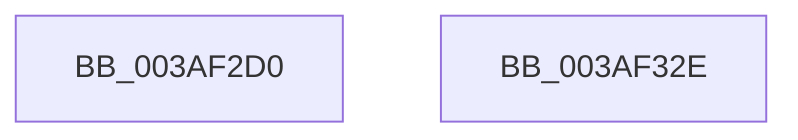

# SmEtwEnabled

- RVA: `0x003AF2D0`–`0x003AF32F` (길이 `95` bytes)
- VA: `0x00000001403AF2D0`
- 실행 섹션: `.text`
- PDB 이름 있음: `예`; PDB Function 태그: `아니요`
- unwind 정보 RVA: `0x0008C108`
- 디코드: `20`개 명령, `95/95` bytes 표시
- 미해석 바이트: `0` (있으면 어셈블리에 `.byte`로 보존)

> 이 문서는 커널 이미지의 기계어와 PDB 기호를 분석해 생성했습니다. 4번과 5번은 함수 원형과 자료형을 바이너리 사용 방식에서 추정한 C 해석이며 원본 소스 복구 결과는 아닙니다.

## 1. Dependencies

- 직접 호출 지점: **1**; 고유 호출 대상: **1**
- 직접 호출자로 확인된 함수: **11**
- RIP 상대 이미지 참조: **3**

### Outgoing calls
- `0x003AF324` → [_security_check_cookie](../6A/_security_check_cookie_function_006AC640.md) (function, `0x006AC640`)

### Direct callers
- [ST_STORE&lt;SM_TRAITS&gt;::StReleaseRegion](ST_STORE_SM_TRAITS_StReleaseRegion_function_003AF138.md) at `0x003AF1AA`
- [ST_STORE&lt;SM_TRAITS&gt;::StDmDeviceIoCompletion](../4B/ST_STORE_SM_TRAITS_StDmDeviceIoCompletion_function_004BBB70.md) at `0x004BBC4F`
- [ST_STORE&lt;SM_TRAITS&gt;::StEmptyStore](../4F/ST_STORE_SM_TRAITS_StEmptyStore_function_004FB4B0.md) at `0x004FB4C1`
- [ST_STORE&lt;SM_TRAITS&gt;::StDmEtwPageRundown](../60/ST_STORE_SM_TRAITS_StDmEtwPageRundown_function_0060D544.md) at `0x0060D570`
- [ST_STORE&lt;SM_TRAITS&gt;::StDmEtwRegionRundown](../60/ST_STORE_SM_TRAITS_StDmEtwRegionRundown_function_0060D6B0.md) at `0x0060D6CC`
- [ST_STORE&lt;SM_TRAITS&gt;::StDmPageError](../60/ST_STORE_SM_TRAITS_StDmPageError_function_0060DDDC.md) at `0x0060DE13`
- [ST_STORE&lt;SM_TRAITS&gt;::StDmRegionEvict](../60/ST_STORE_SM_TRAITS_StDmRegionEvict_function_0060DF9C.md) at `0x0060DFF7`
- [SmKmStoreTerminateWorker](../60/SmKmStoreTerminateWorker_function_0060FB30.md) at `0x0060FCB7`
- [SmEtwEnableCallback](../../page/7A/SmEtwEnableCallback_function_007AA080.md) at `0x007AA17E`
- [SmKmStoreAdd](../../page/A5/SmKmStoreAdd_function_00A512D0.md) at `0x00A514AE`
- [SmKmStoreDelete](../../page/A6/SmKmStoreDelete_function_00A6D7D0.md) at `0x00A6D8B3`

### Static image references
- `0x003AF2D4` → RVA `0x00E0A740` (`.data`; read)
- `0x003AF30B` → RVA `0x00E288D0` (`.data`; read)
- `0x003AF312` → RVA `0x00E288DC` (`.data`; reference)

## 2. Other-region calls and transfers

- 다른 실행 섹션으로 향하는 call: **0**
- 별도 외부 분기/꼬리 이동을 확인하지 못했습니다.

## 3. Assembly (complete function range)

```asm
003AF2D0  48 83 EC 28                     sub rsp, 0x28
003AF2D4  48 8B 05 65 B4 A5 00            mov rax, qword ptr [rip + 0xa5b465]
003AF2DB  48 33 C4                        xor rax, rsp
003AF2DE  48 89 44 24 18                  mov qword ptr [rsp + 0x18], rax
003AF2E3  48 63 C9                        movsxd rcx, ecx
003AF2E6  33 C0                           xor eax, eax
003AF2E8  48 C7 04 24 10 00 00 00         mov qword ptr [rsp], 0x10
003AF2F0  C7 44 24 08 40 00 00 00         mov dword ptr [rsp + 8], 0x40
003AF2F8  C7 44 24 0C 80 00 00 00         mov dword ptr [rsp + 0xc], 0x80
003AF300  C7 44 24 10 00 01 00 00         mov dword ptr [rsp + 0x10], 0x100
003AF308  8B 14 8C                        mov edx, dword ptr [rsp + rcx*4]
003AF30B  48 8D 0D BE 95 A7 00            lea rcx, [rip + 0xa795be]
003AF312  85 15 C4 95 A7 00               test dword ptr [rip + 0xa795c4], edx
003AF318  48 0F 45 C1                     cmovne rax, rcx
003AF31C  48 8B 4C 24 18                  mov rcx, qword ptr [rsp + 0x18]
003AF321  48 33 CC                        xor rcx, rsp
003AF324  E8 17 D3 2F 00                  call 0x1406ac640
003AF329  48 83 C4 28                     add rsp, 0x28
003AF32D  C3                              ret
003AF32E  CC                              int3
```

## 4. C-style interpretation (structured pseudocode)

```c
__int64 __fastcall SmEtwEnabled(int a1)
{
    __int64 result;
    __int64 v_rsp;
    unsigned __int64 v_stack_m10;
    unsigned int v_stack_m18;
    unsigned int v_stack_m1C;
    unsigned int v_stack_m20;
    unsigned __int64 v_stack_m28;

    v_rsp = (v_rsp) - (40);
    result = (*(unsigned __int64 *)(v_rip + 10859621)) ^ (v_rsp);
    v_stack_m10 = result;
    result = 0;
    v_stack_m28 = 16;
    v_stack_m20 = 64;
    v_stack_m1C = 128;
    v_stack_m18 = 256;
    if (((*(unsigned int *)(v_rip + 10982852)) & ((unsigned int)((unsigned int)(*(unsigned int *)(v_rsp + (int)(a1) * 4))))) != 0) { result = v_rip + 10982846; }
    a1 = (v_stack_m10) ^ (v_rsp);
    result = _security_check_cookie(a1, (unsigned int)(*(unsigned int *)(v_rsp + (int)(a1) * 4)), a3, a4);
    v_rsp = (v_rsp) + (40);
    return result;
}
```

## 5. (Beta) C Style

```c
int64_t SmEtwEnabled(int32_t Arg1)
{
    int64_t result;
    int64_t local_rsp;
    uint64_t v_stack_m10;
    uint32_t v_stack_m18;
    uint32_t v_stack_m1C;
    uint32_t v_stack_m20;
    uint64_t v_stack_m28;

    local_rsp = (local_rsp) - (40);
    result = (*(uint64_t *)(v_rip + 0xA5B465)) ^ (local_rsp);
    v_stack_m10 = result;
    result = 0;
    v_stack_m28 = 16;
    v_stack_m20 = 64;
    v_stack_m1C = 128;
    v_stack_m18 = 256;
    if (((*(uint32_t *)(v_rip + 0xA795C4)) & ((uint32_t)((uint32_t)(*(uint32_t *)(local_rsp + (int32_t)(Arg1) * 4))))) != 0) { result = v_rip + 10982846; }
    Arg1 = (v_stack_m10) ^ (local_rsp);
    result = _security_check_cookie(Arg1, (uint32_t)(*(uint32_t *)(local_rsp + (int32_t)(Arg1) * 4)), a3, a4);
    local_rsp = (local_rsp) + (40);
    return result;
}
```

## 6. Execution-region graph

[열기: 2D/3D 그래프와 함수 탐색 컨트롤 패널](../../../control-panel.html?section=text&rva=0x003AF2D0&view=graph)

- 2D 그래프는 위에서 아래로 흐르고, 3D 그래프는 빈 공간을 드래그해 회전합니다. Shift+드래그는 이동, 휠은 확대·축소, 함수 노드 선택은 대상 보고서 이동입니다.

### Static fallback


