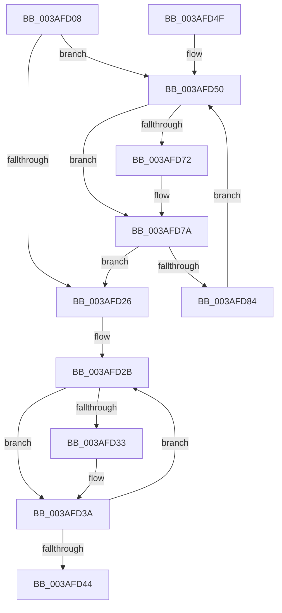

# SmHpChunkHeapCleanup

- RVA: `0x003AFD08`–`0x003AFD86` (길이 `126` bytes)
- VA: `0x00000001403AFD08`
- 실행 섹션: `.text`
- PDB 이름 있음: `예`; PDB Function 태그: `아니요`
- unwind 정보 RVA: `0x0008C18C`
- 디코드: `38`개 명령, `126/126` bytes 표시
- 미해석 바이트: `0` (있으면 어셈블리에 `.byte`로 보존)

> 이 문서는 커널 이미지의 기계어와 PDB 기호를 분석해 생성했습니다. 4번과 5번은 함수 원형과 자료형을 바이너리 사용 방식에서 추정한 C 해석이며 원본 소스 복구 결과는 아닙니다.

## 1. Dependencies

- 직접 호출 지점: **2**; 고유 호출 대상: **2**
- 직접 호출자로 확인된 함수: **2**
- RIP 상대 이미지 참조: **0**

### Outgoing calls
- `0x003AFD35` → [ExFreePoolWithTag](../../poolcode/B8/ExFreePoolWithTag_function_00B82870.md) (function, `0x00B82870`)
- `0x003AFD75` → [SmHpBufferCleanup](../3B/SmHpBufferCleanup_function_003B1480.md) (function, `0x003B1480`)

### Direct callers
- [ST_STORE&lt;SM_TRAITS&gt;::StDmCleanup](ST_STORE_SM_TRAITS_StDmCleanup_function_003AF8D4.md) at `0x003AF926`
- [ST_STORE&lt;SM_TRAITS&gt;::StDmStart](../3B/ST_STORE_SM_TRAITS_StDmStart_function_003B25C8.md) at `0x003B28A5`

### Static image references
- 디코드된 RIP-relative 메모리 참조가 없습니다.

## 2. Other-region calls and transfers

- 다른 실행 섹션으로 향하는 call: **1**
  - `0x003AFD35` → [ExFreePoolWithTag](../../poolcode/B8/ExFreePoolWithTag_function_00B82870.md) (`.text` → `POOLCODE`)
- 별도 외부 분기/꼬리 이동을 확인하지 못했습니다.

## 3. Assembly (complete function range)

```asm
003AFD08  48 89 5C 24 08                  mov qword ptr [rsp + 8], rbx
003AFD0D  89 54 24 10                     mov dword ptr [rsp + 0x10], edx
003AFD11  57                              push rdi
003AFD12  48 83 EC 20                     sub rsp, 0x20
003AFD16  BF 01 00 00 00                  mov edi, 1
003AFD1B  48 8B D9                        mov rbx, rcx
003AFD1E  39 B9 00 01 00 00               cmp dword ptr [rcx + 0x100], edi
003AFD24  77 2A                           ja 0x1403afd50
003AFD26  BF 20 00 00 00                  mov edi, 0x20
003AFD2B  48 8B 0B                        mov rcx, qword ptr [rbx]
003AFD2E  48 85 C9                        test rcx, rcx
003AFD31  74 07                           je 0x1403afd3a
003AFD33  33 D2                           xor edx, edx
003AFD35  E8 36 2B 7D 00                  call 0x140b82870
003AFD3A  48 83 C3 08                     add rbx, 8
003AFD3E  48 83 EF 01                     sub rdi, 1
003AFD42  75 E7                           jne 0x1403afd2b
003AFD44  48 8B 5C 24 30                  mov rbx, qword ptr [rsp + 0x30]
003AFD49  48 83 C4 20                     add rsp, 0x20
003AFD4D  5F                              pop rdi
003AFD4E  C3                              ret
003AFD4F  CC                              int3
003AFD50  83 64 24 38 00                  and dword ptr [rsp + 0x38], 0
003AFD55  BA 01 00 00 00                  mov edx, 1
003AFD5A  0F BD CF                        bsr ecx, edi
003AFD5D  8B C7                           mov eax, edi
003AFD5F  D3 E2                           shl edx, cl
003AFD61  48 33 D0                        xor rdx, rax
003AFD64  48 C1 E2 04                     shl rdx, 4
003AFD68  48 03 14 CB                     add rdx, qword ptr [rbx + rcx*8]
003AFD6C  48 83 3A 00                     cmp qword ptr [rdx], 0
003AFD70  74 08                           je 0x1403afd7a
003AFD72  48 8B CB                        mov rcx, rbx
003AFD75  E8 06 17 00 00                  call 0x1403b1480
003AFD7A  FF C7                           inc edi
003AFD7C  3B BB 00 01 00 00               cmp edi, dword ptr [rbx + 0x100]
003AFD82  73 A2                           jae 0x1403afd26
003AFD84  EB CA                           jmp 0x1403afd50
```

## 4. C-style interpretation (structured pseudocode)

```c
__int64 __fastcall SmHpChunkHeapCleanup(__int64 a1, int a2)
{
    __int64 result;
    __int64 v_rbx;
    __int64 v_rdi;
    __int64 v_rsp;
    unsigned int v_stack_p10;
    unsigned int v_stack_p38;
    unsigned __int64 v_stack_p8;

    v_stack_p8 = v_rbx;
    v_stack_p10 = a2;
    v_rsp = (v_rsp) - (32);
    if ((*(unsigned int *)(a1 + 256)) > 1) goto loc_003AFD50;
loc_003AFD26:
loc_003AFD2B:
    if (*(unsigned __int64 *)(a1) != 0) {
        a2 = 0;
        result = ExFreePoolWithTag(*(unsigned __int64 *)(a1), a2, a3, a4);
    }
    v_rbx = (a1) + (8);
    v_rdi = (32) - (1);
    if (condition_is_not_equal) goto loc_003AFD2B;
    v_rsp = (v_rsp) + (32);
    return result;
loc_003AFD50:
    a2 = (unsigned int)((1) << ((unsigned __int8)(*(unsigned __int64 *)(a1))));
    a2 = (a2) ^ ((unsigned int)((unsigned int)(v_rdi)));
    a2 = (a2) << (4);
    a2 = (a2) + (*(unsigned __int64 *)(v_stack_p8 + *(unsigned __int64 *)(a1) * 8));
    result = (unsigned int)((unsigned int)(v_rdi));
    if ((*(unsigned __int64 *)(a2)) != 0) {
        a1 = v_stack_p8;
        result = SmHpBufferCleanup(a1, a2, a3, a4);
    }
    v_rdi = (unsigned int)((v_rdi) + 1);
    if (((unsigned int)(v_rdi)) >= (*(unsigned int *)(v_stack_p8 + 256))) goto loc_003AFD26;
    goto loc_003AFD50;
}
```

## 5. (Beta) C Style

```c
int64_t SmHpChunkHeapCleanup(void *Arg1, int32_t Arg2)
{
    uint8_t *arg1 = (uint8_t *)Arg1;

    int64_t result;
    int64_t local_rbx;
    int64_t local_rdi;
    int64_t local_rsp;
    uint32_t v_stack_p10;
    uint32_t v_stack_p38;
    uint64_t v_stack_p8;

    v_stack_p8 = local_rbx;
    v_stack_p10 = Arg2;
    local_rsp = (local_rsp) - (32);
    if ((*(uint32_t *)(arg1 + 0x100)) > 1) goto loc_003AFD50;
loc_003AFD26:
loc_003AFD2B:
    if (*(uint64_t *)(arg1) != 0) {
        Arg2 = 0;
        result = ExFreePoolWithTag(*(uint64_t *)(arg1), Arg2, a3, a4);
    }
    local_rbx = (Arg1) + (8);
    local_rdi = (32) - (1);
    if (condition_is_not_equal) goto loc_003AFD2B;
    local_rsp = (local_rsp) + (32);
    return result;
loc_003AFD50:
    Arg2 = (uint32_t)((1) << ((uint8_t)(*(uint64_t *)(arg1))));
    Arg2 = (Arg2) ^ ((uint32_t)((uint32_t)(local_rdi)));
    Arg2 = (Arg2) << (4);
    Arg2 = (Arg2) + (*(uint64_t *)(v_stack_p8 + *(uint64_t *)(arg1) * 8));
    result = (uint32_t)((uint32_t)(local_rdi));
    if ((*(uint64_t *)(Arg2)) != 0) {
        Arg1 = v_stack_p8;
        result = SmHpBufferCleanup(Arg1, Arg2, a3, a4);
    }
    local_rdi = (uint32_t)((local_rdi) + 1);
    if (((uint32_t)(local_rdi)) >= (*(uint32_t *)(v_stack_p8 + 0x100))) goto loc_003AFD26;
    goto loc_003AFD50;
}
```

### 관측된 메모리 오프셋

구조체 형식이 확인되지 않은 접근은 인자 기준의 오프셋으로만 기록했습니다.

| 기준 인자 | 오프셋 표현 | 폭 (bit) | 접근 |
|---|---:|---:|---|
| `Arg1` | `+ 0x0` | `64` | `R` |
| `Arg1` | `+ 0x0 + rcx*8` | `64` | `R` |
| `Arg1` | `+ 0x100` | `32` | `R` |

## 6. Execution-region graph

[열기: 2D/3D 그래프와 함수 탐색 컨트롤 패널](../../../control-panel.html?section=text&rva=0x003AFD08&view=graph)

- 2D 그래프는 위에서 아래로 흐르고, 3D 그래프는 빈 공간을 드래그해 회전합니다. Shift+드래그는 이동, 휠은 확대·축소, 함수 노드 선택은 대상 보고서 이동입니다.

### Static fallback


