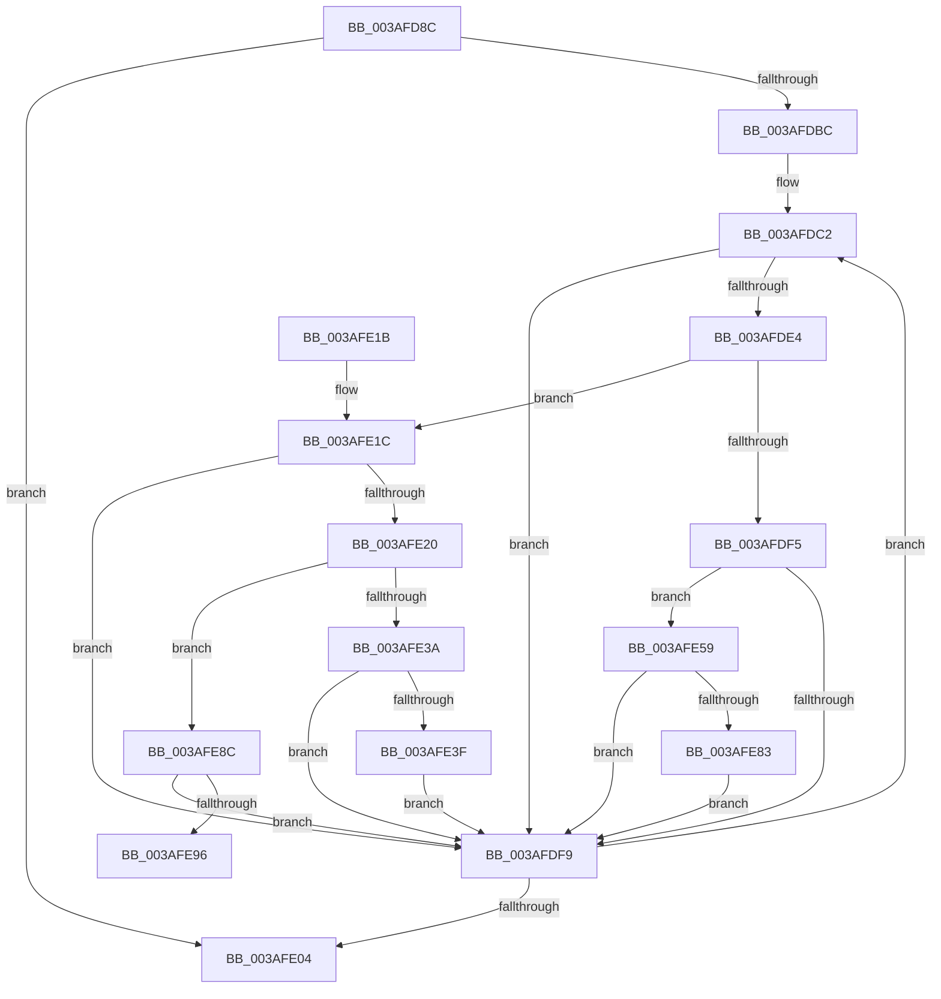

# SmHpChunkHeapProtect

- RVA: `0x003AFD8C`–`0x003AFECA` (길이 `318` bytes)
- VA: `0x00000001403AFD8C`
- 실행 섹션: `.text`
- PDB 이름 있음: `예`; PDB Function 태그: `아니요`
- unwind 정보 RVA: `0x0008C19C`
- 디코드: `94`개 명령, `318/318` bytes 표시
- 미해석 바이트: `0` (있으면 어셈블리에 `.byte`로 보존)

> 이 문서는 커널 이미지의 기계어와 PDB 기호를 분석해 생성했습니다. 4번과 5번은 함수 원형과 자료형을 바이너리 사용 방식에서 추정한 C 해석이며 원본 소스 복구 결과는 아닙니다.

## 1. Dependencies

- 직접 호출 지점: **6**; 고유 호출 대상: **4**
- 직접 호출자로 확인된 함수: **3**
- RIP 상대 이미지 참조: **0**

### Outgoing calls
- `0x003AFE26` → [wyhash](../26/wyhash_function_00269FE4.md) (function, `0x00269FE4`)
- `0x003AFE4E` → [ExProtectPoolEx](../26/ExProtectPoolEx_function_002695D8.md) (function, `0x002695D8`)
- `0x003AFE65` → [ExProtectPoolEx](../26/ExProtectPoolEx_function_002695D8.md) (function, `0x002695D8`)
- `0x003AFE73` → [wyhash](../26/wyhash_function_00269FE4.md) (function, `0x00269FE4`)
- `0x003AFEA6` → [SmPrepareForFatalHeapCorruption](../26/SmPrepareForFatalHeapCorruption_function_00267AC0.md) (function, `0x00267AC0`)
- `0x003AFEC4` → [KeBugCheckEx](../4F/KeBugCheckEx_function_004FD660.md) (function, `0x004FD660`)

### Direct callers
- [sub_0020634E](../20/Unknown_function_0020634E.md) at `0x002063FA`
- [ST_STORE&lt;SM_TRAITS&gt;::StDmCleanup](ST_STORE_SM_TRAITS_StDmCleanup_function_003AF8D4.md) at `0x003AF902`
- [SMKM_STORE&lt;SM_TRAITS&gt;::SmStUnhandledExceptionFilter](../60/SMKM_STORE_SM_TRAITS_SmStUnhandledExceptionFilter_function_0060CC08.md) at `0x0060CC53`

### Static image references
- 디코드된 RIP-relative 메모리 참조가 없습니다.

## 2. Other-region calls and transfers

- 다른 실행 섹션으로 향하는 call: **0**
- 별도 외부 분기/꼬리 이동을 확인하지 못했습니다.

## 3. Assembly (complete function range)

```asm
003AFD8C  48 89 5C 24 10                  mov qword ptr [rsp + 0x10], rbx
003AFD91  48 89 6C 24 18                  mov qword ptr [rsp + 0x18], rbp
003AFD96  56                              push rsi
003AFD97  57                              push rdi
003AFD98  41 55                           push r13
003AFD9A  41 56                           push r14
003AFD9C  41 57                           push r15
003AFD9E  48 83 EC 30                     sub rsp, 0x30
003AFDA2  41 BF 01 00 00 00               mov r15d, 1
003AFDA8  45 8B F0                        mov r14d, r8d
003AFDAB  8B EA                           mov ebp, edx
003AFDAD  48 8B F1                        mov rsi, rcx
003AFDB0  41 8B FF                        mov edi, r15d
003AFDB3  44 39 B9 00 01 00 00            cmp dword ptr [rcx + 0x100], r15d
003AFDBA  76 48                           jbe 0x1403afe04
003AFDBC  41 BD 00 10 00 00               mov r13d, 0x1000
003AFDC2  83 64 24 60 00                  and dword ptr [rsp + 0x60], 0
003AFDC7  41 8B DF                        mov ebx, r15d
003AFDCA  0F BD CF                        bsr ecx, edi
003AFDCD  8B C7                           mov eax, edi
003AFDCF  D3 E3                           shl ebx, cl
003AFDD1  48 33 D8                        xor rbx, rax
003AFDD4  48 C1 E3 04                     shl rbx, 4
003AFDD8  48 03 1C CE                     add rbx, qword ptr [rsi + rcx*8]
003AFDDC  48 8B 0B                        mov rcx, qword ptr [rbx]
003AFDDF  48 85 C9                        test rcx, rcx
003AFDE2  74 15                           je 0x1403afdf9
003AFDE4  48 83 64 24 60 00               and qword ptr [rsp + 0x60], 0
003AFDEA  8B C5                           mov eax, ebp
003AFDEC  83 E0 03                        and eax, 3
003AFDEF  83 7B 0C 00                     cmp dword ptr [rbx + 0xc], 0
003AFDF3  75 27                           jne 0x1403afe1c
003AFDF5  85 C0                           test eax, eax
003AFDF7  74 60                           je 0x1403afe59
003AFDF9  41 03 FF                        add edi, r15d
003AFDFC  3B BE 00 01 00 00               cmp edi, dword ptr [rsi + 0x100]
003AFE02  72 BE                           jb 0x1403afdc2
003AFE04  48 8B 5C 24 68                  mov rbx, qword ptr [rsp + 0x68]
003AFE09  48 8B 6C 24 70                  mov rbp, qword ptr [rsp + 0x70]
003AFE0E  48 83 C4 30                     add rsp, 0x30
003AFE12  41 5F                           pop r15
003AFE14  41 5E                           pop r14
003AFE16  41 5D                           pop r13
003AFE18  5F                              pop rdi
003AFE19  5E                              pop rsi
003AFE1A  C3                              ret
003AFE1B  CC                              int3
003AFE1C  85 C0                           test eax, eax
003AFE1E  74 D9                           je 0x1403afdf9
003AFE20  45 33 C0                        xor r8d, r8d
003AFE23  49 8B D5                        mov rdx, r13
003AFE26  E8 B9 A1 EB FF                  call 0x140269fe4
003AFE2B  44 8B 43 0C                     mov r8d, dword ptr [rbx + 0xc]
003AFE2F  85 C0                           test eax, eax
003AFE31  41 0F 44 C7                     cmove eax, r15d
003AFE35  41 3B C0                        cmp eax, r8d
003AFE38  75 52                           jne 0x1403afe8c
003AFE3A  41 84 EF                        test r15b, bpl
003AFE3D  74 BA                           je 0x1403afdf9
003AFE3F  48 8B 0B                        mov rcx, qword ptr [rbx]
003AFE42  41 B9 04 00 00 00               mov r9d, 4
003AFE48  48 8B D1                        mov rdx, rcx
003AFE4B  4D 8B C5                        mov r8, r13
003AFE4E  E8 85 97 EB FF                  call 0x1402695d8
003AFE53  83 63 0C 00                     and dword ptr [rbx + 0xc], 0
003AFE57  EB A0                           jmp 0x1403afdf9
003AFE59  41 B9 02 00 00 00               mov r9d, 2
003AFE5F  4D 8B C5                        mov r8, r13
003AFE62  48 8B D1                        mov rdx, rcx
003AFE65  E8 6E 97 EB FF                  call 0x1402695d8
003AFE6A  48 8B 0B                        mov rcx, qword ptr [rbx]
003AFE6D  45 33 C0                        xor r8d, r8d
003AFE70  49 8B D5                        mov rdx, r13
003AFE73  E8 6C A1 EB FF                  call 0x140269fe4
003AFE78  89 43 0C                        mov dword ptr [rbx + 0xc], eax
003AFE7B  85 C0                           test eax, eax
003AFE7D  0F 85 76 FF FF FF               jne 0x1403afdf9
003AFE83  44 89 7B 0C                     mov dword ptr [rbx + 0xc], r15d
003AFE87  E9 6D FF FF FF                  jmp 0x1403afdf9
003AFE8C  40 F6 C5 04                     test bpl, 4
003AFE90  0F 85 63 FF FF FF               jne 0x1403afdf9
003AFE96  48 8D 4C 24 60                  lea rcx, [rsp + 0x60]
003AFE9B  44 8B C8                        mov r9d, eax
003AFE9E  48 89 4C 24 20                  mov qword ptr [rsp + 0x20], rcx
003AFEA3  48 8B 0B                        mov rcx, qword ptr [rbx]
003AFEA6  E8 15 7C EB FF                  call 0x140267ac0
003AFEAB  48 8B 44 24 60                  mov rax, qword ptr [rsp + 0x60]
003AFEB0  49 8B D6                        mov rdx, r14
003AFEB3  44 8B 4B 0C                     mov r9d, dword ptr [rbx + 0xc]
003AFEB7  B9 C7 01 00 00                  mov ecx, 0x1c7
003AFEBC  4C 8B 03                        mov r8, qword ptr [rbx]
003AFEBF  48 89 44 24 20                  mov qword ptr [rsp + 0x20], rax
003AFEC4  E8 97 D7 14 00                  call 0x1404fd660
003AFEC9  CC                              int3
```

## 4. C-style interpretation (structured pseudocode)

```c
__int64 __fastcall SmHpChunkHeapProtect(__int64 a1, int a2, int a3)
{
    __int64 result;
    __int64 v_rbx;
    __int64 v_rdi;
    __int64 v_rsp;
    unsigned __int64 v_stack_p10;
    unsigned __int64 v_stack_p18;
    unsigned __int64 v_stack_p20;
    unsigned __int64 v_stack_p60;
    unsigned int v_stack_p8;

    v_stack_p10 = v_rbx;
    v_stack_p18 = v_rbp;
    v_rsp = (v_rsp) - (48);
    if ((*(unsigned int *)(a1 + 256)) <= 1) goto loc_003AFE04;
loc_003AFDC2:
    v_rbx = (unsigned int)((1) << ((unsigned __int8)(a1)));
    v_rbx = (v_rbx) ^ (1);
    v_rbx = (v_rbx) << (4);
    v_rbx = (v_rbx) + (*(unsigned __int64 *)(a1 + a1 * 8));
    if (*(unsigned __int64 *)(v_rbx) == 0) goto loc_003AFDF9;
    result = (unsigned int)(((unsigned int)((unsigned int)((unsigned int)(a2)))) & (3));
    if ((*(unsigned int *)(v_rbx + 12)) != 0) goto loc_003AFE1C;
    if ((unsigned int)(result) == 0) goto loc_003AFE59;
loc_003AFDF9:
    v_rdi = (unsigned int)((1) + (1));
    if (((unsigned int)(v_rdi)) < (*(unsigned int *)(a1 + 256))) goto loc_003AFDC2;
loc_003AFE04:
    v_rsp = (v_rsp) + (48);
    return result;
loc_003AFE1C:
    if ((unsigned int)(result) == 0) goto loc_003AFDF9;
    a3 = 0;
    result = wyhash(*(unsigned __int64 *)(v_rbx), (unsigned int)(0x1000ULL), a3, a4);
    if ((unsigned int)(result) == 0) { result = 1; }
    if (((unsigned int)(result)) != ((unsigned int)((unsigned int)(*(unsigned int *)(v_stack_p10 + 12))))) goto loc_003AFE8C;
    if (((1) & ((unsigned __int8)(v_stack_p18))) == 0) goto loc_003AFDF9;
    result = ExProtectPoolEx(*(unsigned __int64 *)(v_stack_p10), *(unsigned __int64 *)(v_stack_p10), (unsigned int)(0x1000ULL), 4);
    goto loc_003AFDF9;
loc_003AFE59:
    result = ExProtectPoolEx(*(unsigned __int64 *)(v_stack_p10), *(unsigned __int64 *)(v_stack_p10), (unsigned int)(0x1000ULL), 2);
    a3 = 0;
    result = wyhash(*(unsigned __int64 *)(v_stack_p10), (unsigned int)(0x1000ULL), a3, 2);
    *(unsigned int *)(v_stack_p10 + 12) = (unsigned int)(result);
    if ((unsigned int)(result) != 0) goto loc_003AFDF9;
    *(unsigned int *)(v_stack_p10 + 12) = 1;
    goto loc_003AFDF9;
loc_003AFE8C:
    if ((((unsigned __int8)(v_stack_p18)) & (4)) != 0) goto loc_003AFDF9;
    v_stack_p20 = v_stack_p60;
    result = SmPrepareForFatalHeapCorruption(*(unsigned __int64 *)(v_stack_p10), (unsigned int)(0x1000ULL), a3, (unsigned int)((unsigned int)(result)));
    v_stack_p20 = v_stack_p60;
    result = KeBugCheckEx(455, (unsigned int)(a3), *(unsigned __int64 *)(v_stack_p10), (unsigned int)(*(unsigned int *)(v_stack_p10 + 12)));
    return result;
}
```

## 5. (Beta) C Style

```c
int64_t SmHpChunkHeapProtect(void *Arg1, int32_t Arg2, int32_t Arg3)
{
    uint8_t *arg1 = (uint8_t *)Arg1;

    int64_t result;
    int64_t local_rbx;
    int64_t local_rdi;
    int64_t local_rsp;
    uint64_t v_stack_p10;
    uint64_t v_stack_p18;
    uint64_t v_stack_p20;
    uint64_t v_stack_p60;
    uint32_t v_stack_p8;

    v_stack_p10 = local_rbx;
    v_stack_p18 = local_rbp;
    local_rsp = (local_rsp) - (48);
    if ((*(uint32_t *)(arg1 + 0x100)) <= 1) goto loc_003AFE04;
loc_003AFDC2:
    local_rbx = (uint32_t)((1) << ((uint8_t)(Arg1)));
    local_rbx = (local_rbx) ^ (1);
    local_rbx = (local_rbx) << (4);
    local_rbx = (local_rbx) + (*(uint64_t *)(arg1 + arg1 * 8));
    if (*(uint64_t *)(local_rbx) == 0) goto loc_003AFDF9;
    result = (uint32_t)(((uint32_t)((uint32_t)((uint32_t)(Arg2)))) & (3));
    if ((*(uint32_t *)(local_rbx + 0xC)) != 0) goto loc_003AFE1C;
    if ((uint32_t)(result) == 0) goto loc_003AFE59;
loc_003AFDF9:
    local_rdi = (uint32_t)((1) + (1));
    if (((uint32_t)(local_rdi)) < (*(uint32_t *)(arg1 + 0x100))) goto loc_003AFDC2;
loc_003AFE04:
    local_rsp = (local_rsp) + (48);
    return result;
loc_003AFE1C:
    if ((uint32_t)(result) == 0) goto loc_003AFDF9;
    Arg3 = 0;
    result = wyhash(*(uint64_t *)(local_rbx), (uint32_t)(0x1000ULL), Arg3, a4);
    if ((uint32_t)(result) == 0) { result = 1; }
    if (((uint32_t)(result)) != ((uint32_t)((uint32_t)(*(uint32_t *)(v_stack_p10 + 0xC))))) goto loc_003AFE8C;
    if (((1) & ((uint8_t)(v_stack_p18))) == 0) goto loc_003AFDF9;
    result = ExProtectPoolEx(*(uint64_t *)(v_stack_p10), *(uint64_t *)(v_stack_p10), (uint32_t)(0x1000ULL), 4);
    goto loc_003AFDF9;
loc_003AFE59:
    result = ExProtectPoolEx(*(uint64_t *)(v_stack_p10), *(uint64_t *)(v_stack_p10), (uint32_t)(0x1000ULL), 2);
    Arg3 = 0;
    result = wyhash(*(uint64_t *)(v_stack_p10), (uint32_t)(0x1000ULL), Arg3, 2);
    *(uint32_t *)(v_stack_p10 + 0xC) = (uint32_t)(result);
    if ((uint32_t)(result) != 0) goto loc_003AFDF9;
    *(uint32_t *)(v_stack_p10 + 0xC) = 1;
    goto loc_003AFDF9;
loc_003AFE8C:
    if ((((uint8_t)(v_stack_p18)) & (4)) != 0) goto loc_003AFDF9;
    v_stack_p20 = v_stack_p60;
    result = SmPrepareForFatalHeapCorruption(*(uint64_t *)(v_stack_p10), (uint32_t)(0x1000ULL), Arg3, (uint32_t)((uint32_t)(result)));
    v_stack_p20 = v_stack_p60;
    result = KeBugCheckEx(455, (uint32_t)(Arg3), *(uint64_t *)(v_stack_p10), (uint32_t)(*(uint32_t *)(v_stack_p10 + 0xC)));
    return result;
}
```

### 관측된 메모리 오프셋

구조체 형식이 확인되지 않은 접근은 인자 기준의 오프셋으로만 기록했습니다.

| 기준 인자 | 오프셋 표현 | 폭 (bit) | 접근 |
|---|---:|---:|---|
| `Arg1` | `+ 0x0 + rcx*8` | `64` | `R` |
| `Arg1` | `+ 0x100` | `32` | `R` |

## 6. Execution-region graph

[열기: 2D/3D 그래프와 함수 탐색 컨트롤 패널](../../../control-panel.html?section=text&rva=0x003AFD8C&view=graph)

- 2D 그래프는 위에서 아래로 흐르고, 3D 그래프는 빈 공간을 드래그해 회전합니다. Shift+드래그는 이동, 휠은 확대·축소, 함수 노드 선택은 대상 보고서 이동입니다.

### Static fallback


