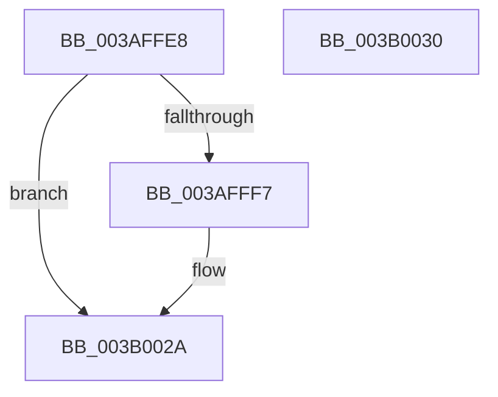

# SmKmStoreHelperCleanup

- RVA: `0x003AFFE8`–`0x003B0031` (길이 `73` bytes)
- VA: `0x00000001403AFFE8`
- 실행 섹션: `.text`
- PDB 이름 있음: `예`; PDB Function 태그: `아니요`
- unwind 정보 RVA: `0x00064C80`
- 디코드: `22`개 명령, `73/73` bytes 표시
- 미해석 바이트: `0` (있으면 어셈블리에 `.byte`로 보존)

> 이 문서는 커널 이미지의 기계어와 PDB 기호를 분석해 생성했습니다. 4번과 5번은 함수 원형과 자료형을 바이너리 사용 방식에서 추정한 C 해석이며 원본 소스 복구 결과는 아닙니다.

## 1. Dependencies

- 직접 호출 지점: **3**; 고유 호출 대상: **3**
- 직접 호출자로 확인된 함수: **1**
- RIP 상대 이미지 참조: **0**

### Outgoing calls
- `0x003B0002` → [SmKmStoreHelperSendCommand](../3B/SmKmStoreHelperSendCommand_function_003B0658.md) (function, `0x003B0658`)
- `0x003B0018` → [KeWaitForSingleObject](../20/KeWaitForSingleObject_function_0020E6B0.md) (function, `0x0020E6B0`)
- `0x003B0025` → [ObfDereferenceObjectWithTag](../2F/ObfDereferenceObjectWithTag_function_002F78E0.md) (function, `0x002F78E0`)

### Direct callers
- [SMKM_STORE&lt;SM_TRAITS&gt;::SmStCleanup](../3B/SMKM_STORE_SM_TRAITS_SmStCleanup_function_003B00E0.md) at `0x003B030E`
- [SMKM_STORE&lt;SM_TRAITS&gt;::SmStCleanup](../3B/SMKM_STORE_SM_TRAITS_SmStCleanup_function_003B00E0.md) at `0x003B031A`

### Static image references
- 디코드된 RIP-relative 메모리 참조가 없습니다.

## 2. Other-region calls and transfers

- 다른 실행 섹션으로 향하는 call: **0**
- 별도 외부 분기/꼬리 이동을 확인하지 못했습니다.

## 3. Assembly (complete function range)

```asm
003AFFE8  40 53                           push rbx
003AFFEA  48 83 EC 30                     sub rsp, 0x30
003AFFEE  48 83 39 00                     cmp qword ptr [rcx], 0
003AFFF2  48 8B D9                        mov rbx, rcx
003AFFF5  74 33                           je 0x1403b002a
003AFFF7  BA 01 00 00 00                  mov edx, 1
003AFFFC  45 33 C0                        xor r8d, r8d
003AFFFF  44 8B CA                        mov r9d, edx
003B0002  E8 51 06 00 00                  call 0x1403b0658
003B0007  48 8B 0B                        mov rcx, qword ptr [rbx]
003B000A  45 33 C9                        xor r9d, r9d
003B000D  48 83 64 24 20 00               and qword ptr [rsp + 0x20], 0
003B0013  45 33 C0                        xor r8d, r8d
003B0016  33 D2                           xor edx, edx
003B0018  E8 93 E6 E5 FF                  call 0x14020e6b0
003B001D  48 8B 0B                        mov rcx, qword ptr [rbx]
003B0020  BA 44 66 6C 74                  mov edx, 0x746c6644
003B0025  E8 B6 78 F4 FF                  call 0x1402f78e0
003B002A  48 83 C4 30                     add rsp, 0x30
003B002E  5B                              pop rbx
003B002F  C3                              ret
003B0030  CC                              int3
```

## 4. C-style interpretation (structured pseudocode)

```c
__int64 __fastcall SmKmStoreHelperCleanup(__int64 a1, __int64 a2, int a3)
{
    __int64 result;
    __int64 v_rsp;
    unsigned __int64 v_stack_m18;

    v_rsp = (v_rsp) - (48);
    if ((*(unsigned __int64 *)(a1)) != 0) {
        a2 = 1;
        a3 = 0;
        a4 = (unsigned int)(a2);
        result = SmKmStoreHelperSendCommand(a1, a2, a3, a4);
        a1 = *(unsigned __int64 *)(a1);
        a4 = 0;
        a3 = 0;
        a2 = 0;
        result = KeWaitForSingleObject(a1, a2, a3, a4);
        a1 = *(unsigned __int64 *)(a1);
        a2 = 0x746C6644ULL;
        result = ObfDereferenceObjectWithTag(a1, a2, a3, a4);
    }
    v_rsp = (v_rsp) + (48);
    return result;
}
```

## 5. (Beta) C Style

```c
int64_t SmKmStoreHelperCleanup(void *Arg1, int64_t Arg2, int32_t Arg3)
{
    uint8_t *arg1 = (uint8_t *)Arg1;

    int64_t result;
    int64_t local_rsp;
    uint64_t v_stack_m18;

    local_rsp = (local_rsp) - (48);
    if ((*(uint64_t *)(arg1)) != 0) {
        Arg2 = 1;
        Arg3 = 0;
        a4 = (uint32_t)(Arg2);
        result = SmKmStoreHelperSendCommand(Arg1, Arg2, Arg3, a4);
        Arg1 = *(uint64_t *)(arg1);
        a4 = 0;
        Arg3 = 0;
        Arg2 = 0;
        result = KeWaitForSingleObject(Arg1, Arg2, Arg3, a4);
        Arg1 = *(uint64_t *)(arg1);
        Arg2 = 0x746C6644ULL;
        result = ObfDereferenceObjectWithTag(Arg1, Arg2, Arg3, a4);
    }
    local_rsp = (local_rsp) + (48);
    return result;
}
```

### 관측된 메모리 오프셋

구조체 형식이 확인되지 않은 접근은 인자 기준의 오프셋으로만 기록했습니다.

| 기준 인자 | 오프셋 표현 | 폭 (bit) | 접근 |
|---|---:|---:|---|
| `Arg1` | `+ 0x0` | `64` | `R` |

## 6. Execution-region graph

[열기: 2D/3D 그래프와 함수 탐색 컨트롤 패널](../../../control-panel.html?section=text&rva=0x003AFFE8&view=graph)

- 2D 그래프는 위에서 아래로 흐르고, 3D 그래프는 빈 공간을 드래그해 회전합니다. Shift+드래그는 이동, 휠은 확대·축소, 함수 노드 선택은 대상 보고서 이동입니다.

### Static fallback


