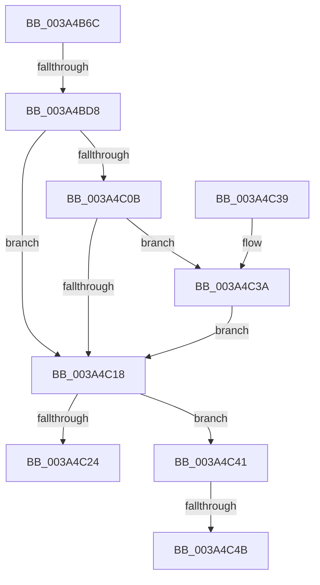

# SmStoreDecompressBuffer

- RVA: `0x003A4B6C`–`0x003A4C50` (길이 `228` bytes)
- VA: `0x00000001403A4B6C`
- 실행 섹션: `.text`
- PDB 이름 있음: `예`; PDB Function 태그: `예`
- unwind 정보 RVA: `0x000899C4`
- 디코드: `62`개 명령, `228/228` bytes 표시
- 미해석 바이트: `0` (있으면 어셈블리에 `.byte`로 보존)

> 이 문서는 커널 이미지의 기계어와 PDB 기호를 분석해 생성했습니다. 4번과 5번은 함수 원형과 자료형을 바이너리 사용 방식에서 추정한 C 해석이며 원본 소스 복구 결과는 아닙니다.

## 1. Dependencies

- 직접 호출 지점: **1**; 고유 호출 대상: **1**
- 직접 호출자로 확인된 함수: **2**
- RIP 상대 이미지 참조: **0**

### Outgoing calls
- `0x003A4C00` → [RtlDecompressBufferLz4](RtlDecompressBufferLz4_function_003A4D20.md) (function, `0x003A4D20`)

### Direct callers
- [ST_STORE&lt;SM_TRAITS&gt;::StDmSinglePageCopy](../31/ST_STORE_SM_TRAITS_StDmSinglePageCopy_function_00317F44.md) at `0x00318095`
- [ST_STORE&lt;SM_TRAITS&gt;::StDmHandleDecompressionFailure](../60/ST_STORE_SM_TRAITS_StDmHandleDecompressionFailure_function_0060DA74.md) at `0x0060DCC7`

### Static image references
- 디코드된 RIP-relative 메모리 참조가 없습니다.

## 2. Other-region calls and transfers

- 다른 실행 섹션으로 향하는 call: **0**
- call이 아닌 외부 분기/꼬리 이동: **3**
  - `0x003A4BD2` → [sub_006E6668](../6E/Unknown_function_006E6668.md) (`tail-transfer`)
  - `0x003A4C45` → [sub_006E6668 + 0x45C](../6E/Unknown_function_006E6668.md) (`tail-transfer`)
  - `0x003A4C4B` → [sub_006E6668 + 0x485](../6E/Unknown_function_006E6668.md) (`tail-transfer`)

## 3. Assembly (complete function range)

```asm
003A4B6C  4C 8B DC                        mov r11, rsp
003A4B6F  4D 89 4B 20                     mov qword ptr [r11 + 0x20], r9
003A4B73  45 89 43 18                     mov dword ptr [r11 + 0x18], r8d
003A4B77  53                              push rbx
003A4B78  56                              push rsi
003A4B79  57                              push rdi
003A4B7A  41 54                           push r12
003A4B7C  41 55                           push r13
003A4B7E  41 56                           push r14
003A4B80  41 57                           push r15
003A4B82  48 81 EC C0 00 00 00            sub rsp, 0xc0
003A4B89  4D 8B D1                        mov r10, r9
003A4B8C  4C 8B FA                        mov r15, rdx
003A4B8F  44 8B B4 24 20 01 00 00         mov r14d, dword ptr [rsp + 0x120]
003A4B97  33 DB                           xor ebx, ebx
003A4B99  41 89 5B 18                     mov dword ptr [r11 + 0x18], ebx
003A4B9D  0F 57 C0                        xorps xmm0, xmm0
003A4BA0  0F 11 44 24 58                  movups xmmword ptr [rsp + 0x58], xmm0
003A4BA5  0F 11 44 24 68                  movups xmmword ptr [rsp + 0x68], xmm0
003A4BAA  0F 11 44 24 78                  movups xmmword ptr [rsp + 0x78], xmm0
003A4BAF  48 8B 81 90 1D 00 00            mov rax, qword ptr [rcx + 0x1d90]
003A4BB6  4C 8B A8 E0 07 00 00            mov r13, qword ptr [rax + 0x7e0]
003A4BBD  4D 89 6B 98                     mov qword ptr [r11 - 0x68], r13
003A4BC1  4C 89 6C 24 58                  mov qword ptr [rsp + 0x58], r13
003A4BC6  8B 81 C0 12 00 00               mov eax, dword ptr [rcx + 0x12c0]
003A4BCC  41 89 43 88                     mov dword ptr [r11 - 0x78], eax
003A4BD0  85 C0                           test eax, eax
003A4BD2  0F 85 90 1A 34 00               jne 0x1406e6668
003A4BD8  48 8B 84 24 28 01 00 00         mov rax, qword ptr [rsp + 0x128]
003A4BE0  48 89 44 24 30                  mov qword ptr [rsp + 0x30], rax
003A4BE5  49 8D 43 18                     lea rax, [r11 + 0x18]
003A4BE9  48 89 44 24 28                  mov qword ptr [rsp + 0x28], rax
003A4BEE  89 5C 24 20                     mov dword ptr [rsp + 0x20], ebx
003A4BF2  45 8B CE                        mov r9d, r14d
003A4BF5  4D 8B C2                        mov r8, r10
003A4BF8  BA 00 10 00 00                  mov edx, 0x1000
003A4BFD  49 8B CF                        mov rcx, r15
003A4C00  E8 1B 01 00 00                  call 0x1403a4d20
003A4C05  8B F8                           mov edi, eax
003A4C07  85 C0                           test eax, eax
003A4C09  78 0D                           js 0x1403a4c18
003A4C0B  81 BC 24 10 01 00 00 00 10 00 00  cmp dword ptr [rsp + 0x110], 0x1000
003A4C16  75 22                           jne 0x1403a4c3a
003A4C18  BE 01 00 00 00                  mov esi, 1
003A4C1D  48 39 5C 24 60                  cmp qword ptr [rsp + 0x60], rbx
003A4C22  75 1D                           jne 0x1403a4c41
003A4C24  8B C7                           mov eax, edi
003A4C26  48 81 C4 C0 00 00 00            add rsp, 0xc0
003A4C2D  41 5F                           pop r15
003A4C2F  41 5E                           pop r14
003A4C31  41 5D                           pop r13
003A4C33  41 5C                           pop r12
003A4C35  5F                              pop rdi
003A4C36  5E                              pop rsi
003A4C37  5B                              pop rbx
003A4C38  C3                              ret
003A4C39  CC                              int3
003A4C3A  BF 02 01 00 C0                  mov edi, 0xc0000102
003A4C3F  EB D7                           jmp 0x1403a4c18
003A4C41  39 5C 24 7C                     cmp dword ptr [rsp + 0x7c], ebx
003A4C45  0F 87 79 1E 34 00               ja 0x1406e6ac4
003A4C4B  E9 9D 1E 34 00                  jmp 0x1406e6aed
```

## 4. C-style interpretation (structured pseudocode)

```c
__int64 __fastcall SmStoreDecompressBuffer(__int64 a1, __int64 a2, int a3, __int64 a4, unsigned int a5, __int64 a6)
{
    __int64 result;
    __int64 v_rbx;
    __int64 v_rsp;
    unsigned __int64 v_stack_m80;
    unsigned __int64 v_stack_m90;
    unsigned __int64 v_stack_m98;
    unsigned __int64 v_stack_mA0;
    unsigned __int64 v_stack_mC8;
    unsigned __int64 v_stack_mD0;
    unsigned int v_stack_mD8;
    unsigned int v_stack_p18;
    unsigned int v_stack_p7C;

    *(unsigned __int64 *)(v_rsp + 32) = a4;
    *(unsigned int *)(v_rsp + 24) = a3;
    v_rsp = (v_rsp) - (192);
    v_rbx = 0;
    *(unsigned int *)(v_rsp + 24) = 0;
    v_stack_mA0 = v_xmm0;
    v_stack_m90 = v_xmm0;
    v_stack_m80 = v_xmm0;
    *(unsigned __int64 *)(v_rsp - 104) = *(unsigned __int64 *)(*(unsigned __int64 *)(a1 + 7568) + 2016);
    v_stack_mA0 = *(unsigned __int64 *)(*(unsigned __int64 *)(a1 + 7568) + 2016);
    *(unsigned int *)(v_rsp - 120) = (unsigned int)((unsigned int)(*(unsigned int *)(a1 + 4800)));
    v_stack_mC8 = a6;
    v_stack_mD0 = v_rsp + 24;
    v_stack_mD8 = 0;
    result = RtlDecompressBufferLz4(a2, (unsigned int)(0x1000ULL), a4, (unsigned int)((unsigned int)((unsigned int)(a5))));
    if (sign_flag) goto loc_003A4C18;
    if (v_stack_p18 != 0x1000ULL) goto loc_003A4C3A;
loc_003A4C18:
    if (v_stack_m98 != 0) goto loc_003A4C41;
    v_rsp = (v_rsp) + (192);
    return (unsigned int)((unsigned int)((unsigned int)((unsigned int)(result))));
loc_003A4C3A:
    goto loc_003A4C18;
loc_003A4C41:
}
```

## 5. (Beta) C Style

```c
int64_t SmStoreDecompressBuffer(void *Arg1, int64_t Arg2, int32_t Arg3, int64_t Arg4, uint32_t Arg5, int64_t Arg6)
{
    uint8_t *arg1 = (uint8_t *)Arg1;

    int64_t result;
    int64_t local_rbx;
    int64_t local_rsp;
    uint64_t v_stack_m80;
    uint64_t v_stack_m90;
    uint64_t v_stack_m98;
    uint64_t v_stack_mA0;
    uint64_t v_stack_mC8;
    uint64_t v_stack_mD0;
    uint32_t v_stack_mD8;
    uint32_t v_stack_p18;
    uint32_t v_stack_p7C;

    *(uint64_t *)(local_rsp + 0x20) = Arg4;
    *(uint32_t *)(local_rsp + 0x18) = Arg3;
    local_rsp = (local_rsp) - (192);
    local_rbx = 0;
    *(uint32_t *)(local_rsp + 0x18) = 0;
    v_stack_mA0 = v_xmm0;
    v_stack_m90 = v_xmm0;
    v_stack_m80 = v_xmm0;
    *(uint64_t *)(local_rsp - 0x68) = *(uint64_t *)(*(uint64_t *)(arg1 + 0x1D90) + 0x7E0);
    v_stack_mA0 = *(uint64_t *)(*(uint64_t *)(arg1 + 0x1D90) + 0x7E0);
    *(uint32_t *)(local_rsp - 0x78) = (uint32_t)((uint32_t)(*(uint32_t *)(arg1 + 0x12C0)));
    v_stack_mC8 = Arg6;
    v_stack_mD0 = local_rsp + 24;
    v_stack_mD8 = 0;
    result = RtlDecompressBufferLz4(Arg2, (uint32_t)(0x1000ULL), Arg4, (uint32_t)((uint32_t)((uint32_t)(Arg5))));
    if (sign_flag) goto loc_003A4C18;
    if (v_stack_p18 != 0x1000ULL) goto loc_003A4C3A;
loc_003A4C18:
    if (v_stack_m98 != 0) goto loc_003A4C41;
    local_rsp = (local_rsp) + (192);
    return (uint32_t)((uint32_t)((uint32_t)((uint32_t)(result))));
loc_003A4C3A:
    goto loc_003A4C18;
loc_003A4C41:
}
```

### 관측된 메모리 오프셋

구조체 형식이 확인되지 않은 접근은 인자 기준의 오프셋으로만 기록했습니다.

| 기준 인자 | 오프셋 표현 | 폭 (bit) | 접근 |
|---|---:|---:|---|
| `Arg1` | `+ 0x12C0` | `32` | `R` |
| `Arg1` | `+ 0x1D90` | `64` | `R` |

## 6. Execution-region graph

[열기: 2D/3D 그래프와 함수 탐색 컨트롤 패널](../../../control-panel.html?section=text&rva=0x003A4B6C&view=graph)

- 2D 그래프는 위에서 아래로 흐르고, 3D 그래프는 빈 공간을 드래그해 회전합니다. Shift+드래그는 이동, 휠은 확대·축소, 함수 노드 선택은 대상 보고서 이동입니다.

### Static fallback


