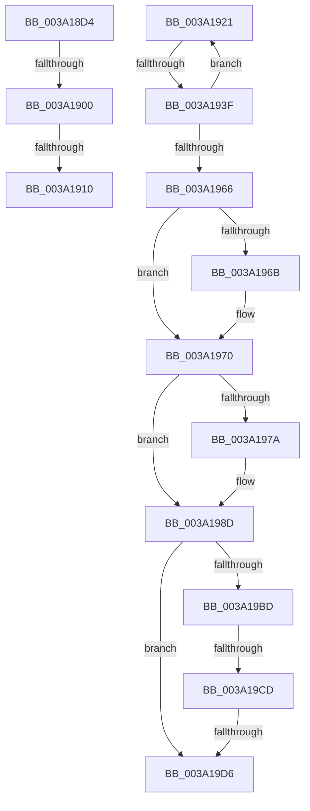

# sub_003A18D4

- RVA: `0x003A18D4`–`0x003A19EE` (길이 `282` bytes)
- VA: `0x00000001403A18D4`
- 실행 섹션: `.text`
- PDB 이름 있음: `아니요`; PDB Function 태그: `아니요`
- unwind 정보 RVA: `0x00081F14`
- 디코드: `61`개 명령, `282/282` bytes 표시
- 미해석 바이트: `0` (있으면 어셈블리에 `.byte`로 보존)

> 이 문서는 커널 이미지의 기계어와 PDB 기호를 분석해 생성했습니다. 4번과 5번은 함수 원형과 자료형을 바이너리 사용 방식에서 추정한 C 해석이며 원본 소스 복구 결과는 아닙니다.

## 1. Dependencies

- 직접 호출 지점: **5**; 고유 호출 대상: **5**
- 직접 호출자로 확인된 함수: **0**
- RIP 상대 이미지 참조: **7**

### Outgoing calls
- `0x003A1917` → [KxWaitForSpinLockAndAcquire](../20/KxWaitForSpinLockAndAcquire_function_002085C0.md) (function, `0x002085C0`)
- `0x003A192B` → [KiAcquireKobjectLockSafe](../25/KiAcquireKobjectLockSafe_function_00251C90.md) (function, `0x00251C90`)
- `0x003A1957` → [KiExpireTimer2](KiExpireTimer2_function_003A24E0.md) (function, `0x003A24E0`)
- `0x003A196B` → [KiCheckAndRearmForceIdle](KiCheckAndRearmForceIdle_function_003A1C58.md) (function, `0x003A1C58`)
- `0x003A1988` → [KiProcessThreadWaitList](../25/KiProcessThreadWaitList_function_00252CC0.md) (function, `0x00252CC0`)

### Direct callers
- 이 함수 시작 RVA로 연결되는 직접 call은 확인되지 않았습니다. 간접 호출은 완전히 역산할 수 없습니다.

### Static image references
- `0x003A18E7` → RVA `0x00FC6B06` (`ALMOSTRO`; read)
- `0x003A1900` → RVA `0x00FCF600` (`CACHEALI`; read/write)
- `0x003A1910` → RVA `0x00FCF600` (`CACHEALI`; read)
- `0x003A199A` → RVA `0x00F23360` (`.data`; read)
- `0x003A19A1` → RVA `0x00F23348` (`.data`; read)
- `0x003A19AF` → RVA `0x00FC6AA0` (`ALMOSTRO`; read)
- `0x003A19BD` → RVA `0x00F21F90` (`.data`; read)

## 2. Other-region calls and transfers

- 다른 실행 섹션으로 향하는 call: **0**
- call이 아닌 외부 분기/꼬리 이동: **6**
  - `0x003A18FA` → [sub_003A1A0C](Unknown_function_003A1A0C.md) (`tail-transfer`)
  - `0x003A190A` → [sub_003A1A0C + 0x1A](Unknown_function_003A1A0C.md) (`tail-transfer`)
  - `0x003A191C` → [sub_003A1A0C + 0x1A](Unknown_function_003A1A0C.md) (`tail-transfer`)
  - `0x003A1939` → [sub_003A1A0C + 0x1F4](Unknown_function_003A1A0C.md) (`tail-transfer`)
  - `0x003A19C7` → [sub_003A1A0C + 0x236](Unknown_function_003A1A0C.md) (`tail-transfer`)
  - `0x003A19D0` → [sub_003A1A0C + 0x224](Unknown_function_003A1A0C.md) (`tail-transfer`)

## 3. Assembly (complete function range)

```asm
003A18D4  49 89 5B 18                     mov qword ptr [r11 + 0x18], rbx
003A18D8  49 8D 43 80                     lea rax, [r11 - 0x80]
003A18DC  49 89 6B D0                     mov qword ptr [r11 - 0x30], rbp
003A18E0  4D 89 63 C8                     mov qword ptr [r11 - 0x38], r12
003A18E4  45 32 E4                        xor r12b, r12b
003A18E7  F6 05 18 52 C2 00 21            test byte ptr [rip + 0xc25218], 0x21
003A18EE  49 89 43 88                     mov qword ptr [r11 - 0x78], rax
003A18F2  49 8D 43 80                     lea rax, [r11 - 0x80]
003A18F6  49 89 43 80                     mov qword ptr [r11 - 0x80], rax
003A18FA  0F 85 0C 01 00 00               jne 0x1403a1a0c
003A1900  F0 48 0F BA 2D F6 DC C2 00 00   lock bts qword ptr [rip + 0xc2dcf6], 0
003A190A  0F 83 16 01 00 00               jae 0x1403a1a26
003A1910  48 8D 0D E9 DC C2 00            lea rcx, [rip + 0xc2dce9]
003A1917  E8 A4 6C E6 FF                  call 0x1402085c0
003A191C  E9 05 01 00 00                  jmp 0x1403a1a26
003A1921  48 8D 7B E8                     lea rdi, [rbx - 0x18]
003A1925  48 8B 1B                        mov rbx, qword ptr [rbx]
003A1928  48 8B CF                        mov rcx, rdi
003A192B  E8 60 03 EB FF                  call 0x140251c90
003A1930  0F B6 47 01                     movzx eax, byte ptr [rdi + 1]
003A1934  48 8B CF                        mov rcx, rdi
003A1937  A8 02                           test al, 2
003A1939  0F 84 C1 02 00 00               je 0x1403a1c00
003A193F  F6 87 81 00 00 00 02            test byte ptr [rdi + 0x81], 2
003A1946  4D 8B CE                        mov r9, r14
003A1949  45 0F B6 E4                     movzx r12d, r12b
003A194D  4D 8B C5                        mov r8, r13
003A1950  49 8B D7                        mov rdx, r15
003A1953  44 0F 45 E6                     cmovne r12d, esi
003A1957  E8 84 0B 00 00                  call 0x1403a24e0
003A195C  48 8D 44 24 38                  lea rax, [rsp + 0x38]
003A1961  48 3B D8                        cmp rbx, rax
003A1964  75 BB                           jne 0x1403a1921
003A1966  45 84 E4                        test r12b, r12b
003A1969  74 05                           je 0x1403a1970
003A196B  E8 E8 02 00 00                  call 0x1403a1c58
003A1970  49 83 BF 08 2D 00 00 00         cmp qword ptr [r15 + 0x2d08], 0
003A1978  74 13                           je 0x1403a198d
003A197A  41 B9 02 00 00 00               mov r9d, 2
003A1980  45 33 C0                        xor r8d, r8d
003A1983  8B D6                           mov edx, esi
003A1985  49 8B CF                        mov rcx, r15
003A1988  E8 33 13 EB FF                  call 0x140252cc0
003A198D  48 B9 08 00 00 00 80 F7 FF FF   movabs rcx, 0xfffff78000000008
003A1997  48 8B 09                        mov rcx, qword ptr [rcx]
003A199A  48 8B 05 BF 19 B8 00            mov rax, qword ptr [rip + 0xb819bf]
003A19A1  48 8B 15 A0 19 B8 00            mov rdx, qword ptr [rip + 0xb819a0]
003A19A8  48 3B C2                        cmp rax, rdx
003A19AB  48 0F 42 D0                     cmovb rdx, rax
003A19AF  8B 05 EB 50 C2 00               mov eax, dword ptr [rip + 0xc250eb]
003A19B5  48 03 C1                        add rax, rcx
003A19B8  48 3B D0                        cmp rdx, rax
003A19BB  73 19                           jae 0x1403a19d6
003A19BD  48 8B 0D CC 05 B8 00            mov rcx, qword ptr [rip + 0xb805cc]
003A19C4  48 85 C9                        test rcx, rcx
003A19C7  0F 84 75 02 00 00               je 0x1403a1c42
003A19CD  48 3B D1                        cmp rdx, rcx
003A19D0  0F 82 5A 02 00 00               jb 0x1403a1c30
003A19D6  48 8B AC 24 88 00 00 00         mov rbp, qword ptr [rsp + 0x88]
003A19DE  48 8B 9C 24 D0 00 00 00         mov rbx, qword ptr [rsp + 0xd0]
003A19E6  4C 8B A4 24 80 00 00 00         mov r12, qword ptr [rsp + 0x80]
```

## 4. C-style interpretation (structured pseudocode)

```c
__int64 __fastcall sub_003A18D4(void)
{
    __int64 result;
    __int64 v_r12;
    unsigned __int64 v_stack_p38;
    unsigned __int64 v_stack_p80;
    unsigned __int64 v_stack_p88;
    unsigned __int64 v_stack_pD0;

    *(unsigned __int64 *)(v_r11 + 24) = v_rbx;
    *(unsigned __int64 *)(v_r11 - 48) = v_rbp;
    *(unsigned __int64 *)(v_r11 - 56) = v_r12;
    v_r12 = 0;
    *(unsigned __int64 *)(v_r11 - 120) = v_r11 - 128;
    *(unsigned __int64 *)(v_r11 - 128) = v_r11 - 128;
    result = KxWaitForSpinLockAndAcquire(v_rip + 12770537, a2, a3, a4);
}
```

## 5. (Beta) C Style

```c
void sub_003A18D4(void)
{
    int64_t result;
    int64_t local_r12;
    uint64_t v_stack_p38;
    uint64_t v_stack_p80;
    uint64_t v_stack_p88;
    uint64_t v_stack_pD0;

    *(uint64_t *)(local_r11 + 0x18) = local_rbx;
    *(uint64_t *)(local_r11 - 0x30) = local_rbp;
    *(uint64_t *)(local_r11 - 0x38) = local_r12;
    local_r12 = 0;
    *(uint64_t *)(local_r11 - 0x78) = local_r11 - 128;
    *(uint64_t *)(local_r11 - 0x80) = local_r11 - 128;
    result = KxWaitForSpinLockAndAcquire(v_rip + 12770537, a2, a3, a4);
}
```

## 6. Execution-region graph

[열기: 2D/3D 그래프와 함수 탐색 컨트롤 패널](../../../control-panel.html?section=text&rva=0x003A18D4&view=graph)

- 2D 그래프는 위에서 아래로 흐르고, 3D 그래프는 빈 공간을 드래그해 회전합니다. Shift+드래그는 이동, 휠은 확대·축소, 함수 노드 선택은 대상 보고서 이동입니다.

### Static fallback


