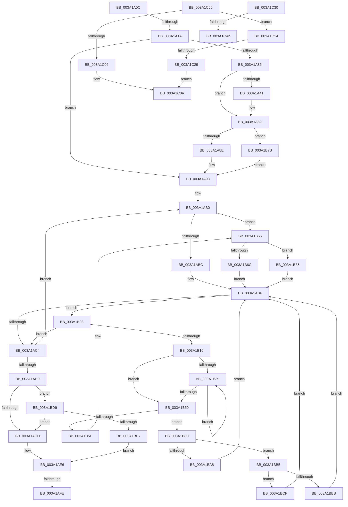

# sub_003A1A0C

- RVA: `0x003A1A0C`–`0x003A1C52` (길이 `582` bytes)
- VA: `0x00000001403A1A0C`
- 실행 섹션: `.text`
- PDB 이름 있음: `아니요`; PDB Function 태그: `아니요`
- unwind 정보 RVA: `0x00081F44`
- 디코드: `140`개 명령, `582/582` bytes 표시
- 미해석 바이트: `0` (있으면 어셈블리에 `.byte`로 보존)

> 이 문서는 커널 이미지의 기계어와 PDB 기호를 분석해 생성했습니다. 4번과 5번은 함수 원형과 자료형을 바이너리 사용 방식에서 추정한 C 해석이며 원본 소스 복구 결과는 아닙니다.

## 1. Dependencies

- 직접 호출 지점: **7**; 고유 호출 대상: **7**
- 직접 호출자로 확인된 함수: **0**
- RIP 상대 이미지 참조: **8**

### Outgoing calls
- `0x003A1A21` → [KiAcquireSpinLockInstrumented](../20/KiAcquireSpinLockInstrumented_function_002084F0.md) (function, `0x002084F0`)
- `0x003A1A78` → [EtwTraceKernelEvent](../23/EtwTraceKernelEvent_function_00235350.md) (function, `0x00235350`)
- `0x003A1B1A` → [KiRemoveTimer2](KiRemoveTimer2_function_003A1D60.md) (function, `0x003A1D60`)
- `0x003A1BF6` → [KiReleaseSpinLockInstrumented](../39/KiReleaseSpinLockInstrumented_function_00392EF0.md) (function, `0x00392EF0`)
- `0x003A1C0A` → [KiUpdateTimer2Flags](KiUpdateTimer2Flags_function_003A2100.md) (function, `0x003A2100`)
- `0x003A1C19` → [KiInsertTimer2](KiInsertTimer2_function_003A244C.md) (function, `0x003A244C`)
- `0x003A1C48` → [KiSendClockInterruptToTargetProcessor](../23/KiSendClockInterruptToTargetProcessor_function_00234700.md) (function, `0x00234700`)

### Direct callers
- 이 함수 시작 RVA로 연결되는 직접 call은 확인되지 않았습니다. 간접 호출은 완전히 역산할 수 없습니다.

### Static image references
- `0x003A1A0C` → RVA `0x00F0DE58` (`.data`; read)
- `0x003A1A1A` → RVA `0x00FCF600` (`CACHEALI`; read)
- `0x003A1A35` → RVA `0x00FC6B08` (`ALMOSTRO`; read)
- `0x003A1A93` → RVA `0x00F23320` (`.data`; read)
- `0x003A1AD0` → RVA `0x00FC6B06` (`ALMOSTRO`; read)
- `0x003A1ADD` → RVA `0x00FCF600` (`CACHEALI`; read/write)
- `0x003A1C30` → RVA `0x00FC6B3C` (`ALMOSTRO`; read)
- `0x003A1C42` → RVA `0x00F21FB0` (`.data`; read)

## 2. Other-region calls and transfers

- 다른 실행 섹션으로 향하는 call: **0**
- call이 아닌 외부 분기/꼬리 이동: **7**
  - `0x003A1A14` → [sub_003A18D4 + 0x2C](Unknown_function_003A18D4.md) (`tail-transfer`)
  - `0x003A1AF8` → [sub_003A18D4 + 0x9C](Unknown_function_003A18D4.md) (`tail-transfer`)
  - `0x003A1AFE` → [sub_003A18D4 + 0x4D](Unknown_function_003A18D4.md) (`tail-transfer`)
  - `0x003A1C0F` → [sub_003A18D4 + 0x88](Unknown_function_003A18D4.md) (`tail-transfer`)
  - `0x003A1C23` → [sub_003A18D4 + 0x6B](Unknown_function_003A18D4.md) (`tail-transfer`)
  - `0x003A1C3C` → [sub_003A18D4 + 0x102](Unknown_function_003A18D4.md) (`tail-transfer`)
  - `0x003A1C4D` → [sub_003A18D4 + 0x102](Unknown_function_003A18D4.md) (`tail-transfer`)

## 3. Assembly (complete function range)

```asm
003A1A0C  8B 05 46 C4 B6 00               mov eax, dword ptr [rip + 0xb6c446]
003A1A12  85 C0                           test eax, eax
003A1A14  0F 85 E6 FE FF FF               jne 0x1403a1900
003A1A1A  48 8D 0D DF DB C2 00            lea rcx, [rip + 0xc2dbdf]
003A1A21  E8 CA 6A E6 FF                  call 0x1402084f0
003A1A26  BD 07 00 00 00                  mov ebp, 7
003A1A2B  33 DB                           xor ebx, ebx
003A1A2D  8D 4D FA                        lea ecx, [rbp - 6]
003A1A30  40 84 FF                        test dil, dil
003A1A33  75 5E                           jne 0x1403a1a93
003A1A35  F7 05 C9 50 C2 00 00 00 02 00   test dword ptr [rip + 0xc250c9], 0x20000
003A1A3F  74 41                           je 0x1403a1a82
003A1A41  88 4C 24 58                     mov byte ptr [rsp + 0x58], cl
003A1A45  48 8D 44 24 50                  lea rax, [rsp + 0x50]
003A1A4A  8B D1                           mov edx, ecx
003A1A4C  48 89 44 24 60                  mov qword ptr [rsp + 0x60], rax
003A1A51  48 8D 4C 24 60                  lea rcx, [rsp + 0x60]
003A1A56  4C 89 6C 24 50                  mov qword ptr [rsp + 0x50], r13
003A1A5B  41 B9 50 0F 00 00               mov r9d, 0xf50
003A1A61  48 C7 44 24 68 10 00 00 00      mov qword ptr [rsp + 0x68], 0x10
003A1A6A  41 B8 00 00 02 40               mov r8d, 0x40020000
003A1A70  C7 44 24 20 02 06 00 00         mov dword ptr [rsp + 0x20], 0x602
003A1A78  E8 D3 38 E9 FF                  call 0x140235350
003A1A7D  B9 01 00 00 00                  mov ecx, 1
003A1A82  48 8B D9                        mov rbx, rcx
003A1A85  40 84 F6                        test sil, sil
003A1A88  0F 84 ED 00 00 00               je 0x1403a1b7b
003A1A8E  BD 04 00 00 00                  mov ebp, 4
003A1A93  48 8D 0D 86 18 B8 00            lea rcx, [rip + 0xb81886]
003A1A9A  48 8D 04 5B                     lea rax, [rbx + rbx*2]
003A1A9E  48 8D 3C C1                     lea rdi, [rcx + rax*8]
003A1AA2  B9 18 00 00 00                  mov ecx, 0x18
003A1AA7  66 0F 1F 84 00 00 00 00 00      nop word ptr [rax + rax]
003A1AB0  48 8B 47 08                     mov rax, qword ptr [rdi + 8]
003A1AB4  A8 01                           test al, 1
003A1AB6  0F 85 AA 00 00 00               jne 0x1403a1b66
003A1ABC  48 8B F0                        mov rsi, rax
003A1ABF  48 85 F6                        test rsi, rsi
003A1AC2  75 3F                           jne 0x1403a1b03
003A1AC4  48 FF C3                        inc rbx
003A1AC7  48 83 C7 18                     add rdi, 0x18
003A1ACB  48 3B DD                        cmp rbx, rbp
003A1ACE  7C E0                           jl 0x1403a1ab0
003A1AD0  F6 05 2F 50 C2 00 01            test byte ptr [rip + 0xc2502f], 1
003A1AD7  0F 85 FC 00 00 00               jne 0x1403a1bd9
003A1ADD  F0 48 83 25 1A DB C2 00 00      lock and qword ptr [rip + 0xc2db1a], 0
003A1AE6  48 8B 5C 24 38                  mov rbx, qword ptr [rsp + 0x38]
003A1AEB  48 8D 44 24 38                  lea rax, [rsp + 0x38]
003A1AF0  BE 01 00 00 00                  mov esi, 1
003A1AF5  48 3B D8                        cmp rbx, rax
003A1AF8  0F 84 72 FE FF FF               je 0x1403a1970
003A1AFE  E9 1E FE FF FF                  jmp 0x1403a1921
003A1B03  33 C0                           xor eax, eax
003A1B05  48 83 FB 03                     cmp rbx, 3
003A1B09  48 0F 4D C1                     cmovge rax, rcx
003A1B0D  48 2B F0                        sub rsi, rax
003A1B10  4C 3B 6E 30                     cmp r13, qword ptr [rsi + 0x30]
003A1B14  72 AE                           jb 0x1403a1ac4
003A1B16  48 8D 4E E8                     lea rcx, [rsi - 0x18]
003A1B1A  E8 41 02 00 00                  call 0x1403a1d60
003A1B1F  8B 56 E8                        mov edx, dword ptr [rsi - 0x18]
003A1B22  8B CA                           mov ecx, edx
003A1B24  81 E1 FF F2 FF FF               and ecx, 0xfffff2ff
003A1B2A  8B C2                           mov eax, edx
003A1B2C  0F BA E9 09                     bts ecx, 9
003A1B30  F0 0F B1 4E E8                  lock cmpxchg dword ptr [rsi - 0x18], ecx
003A1B35  3B D0                           cmp edx, eax
003A1B37  74 17                           je 0x1403a1b50
003A1B39  8B C8                           mov ecx, eax
003A1B3B  8B D0                           mov edx, eax
003A1B3D  81 E1 FF F2 FF FF               and ecx, 0xfffff2ff
003A1B43  0F BA E9 09                     bts ecx, 9
003A1B47  F0 0F B1 4E E8                  lock cmpxchg dword ptr [rsi - 0x18], ecx
003A1B4C  3B D0                           cmp edx, eax
003A1B4E  75 E9                           jne 0x1403a1b39
003A1B50  48 8B 44 24 40                  mov rax, qword ptr [rsp + 0x40]
003A1B55  48 8D 4C 24 38                  lea rcx, [rsp + 0x38]
003A1B5A  48 39 08                        cmp qword ptr [rax], rcx
003A1B5D  74 2D                           je 0x1403a1b8c
003A1B5F  B9 03 00 00 00                  mov ecx, 3
003A1B64  CD 29                           int 0x29
003A1B66  48 83 F8 01                     cmp rax, 1
003A1B6A  74 19                           je 0x1403a1b85
003A1B6C  48 8B F7                        mov rsi, rdi
003A1B6F  48 83 CE 01                     or rsi, 1
003A1B73  48 33 F0                        xor rsi, rax
003A1B76  E9 44 FF FF FF                  jmp 0x1403a1abf
003A1B7B  BD 03 00 00 00                  mov ebp, 3
003A1B80  E9 0E FF FF FF                  jmp 0x1403a1a93
003A1B85  33 F6                           xor esi, esi
003A1B87  E9 33 FF FF FF                  jmp 0x1403a1abf
003A1B8C  48 89 46 08                     mov qword ptr [rsi + 8], rax
003A1B90  48 8D 4C 24 38                  lea rcx, [rsp + 0x38]
003A1B95  48 89 0E                        mov qword ptr [rsi], rcx
003A1B98  48 89 30                        mov qword ptr [rax], rsi
003A1B9B  48 8B 47 08                     mov rax, qword ptr [rdi + 8]
003A1B9F  48 89 74 24 40                  mov qword ptr [rsp + 0x40], rsi
003A1BA4  A8 01                           test al, 1
003A1BA6  75 0D                           jne 0x1403a1bb5
003A1BA8  48 8B F0                        mov rsi, rax
003A1BAB  B9 18 00 00 00                  mov ecx, 0x18
003A1BB0  E9 0A FF FF FF                  jmp 0x1403a1abf
003A1BB5  48 83 F8 01                     cmp rax, 1
003A1BB9  74 14                           je 0x1403a1bcf
003A1BBB  48 8B F7                        mov rsi, rdi
003A1BBE  B9 18 00 00 00                  mov ecx, 0x18
003A1BC3  48 83 CE 01                     or rsi, 1
003A1BC7  48 33 F0                        xor rsi, rax
003A1BCA  E9 F0 FE FF FF                  jmp 0x1403a1abf
003A1BCF  33 F6                           xor esi, esi
003A1BD1  8D 4E 18                        lea ecx, [rsi + 0x18]
003A1BD4  E9 E6 FE FF FF                  jmp 0x1403a1abf
003A1BD9  8B 05 79 C2 B6 00               mov eax, dword ptr [rip + 0xb6c279]
003A1BDF  85 C0                           test eax, eax
003A1BE1  0F 85 F6 FE FF FF               jne 0x1403a1add
003A1BE7  48 8B 94 24 B8 00 00 00         mov rdx, qword ptr [rsp + 0xb8]
003A1BEF  48 8D 0D 0A DA C2 00            lea rcx, [rip + 0xc2da0a]
003A1BF6  E8 F5 12 FF FF                  call 0x140392ef0
003A1BFB  E9 E6 FE FF FF                  jmp 0x1403a1ae6
003A1C00  33 D2                           xor edx, edx
003A1C02  A8 08                           test al, 8
003A1C04  75 0E                           jne 0x1403a1c14
003A1C06  44 8D 42 04                     lea r8d, [rdx + 4]
003A1C0A  E8 F1 04 00 00                  call 0x1403a2100
003A1C0F  E9 48 FD FF FF                  jmp 0x1403a195c
003A1C14  4C 8D 44 24 30                  lea r8, [rsp + 0x30]
003A1C19  E8 2E 08 00 00                  call 0x1403a244c
003A1C1E  48 8B CF                        mov rcx, rdi
003A1C21  84 C0                           test al, al
003A1C23  0F 84 16 FD FF FF               je 0x1403a193f
003A1C29  45 33 C0                        xor r8d, r8d
003A1C2C  8B D6                           mov edx, esi
003A1C2E  EB DA                           jmp 0x1403a1c0a
003A1C30  8B 05 06 4F C2 00               mov eax, dword ptr [rip + 0xc24f06]
003A1C36  48 2B CA                        sub rcx, rdx
003A1C39  48 3B C8                        cmp rcx, rax
003A1C3C  0F 86 94 FD FF FF               jbe 0x1403a19d6
003A1C42  8B 0D 68 03 B8 00               mov ecx, dword ptr [rip + 0xb80368]
003A1C48  E8 B3 2A E9 FF                  call 0x140234700
003A1C4D  E9 84 FD FF FF                  jmp 0x1403a19d6
```

## 4. C-style interpretation (structured pseudocode)

```c
__int64 __fastcall sub_003A1A0C(__int64 a1, __int64 a2, __int64 a3, __int64 a4, __int64 a5, __int64 a6, __int64 a7, __int64 a8, __int64 a9, __int64 a10, __int64 a11, __int64 a12, __int64 a13, __int64 a14, __int64 a15, __int64 a16, __int64 a17, __int64 a18, __int64 a19, __int64 a20, __int64 a21, __int64 a22, __int64 a23)
{
    __int64 result;
    __int64 v_rbx;
    __int64 v_rdi;
    __int64 v_rsi;
    unsigned int v_stack_p20;
    unsigned __int64 v_stack_p30;
    unsigned __int64 v_stack_p40;
    unsigned __int64 v_stack_p50;
    unsigned __int8 v_stack_p58;
    unsigned __int64 v_stack_p60;
    unsigned __int64 v_stack_p68;

    result = KiAcquireSpinLockInstrumented(v_rip + 12770271, a2, a3, a4);
    v_rbx = 0;
    if ((unsigned __int8)(v_rdi) != 0) goto loc_003A1A93;
    if (((*(unsigned int *)(v_rip + 12734665)) & (0x20000ULL)) != 0) {
        v_stack_p58 = (unsigned __int8)(7 - 6);
        result = a10;
        a2 = (unsigned int)(7 - 6);
        v_stack_p60 = result;
        a1 = a12;
        v_stack_p50 = v_r13;
        a4 = 0xF50ULL;
        v_stack_p68 = 16;
        a3 = 0x40020000ULL;
        v_stack_p20 = 0x602ULL;
        result = EtwTraceKernelEvent(a1, a2, a3, a4);
        a1 = 1;
    }
    if ((unsigned __int8)(v_rsi) == 0) goto loc_003A1B7B;
loc_003A1A93:
loc_003A1AB0:
    if ((((unsigned __int8)(*(unsigned __int64 *)(v_rip + 12064902 + a1 + a1 * 2 * 8 + 8))) & (1)) != 0) goto loc_003A1B66;
loc_003A1ABF:
    if (*(unsigned __int64 *)(v_rip + 12064902 + a1 + a1 * 2 * 8 + 8) != 0) goto loc_003A1B03;
loc_003A1AC4:
    v_rbx = (a1) + 1;
    v_rdi = (v_rip + 12064902 + a1 + a1 * 2 * 8) + (24);
    if (v_rbx < 4) goto loc_003A1AB0;
    if (((*(unsigned __int8 *)(v_rip + 12734511)) & (1)) != 0) goto loc_003A1BD9;
loc_003A1ADD:
loc_003A1AE6:
loc_003A1B03:
    result = 0;
    if (a7 >= 3) { result = 24; }
    v_rsi = (1) - (result);
    if (v_r13 < (*(unsigned __int64 *)(v_rsi + 48))) goto loc_003A1AC4;
    result = KiRemoveTimer2(v_rsi - 24, a2, a3, a4);
    a1 = (unsigned int)(((unsigned int)((unsigned int)((unsigned int)(*(unsigned int *)(v_rsi - 24))))) & (0xFFFFF2FFULL));
    if (((unsigned int)((unsigned int)(*(unsigned int *)(v_rsi - 24)))) == ((unsigned int)((unsigned int)((unsigned int)((unsigned int)(*(unsigned int *)(v_rsi - 24))))))) goto loc_003A1B50;
loc_003A1B39:
    a1 = (unsigned int)(((unsigned int)((unsigned int)((unsigned int)((unsigned int)((unsigned int)(*(unsigned int *)(v_rsi - 24))))))) & (0xFFFFF2FFULL));
    if (((unsigned int)((unsigned int)((unsigned int)((unsigned int)((unsigned int)((unsigned int)(*(unsigned int *)(v_rsi - 24)))))))) != ((unsigned int)((unsigned int)((unsigned int)((unsigned int)(*(unsigned int *)(v_rsi - 24))))))) goto loc_003A1B39;
loc_003A1B50:
    if ((*(unsigned __int64 *)(a8)) == a7) goto loc_003A1B8C;
loc_003A1B66:
    if (a8 == 1) goto loc_003A1B85;
    v_rsi = (v_rdi) | (1);
    v_rsi = (v_rsi) ^ (a8);
    goto loc_003A1ABF;
loc_003A1B7B:
    goto loc_003A1A93;
loc_003A1B85:
    v_rsi = 0;
    goto loc_003A1ABF;
loc_003A1B8C:
    *(unsigned __int64 *)(v_rsi + 8) = a8;
    *(unsigned __int64 *)(v_rsi) = a7;
    *(unsigned __int64 *)(a8) = 0;
    v_stack_p40 = 0;
    if ((((unsigned __int8)(*(unsigned __int64 *)(v_rdi + 8))) & (1)) != 0) goto loc_003A1BB5;
    goto loc_003A1ABF;
loc_003A1BB5:
    if ((*(unsigned __int64 *)(v_rdi + 8)) == 1) goto loc_003A1BCF;
    v_rsi = (v_rdi) | (1);
    v_rsi = (v_rsi) ^ (*(unsigned __int64 *)(v_rdi + 8));
    goto loc_003A1ABF;
loc_003A1BCF:
    v_rsi = 0;
    goto loc_003A1ABF;
loc_003A1BD9:
    if ((unsigned int)((unsigned int)(*(unsigned int *)(v_rip + 11977337))) != 0) goto loc_003A1ADD;
    result = KiReleaseSpinLockInstrumented(v_rip + 12769802, a23, a3, a4);
    goto loc_003A1AE6;
}
```

## 5. (Beta) C Style

```c
int64_t sub_003A1A0C(int64_t Arg1, int64_t Arg2, int64_t Arg3, int64_t Arg4, uint64_t Arg5, uint64_t Arg6, int64_t Arg7, void *Arg8, uint64_t Arg9, int64_t Arg10, uint64_t Arg11, int64_t Arg12, uint64_t Arg13, uint64_t Arg14, uint64_t Arg15, uint64_t Arg16, uint64_t Arg17, uint64_t Arg18, uint64_t Arg19, uint64_t Arg20, uint64_t Arg21, uint64_t Arg22, int64_t Arg23)
{
    uint8_t *arg8 = (uint8_t *)Arg8;

    int64_t result;
    int64_t local_rbx;
    int64_t local_rdi;
    int64_t local_rsi;
    uint32_t v_stack_p20;
    uint64_t v_stack_p30;
    uint64_t v_stack_p40;
    uint64_t v_stack_p50;
    uint8_t v_stack_p58;
    uint64_t v_stack_p60;
    uint64_t v_stack_p68;

    result = KiAcquireSpinLockInstrumented(v_rip + 12770271, Arg2, Arg3, Arg4);
    local_rbx = 0;
    if ((uint8_t)(local_rdi) != 0) goto loc_003A1A93;
    if (((*(uint32_t *)(v_rip + 0xC250C9)) & (0x20000ULL)) != 0) {
        v_stack_p58 = (uint8_t)(7 - 6);
        result = Arg10;
        Arg2 = (uint32_t)(7 - 6);
        v_stack_p60 = result;
        Arg1 = Arg12;
        v_stack_p50 = local_r13;
        Arg4 = 0xF50ULL;
        v_stack_p68 = 16;
        Arg3 = 0x40020000ULL;
        v_stack_p20 = 0x602ULL;
        result = EtwTraceKernelEvent(Arg1, Arg2, Arg3, Arg4);
        Arg1 = 1;
    }
    if ((uint8_t)(local_rsi) == 0) goto loc_003A1B7B;
loc_003A1A93:
loc_003A1AB0:
    if ((((uint8_t)(*(uint64_t *)(v_rip + 0xB81886 + Arg1 + Arg1 * 2 * 8 + 0x8))) & (1)) != 0) goto loc_003A1B66;
loc_003A1ABF:
    if (*(uint64_t *)(v_rip + 0xB81886 + Arg1 + Arg1 * 2 * 8 + 0x8) != 0) goto loc_003A1B03;
loc_003A1AC4:
    local_rbx = (Arg1) + 1;
    local_rdi = (v_rip + 12064902 + Arg1 + Arg1 * 2 * 8) + (24);
    if (local_rbx < 4) goto loc_003A1AB0;
    if (((*(uint8_t *)(v_rip + 0xC2502F)) & (1)) != 0) goto loc_003A1BD9;
loc_003A1ADD:
loc_003A1AE6:
loc_003A1B03:
    result = 0;
    if (Arg7 >= 3) { result = 24; }
    local_rsi = (1) - (result);
    if (local_r13 < (*(uint64_t *)(local_rsi + 0x30))) goto loc_003A1AC4;
    result = KiRemoveTimer2(local_rsi - 24, Arg2, Arg3, Arg4);
    Arg1 = (uint32_t)(((uint32_t)((uint32_t)((uint32_t)(*(uint32_t *)(local_rsi - 0x18))))) & (0xFFFFF2FFULL));
    if (((uint32_t)((uint32_t)(*(uint32_t *)(local_rsi - 0x18)))) == ((uint32_t)((uint32_t)((uint32_t)((uint32_t)(*(uint32_t *)(local_rsi - 0x18))))))) goto loc_003A1B50;
loc_003A1B39:
    Arg1 = (uint32_t)(((uint32_t)((uint32_t)((uint32_t)((uint32_t)((uint32_t)(*(uint32_t *)(local_rsi - 0x18))))))) & (0xFFFFF2FFULL));
    if (((uint32_t)((uint32_t)((uint32_t)((uint32_t)((uint32_t)((uint32_t)(*(uint32_t *)(local_rsi - 0x18)))))))) != ((uint32_t)((uint32_t)((uint32_t)((uint32_t)(*(uint32_t *)(local_rsi - 0x18))))))) goto loc_003A1B39;
loc_003A1B50:
    if ((*(uint64_t *)(arg8)) == Arg7) goto loc_003A1B8C;
loc_003A1B66:
    if (Arg8 == 1) goto loc_003A1B85;
    local_rsi = (local_rdi) | (1);
    local_rsi = (local_rsi) ^ (Arg8);
    goto loc_003A1ABF;
loc_003A1B7B:
    goto loc_003A1A93;
loc_003A1B85:
    local_rsi = 0;
    goto loc_003A1ABF;
loc_003A1B8C:
    *(void **)(local_rsi + 0x8) = Arg8;
    *(uint64_t *)(local_rsi) = Arg7;
    *(uint64_t *)(arg8) = 0;
    v_stack_p40 = 0;
    if ((((uint8_t)(*(uint64_t *)(local_rdi + 0x8))) & (1)) != 0) goto loc_003A1BB5;
    goto loc_003A1ABF;
loc_003A1BB5:
    if ((*(uint64_t *)(local_rdi + 0x8)) == 1) goto loc_003A1BCF;
    local_rsi = (local_rdi) | (1);
    local_rsi = (local_rsi) ^ (*(uint64_t *)(local_rdi + 0x8));
    goto loc_003A1ABF;
loc_003A1BCF:
    local_rsi = 0;
    goto loc_003A1ABF;
loc_003A1BD9:
    if ((uint32_t)((uint32_t)(*(uint32_t *)(v_rip + 0xB6C279))) != 0) goto loc_003A1ADD;
    result = KiReleaseSpinLockInstrumented(v_rip + 12769802, Arg23, Arg3, Arg4);
    goto loc_003A1AE6;
}
```

### 관측된 메모리 오프셋

구조체 형식이 확인되지 않은 접근은 인자 기준의 오프셋으로만 기록했습니다.

| 기준 인자 | 오프셋 표현 | 폭 (bit) | 접근 |
|---|---:|---:|---|
| `Arg8` | `+ 0x0` | `64` | `R` |
| `Arg8` | `+ 0x0` | `64` | `W` |

## 6. Execution-region graph

[열기: 2D/3D 그래프와 함수 탐색 컨트롤 패널](../../../control-panel.html?section=text&rva=0x003A1A0C&view=graph)

- 2D 그래프는 위에서 아래로 흐르고, 3D 그래프는 빈 공간을 드래그해 회전합니다. Shift+드래그는 이동, 휠은 확대·축소, 함수 노드 선택은 대상 보고서 이동입니다.

### Static fallback


