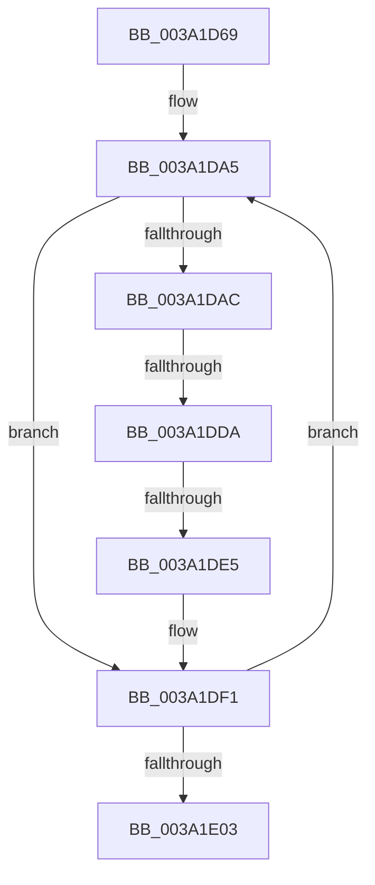

# sub_003A1D69

- RVA: `0x003A1D69`–`0x003A1E26` (길이 `189` bytes)
- VA: `0x00000001403A1D69`
- 실행 섹션: `.text`
- PDB 이름 있음: `아니요`; PDB Function 태그: `아니요`
- unwind 정보 RVA: `0x00081F74`
- 디코드: `50`개 명령, `189/189` bytes 표시
- 미해석 바이트: `0` (있으면 어셈블리에 `.byte`로 보존)

> 이 문서는 커널 이미지의 기계어와 PDB 기호를 분석해 생성했습니다. 4번과 5번은 함수 원형과 자료형을 바이너리 사용 방식에서 추정한 C 해석이며 원본 소스 복구 결과는 아닙니다.

## 1. Dependencies

- 직접 호출 지점: **1**; 고유 호출 대상: **1**
- 직접 호출자로 확인된 함수: **0**
- RIP 상대 이미지 참조: **1**

### Outgoing calls
- `0x003A1DE5` → [RtlRbRemoveNode](../2E/RtlRbRemoveNode_function_002E4C10.md) (function, `0x002E4C10`)

### Direct callers
- 이 함수 시작 RVA로 연결되는 직접 call은 확인되지 않았습니다. 간접 호출은 완전히 역산할 수 없습니다.

### Static image references
- `0x003A1D6D` → RVA `0x00000000` (`image boundary/outside`; read)

## 2. Other-region calls and transfers

- 다른 실행 섹션으로 향하는 call: **0**
- call이 아닌 외부 분기/꼬리 이동: **3**
  - `0x003A1DD4` → [sub_003A1EDB + 0x14](Unknown_function_003A1EDB.md) (`tail-transfer`)
  - `0x003A1DE3` → [sub_003A1E3F](Unknown_function_003A1E3F.md) (`tail-transfer`)
  - `0x003A1E24` → [sub_003A1E65](Unknown_function_003A1E65.md) (`tail-transfer`)

## 3. Assembly (complete function range)

```asm
003A1D69  48 89 58 08                     mov qword ptr [rax + 8], rbx
003A1D6D  4C 8D 0D 8C E2 C5 FF            lea r9, [rip - 0x3a1d74]
003A1D74  48 89 68 10                     mov qword ptr [rax + 0x10], rbp
003A1D78  33 DB                           xor ebx, ebx
003A1D7A  48 89 70 18                     mov qword ptr [rax + 0x18], rsi
003A1D7E  48 89 78 F0                     mov qword ptr [rax - 0x10], rdi
003A1D82  48 8D B9 82 00 00 00            lea rdi, [rcx + 0x82]
003A1D89  4C 89 60 E8                     mov qword ptr [rax - 0x18], r12
003A1D8D  45 33 E4                        xor r12d, r12d
003A1D90  4C 89 78 D8                     mov qword ptr [rax - 0x28], r15
003A1D94  8D 6B 48                        lea ebp, [rbx + 0x48]
003A1D97  4C 8B F9                        mov r15, rcx
003A1D9A  4C 89 68 E0                     mov qword ptr [rax - 0x20], r13
003A1D9E  33 F6                           xor esi, esi
003A1DA0  4D 8D 74 24 FF                  lea r14, [r12 - 1]
003A1DA5  0F B6 07                        movzx eax, byte ptr [rdi]
003A1DA8  A8 10                           test al, 0x10
003A1DAA  75 45                           jne 0x1403a1df1
003A1DAC  24 07                           and al, 7
003A1DAE  0F B6 C0                        movzx eax, al
003A1DB1  48 8D 0C 40                     lea rcx, [rax + rax*2]
003A1DB5  8B C3                           mov eax, ebx
003A1DB7  4C 8D 2C CD 20 33 F2 00         lea r13, [rcx*8 + 0xf23320]
003A1DBF  48 FF C0                        inc rax
003A1DC2  4D 03 E9                        add r13, r9
003A1DC5  48 8D 04 40                     lea rax, [rax + rax*2]
003A1DC9  49 8B 4D 08                     mov rcx, qword ptr [r13 + 8]
003A1DCD  49 8D 14 C7                     lea rdx, [r15 + rax*8]
003A1DD1  F6 C1 01                        test cl, 1
003A1DD4  0F 85 15 01 00 00               jne 0x1403a1eef
003A1DDA  48 8B C1                        mov rax, rcx
003A1DDD  49 8B CD                        mov rcx, r13
003A1DE0  48 3B C2                        cmp rax, rdx
003A1DE3  74 5A                           je 0x1403a1e3f
003A1DE5  E8 26 2E F4 FF                  call 0x1402e4c10
003A1DEA  4C 8D 0D 0F E2 C5 FF            lea r9, [rip - 0x3a1df1]
003A1DF1  FF C3                           inc ebx
003A1DF3  48 83 C5 08                     add rbp, 8
003A1DF7  48 FF C7                        inc rdi
003A1DFA  48 83 C6 18                     add rsi, 0x18
003A1DFE  83 FB 02                        cmp ebx, 2
003A1E01  72 A2                           jb 0x1403a1da5
003A1E03  4C 8B 6C 24 28                  mov r13, qword ptr [rsp + 0x28]
003A1E08  45 85 E4                        test r12d, r12d
003A1E0B  4C 8B 64 24 30                  mov r12, qword ptr [rsp + 0x30]
003A1E10  48 8B 7C 24 38                  mov rdi, qword ptr [rsp + 0x38]
003A1E15  48 8B 74 24 60                  mov rsi, qword ptr [rsp + 0x60]
003A1E1A  48 8B 6C 24 58                  mov rbp, qword ptr [rsp + 0x58]
003A1E1F  48 8B 5C 24 50                  mov rbx, qword ptr [rsp + 0x50]
003A1E24  75 3F                           jne 0x1403a1e65
```

## 4. C-style interpretation (structured pseudocode)

```c
__int64 __fastcall sub_003A1D69(__int64 a1, __int64 a2, __int64 a3, __int64 a4, __int64 a5, __int64 a6, __int64 a7, __int64 a8, __int64 a9, __int64 a10, __int64 a11, __int64 a12)
{
    __int64 result;
    __int64 v_r12;
    __int64 v_r13;
    __int64 v_rbp;
    __int64 v_rbx;
    __int64 v_rdi;
    __int64 v_rsi;

    *(unsigned __int64 *)(result + 8) = v_rbx;
    *(unsigned __int64 *)(result + 16) = v_rbp;
    v_rbx = 0;
    *(unsigned __int64 *)(result + 24) = v_rsi;
    *(unsigned __int64 *)(result - 16) = v_rdi;
    *(unsigned __int64 *)(result - 24) = v_r12;
    v_r12 = 0;
    *(unsigned __int64 *)(result - 40) = v_r15;
    *(unsigned __int64 *)(result - 32) = v_r13;
    v_rsi = 0;
loc_003A1DA5:
    if ((((unsigned __int8)(*(unsigned __int8 *)(a1 + 130))) & (16)) != 0) goto loc_003A1DF1;
    result = (unsigned __int8)((*(unsigned __int8 *)(a1 + 130)) & (7));
    result = (0) + 1;
    v_r13 = ((unsigned __int8)(result) + (unsigned __int8)(result) * 2 * 8 + 15872800) + (v_rip - 3808628);
    result = RtlRbRemoveNode(v_r13, a1 + result + result * 2 * 8, a3, v_rip - 3808628);
loc_003A1DF1:
    v_rbx = (unsigned int)((v_rbx) + 1);
    v_rbp = (v_rbx + 72) + (8);
    v_rdi = (a1 + 130) + 1;
    v_rsi = (v_rsi) + (24);
    if (((unsigned int)(v_rbx)) < 2) goto loc_003A1DA5;
}
```

## 5. (Beta) C Style

```c
int64_t sub_003A1D69(void *Arg1, int64_t Arg2, int64_t Arg3, int64_t Arg4, int64_t Arg5, int64_t Arg6, int64_t Arg7, uint64_t Arg8, uint64_t Arg9, int64_t Arg10, int64_t Arg11, int64_t Arg12)
{
    uint8_t *arg1 = (uint8_t *)Arg1;

    int64_t result;
    int64_t local_r12;
    int64_t local_r13;
    int64_t local_rbp;
    int64_t local_rbx;
    int64_t local_rdi;
    int64_t local_rsi;

    *(uint64_t *)(result + 0x8) = local_rbx;
    *(uint64_t *)(result + 0x10) = local_rbp;
    local_rbx = 0;
    *(uint64_t *)(result + 0x18) = local_rsi;
    *(uint64_t *)(result - 0x10) = local_rdi;
    *(uint64_t *)(result - 0x18) = local_r12;
    local_r12 = 0;
    *(uint64_t *)(result - 0x28) = local_r15;
    *(uint64_t *)(result - 0x20) = local_r13;
    local_rsi = 0;
loc_003A1DA5:
    if ((((uint8_t)(*(uint8_t *)(arg1 + 0x82))) & (16)) != 0) goto loc_003A1DF1;
    result = (uint8_t)((*(uint8_t *)(arg1 + 0x82)) & (7));
    result = (0) + 1;
    local_r13 = ((uint8_t)(result) + (uint8_t)(result) * 2 * 8 + 15872800) + (v_rip - 3808628);
    result = RtlRbRemoveNode(local_r13, Arg1 + result + result * 2 * 8, Arg3, v_rip - 3808628);
loc_003A1DF1:
    local_rbx = (uint32_t)((local_rbx) + 1);
    local_rbp = (local_rbx + 72) + (8);
    local_rdi = (Arg1 + 130) + 1;
    local_rsi = (local_rsi) + (24);
    if (((uint32_t)(local_rbx)) < 2) goto loc_003A1DA5;
}
```

### 관측된 메모리 오프셋

구조체 형식이 확인되지 않은 접근은 인자 기준의 오프셋으로만 기록했습니다.

| 기준 인자 | 오프셋 표현 | 폭 (bit) | 접근 |
|---|---:|---:|---|
| `Arg1` | `+ 0x0 + rax*8` | `64` | `R` |
| `Arg1` | `+ 0x82` | `64` | `R` |

## 6. Execution-region graph

[열기: 2D/3D 그래프와 함수 탐색 컨트롤 패널](../../../control-panel.html?section=text&rva=0x003A1D69&view=graph)

- 2D 그래프는 위에서 아래로 흐르고, 3D 그래프는 빈 공간을 드래그해 회전합니다. Shift+드래그는 이동, 휠은 확대·축소, 함수 노드 선택은 대상 보고서 이동입니다.

### Static fallback


