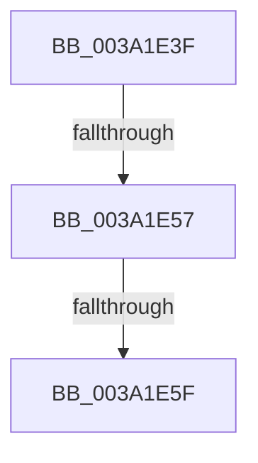

# sub_003A1E3F

- RVA: `0x003A1E3F`–`0x003A1E65` (길이 `38` bytes)
- VA: `0x00000001403A1E3F`
- 실행 섹션: `.text`
- PDB 이름 있음: `아니요`; PDB Function 태그: `아니요`
- unwind 정보 RVA: `0x00081FC8`
- 디코드: `10`개 명령, `38/38` bytes 표시
- 미해석 바이트: `0` (있으면 어셈블리에 `.byte`로 보존)

> 이 문서는 커널 이미지의 기계어와 PDB 기호를 분석해 생성했습니다. 4번과 5번은 함수 원형과 자료형을 바이너리 사용 방식에서 추정한 C 해석이며 원본 소스 복구 결과는 아닙니다.

## 1. Dependencies

- 직접 호출 지점: **1**; 고유 호출 대상: **1**
- 직접 호출자로 확인된 함수: **0**
- RIP 상대 이미지 참조: **0**

### Outgoing calls
- `0x003A1E3F` → [RtlRbRemoveNode](../2E/RtlRbRemoveNode_function_002E4C10.md) (function, `0x002E4C10`)

### Direct callers
- 이 함수 시작 RVA로 연결되는 직접 call은 확인되지 않았습니다. 간접 호출은 완전히 역산할 수 없습니다.

### Static image references
- 디코드된 RIP-relative 메모리 참조가 없습니다.

## 2. Other-region calls and transfers

- 다른 실행 섹션으로 향하는 call: **0**
- call이 아닌 외부 분기/꼬리 이동: **3**
  - `0x003A1E51` → [sub_003A1EDB + 0x29](Unknown_function_003A1EDB.md) (`tail-transfer`)
  - `0x003A1E5D` → [sub_003A1EDB](Unknown_function_003A1EDB.md) (`tail-transfer`)
  - `0x003A1E63` → [sub_003A1D69 + 0x81](Unknown_function_003A1D69.md) (`tail-transfer`)

## 3. Assembly (complete function range)

```asm
003A1E3F  E8 CC 2D F4 FF                  call 0x1402e4c10
003A1E44  49 8B 45 08                     mov rax, qword ptr [r13 + 8]
003A1E48  41 BC 01 00 00 00               mov r12d, 1
003A1E4E  41 84 C4                        test r12b, al
003A1E51  0F 85 AD 00 00 00               jne 0x1403a1f04
003A1E57  48 8B C8                        mov rcx, rax
003A1E5A  48 85 C9                        test rcx, rcx
003A1E5D  75 7C                           jne 0x1403a1edb
003A1E5F  4D 89 75 10                     mov qword ptr [r13 + 0x10], r14
003A1E63  EB 85                           jmp 0x1403a1dea
```

## 4. C-style interpretation (structured pseudocode)

```c
__int64 __fastcall sub_003A1E3F(void)
{
    __int64 result;

    result = RtlRbRemoveNode(a1, a2, a3, a4);
    *(unsigned __int64 *)(v_r13 + 16) = v_r14;
}
```

## 5. (Beta) C Style

```c
void sub_003A1E3F(void)
{
    int64_t result;

    result = RtlRbRemoveNode(a1, a2, a3, a4);
    *(uint64_t *)(local_r13 + 0x10) = local_r14;
}
```

## 6. Execution-region graph

[열기: 2D/3D 그래프와 함수 탐색 컨트롤 패널](../../../control-panel.html?section=text&rva=0x003A1E3F&view=graph)

- 2D 그래프는 위에서 아래로 흐르고, 3D 그래프는 빈 공간을 드래그해 회전합니다. Shift+드래그는 이동, 휠은 확대·축소, 함수 노드 선택은 대상 보고서 이동입니다.

### Static fallback


