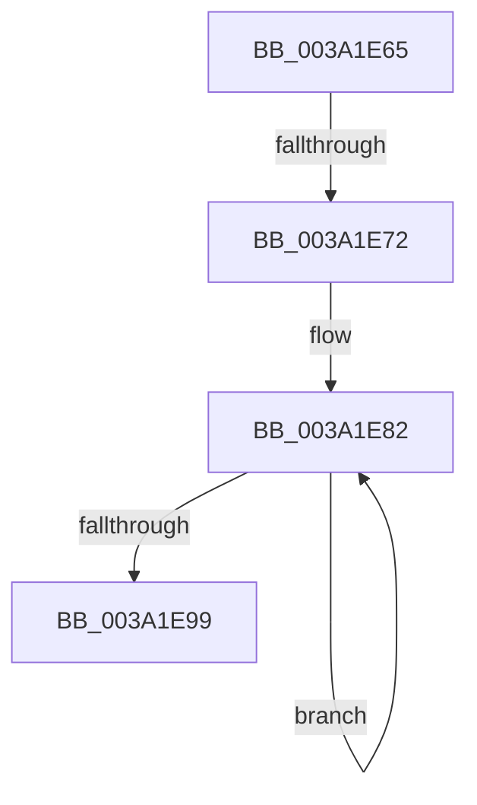

# sub_003A1E65

- RVA: `0x003A1E65`–`0x003A1EA2` (길이 `61` bytes)
- VA: `0x00000001403A1E65`
- 실행 섹션: `.text`
- PDB 이름 있음: `아니요`; PDB Function 태그: `아니요`
- unwind 정보 RVA: `0x00081FF4`
- 디코드: `15`개 명령, `61/61` bytes 표시
- 미해석 바이트: `0` (있으면 어셈블리에 `.byte`로 보존)

> 이 문서는 커널 이미지의 기계어와 PDB 기호를 분석해 생성했습니다. 4번과 5번은 함수 원형과 자료형을 바이너리 사용 방식에서 추정한 C 해석이며 원본 소스 복구 결과는 아닙니다.

## 1. Dependencies

- 직접 호출 지점: **0**; 고유 호출 대상: **0**
- 직접 호출자로 확인된 함수: **0**
- RIP 상대 이미지 참조: **3**

### Outgoing calls
- 직접 디코드된 call 명령이 없습니다.

### Direct callers
- 이 함수 시작 RVA로 연결되는 직접 call은 확인되지 않았습니다. 간접 호출은 완전히 역산할 수 없습니다.

### Static image references
- `0x003A1E69` → RVA `0x00F23300` (`.data`; read)
- `0x003A1E75` → RVA `0x00F23330` (`.data`; read)
- `0x003A1E99` → RVA `0x00F23300` (`.data`; write)

## 2. Other-region calls and transfers

- 다른 실행 섹션으로 향하는 call: **0**
- call이 아닌 외부 분기/꼬리 이동: **2**
  - `0x003A1E70` → [sub_003A1E26](Unknown_function_003A1E26.md) (`tail-transfer`)
  - `0x003A1EA0` → [sub_003A1E26](Unknown_function_003A1E26.md) (`tail-transfer`)

## 3. Assembly (complete function range)

```asm
003A1E65  49 8B 47 48                     mov rax, qword ptr [r15 + 0x48]
003A1E69  48 39 05 90 14 B8 00            cmp qword ptr [rip + 0xb81490], rax
003A1E70  75 B4                           jne 0x1403a1e26
003A1E72  49 8B C6                        mov rax, r14
003A1E75  48 8D 15 B4 14 B8 00            lea rdx, [rip + 0xb814b4]
003A1E7C  41 B8 07 00 00 00               mov r8d, 7
003A1E82  48 8B C8                        mov rcx, rax
003A1E85  48 8B 02                        mov rax, qword ptr [rdx]
003A1E88  48 3B C1                        cmp rax, rcx
003A1E8B  48 8D 52 18                     lea rdx, [rdx + 0x18]
003A1E8F  48 0F 43 C1                     cmovae rax, rcx
003A1E93  49 83 E8 01                     sub r8, 1
003A1E97  75 E9                           jne 0x1403a1e82
003A1E99  48 89 05 60 14 B8 00            mov qword ptr [rip + 0xb81460], rax
003A1EA0  EB 84                           jmp 0x1403a1e26
```

## 4. C-style interpretation (structured pseudocode)

```c
__int64 __fastcall sub_003A1E65(void)
{
    __int64 result;

loc_003A1E82:
    result = *(unsigned __int64 *)(v_rip + 12063924);
    if ((*(unsigned __int64 *)(v_rip + 12063924)) >= v_r14) { result = v_r14; }
    a3 = (7) - (1);
    if (condition_is_not_equal) goto loc_003A1E82;
    *(unsigned __int64 *)(v_rip + 12063840) = result;
}
```

## 5. (Beta) C Style

```c
void sub_003A1E65(void)
{
    int64_t result;

loc_003A1E82:
    result = *(uint64_t *)(v_rip + 0xB814B4);
    if ((*(uint64_t *)(v_rip + 0xB814B4)) >= local_r14) { result = local_r14; }
    a3 = (7) - (1);
    if (condition_is_not_equal) goto loc_003A1E82;
    *(uint64_t *)(v_rip + 0xB81460) = result;
}
```

## 6. Execution-region graph

[열기: 2D/3D 그래프와 함수 탐색 컨트롤 패널](../../../control-panel.html?section=text&rva=0x003A1E65&view=graph)

- 2D 그래프는 위에서 아래로 흐르고, 3D 그래프는 빈 공간을 드래그해 회전합니다. Shift+드래그는 이동, 휠은 확대·축소, 함수 노드 선택은 대상 보고서 이동입니다.

### Static fallback


