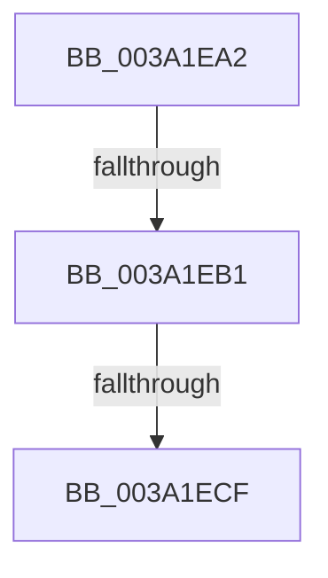

# sub_003A1EA2

- RVA: `0x003A1EA2`–`0x003A1EDB` (길이 `57` bytes)
- VA: `0x00000001403A1EA2`
- 실행 섹션: `.text`
- PDB 이름 있음: `아니요`; PDB Function 태그: `아니요`
- unwind 정보 RVA: `0x00082008`
- 디코드: `10`개 명령, `57/57` bytes 표시
- 미해석 바이트: `0` (있으면 어셈블리에 `.byte`로 보존)

> 이 문서는 커널 이미지의 기계어와 PDB 기호를 분석해 생성했습니다. 4번과 5번은 함수 원형과 자료형을 바이너리 사용 방식에서 추정한 C 해석이며 원본 소스 복구 결과는 아닙니다.

## 1. Dependencies

- 직접 호출 지점: **0**; 고유 호출 대상: **0**
- 직접 호출자로 확인된 함수: **0**
- RIP 상대 이미지 참조: **2**

### Outgoing calls
- 직접 디코드된 call 명령이 없습니다.

### Direct callers
- 이 함수 시작 RVA로 연결되는 직접 call은 확인되지 않았습니다. 간접 호출은 완전히 역산할 수 없습니다.

### Static image references
- `0x003A1EA2` → RVA `0x00F232F8` (`.data`; read/write)
- `0x003A1EB1` → RVA `0x00F21FB0` (`.data`; read)

## 2. Other-region calls and transfers

- 다른 실행 섹션으로 향하는 call: **0**
- call이 아닌 외부 분기/꼬리 이동: **3**
  - `0x003A1EAF` → [sub_003A1E37](Unknown_function_003A1E37.md) (`tail-transfer`)
  - `0x003A1EC9` → [sub_003A1E37](Unknown_function_003A1E37.md) (`tail-transfer`)
  - `0x003A1ED6` → [sub_003A1E37](Unknown_function_003A1E37.md) (`tail-transfer`)

## 3. Assembly (complete function range)

```asm
003A1EA2  F0 44 0F C1 35 4D 14 B8 00      lock xadd dword ptr [rip + 0xb8144d], r14d
003A1EAB  41 83 FE 01                     cmp r14d, 1
003A1EAF  75 86                           jne 0x1403a1e37
003A1EB1  8B 05 F9 00 B8 00               mov eax, dword ptr [rip + 0xb800f9]
003A1EB7  49 8B 84 C1 40 8C FC 00         mov rax, qword ptr [r9 + rax*8 + 0xfc8c40]
003A1EBF  48 8B 88 B8 8E 00 00            mov rcx, qword ptr [rax + 0x8eb8]
003A1EC6  48 85 C9                        test rcx, rcx
003A1EC9  0F 84 68 FF FF FF               je 0x1403a1e37
003A1ECF  F0 81 21 FF FF F7 FF            lock and dword ptr [rcx], 0xfff7ffff
003A1ED6  E9 5C FF FF FF                  jmp 0x1403a1e37
```

## 4. C-style interpretation (structured pseudocode)

```c
__int64 __fastcall sub_003A1EA2(__int64 a1, __int64 a2, __int64 a3, __int64 a4)
{
}
```

## 5. (Beta) C Style

```c
int64_t sub_003A1EA2(int64_t Arg1, int64_t Arg2, int64_t Arg3, void *Arg4)
{
    uint8_t *arg4 = (uint8_t *)Arg4;

}
```

### 관측된 메모리 오프셋

구조체 형식이 확인되지 않은 접근은 인자 기준의 오프셋으로만 기록했습니다.

| 기준 인자 | 오프셋 표현 | 폭 (bit) | 접근 |
|---|---:|---:|---|
| `Arg4` | `+ 0xFC8C40 + rax*8` | `64` | `R` |

## 6. Execution-region graph

[열기: 2D/3D 그래프와 함수 탐색 컨트롤 패널](../../../control-panel.html?section=text&rva=0x003A1EA2&view=graph)

- 2D 그래프는 위에서 아래로 흐르고, 3D 그래프는 빈 공간을 드래그해 회전합니다. Shift+드래그는 이동, 휠은 확대·축소, 함수 노드 선택은 대상 보고서 이동입니다.

### Static fallback


