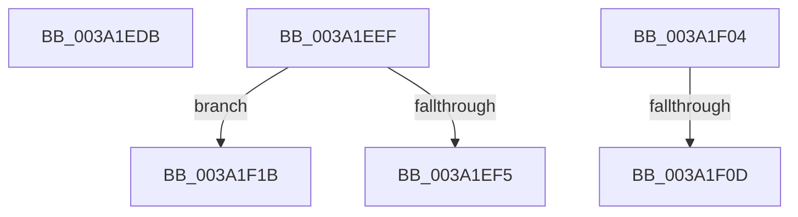

# sub_003A1EDB

- RVA: `0x003A1EDB`–`0x003A1F22` (길이 `71` bytes)
- VA: `0x00000001403A1EDB`
- 실행 섹션: `.text`
- PDB 이름 있음: `아니요`; PDB Function 태그: `아니요`
- unwind 정보 RVA: `0x00082018`
- 디코드: `19`개 명령, `71/71` bytes 표시
- 미해석 바이트: `0` (있으면 어셈블리에 `.byte`로 보존)

> 이 문서는 커널 이미지의 기계어와 PDB 기호를 분석해 생성했습니다. 4번과 5번은 함수 원형과 자료형을 바이너리 사용 방식에서 추정한 C 해석이며 원본 소스 복구 결과는 아닙니다.

## 1. Dependencies

- 직접 호출 지점: **0**; 고유 호출 대상: **0**
- 직접 호출자로 확인된 함수: **0**
- RIP 상대 이미지 참조: **0**

### Outgoing calls
- 직접 디코드된 call 명령이 없습니다.

### Direct callers
- 이 함수 시작 RVA로 연결되는 직접 call은 확인되지 않았습니다. 간접 호출은 완전히 역산할 수 없습니다.

### Static image references
- 디코드된 RIP-relative 메모리 참조가 없습니다.

## 2. Other-region calls and transfers

- 다른 실행 섹션으로 향하는 call: **0**
- call이 아닌 외부 분기/꼬리 이동: **5**
  - `0x003A1EEA` → [sub_003A1D69 + 0x81](Unknown_function_003A1D69.md) (`tail-transfer`)
  - `0x003A1EFF` → [sub_003A1D69 + 0x74](Unknown_function_003A1D69.md) (`tail-transfer`)
  - `0x003A1F07` → [sub_003A1E3F + 0x20](Unknown_function_003A1E3F.md) (`tail-transfer`)
  - `0x003A1F16` → [sub_003A1E3F + 0x1B](Unknown_function_003A1E3F.md) (`tail-transfer`)
  - `0x003A1F1D` → [sub_003A1D69 + 0x74](Unknown_function_003A1D69.md) (`tail-transfer`)

## 3. Assembly (complete function range)

```asm
003A1EDB  48 8B C5                        mov rax, rbp
003A1EDE  48 2B C6                        sub rax, rsi
003A1EE1  48 8B 4C 08 E8                  mov rcx, qword ptr [rax + rcx - 0x18]
003A1EE6  49 89 4D 10                     mov qword ptr [r13 + 0x10], rcx
003A1EEA  E9 FB FE FF FF                  jmp 0x1403a1dea
003A1EEF  48 83 F9 01                     cmp rcx, 1
003A1EF3  74 26                           je 0x1403a1f1b
003A1EF5  49 8B C5                        mov rax, r13
003A1EF8  48 83 C8 01                     or rax, 1
003A1EFC  48 33 C1                        xor rax, rcx
003A1EFF  E9 D9 FE FF FF                  jmp 0x1403a1ddd
003A1F04  49 3B C4                        cmp rax, r12
003A1F07  0F 84 52 FF FF FF               je 0x1403a1e5f
003A1F0D  49 8B CD                        mov rcx, r13
003A1F10  49 0B CC                        or rcx, r12
003A1F13  48 33 C8                        xor rcx, rax
003A1F16  E9 3F FF FF FF                  jmp 0x1403a1e5a
003A1F1B  33 C0                           xor eax, eax
003A1F1D  E9 BB FE FF FF                  jmp 0x1403a1ddd
```

## 4. C-style interpretation (structured pseudocode)

```c
__int64 __fastcall sub_003A1EDB(__int64 a1)
{
    __int64 result;

    result = (v_rbp) - (v_rsi);
    *(unsigned __int64 *)(v_r13 + 16) = *(unsigned __int64 *)(result + a1 * 1 - 24);
}
```

## 5. (Beta) C Style

```c
int64_t sub_003A1EDB(int64_t Arg1)
{
    int64_t result;

    result = (local_rbp) - (local_rsi);
    *(uint64_t *)(local_r13 + 0x10) = *(uint64_t *)(result + Arg1 * 1 - 0x18);
}
```

## 6. Execution-region graph

[열기: 2D/3D 그래프와 함수 탐색 컨트롤 패널](../../../control-panel.html?section=text&rva=0x003A1EDB&view=graph)

- 2D 그래프는 위에서 아래로 흐르고, 3D 그래프는 빈 공간을 드래그해 회전합니다. Shift+드래그는 이동, 휠은 확대·축소, 함수 노드 선택은 대상 보고서 이동입니다.

### Static fallback


