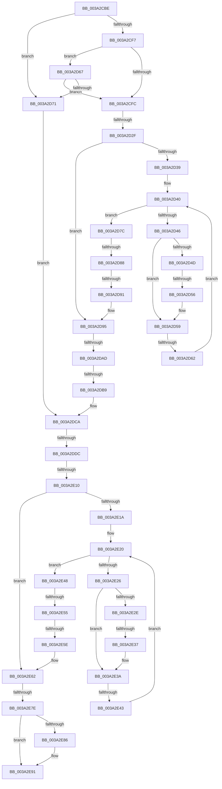

# sub_003A2CBE

- RVA: `0x003A2CBE`–`0x003A2EAC` (길이 `494` bytes)
- VA: `0x00000001403A2CBE`
- 실행 섹션: `.text`
- PDB 이름 있음: `아니요`; PDB Function 태그: `아니요`
- unwind 정보 RVA: `0x000820E4`
- 디코드: `133`개 명령, `494/494` bytes 표시
- 미해석 바이트: `0` (있으면 어셈블리에 `.byte`로 보존)

> 이 문서는 커널 이미지의 기계어와 PDB 기호를 분석해 생성했습니다. 4번과 5번은 함수 원형과 자료형을 바이너리 사용 방식에서 추정한 C 해석이며 원본 소스 복구 결과는 아닙니다.

## 1. Dependencies

- 직접 호출 지점: **2**; 고유 호출 대상: **1**
- 직접 호출자로 확인된 함수: **0**
- RIP 상대 이미지 참조: **1**

### Outgoing calls
- `0x003A2D9B` → [RtlRbInsertNodeEx](../2E/RtlRbInsertNodeEx_function_002E4570.md) (function, `0x002E4570`)
- `0x003A2E6C` → [RtlRbInsertNodeEx](../2E/RtlRbInsertNodeEx_function_002E4570.md) (function, `0x002E4570`)

### Direct callers
- 이 함수 시작 RVA로 연결되는 직접 call은 확인되지 않았습니다. 간접 호출은 완전히 역산할 수 없습니다.

### Static image references
- `0x003A2DC3` → RVA `0x00000000` (`image boundary/outside`; read)

## 2. Other-region calls and transfers

- 다른 실행 섹션으로 향하는 call: **0**
- call이 아닌 외부 분기/꼬리 이동: **15**
  - `0x003A2D29` → [sub_003A2F4F + 0x7A](Unknown_function_003A2F4F.md) (`tail-transfer`)
  - `0x003A2D50` → [sub_003A2F4F + 0x7F](Unknown_function_003A2F4F.md) (`tail-transfer`)
  - `0x003A2D5C` → [sub_003A2F4F + 0x7F](Unknown_function_003A2F4F.md) (`tail-transfer`)
  - `0x003A2D82` → [sub_003A2F4F + 0x2A](Unknown_function_003A2F4F.md) (`tail-transfer`)
  - `0x003A2D8B` → [sub_003A2F4F + 0x27](Unknown_function_003A2F4F.md) (`tail-transfer`)
  - `0x003A2DA7` → [sub_003A2F4F + 0x4B](Unknown_function_003A2F4F.md) (`tail-transfer`)
  - `0x003A2DB3` → [sub_003A2F4F + 0x1F](Unknown_function_003A2F4F.md) (`tail-transfer`)
  - `0x003A2DD6` → [sub_003A2F4F](Unknown_function_003A2F4F.md) (`tail-transfer`)
  - `0x003A2E0A` → [sub_003A2F4F + 0x6E](Unknown_function_003A2F4F.md) (`tail-transfer`)
  - `0x003A2E31` → [sub_003A2F4F + 0x73](Unknown_function_003A2F4F.md) (`tail-transfer`)
  - `0x003A2E3D` → [sub_003A2F4F + 0x73](Unknown_function_003A2F4F.md) (`tail-transfer`)
  - `0x003A2E4F` → [sub_003A2F4F + 0x11](Unknown_function_003A2F4F.md) (`tail-transfer`)
  - `0x003A2E58` → [sub_003A2F4F + 0xE](Unknown_function_003A2F4F.md) (`tail-transfer`)
  - `0x003A2E78` → [sub_003A2F4F + 0x38](Unknown_function_003A2F4F.md) (`tail-transfer`)
  - `0x003A2EAA` → [sub_003A2ED0](Unknown_function_003A2ED0.md) (`tail-transfer`)

## 3. Assembly (complete function range)

```asm
003A2CBE  48 89 70 E0                     mov qword ptr [rax - 0x20], rsi
003A2CC2  48 8B D9                        mov rbx, rcx
003A2CC5  0F B6 89 82 00 00 00            movzx ecx, byte ptr [rcx + 0x82]
003A2CCC  4D 8B E9                        mov r13, r9
003A2CCF  48 89 78 D8                     mov qword ptr [rax - 0x28], rdi
003A2CD3  41 B4 01                        mov r12b, 1
003A2CD6  4C 89 70 D0                     mov qword ptr [rax - 0x30], r14
003A2CDA  4D 8B F0                        mov r14, r8
003A2CDD  4C 89 78 C8                     mov qword ptr [rax - 0x38], r15
003A2CE1  45 33 FF                        xor r15d, r15d
003A2CE4  41 C6 00 00                     mov byte ptr [r8], 0
003A2CE8  41 8B FF                        mov edi, r15d
003A2CEB  41 88 39                        mov byte ptr [r9], dil
003A2CEE  41 8D 6F 01                     lea ebp, [r15 + 1]
003A2CF2  80 F9 17                        cmp cl, 0x17
003A2CF5  74 7A                           je 0x1403a2d71
003A2CF7  F6 C1 20                        test cl, 0x20
003A2CFA  75 6B                           jne 0x1403a2d67
003A2CFC  0F B6 C1                        movzx eax, cl
003A2CFF  48 8D BA 20 33 F2 00            lea rdi, [rdx + 0xf23320]
003A2D06  83 E1 07                        and ecx, 7
003A2D09  48 8D 73 18                     lea rsi, [rbx + 0x18]
003A2D0D  24 EF                           and al, 0xef
003A2D0F  88 83 82 00 00 00               mov byte ptr [rbx + 0x82], al
003A2D15  48 8D 04 49                     lea rax, [rcx + rcx*2]
003A2D19  48 8B 4C C7 08                  mov rcx, qword ptr [rdi + rax*8 + 8]
003A2D1E  48 8B 14 C7                     mov rdx, qword ptr [rdi + rax*8]
003A2D22  48 8D 3C C7                     lea rdi, [rdi + rax*8]
003A2D26  40 84 CD                        test bpl, cl
003A2D29  0F 85 9A 02 00 00               jne 0x1403a2fc9
003A2D2F  23 CD                           and ecx, ebp
003A2D31  45 32 C0                        xor r8b, r8b
003A2D34  48 85 D2                        test rdx, rdx
003A2D37  74 5C                           je 0x1403a2d95
003A2D39  4C 8B 43 48                     mov r8, qword ptr [rbx + 0x48]
003A2D3D  0F 1F 00                        nop dword ptr [rax]
003A2D40  4C 3B 42 30                     cmp r8, qword ptr [rdx + 0x30]
003A2D44  73 36                           jae 0x1403a2d7c
003A2D46  48 8B 02                        mov rax, qword ptr [rdx]
003A2D49  85 C9                           test ecx, ecx
003A2D4B  74 0C                           je 0x1403a2d59
003A2D4D  48 85 C0                        test rax, rax
003A2D50  0F 84 78 02 00 00               je 0x1403a2fce
003A2D56  48 33 C2                        xor rax, rdx
003A2D59  48 85 C0                        test rax, rax
003A2D5C  0F 84 6C 02 00 00               je 0x1403a2fce
003A2D62  48 8B D0                        mov rdx, rax
003A2D65  EB D9                           jmp 0x1403a2d40
003A2D67  48 8B 43 50                     mov rax, qword ptr [rbx + 0x50]
003A2D6B  48 39 43 48                     cmp qword ptr [rbx + 0x48], rax
003A2D6F  75 8B                           jne 0x1403a2cfc
003A2D71  80 C9 10                        or cl, 0x10
003A2D74  88 8B 82 00 00 00               mov byte ptr [rbx + 0x82], cl
003A2D7A  EB 4E                           jmp 0x1403a2dca
003A2D7C  48 8B 42 08                     mov rax, qword ptr [rdx + 8]
003A2D80  85 C9                           test ecx, ecx
003A2D82  0F 84 F1 01 00 00               je 0x1403a2f79
003A2D88  48 85 C0                        test rax, rax
003A2D8B  0F 85 E5 01 00 00               jne 0x1403a2f76
003A2D91  44 0F B6 C5                     movzx r8d, bpl
003A2D95  4C 8B CE                        mov r9, rsi
003A2D98  48 8B CF                        mov rcx, rdi
003A2D9B  E8 D0 17 F4 FF                  call 0x1402e4570
003A2DA0  48 8B 4F 08                     mov rcx, qword ptr [rdi + 8]
003A2DA4  40 84 CD                        test bpl, cl
003A2DA7  0F 85 ED 01 00 00               jne 0x1403a2f9a
003A2DAD  48 8B C1                        mov rax, rcx
003A2DB0  48 3B C6                        cmp rax, rsi
003A2DB3  0F 85 B5 01 00 00               jne 0x1403a2f6e
003A2DB9  48 8B 43 48                     mov rax, qword ptr [rbx + 0x48]
003A2DBD  48 89 47 10                     mov qword ptr [rdi + 0x10], rax
003A2DC1  8B FD                           mov edi, ebp
003A2DC3  48 8D 15 36 D2 C5 FF            lea rdx, [rip - 0x3a2dca]
003A2DCA  48 83 7B 50 FF                  cmp qword ptr [rbx + 0x50], -1
003A2DCF  0F B6 8B 83 00 00 00            movzx ecx, byte ptr [rbx + 0x83]
003A2DD6  0F 84 73 01 00 00               je 0x1403a2f4f
003A2DDC  0F B6 C1                        movzx eax, cl
003A2DDF  4C 8D 73 30                     lea r14, [rbx + 0x30]
003A2DE3  24 EF                           and al, 0xef
003A2DE5  80 E1 07                        and cl, 7
003A2DE8  88 83 83 00 00 00               mov byte ptr [rbx + 0x83], al
003A2DEE  0F B6 C1                        movzx eax, cl
003A2DF1  48 8D 0C 40                     lea rcx, [rax + rax*2]
003A2DF5  48 8D 34 CD 20 33 F2 00         lea rsi, [rcx*8 + 0xf23320]
003A2DFD  48 03 F2                        add rsi, rdx
003A2E00  4C 8B 46 08                     mov r8, qword ptr [rsi + 8]
003A2E04  48 8B 16                        mov rdx, qword ptr [rsi]
003A2E07  44 84 C5                        test bpl, r8b
003A2E0A  0F 85 AD 01 00 00               jne 0x1403a2fbd
003A2E10  44 23 C5                        and r8d, ebp
003A2E13  32 C0                           xor al, al
003A2E15  48 85 D2                        test rdx, rdx
003A2E18  74 48                           je 0x1403a2e62
003A2E1A  48 8B 4B 50                     mov rcx, qword ptr [rbx + 0x50]
003A2E1E  66 90                           nop
003A2E20  48 3B 4A 20                     cmp rcx, qword ptr [rdx + 0x20]
003A2E24  73 22                           jae 0x1403a2e48
003A2E26  48 8B 02                        mov rax, qword ptr [rdx]
003A2E29  45 85 C0                        test r8d, r8d
003A2E2C  74 0C                           je 0x1403a2e3a
003A2E2E  48 85 C0                        test rax, rax
003A2E31  0F 84 8B 01 00 00               je 0x1403a2fc2
003A2E37  48 33 C2                        xor rax, rdx
003A2E3A  48 85 C0                        test rax, rax
003A2E3D  0F 84 7F 01 00 00               je 0x1403a2fc2
003A2E43  48 8B D0                        mov rdx, rax
003A2E46  EB D8                           jmp 0x1403a2e20
003A2E48  48 8B 42 08                     mov rax, qword ptr [rdx + 8]
003A2E4C  45 85 C0                        test r8d, r8d
003A2E4F  0F 84 0B 01 00 00               je 0x1403a2f60
003A2E55  48 85 C0                        test rax, rax
003A2E58  0F 85 FF 00 00 00               jne 0x1403a2f5d
003A2E5E  40 0F B6 C5                     movzx eax, bpl
003A2E62  4D 8B CE                        mov r9, r14
003A2E65  44 0F B6 C0                     movzx r8d, al
003A2E69  48 8B CE                        mov rcx, rsi
003A2E6C  E8 FF 16 F4 FF                  call 0x1402e4570
003A2E71  48 8B 4E 08                     mov rcx, qword ptr [rsi + 8]
003A2E75  40 84 CD                        test bpl, cl
003A2E78  0F 85 09 01 00 00               jne 0x1403a2f87
003A2E7E  48 8B C1                        mov rax, rcx
003A2E81  49 3B C6                        cmp rax, r14
003A2E84  75 0B                           jne 0x1403a2e91
003A2E86  48 8B 43 50                     mov rax, qword ptr [rbx + 0x50]
003A2E8A  44 8B FD                        mov r15d, ebp
003A2E8D  48 89 46 10                     mov qword ptr [rsi + 0x10], rax
003A2E91  4C 8B 74 24 70                  mov r14, qword ptr [rsp + 0x70]
003A2E96  41 0B FF                        or edi, r15d
003A2E99  4C 8B 7C 24 20                  mov r15, qword ptr [rsp + 0x20]
003A2E9E  85 FF                           test edi, edi
003A2EA0  48 8B 7C 24 30                  mov rdi, qword ptr [rsp + 0x30]
003A2EA5  48 8B 74 24 38                  mov rsi, qword ptr [rsp + 0x38]
003A2EAA  75 24                           jne 0x1403a2ed0
```

## 4. C-style interpretation (structured pseudocode)

```c
__int64 __fastcall sub_003A2CBE(__int64 a1, __int64 a2, __int64 a3, __int64 a4, __int64 a5, __int64 a6, __int64 a7, __int64 a8, __int64 a9, __int64 a10, __int64 a11, __int64 a12, __int64 a13, __int64 a14)
{
    __int64 result;
    __int64 v_r15;
    __int64 v_rdi;
    __int64 v_rsi;
    unsigned __int64 v_stack_p20;

    *(unsigned __int64 *)(result - 32) = v_rsi;
    *(unsigned __int64 *)(result - 40) = v_rdi;
    *(unsigned __int64 *)(result - 48) = v_r14;
    *(unsigned __int64 *)(result - 56) = v_r15;
    v_r15 = 0;
    *(unsigned __int8 *)(a3) = 0;
    *(unsigned __int8 *)(a4) = 0;
    if (((unsigned __int8)(*(unsigned __int8 *)(a1 + 130))) == 23) goto loc_003A2D71;
    if ((((unsigned __int8)(*(unsigned __int8 *)(a1 + 130))) & (32)) != 0) goto loc_003A2D67;
loc_003A2CFC:
    a1 = (unsigned int)((*(unsigned __int8 *)(a1 + 130)) & (7));
    result = (unsigned __int8)(((unsigned __int8)(*(unsigned __int8 *)(a1 + 130))) & (239));
    *(unsigned __int8 *)(a1 + 130) = (unsigned __int8)(result);
    a1 = (unsigned int)((*(unsigned __int64 *)(a2 + 15872800 + a1 + a1 * 2 * 8 + 8)) & ((unsigned int)(v_r15 + 1)));
    a3 = 0;
    if (*(unsigned __int64 *)(a2 + 15872800 + a1 + a1 * 2 * 8) == 0) goto loc_003A2D95;
loc_003A2D40:
    if ((*(unsigned __int64 *)(a1 + 72)) >= (*(unsigned __int64 *)(*(unsigned __int64 *)(a2 + 15872800 + a1 + a1 * 2 * 8) + 48))) goto loc_003A2D7C;
    if ((unsigned int)(a1) == 0) goto loc_003A2D59;
    result = (*(unsigned __int64 *)(*(unsigned __int64 *)(a2 + 15872800 + a1 + a1 * 2 * 8))) ^ (*(unsigned __int64 *)(a2 + 15872800 + a1 + a1 * 2 * 8));
loc_003A2D59:
    goto loc_003A2D40;
loc_003A2D67:
    if ((*(unsigned __int64 *)(a1 + 72)) != (*(unsigned __int64 *)(a1 + 80))) goto loc_003A2CFC;
loc_003A2D71:
    a1 = (unsigned __int8)((a1) | (16));
    *(unsigned __int8 *)(a1 + 130) = (unsigned __int8)(a1);
    goto loc_003A2DCA;
loc_003A2D7C:
loc_003A2D95:
    result = RtlRbInsertNodeEx(a2 + 15872800 + a1 + a1 * 2 * 8, result, (unsigned __int8)(v_r15 + 1), a1 + 24);
    *(unsigned __int64 *)(a2 + 15872800 + a1 + a1 * 2 * 8 + 16) = *(unsigned __int64 *)(a1 + 72);
loc_003A2DCA:
    result = (unsigned __int8)(((unsigned __int8)(*(unsigned __int8 *)(a1 + 131))) & (239));
    a1 = (unsigned __int8)((*(unsigned __int8 *)(a1 + 131)) & (7));
    *(unsigned __int8 *)(a1 + 131) = (unsigned __int8)(result);
    v_rsi = ((unsigned __int8)(a1) + (unsigned __int8)(a1) * 2 * 8 + 15872800) + (v_rip - 3812810);
    a3 = (unsigned int)((*(unsigned __int64 *)(v_rsi + 8)) & ((unsigned int)(v_r15 + 1)));
    result = 0;
    if (*(unsigned __int64 *)(v_rsi) == 0) goto loc_003A2E62;
loc_003A2E20:
    if ((*(unsigned __int64 *)(a1 + 80)) >= (*(unsigned __int64 *)(*(unsigned __int64 *)(v_rsi) + 32))) goto loc_003A2E48;
    if ((unsigned int)(a3) == 0) goto loc_003A2E3A;
    result = (*(unsigned __int64 *)(*(unsigned __int64 *)(v_rsi))) ^ (*(unsigned __int64 *)(v_rsi));
loc_003A2E3A:
    goto loc_003A2E20;
loc_003A2E48:
loc_003A2E62:
    result = RtlRbInsertNodeEx(v_rsi, result, (unsigned __int8)((unsigned __int8)(v_r15 + 1)), a1 + 48);
    result = *(unsigned __int64 *)(v_rsi + 8);
    if ((*(unsigned __int64 *)(v_rsi + 8)) == (a1 + 48)) {
        result = *(unsigned __int64 *)(a1 + 80);
        v_r15 = (unsigned int)(v_r15 + 1);
        *(unsigned __int64 *)(v_rsi + 16) = result;
    }
    v_rdi = (unsigned int)(((unsigned int)((unsigned int)(v_r15 + 1))) | ((unsigned int)(v_r15)));
}
```

## 5. (Beta) C Style

```c
int64_t sub_003A2CBE(void *Arg1, void *Arg2, void *Arg3, void *Arg4, uint64_t Arg5, int64_t Arg6, int64_t Arg7, uint64_t Arg8, uint64_t Arg9, uint64_t Arg10, uint64_t Arg11, uint64_t Arg12, uint64_t Arg13, int64_t Arg14)
{
    uint8_t *arg1 = (uint8_t *)Arg1;
    uint8_t *arg2 = (uint8_t *)Arg2;
    uint8_t *arg3 = (uint8_t *)Arg3;
    uint8_t *arg4 = (uint8_t *)Arg4;

    int64_t result;
    int64_t local_r15;
    int64_t local_rdi;
    int64_t local_rsi;
    uint64_t v_stack_p20;

    *(uint64_t *)(result - 0x20) = local_rsi;
    *(uint64_t *)(result - 0x28) = local_rdi;
    *(uint64_t *)(result - 0x30) = local_r14;
    *(uint64_t *)(result - 0x38) = local_r15;
    local_r15 = 0;
    *(uint8_t *)(arg3) = 0;
    *(uint8_t *)(arg4) = 0;
    if (((uint8_t)(*(uint8_t *)(arg1 + 0x82))) == 23) goto loc_003A2D71;
    if ((((uint8_t)(*(uint8_t *)(arg1 + 0x82))) & (32)) != 0) goto loc_003A2D67;
loc_003A2CFC:
    Arg1 = (uint32_t)((*(uint8_t *)(arg1 + 0x82)) & (7));
    result = (uint8_t)(((uint8_t)(*(uint8_t *)(arg1 + 0x82))) & (239));
    *(uint8_t *)(arg1 + 0x82) = (uint8_t)(result);
    Arg1 = (uint32_t)((*(uint64_t *)(arg2 + 0xF23320 + arg1 + arg1 * 2 * 8 + 0x8)) & ((uint32_t)(local_r15 + 1)));
    Arg3 = 0;
    if (*(uint64_t *)(arg2 + 0xF23320 + arg1 + arg1 * 2 * 8) == 0) goto loc_003A2D95;
loc_003A2D40:
    if ((*(uint64_t *)(arg1 + 0x48)) >= (*(uint64_t *)(*(uint64_t *)(arg2 + 0xF23320 + arg1 + arg1 * 2 * 8) + 0x30))) goto loc_003A2D7C;
    if ((uint32_t)(Arg1) == 0) goto loc_003A2D59;
    result = (*(uint64_t *)(*(uint64_t *)(arg2 + 0xF23320 + arg1 + arg1 * 2 * 8))) ^ (*(uint64_t *)(arg2 + 0xF23320 + arg1 + arg1 * 2 * 8));
loc_003A2D59:
    goto loc_003A2D40;
loc_003A2D67:
    if ((*(uint64_t *)(arg1 + 0x48)) != (*(uint64_t *)(arg1 + 0x50))) goto loc_003A2CFC;
loc_003A2D71:
    Arg1 = (uint8_t)((Arg1) | (16));
    *(uint8_t *)(arg1 + 0x82) = (uint8_t)(Arg1);
    goto loc_003A2DCA;
loc_003A2D7C:
loc_003A2D95:
    result = RtlRbInsertNodeEx(Arg2 + 15872800 + Arg1 + Arg1 * 2 * 8, result, (uint8_t)(local_r15 + 1), Arg1 + 24);
    *(uint64_t *)(arg2 + 0xF23320 + arg1 + arg1 * 2 * 8 + 0x10) = *(uint64_t *)(arg1 + 0x48);
loc_003A2DCA:
    result = (uint8_t)(((uint8_t)(*(uint8_t *)(arg1 + 0x83))) & (239));
    Arg1 = (uint8_t)((*(uint8_t *)(arg1 + 0x83)) & (7));
    *(uint8_t *)(arg1 + 0x83) = (uint8_t)(result);
    local_rsi = ((uint8_t)(Arg1) + (uint8_t)(Arg1) * 2 * 8 + 15872800) + (v_rip - 3812810);
    Arg3 = (uint32_t)((*(uint64_t *)(local_rsi + 0x8)) & ((uint32_t)(local_r15 + 1)));
    result = 0;
    if (*(uint64_t *)(local_rsi) == 0) goto loc_003A2E62;
loc_003A2E20:
    if ((*(uint64_t *)(arg1 + 0x50)) >= (*(uint64_t *)(*(uint64_t *)(local_rsi) + 0x20))) goto loc_003A2E48;
    if ((uint32_t)(Arg3) == 0) goto loc_003A2E3A;
    result = (*(uint64_t *)(*(uint64_t *)(local_rsi))) ^ (*(uint64_t *)(local_rsi));
loc_003A2E3A:
    goto loc_003A2E20;
loc_003A2E48:
loc_003A2E62:
    result = RtlRbInsertNodeEx(local_rsi, result, (uint8_t)((uint8_t)(local_r15 + 1)), Arg1 + 48);
    result = *(uint64_t *)(local_rsi + 0x8);
    if ((*(uint64_t *)(local_rsi + 0x8)) == (Arg1 + 48)) {
        result = *(uint64_t *)(arg1 + 0x50);
        local_r15 = (uint32_t)(local_r15 + 1);
        *(uint64_t *)(local_rsi + 0x10) = result;
    }
    local_rdi = (uint32_t)(((uint32_t)((uint32_t)(local_r15 + 1))) | ((uint32_t)(local_r15)));
}
```

### 관측된 메모리 오프셋

구조체 형식이 확인되지 않은 접근은 인자 기준의 오프셋으로만 기록했습니다.

| 기준 인자 | 오프셋 표현 | 폭 (bit) | 접근 |
|---|---:|---:|---|
| `Arg1` | `+ 0x18` | `64` | `R` |
| `Arg1` | `+ 0x30` | `64` | `R` |
| `Arg1` | `+ 0x48` | `64` | `R` |
| `Arg1` | `+ 0x50` | `64` | `R` |
| `Arg1` | `+ 0x82` | `8` | `R` |
| `Arg1` | `+ 0x82` | `8` | `W` |
| `Arg1` | `+ 0x83` | `8` | `R` |
| `Arg1` | `+ 0x83` | `8` | `W` |
| `Arg2` | `+ 0x0 + rax*8` | `64` | `R` |
| `Arg2` | `+ 0x8` | `64` | `R` |
| `Arg2` | `+ 0x8 + rax*8` | `64` | `R` |
| `Arg2` | `+ 0x10` | `64` | `W` |
| `Arg2` | `+ 0xF23320` | `64` | `R` |
| `Arg3` | `+ 0x0` | `8` | `W` |
| `Arg4` | `+ 0x0` | `8` | `W` |

## 6. Execution-region graph

[열기: 2D/3D 그래프와 함수 탐색 컨트롤 패널](../../../control-panel.html?section=text&rva=0x003A2CBE&view=graph)

- 2D 그래프는 위에서 아래로 흐르고, 3D 그래프는 빈 공간을 드래그해 회전합니다. Shift+드래그는 이동, 휠은 확대·축소, 함수 노드 선택은 대상 보고서 이동입니다.

### Static fallback


