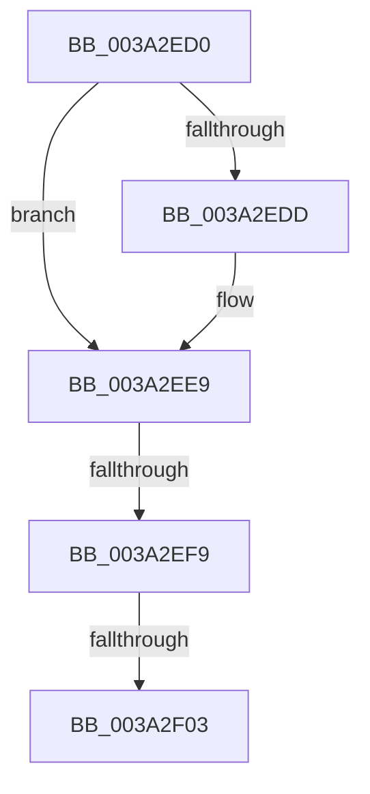

# sub_003A2ED0

- RVA: `0x003A2ED0`–`0x003A2F10` (길이 `64` bytes)
- VA: `0x00000001403A2ED0`
- 실행 섹션: `.text`
- PDB 이름 있음: `아니요`; PDB Function 태그: `아니요`
- unwind 정보 RVA: `0x0008212C`
- 디코드: `15`개 명령, `64/64` bytes 표시
- 미해석 바이트: `0` (있으면 어셈블리에 `.byte`로 보존)

> 이 문서는 커널 이미지의 기계어와 PDB 기호를 분석해 생성했습니다. 4번과 5번은 함수 원형과 자료형을 바이너리 사용 방식에서 추정한 C 해석이며 원본 소스 복구 결과는 아닙니다.

## 1. Dependencies

- 직접 호출 지점: **1**; 고유 호출 대상: **1**
- 직접 호출자로 확인된 함수: **0**
- RIP 상대 이미지 참조: **2**

### Outgoing calls
- `0x003A2F06` → [KiRemoveTimer2](KiRemoveTimer2_function_003A1D60.md) (function, `0x003A1D60`)

### Direct callers
- 이 함수 시작 RVA로 연결되는 직접 call은 확인되지 않았습니다. 간접 호출은 완전히 역산할 수 없습니다.

### Static image references
- `0x003A2ED4` → RVA `0x00F23300` (`.data`; read)
- `0x003A2EDD` → RVA `0x00F23300` (`.data`; write)

## 2. Other-region calls and transfers

- 다른 실행 섹션으로 향하는 call: **0**
- call이 아닌 외부 분기/꼬리 이동: **3**
  - `0x003A2EF7` → [sub_003A2EAC](Unknown_function_003A2EAC.md) (`tail-transfer`)
  - `0x003A2F01` → [sub_003A2EAC](Unknown_function_003A2EAC.md) (`tail-transfer`)
  - `0x003A2F0E` → [sub_003A2EAC](Unknown_function_003A2EAC.md) (`tail-transfer`)

## 3. Assembly (complete function range)

```asm
003A2ED0  48 8B 43 48                     mov rax, qword ptr [rbx + 0x48]
003A2ED4  48 39 05 25 04 B8 00            cmp qword ptr [rip + 0xb80425], rax
003A2EDB  76 0C                           jbe 0x1403a2ee9
003A2EDD  48 89 05 1C 04 B8 00            mov qword ptr [rip + 0xb8041c], rax
003A2EE4  F0 83 0C 24 00                  lock or dword ptr [rsp], 0
003A2EE9  48 A1 08 00 00 00 80 F7 FF FF   movabs rax, qword ptr [0xfffff78000000008]
003A2EF3  48 39 43 48                     cmp qword ptr [rbx + 0x48], rax
003A2EF7  77 B3                           ja 0x1403a2eac
003A2EF9  80 7C 24 68 00                  cmp byte ptr [rsp + 0x68], 0
003A2EFE  41 88 2E                        mov byte ptr [r14], bpl
003A2F01  75 A9                           jne 0x1403a2eac
003A2F03  48 8B CB                        mov rcx, rbx
003A2F06  E8 55 EE FF FF                  call 0x1403a1d60
003A2F0B  45 32 E4                        xor r12b, r12b
003A2F0E  EB 9C                           jmp 0x1403a2eac
```

## 4. C-style interpretation (structured pseudocode)

```c
__int64 __fastcall sub_003A2ED0(__int64 a1, __int64 a2, __int64 a3, __int64 a4, __int64 a5, __int64 a6, __int64 a7, __int64 a8, __int64 a9, __int64 a10, __int64 a11, __int64 a12, unsigned __int8 a13)
{
    __int64 result;
    __int64 v_r12;
    unsigned int v_stack_p0;

    if ((*(unsigned __int64 *)(v_rip + 12059685)) >= = (*(unsigned __int64 *)(v_rbx + 72))) {
        *(unsigned __int64 *)(v_rip + 12059676) = *(unsigned __int64 *)(v_rbx + 72);
    }
    *(unsigned __int8 *)(v_r14) = (unsigned __int8)(v_rbp);
    result = KiRemoveTimer2(v_rbx, a2, a3, a4);
    v_r12 = 0;
}
```

## 5. (Beta) C Style

```c
int64_t sub_003A2ED0(int64_t Arg1, int64_t Arg2, int64_t Arg3, int64_t Arg4, uint64_t Arg5, uint64_t Arg6, uint64_t Arg7, uint64_t Arg8, uint64_t Arg9, uint64_t Arg10, uint64_t Arg11, uint64_t Arg12, uint8_t Arg13)
{
    int64_t result;
    int64_t local_r12;
    uint32_t v_stack_p0;

    if ((*(uint64_t *)(v_rip + 0xB80425)) >= = (*(uint64_t *)(local_rbx + 0x48))) {
        *(uint64_t *)(v_rip + 0xB8041C) = *(uint64_t *)(local_rbx + 0x48);
    }
    *(uint8_t *)(local_r14) = (uint8_t)(local_rbp);
    result = KiRemoveTimer2(local_rbx, Arg2, Arg3, Arg4);
    local_r12 = 0;
}
```

## 6. Execution-region graph

[열기: 2D/3D 그래프와 함수 탐색 컨트롤 패널](../../../control-panel.html?section=text&rva=0x003A2ED0&view=graph)

- 2D 그래프는 위에서 아래로 흐르고, 3D 그래프는 빈 공간을 드래그해 회전합니다. Shift+드래그는 이동, 휠은 확대·축소, 함수 노드 선택은 대상 보고서 이동입니다.

### Static fallback


