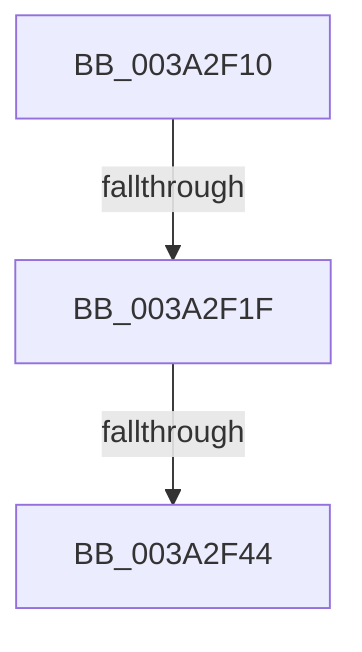

# sub_003A2F10

- RVA: `0x003A2F10`–`0x003A2F4F` (길이 `63` bytes)
- VA: `0x00000001403A2F10`
- 실행 섹션: `.text`
- PDB 이름 있음: `아니요`; PDB Function 태그: `아니요`
- unwind 정보 RVA: `0x00082144`
- 디코드: `13`개 명령, `63/63` bytes 표시
- 미해석 바이트: `0` (있으면 어셈블리에 `.byte`로 보존)

> 이 문서는 커널 이미지의 기계어와 PDB 기호를 분석해 생성했습니다. 4번과 5번은 함수 원형과 자료형을 바이너리 사용 방식에서 추정한 C 해석이며 원본 소스 복구 결과는 아닙니다.

## 1. Dependencies

- 직접 호출 지점: **0**; 고유 호출 대상: **0**
- 직접 호출자로 확인된 함수: **0**
- RIP 상대 이미지 참조: **3**

### Outgoing calls
- 직접 디코드된 call 명령이 없습니다.

### Direct callers
- 이 함수 시작 RVA로 연결되는 직접 call은 확인되지 않았습니다. 간접 호출은 완전히 역산할 수 없습니다.

### Static image references
- `0x003A2F10` → RVA `0x00F232F8` (`.data`; read/write)
- `0x003A2F1F` → RVA `0x00F21FB0` (`.data`; read)
- `0x003A2F25` → RVA `0x00000000` (`image boundary/outside`; read)

## 2. Other-region calls and transfers

- 다른 실행 섹션으로 향하는 call: **0**
- call이 아닌 외부 분기/꼬리 이동: **3**
  - `0x003A2F1D` → [sub_003A2EC1](Unknown_function_003A2EC1.md) (`tail-transfer`)
  - `0x003A2F3E` → [sub_003A2FE6](Unknown_function_003A2FE6.md) (`tail-transfer`)
  - `0x003A2F4A` → [sub_003A2EC1](Unknown_function_003A2EC1.md) (`tail-transfer`)

## 3. Assembly (complete function range)

```asm
003A2F10  F0 0F C1 2D E0 03 B8 00         lock xadd dword ptr [rip + 0xb803e0], ebp
003A2F18  FF C5                           inc ebp
003A2F1A  83 FD 01                        cmp ebp, 1
003A2F1D  75 A2                           jne 0x1403a2ec1
003A2F1F  8B 05 8B F0 B7 00               mov eax, dword ptr [rip + 0xb7f08b]
003A2F25  48 8D 0D D4 D0 C5 FF            lea rcx, [rip - 0x3a2f2c]
003A2F2C  48 8B 84 C1 40 8C FC 00         mov rax, qword ptr [rcx + rax*8 + 0xfc8c40]
003A2F34  48 8B 90 B8 8E 00 00            mov rdx, qword ptr [rax + 0x8eb8]
003A2F3B  48 85 D2                        test rdx, rdx
003A2F3E  0F 85 A2 00 00 00               jne 0x1403a2fe6
003A2F44  32 C0                           xor al, al
003A2F46  41 88 45 00                     mov byte ptr [r13], al
003A2F4A  E9 72 FF FF FF                  jmp 0x1403a2ec1
```

## 4. C-style interpretation (structured pseudocode)

```c
__int64 __fastcall sub_003A2F10(void)
{
    __int64 result;
    __int64 v_rbp;

    v_rbp = (unsigned int)((v_rbp) + 1);
    result = 0;
    *(unsigned __int8 *)(v_r13) = 0;
}
```

## 5. (Beta) C Style

```c
void sub_003A2F10(void)
{
    int64_t result;
    int64_t local_rbp;

    local_rbp = (uint32_t)((local_rbp) + 1);
    result = 0;
    *(uint8_t *)(local_r13) = 0;
}
```

## 6. Execution-region graph

[열기: 2D/3D 그래프와 함수 탐색 컨트롤 패널](../../../control-panel.html?section=text&rva=0x003A2F10&view=graph)

- 2D 그래프는 위에서 아래로 흐르고, 3D 그래프는 빈 공간을 드래그해 회전합니다. Shift+드래그는 이동, 휠은 확대·축소, 함수 노드 선택은 대상 보고서 이동입니다.

### Static fallback


