# sub_003A2F4F

- RVA: `0x003A2F4F`–`0x003A2FE6` (길이 `151` bytes)
- VA: `0x00000001403A2F4F`
- 실행 섹션: `.text`
- PDB 이름 있음: `아니요`; PDB Function 태그: `아니요`
- unwind 정보 RVA: `0x00082154`
- 디코드: `41`개 명령, `151/151` bytes 표시
- 미해석 바이트: `0` (있으면 어셈블리에 `.byte`로 보존)

> 이 문서는 커널 이미지의 기계어와 PDB 기호를 분석해 생성했습니다. 4번과 5번은 함수 원형과 자료형을 바이너리 사용 방식에서 추정한 C 해석이며 원본 소스 복구 결과는 아닙니다.

## 1. Dependencies

- 직접 호출 지점: **0**; 고유 호출 대상: **0**
- 직접 호출자로 확인된 함수: **0**
- RIP 상대 이미지 참조: **0**

### Outgoing calls
- 직접 디코드된 call 명령이 없습니다.

### Direct callers
- 이 함수 시작 RVA로 연결되는 직접 call은 확인되지 않았습니다. 간접 호출은 완전히 역산할 수 없습니다.

### Static image references
- 디코드된 RIP-relative 메모리 참조가 없습니다.

## 2. Other-region calls and transfers

- 다른 실행 섹션으로 향하는 call: **0**
- call이 아닌 외부 분기/꼬리 이동: **14**
  - `0x003A2F58` → [sub_003A2CBE + 0x1DB](Unknown_function_003A2CBE.md) (`tail-transfer`)
  - `0x003A2F63` → [sub_003A2CBE + 0x185](Unknown_function_003A2CBE.md) (`tail-transfer`)
  - `0x003A2F69` → [sub_003A2CBE + 0x1A0](Unknown_function_003A2CBE.md) (`tail-transfer`)
  - `0x003A2F71` → [sub_003A2CBE + 0x105](Unknown_function_003A2CBE.md) (`tail-transfer`)
  - `0x003A2F7C` → [sub_003A2CBE + 0xA4](Unknown_function_003A2CBE.md) (`tail-transfer`)
  - `0x003A2F82` → [sub_003A2CBE + 0xD3](Unknown_function_003A2CBE.md) (`tail-transfer`)
  - `0x003A2F95` → [sub_003A2CBE + 0x1C3](Unknown_function_003A2CBE.md) (`tail-transfer`)
  - `0x003A2FA8` → [sub_003A2CBE + 0xF2](Unknown_function_003A2CBE.md) (`tail-transfer`)
  - `0x003A2FB0` → [sub_003A2CBE + 0x1C3](Unknown_function_003A2CBE.md) (`tail-transfer`)
  - `0x003A2FB8` → [sub_003A2CBE + 0xF2](Unknown_function_003A2CBE.md) (`tail-transfer`)
  - `0x003A2FC4` → [sub_003A2CBE + 0x1A4](Unknown_function_003A2CBE.md) (`tail-transfer`)
  - `0x003A2FD1` → [sub_003A2CBE + 0xD7](Unknown_function_003A2CBE.md) (`tail-transfer`)
  - `0x003A2FD9` → [sub_003A2CBE + 0x152](Unknown_function_003A2CBE.md) (`tail-transfer`)
  - `0x003A2FE1` → [sub_003A2CBE + 0x71](Unknown_function_003A2CBE.md) (`tail-transfer`)

## 3. Assembly (complete function range)

```asm
003A2F4F  80 C9 10                        or cl, 0x10
003A2F52  88 8B 83 00 00 00               mov byte ptr [rbx + 0x83], cl
003A2F58  E9 3C FF FF FF                  jmp 0x1403a2e99
003A2F5D  48 33 C2                        xor rax, rdx
003A2F60  48 85 C0                        test rax, rax
003A2F63  0F 85 DA FE FF FF               jne 0x1403a2e43
003A2F69  E9 F0 FE FF FF                  jmp 0x1403a2e5e
003A2F6E  41 8B FF                        mov edi, r15d
003A2F71  E9 4D FE FF FF                  jmp 0x1403a2dc3
003A2F76  48 33 C2                        xor rax, rdx
003A2F79  48 85 C0                        test rax, rax
003A2F7C  0F 85 E0 FD FF FF               jne 0x1403a2d62
003A2F82  E9 0A FE FF FF                  jmp 0x1403a2d91
003A2F87  48 3B CD                        cmp rcx, rbp
003A2F8A  74 21                           je 0x1403a2fad
003A2F8C  48 8B C6                        mov rax, rsi
003A2F8F  48 0B C5                        or rax, rbp
003A2F92  48 33 C1                        xor rax, rcx
003A2F95  E9 E7 FE FF FF                  jmp 0x1403a2e81
003A2F9A  48 3B CD                        cmp rcx, rbp
003A2F9D  74 16                           je 0x1403a2fb5
003A2F9F  48 8B C7                        mov rax, rdi
003A2FA2  48 0B C5                        or rax, rbp
003A2FA5  48 33 C1                        xor rax, rcx
003A2FA8  E9 03 FE FF FF                  jmp 0x1403a2db0
003A2FAD  49 8B C7                        mov rax, r15
003A2FB0  E9 CC FE FF FF                  jmp 0x1403a2e81
003A2FB5  49 8B C7                        mov rax, r15
003A2FB8  E9 F3 FD FF FF                  jmp 0x1403a2db0
003A2FBD  48 85 D2                        test rdx, rdx
003A2FC0  75 14                           jne 0x1403a2fd6
003A2FC2  32 C0                           xor al, al
003A2FC4  E9 99 FE FF FF                  jmp 0x1403a2e62
003A2FC9  48 85 D2                        test rdx, rdx
003A2FCC  75 10                           jne 0x1403a2fde
003A2FCE  45 32 C0                        xor r8b, r8b
003A2FD1  E9 BF FD FF FF                  jmp 0x1403a2d95
003A2FD6  48 33 D6                        xor rdx, rsi
003A2FD9  E9 32 FE FF FF                  jmp 0x1403a2e10
003A2FDE  48 33 D7                        xor rdx, rdi
003A2FE1  E9 49 FD FF FF                  jmp 0x1403a2d2f
```

## 4. C-style interpretation (structured pseudocode)

```c
__int64 __fastcall sub_003A2F4F(unsigned __int8 a1, __int64 a2, unsigned __int8 a3)
{
    a1 = (unsigned __int8)((a1) | (16));
    *(unsigned __int8 *)(v_rbx + 131) = a1;
}
```

## 5. (Beta) C Style

```c
int64_t sub_003A2F4F(uint8_t Arg1, int64_t Arg2, uint8_t Arg3)
{
    Arg1 = (uint8_t)((Arg1) | (16));
    *(uint8_t *)(local_rbx + 0x83) = Arg1;
}
```

## 6. Execution-region graph

[열기: 2D/3D 그래프와 함수 탐색 컨트롤 패널](../../../control-panel.html?section=text&rva=0x003A2F4F&view=graph)

- 2D 그래프는 위에서 아래로 흐르고, 3D 그래프는 빈 공간을 드래그해 회전합니다. Shift+드래그는 이동, 휠은 확대·축소, 함수 노드 선택은 대상 보고서 이동입니다.

### Static fallback

```mermaid
flowchart TD
  bb_003A2F4F[BB_003A2F4F]
  bb_003A2F5D[BB_003A2F5D]
  bb_003A2F69[BB_003A2F69]
  bb_003A2F6E[BB_003A2F6E]
  bb_003A2F76[BB_003A2F76]
  bb_003A2F82[BB_003A2F82]
  bb_003A2F87[BB_003A2F87]
  bb_003A2F8C[BB_003A2F8C]
  bb_003A2F9A[BB_003A2F9A]
  bb_003A2F9F[BB_003A2F9F]
  bb_003A2FAD[BB_003A2FAD]
  bb_003A2FB5[BB_003A2FB5]
  bb_003A2FBD[BB_003A2FBD]
  bb_003A2FC2[BB_003A2FC2]
  bb_003A2FC9[BB_003A2FC9]
  bb_003A2FCE[BB_003A2FCE]
  bb_003A2FD6[BB_003A2FD6]
  bb_003A2FDE[BB_003A2FDE]
  bb_003A2F5D -->|fallthrough| bb_003A2F69
  bb_003A2F76 -->|fallthrough| bb_003A2F82
  bb_003A2F87 -->|branch| bb_003A2FAD
  bb_003A2F87 -->|fallthrough| bb_003A2F8C
  bb_003A2F9A -->|branch| bb_003A2FB5
  bb_003A2F9A -->|fallthrough| bb_003A2F9F
  bb_003A2FBD -->|branch| bb_003A2FD6
  bb_003A2FBD -->|fallthrough| bb_003A2FC2
  bb_003A2FC9 -->|branch| bb_003A2FDE
  bb_003A2FC9 -->|fallthrough| bb_003A2FCE
```


