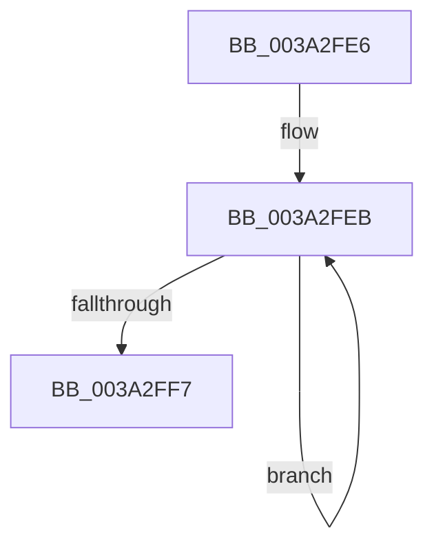

# sub_003A2FE6

- RVA: `0x003A2FE6`–`0x003A3003` (길이 `29` bytes)
- VA: `0x00000001403A2FE6`
- 실행 섹션: `.text`
- PDB 이름 있음: `아니요`; PDB Function 태그: `아니요`
- unwind 정보 RVA: `0x00082178`
- 디코드: `10`개 명령, `29/29` bytes 표시
- 미해석 바이트: `0` (있으면 어셈블리에 `.byte`로 보존)

> 이 문서는 커널 이미지의 기계어와 PDB 기호를 분석해 생성했습니다. 4번과 5번은 함수 원형과 자료형을 바이너리 사용 방식에서 추정한 C 해석이며 원본 소스 복구 결과는 아닙니다.

## 1. Dependencies

- 직접 호출 지점: **0**; 고유 호출 대상: **0**
- 직접 호출자로 확인된 함수: **0**
- RIP 상대 이미지 참조: **0**

### Outgoing calls
- 직접 디코드된 call 명령이 없습니다.

### Direct callers
- 이 함수 시작 RVA로 연결되는 직접 call은 확인되지 않았습니다. 간접 호출은 완전히 역산할 수 없습니다.

### Static image references
- 디코드된 RIP-relative 메모리 참조가 없습니다.

## 2. Other-region calls and transfers

- 다른 실행 섹션으로 향하는 call: **0**
- call이 아닌 외부 분기/꼬리 이동: **1**
  - `0x003A2FFE` → [sub_003A2F10 + 0x36](Unknown_function_003A2F10.md) (`tail-transfer`)

## 3. Assembly (complete function range)

```asm
003A2FE6  0F 0D 0A                        prefetchw byte ptr [rdx]
003A2FE9  8B 02                           mov eax, dword ptr [rdx]
003A2FEB  8B C8                           mov ecx, eax
003A2FED  0F BA E9 13                     bts ecx, 0x13
003A2FF1  F0 0F B1 0A                     lock cmpxchg dword ptr [rdx], ecx
003A2FF5  75 F4                           jne 0x1403a2feb
003A2FF7  C1 E8 13                        shr eax, 0x13
003A2FFA  F6 D0                           not al
003A2FFC  24 01                           and al, 1
003A2FFE  E9 43 FF FF FF                  jmp 0x1403a2f46
```

## 4. C-style interpretation (structured pseudocode)

```c
__int64 __fastcall sub_003A2FE6(__int64 a1, __int64 a2)
{
    __int64 result;

loc_003A2FEB:
    if (condition_is_not_equal) goto loc_003A2FEB;
    result = (unsigned int)(((unsigned int)(*(unsigned int *)(a2))) >> (19));
    result = (unsigned __int8)(~(result));
    result = (unsigned __int8)((result) & (1));
}
```

## 5. (Beta) C Style

```c
int64_t sub_003A2FE6(int64_t Arg1, void *Arg2)
{
    uint8_t *arg2 = (uint8_t *)Arg2;

    int64_t result;

loc_003A2FEB:
    if (condition_is_not_equal) goto loc_003A2FEB;
    result = (uint32_t)(((uint32_t)(*(uint32_t *)(arg2))) >> (19));
    result = (uint8_t)(~(result));
    result = (uint8_t)((result) & (1));
}
```

### 관측된 메모리 오프셋

구조체 형식이 확인되지 않은 접근은 인자 기준의 오프셋으로만 기록했습니다.

| 기준 인자 | 오프셋 표현 | 폭 (bit) | 접근 |
|---|---:|---:|---|
| `Arg2` | `+ 0x0` | `8` | `R` |
| `Arg2` | `+ 0x0` | `32` | `R` |

## 6. Execution-region graph

[열기: 2D/3D 그래프와 함수 탐색 컨트롤 패널](../../../control-panel.html?section=text&rva=0x003A2FE6&view=graph)

- 2D 그래프는 위에서 아래로 흐르고, 3D 그래프는 빈 공간을 드래그해 회전합니다. Shift+드래그는 이동, 휠은 확대·축소, 함수 노드 선택은 대상 보고서 이동입니다.

### Static fallback


