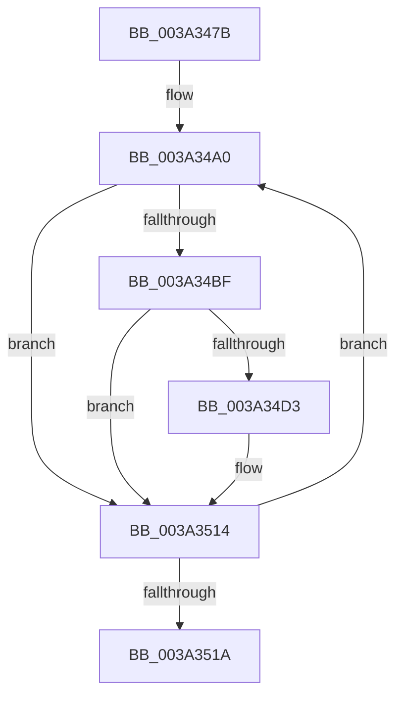

# sub_003A347B

- RVA: `0x003A347B`–`0x003A352A` (길이 `175` bytes)
- VA: `0x00000001403A347B`
- 실행 섹션: `.text`
- PDB 이름 있음: `아니요`; PDB Function 태그: `아니요`
- unwind 정보 RVA: `0x000821C8`
- 디코드: `35`개 명령, `175/175` bytes 표시
- 미해석 바이트: `0` (있으면 어셈블리에 `.byte`로 보존)

> 이 문서는 커널 이미지의 기계어와 PDB 기호를 분석해 생성했습니다. 4번과 5번은 함수 원형과 자료형을 바이너리 사용 방식에서 추정한 C 해석이며 원본 소스 복구 결과는 아닙니다.

## 1. Dependencies

- 직접 호출 지점: **1**; 고유 호출 대상: **1**
- 직접 호출자로 확인된 함수: **0**
- RIP 상대 이미지 참조: **1**

### Outgoing calls
- `0x003A350F` → [EtwpLogKernelEvent](../25/EtwpLogKernelEvent_function_0025CC00.md) (function, `0x0025CC00`)

### Direct callers
- 이 함수 시작 RVA로 연결되는 직접 call은 확인되지 않았습니다. 간접 호출은 완전히 역산할 수 없습니다.

### Static image references
- `0x003A34A0` → RVA `0x00FC6AA8` (`ALMOSTRO`; read)

## 2. Other-region calls and transfers

- 다른 실행 섹션으로 향하는 call: **0**
- 별도 외부 분기/꼬리 이동을 확인하지 못했습니다.

## 3. Assembly (complete function range)

```asm
003A347B  49 89 6B 10                     mov qword ptr [r11 + 0x10], rbp
003A347F  8B AC 24 A0 00 00 00            mov ebp, dword ptr [rsp + 0xa0]
003A3486  49 89 73 18                     mov qword ptr [r11 + 0x18], rsi
003A348A  48 8B B4 24 A8 00 00 00         mov rsi, qword ptr [rsp + 0xa8]
003A3492  0F 1F 40 00                     nop dword ptr [rax]
003A3496  66 66 0F 1F 84 00 00 00 00 00   nop word ptr [rax + rax]
003A34A0  48 8B 15 01 36 C2 00            mov rdx, qword ptr [rip + 0xc23601]
003A34A7  8D 43 FF                        lea eax, [rbx - 1]
003A34AA  23 D8                           and ebx, eax
003A34AC  49 8B C0                        mov rax, r8
003A34AF  48 C1 E0 05                     shl rax, 5
003A34B3  48 8D 8A CC 11 00 00            lea rcx, [rdx + 0x11cc]
003A34BA  48 03 C8                        add rcx, rax
003A34BD  74 55                           je 0x1403a3514
003A34BF  48 8B C7                        mov rax, rdi
003A34C2  48 C1 E8 1D                     shr rax, 0x1d
003A34C6  8B 0C 81                        mov ecx, dword ptr [rcx + rax*4]
003A34C9  23 CF                           and ecx, edi
003A34CB  F7 C1 FF FF FF 1F               test ecx, 0x1fffffff
003A34D1  74 41                           je 0x1403a3514
003A34D3  42 0F B6 84 42 99 11 00 00      movzx eax, byte ptr [rdx + r8*2 + 0x1199]
003A34DC  41 B9 02 00 00 00               mov r9d, 2
003A34E2  48 FF C8                        dec rax
003A34E5  48 C7 44 24 40 08 00 00 00      mov qword ptr [rsp + 0x40], 8
003A34EE  89 6C 24 28                     mov dword ptr [rsp + 0x28], ebp
003A34F2  66 44 89 74 24 20               mov word ptr [rsp + 0x20], r14w
003A34F8  48 8D 0C C6                     lea rcx, [rsi + rax*8]
003A34FC  48 89 4C 24 38                  mov qword ptr [rsp + 0x38], rcx
003A3501  48 8D 4C 24 38                  lea rcx, [rsp + 0x38]
003A3506  46 0F B6 84 42 98 11 00 00      movzx r8d, byte ptr [rdx + r8*2 + 0x1198]
003A350F  E8 EC 96 EB FF                  call 0x14025cc00
003A3514  44 0F BC C3                     bsf r8d, ebx
003A3518  75 86                           jne 0x1403a34a0
003A351A  48 8B B4 24 90 00 00 00         mov rsi, qword ptr [rsp + 0x90]
003A3522  48 8B AC 24 88 00 00 00         mov rbp, qword ptr [rsp + 0x88]
```

## 4. C-style interpretation (structured pseudocode)

```c
__int64 __fastcall sub_003A347B(__int64 a1, __int64 a2, __int64 a3, __int64 a4, __int64 a5, __int64 a6, __int64 a7, __int64 a8, __int64 a9, __int64 a10, __int64 a11, __int64 a12, __int64 a13, __int64 a14, __int64 a15, __int64 a16, __int64 a17, __int64 a18, __int64 a19, unsigned int a20, __int64 a21)
{
    __int64 result;
    __int64 v_rbx;
    unsigned __int16 v_stack_p20;
    unsigned int v_stack_p28;
    unsigned __int64 v_stack_p38;
    unsigned __int64 v_stack_p40;

    *(unsigned __int64 *)(v_r11 + 16) = v_rbp;
    *(unsigned __int64 *)(v_r11 + 24) = v_rsi;
loc_003A34A0:
    v_rbx = (unsigned int)((v_rbx) & ((unsigned int)(v_rbx - 1)));
    result = (a3) << (5);
    a1 = (*(unsigned __int64 *)(v_rip + 12727809) + 4556) + (result);
    if (condition_is_equal) goto loc_003A3514;
    result = (v_rdi) >> (29);
    a1 = (unsigned int)(((unsigned int)(*(unsigned int *)(a1 + result * 4))) & ((unsigned int)(v_rdi)));
    if ((((unsigned int)(a1)) & (0x1FFFFFFFULL)) != 0) {
        result = *(unsigned __int8 *)(*(unsigned __int64 *)(v_rip + 12727809) + a3 * 2 + 4505);
        a4 = 2;
        result = (result) - 1;
        v_stack_p40 = 8;
        v_stack_p28 = (unsigned int)((unsigned int)(a20));
        v_stack_p20 = (unsigned __int16)(v_r14);
        a1 = a21 + result * 8;
        v_stack_p38 = a1;
        a1 = a7;
        a3 = *(unsigned __int8 *)(*(unsigned __int64 *)(v_rip + 12727809) + a3 * 2 + 4504);
        result = EtwpLogKernelEvent(a1, *(unsigned __int64 *)(v_rip + 12727809), a3, a4);
    }
    if ((((unsigned int)(a1)) & (0x1FFFFFFFULL)) != 0) goto loc_003A34A0;
    return result;
}
```

## 5. (Beta) C Style

```c
int64_t sub_003A347B(int64_t Arg1, int64_t Arg2, int64_t Arg3, int64_t Arg4, uint64_t Arg5, uint64_t Arg6, int64_t Arg7, uint64_t Arg8, uint64_t Arg9, uint64_t Arg10, uint64_t Arg11, uint64_t Arg12, uint64_t Arg13, uint64_t Arg14, uint64_t Arg15, uint64_t Arg16, int64_t Arg17, int64_t Arg18, uint64_t Arg19, uint32_t Arg20, void *Arg21)
{
    uint8_t *arg21 = (uint8_t *)Arg21;

    int64_t result;
    int64_t local_rbx;
    uint16_t v_stack_p20;
    uint32_t v_stack_p28;
    uint64_t v_stack_p38;
    uint64_t v_stack_p40;

    *(uint64_t *)(local_r11 + 0x10) = local_rbp;
    *(uint64_t *)(local_r11 + 0x18) = local_rsi;
loc_003A34A0:
    local_rbx = (uint32_t)((local_rbx) & ((uint32_t)(local_rbx - 1)));
    result = (Arg3) << (5);
    Arg1 = (*(uint64_t *)(v_rip + 0xC23601) + 4556) + (result);
    if (condition_is_equal) goto loc_003A3514;
    result = (local_rdi) >> (29);
    Arg1 = (uint32_t)(((uint32_t)(*(uint32_t *)(Arg1 + result * 4))) & ((uint32_t)(local_rdi)));
    if ((((uint32_t)(Arg1)) & (0x1FFFFFFFULL)) != 0) {
        result = *(uint8_t *)(*(uint64_t *)(v_rip + 0xC23601) + Arg3 * 2 + 0x1199);
        Arg4 = 2;
        result = (result) - 1;
        v_stack_p40 = 8;
        v_stack_p28 = (uint32_t)((uint32_t)(Arg20));
        v_stack_p20 = (uint16_t)(local_r14);
        Arg1 = Arg21 + result * 8;
        v_stack_p38 = Arg1;
        Arg1 = Arg7;
        Arg3 = *(uint8_t *)(*(uint64_t *)(v_rip + 0xC23601) + Arg3 * 2 + 0x1198);
        result = EtwpLogKernelEvent(Arg1, *(uint64_t *)(v_rip + 0xC23601), Arg3, Arg4);
    }
    if ((((uint32_t)(Arg1)) & (0x1FFFFFFFULL)) != 0) goto loc_003A34A0;
    return result;
}
```

### 관측된 메모리 오프셋

구조체 형식이 확인되지 않은 접근은 인자 기준의 오프셋으로만 기록했습니다.

| 기준 인자 | 오프셋 표현 | 폭 (bit) | 접근 |
|---|---:|---:|---|
| `Arg21` | `+ 0x0 + rax*8` | `64` | `R` |

## 6. Execution-region graph

[열기: 2D/3D 그래프와 함수 탐색 컨트롤 패널](../../../control-panel.html?section=text&rva=0x003A347B&view=graph)

- 2D 그래프는 위에서 아래로 흐르고, 3D 그래프는 빈 공간을 드래그해 회전합니다. Shift+드래그는 이동, 휠은 확대·축소, 함수 노드 선택은 대상 보고서 이동입니다.

### Static fallback


