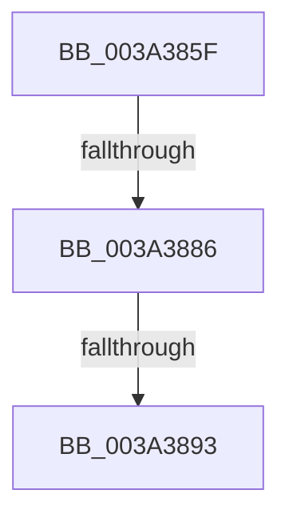

# sub_003A385F

- RVA: `0x003A385F`–`0x003A38A5` (길이 `70` bytes)
- VA: `0x00000001403A385F`
- 실행 섹션: `.text`
- PDB 이름 있음: `아니요`; PDB Function 태그: `아니요`
- unwind 정보 RVA: `0x0008222C`
- 디코드: `14`개 명령, `70/70` bytes 표시
- 미해석 바이트: `0` (있으면 어셈블리에 `.byte`로 보존)

> 이 문서는 커널 이미지의 기계어와 PDB 기호를 분석해 생성했습니다. 4번과 5번은 함수 원형과 자료형을 바이너리 사용 방식에서 추정한 C 해석이며 원본 소스 복구 결과는 아닙니다.

## 1. Dependencies

- 직접 호출 지점: **2**; 고유 호출 대상: **2**
- 직접 호출자로 확인된 함수: **0**
- RIP 상대 이미지 참조: **1**

### Outgoing calls
- `0x003A3869` → [KeDisableInterrupts](../21/KeDisableInterrupts_function_00217BE0.md) (function, `0x00217BE0`)
- `0x003A3886` → [KeIsForceIdleEngaged](KeIsForceIdleEngaged_function_003A38D0.md) (function, `0x003A38D0`)

### Direct callers
- 이 함수 시작 RVA로 연결되는 직접 call은 확인되지 않았습니다. 간접 호출은 완전히 역산할 수 없습니다.

### Static image references
- `0x003A3876` → RVA `0x00F23140` (`.data`; read/write)

## 2. Other-region calls and transfers

- 다른 실행 섹션으로 향하는 call: **0**
- call이 아닌 외부 분기/꼬리 이동: **3**
  - `0x003A3880` → [sub_006E638A](../6E/Unknown_function_006E638A.md) (`tail-transfer`)
  - `0x003A388D` → [sub_006E638A + 0x1B](../6E/Unknown_function_006E638A.md) (`tail-transfer`)
  - `0x003A38A3` → [KiForceIdleInterruptNotify + 0xD](KiForceIdleInterruptNotify_function_003A3830.md) (`tail-transfer`)

## 3. Assembly (complete function range)

```asm
003A385F  48 89 5C 24 20                  mov qword ptr [rsp + 0x20], rbx
003A3864  4C 89 44 24 38                  mov qword ptr [rsp + 0x38], r8
003A3869  E8 72 43 E7 FF                  call 0x140217be0
003A386E  0F B6 D8                        movzx ebx, al
003A3871  44 89 44 24 30                  mov dword ptr [rsp + 0x30], r8d
003A3876  F0 48 0F BA 2D C0 F8 B7 00 00   lock bts qword ptr [rip + 0xb7f8c0], 0
003A3880  0F 82 04 2B 34 00               jb 0x1406e638a
003A3886  E8 45 00 00 00                  call 0x1403a38d0
003A388B  84 C0                           test al, al
003A388D  0F 85 12 2B 34 00               jne 0x1406e63a5
003A3893  F0 48 83 25 A4 F8 B7 00 00      lock and qword ptr [rip + 0xb7f8a4], 0
003A389C  84 DB                           test bl, bl
003A389E  48 8B 5C 24 20                  mov rbx, qword ptr [rsp + 0x20]
003A38A3  74 98                           je 0x1403a383d
```

## 4. C-style interpretation (structured pseudocode)

```c
__int64 __fastcall sub_003A385F(__int64 a1, __int64 a2, __int64 a3)
{
    __int64 result;
    unsigned __int64 v_stack_p20;
    unsigned int v_stack_p30;
    unsigned __int64 v_stack_p38;

    v_stack_p20 = v_rbx;
    v_stack_p38 = a3;
    result = KeDisableInterrupts(a1, a2, a3, a4);
    v_stack_p30 = (unsigned int)(a3);
    result = KeIsForceIdleEngaged(a1, a2, a3, a4);
}
```

## 5. (Beta) C Style

```c
int64_t sub_003A385F(int64_t Arg1, int64_t Arg2, int64_t Arg3)
{
    int64_t result;
    uint64_t v_stack_p20;
    uint32_t v_stack_p30;
    uint64_t v_stack_p38;

    v_stack_p20 = local_rbx;
    v_stack_p38 = Arg3;
    result = KeDisableInterrupts(Arg1, Arg2, Arg3, a4);
    v_stack_p30 = (uint32_t)(Arg3);
    result = KeIsForceIdleEngaged(Arg1, Arg2, Arg3, a4);
}
```

## 6. Execution-region graph

[열기: 2D/3D 그래프와 함수 탐색 컨트롤 패널](../../../control-panel.html?section=text&rva=0x003A385F&view=graph)

- 2D 그래프는 위에서 아래로 흐르고, 3D 그래프는 빈 공간을 드래그해 회전합니다. Shift+드래그는 이동, 휠은 확대·축소, 함수 노드 선택은 대상 보고서 이동입니다.

### Static fallback


