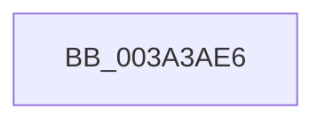

# sub_003A3AE6

- RVA: `0x003A3AE6`–`0x003A3B13` (길이 `45` bytes)
- VA: `0x00000001403A3AE6`
- 실행 섹션: `.text`
- PDB 이름 있음: `아니요`; PDB Function 태그: `아니요`
- unwind 정보 RVA: `0x0008231C`
- 디코드: `8`개 명령, `45/45` bytes 표시
- 미해석 바이트: `0` (있으면 어셈블리에 `.byte`로 보존)

> 이 문서는 커널 이미지의 기계어와 PDB 기호를 분석해 생성했습니다. 4번과 5번은 함수 원형과 자료형을 바이너리 사용 방식에서 추정한 C 해석이며 원본 소스 복구 결과는 아닙니다.

## 1. Dependencies

- 직접 호출 지점: **0**; 고유 호출 대상: **0**
- 직접 호출자로 확인된 함수: **0**
- RIP 상대 이미지 참조: **0**

### Outgoing calls
- 직접 디코드된 call 명령이 없습니다.

### Direct callers
- 이 함수 시작 RVA로 연결되는 직접 call은 확인되지 않았습니다. 간접 호출은 완전히 역산할 수 없습니다.

### Static image references
- 디코드된 RIP-relative 메모리 참조가 없습니다.

## 2. Other-region calls and transfers

- 다른 실행 섹션으로 향하는 call: **0**
- call이 아닌 외부 분기/꼬리 이동: **1**
  - `0x003A3B0D` → [sub_003A3F1C](Unknown_function_003A3F1C.md) (`tail-transfer`)

## 3. Assembly (complete function range)

```asm
003A3AE6  48 89 B4 24 00 01 00 00         mov qword ptr [rsp + 0x100], rsi
003A3AEE  4C 89 A4 24 D8 00 00 00         mov qword ptr [rsp + 0xd8], r12
003A3AF6  45 33 E4                        xor r12d, r12d
003A3AF9  41 8B F4                        mov esi, r12d
003A3AFC  48 89 8F 98 9A 00 00            mov qword ptr [rdi + 0x9a98], rcx
003A3B03  48 87 B7 C0 9A 00 00            xchg qword ptr [rdi + 0x9ac0], rsi
003A3B0A  48 85 F6                        test rsi, rsi
003A3B0D  0F 84 09 04 00 00               je 0x1403a3f1c
```

## 4. C-style interpretation (structured pseudocode)

```c
void __fastcall sub_003A3AE6(__int64 a1)
{
    __int64 v_r12;
    unsigned __int64 v_stack_p100;
    unsigned __int64 v_stack_pD8;

    v_stack_p100 = v_rsi;
    v_stack_pD8 = v_r12;
    v_r12 = 0;
    *(unsigned __int64 *)(v_rdi + 39576) = a1;
}
```

## 5. (Beta) C Style

```c
void sub_003A3AE6(int64_t Arg1)
{
    int64_t local_r12;
    uint64_t v_stack_p100;
    uint64_t v_stack_pD8;

    v_stack_p100 = local_rsi;
    v_stack_pD8 = local_r12;
    local_r12 = 0;
    *(uint64_t *)(local_rdi + 0x9A98) = Arg1;
}
```

## 6. Execution-region graph

[열기: 2D/3D 그래프와 함수 탐색 컨트롤 패널](../../../control-panel.html?section=text&rva=0x003A3AE6&view=graph)

- 2D 그래프는 위에서 아래로 흐르고, 3D 그래프는 빈 공간을 드래그해 회전합니다. Shift+드래그는 이동, 휠은 확대·축소, 함수 노드 선택은 대상 보고서 이동입니다.

### Static fallback


