# sub_003A3B13

- RVA: `0x003A3B13`–`0x003A3E54` (길이 `833` bytes)
- VA: `0x00000001403A3B13`
- 실행 섹션: `.text`
- PDB 이름 있음: `아니요`; PDB Function 태그: `아니요`
- unwind 정보 RVA: `0x00082334`
- 디코드: `173`개 명령, `833/833` bytes 표시
- 미해석 바이트: `0` (있으면 어셈블리에 `.byte`로 보존)

> 이 문서는 커널 이미지의 기계어와 PDB 기호를 분석해 생성했습니다. 4번과 5번은 함수 원형과 자료형을 바이너리 사용 방식에서 추정한 C 해석이며 원본 소스 복구 결과는 아닙니다.

## 1. Dependencies

- 직접 호출 지점: **0**; 고유 호출 대상: **0**
- 직접 호출자로 확인된 함수: **0**
- RIP 상대 이미지 참조: **6**

### Outgoing calls
- 직접 디코드된 call 명령이 없습니다.

### Direct callers
- 이 함수 시작 RVA로 연결되는 직접 call은 확인되지 않았습니다. 간접 호출은 완전히 역산할 수 없습니다.

### Static image references
- `0x003A3B1B` → RVA `0x00FC8C40` (`ALMOSTRO`; read)
- `0x003A3B2A` → RVA `0x003A3FE0` (`KiIpiUpdateThreadTag`; read)
- `0x003A3B39` → RVA `0x003A4000` (`KiIpiGenericCallTarget`; read)
- `0x003A3B70` → RVA `0x00FC6B08` (`ALMOSTRO`; read)
- `0x003A3B9B` → RVA `0x00FCFC80` (`CACHEALI`; read)
- `0x003A3CA6` → RVA `0x00FC6A87` (`ALMOSTRO`; read)

## 2. Other-region calls and transfers

- 다른 실행 섹션으로 향하는 call: **0**
- call이 아닌 외부 분기/꼬리 이동: **12**
  - `0x003A3B95` → [sub_003A3F33 + 0x1D](Unknown_function_003A3F33.md) (`tail-transfer`)
  - `0x003A3BB2` → [sub_003A3E54 + 0x2C](Unknown_function_003A3E54.md) (`tail-transfer`)
  - `0x003A3C0E` → [sub_003A3E54 + 0x31](Unknown_function_003A3E54.md) (`tail-transfer`)
  - `0x003A3C17` → [sub_003A3F33 + 0xE](Unknown_function_003A3F33.md) (`tail-transfer`)
  - `0x003A3C25` → [sub_003A3E54 + 0x22](Unknown_function_003A3E54.md) (`tail-transfer`)
  - `0x003A3C3C` → [sub_003A3F33 + 0x84](Unknown_function_003A3F33.md) (`tail-transfer`)
  - `0x003A3C6D` → [sub_003A3E54 + 0x42](Unknown_function_003A3E54.md) (`tail-transfer`)
  - `0x003A3CCF` → [sub_003A3F33 + 0x27](Unknown_function_003A3F33.md) (`tail-transfer`)
  - `0x003A3D54` → [sub_003A3F33 + 0x76](Unknown_function_003A3F33.md) (`tail-transfer`)
  - `0x003A3DBE` → [sub_003A3E54](Unknown_function_003A3E54.md) (`tail-transfer`)
  - `0x003A3DC9` → [sub_003A3F33 + 0x62](Unknown_function_003A3F33.md) (`tail-transfer`)
  - `0x003A3E4F` → [sub_003A3F1C + 0x2](Unknown_function_003A3F1C.md) (`tail-transfer`)

## 3. Assembly (complete function range)

```asm
003A3B13  48 89 9C 24 F0 00 00 00         mov qword ptr [rsp + 0xf0], rbx
003A3B1B  48 8D 0D 1E 51 C2 00            lea rcx, [rip + 0xc2511e]
003A3B22  48 89 AC 24 F8 00 00 00         mov qword ptr [rsp + 0xf8], rbp
003A3B2A  4C 8D 15 AF 04 00 00            lea r10, [rip + 0x4af]
003A3B31  4C 89 AC 24 D0 00 00 00         mov qword ptr [rsp + 0xd0], r13
003A3B39  4C 8D 1D C0 04 00 00            lea r11, [rip + 0x4c0]
003A3B40  4C 89 B4 24 C8 00 00 00         mov qword ptr [rsp + 0xc8], r14
003A3B48  4C 89 BC 24 C0 00 00 00         mov qword ptr [rsp + 0xc0], r15
003A3B50  48 8B C6                        mov rax, rsi
003A3B53  48 89 74 24 58                  mov qword ptr [rsp + 0x58], rsi
003A3B58  48 2B C7                        sub rax, rdi
003A3B5B  4C 89 64 24 60                  mov qword ptr [rsp + 0x60], r12
003A3B60  48 2D C0 CE 00 00               sub rax, 0xcec0
003A3B66  0F 57 C0                        xorps xmm0, xmm0
003A3B69  48 C1 F8 06                     sar rax, 6
003A3B6D  4C 8B F6                        mov r14, rsi
003A3B70  F7 05 8E 2F C2 00 00 00 40 00   test dword ptr [rip + 0xc22f8e], 0x400000
003A3B7A  4D 8B FC                        mov r15, r12
003A3B7D  48 8B 36                        mov rsi, qword ptr [rsi]
003A3B80  8B C0                           mov eax, eax
003A3B82  0F 11 44 24 68                  movups xmmword ptr [rsp + 0x68], xmm0
003A3B87  0F 11 44 24 78                  movups xmmword ptr [rsp + 0x78], xmm0
003A3B8C  48 8B 2C C1                     mov rbp, qword ptr [rcx + rax*8]
003A3B90  48 89 6C 24 40                  mov qword ptr [rsp + 0x40], rbp
003A3B95  0F 84 B5 03 00 00               je 0x1403a3f50
003A3B9B  4C 8B 05 DE C0 C2 00            mov r8, qword ptr [rip + 0xc2c0de]
003A3BA2  41 8B DC                        mov ebx, r12d
003A3BA5  C6 44 24 30 01                  mov byte ptr [rsp + 0x30], 1
003A3BAA  44 89 64 24 34                  mov dword ptr [rsp + 0x34], r12d
003A3BAF  4D 85 C0                        test r8, r8
003A3BB2  0F 84 C8 02 00 00               je 0x1403a3e80
003A3BB8  41 8B 80 A8 11 00 00            mov eax, dword ptr [r8 + 0x11a8]
003A3BBF  0F BC D0                        bsf edx, eax
003A3BC2  89 54 24 34                     mov dword ptr [rsp + 0x34], edx
003A3BC6  74 43                           je 0x1403a3c0b
003A3BC8  0F 1F 84 00 00 00 00 00         nop dword ptr [rax + rax]
003A3BD0  8D 48 FF                        lea ecx, [rax - 1]
003A3BD3  23 C1                           and eax, ecx
003A3BD5  8B CA                           mov ecx, edx
003A3BD7  48 C1 E2 05                     shl rdx, 5
003A3BDB  48 81 C2 CC 11 00 00            add rdx, 0x11cc
003A3BE2  49 03 D0                        add rdx, r8
003A3BE5  74 1B                           je 0x1403a3c02
003A3BE7  F7 42 08 00 00 40 00            test dword ptr [rdx + 8], 0x400000
003A3BEE  74 12                           je 0x1403a3c02
003A3BF0  41 0F B6 8C 48 99 11 00 00      movzx ecx, byte ptr [r8 + rcx*2 + 0x1199]
003A3BF9  BA 01 00 00 00                  mov edx, 1
003A3BFE  D3 E2                           shl edx, cl
003A3C00  0B DA                           or ebx, edx
003A3C02  0F BC D0                        bsf edx, eax
003A3C05  75 C9                           jne 0x1403a3bd0
003A3C07  89 54 24 34                     mov dword ptr [rsp + 0x34], edx
003A3C0B  F6 C3 02                        test bl, 2
003A3C0E  0F 85 71 02 00 00               jne 0x1403a3e85
003A3C14  F6 C3 04                        test bl, 4
003A3C17  0F 85 24 03 00 00               jne 0x1403a3f41
003A3C1D  4C 89 64 24 70                  mov qword ptr [rsp + 0x70], r12
003A3C22  F6 C3 08                        test bl, 8
003A3C25  0F 84 4B 02 00 00               je 0x1403a3e76
003A3C2B  0F 31                           rdtsc
003A3C2D  48 C1 E2 20                     shl rdx, 0x20
003A3C31  48 0B C2                        or rax, rdx
003A3C34  48 89 44 24 78                  mov qword ptr [rsp + 0x78], rax
003A3C39  F6 C3 10                        test bl, 0x10
003A3C3C  0F 85 75 03 00 00               jne 0x1403a3fb7
003A3C42  4C 89 A4 24 80 00 00 00         mov qword ptr [rsp + 0x80], r12
003A3C4A  4C 8D 15 8F 03 00 00            lea r10, [rip + 0x38f]
003A3C51  4C 8D 1D A8 03 00 00            lea r11, [rip + 0x3a8]
003A3C58  49 8B 46 08                     mov rax, qword ptr [r14 + 8]
003A3C5C  8B D8                           mov ebx, eax
003A3C5E  83 E3 0F                        and ebx, 0xf
003A3C61  83 FB 06                        cmp ebx, 6
003A3C64  0F 84 42 01 00 00               je 0x1403a3dac
003A3C6A  83 FB 04                        cmp ebx, 4
003A3C6D  0F 85 23 02 00 00               jne 0x1403a3e96
003A3C73  48 C1 F8 07                     sar rax, 7
003A3C77  41 BC 01 00 00 00               mov r12d, 1
003A3C7D  8B 50 0C                        mov edx, dword ptr [rax + 0xc]
003A3C80  8B CA                           mov ecx, edx
003A3C82  4C 8B 30                        mov r14, qword ptr [rax]
003A3C85  8B 40 08                        mov eax, dword ptr [rax + 8]
003A3C88  41 D3 E4                        shl r12d, cl
003A3C8B  41 83 E4 06                     and r12d, 6
003A3C8F  89 54 24 38                     mov dword ptr [rsp + 0x38], edx
003A3C93  33 FF                           xor edi, edi
003A3C95  49 8D 04 C6                     lea rax, [r14 + rax*8]
003A3C99  48 89 44 24 48                  mov qword ptr [rsp + 0x48], rax
003A3C9E  49 8B 2E                        mov rbp, qword ptr [r14]
003A3CA1  45 85 E4                        test r12d, r12d
003A3CA4  74 4F                           je 0x1403a3cf5
003A3CA6  40 38 3D DA 2D C2 00            cmp byte ptr [rip + 0xc22dda], dil
003A3CAD  74 46                           je 0x1403a3cf5
003A3CAF  65 48 8B 04 25 88 01 00 00      mov rax, qword ptr gs:[0x188]
003A3CB8  48 8B 88 B8 00 00 00            mov rcx, qword ptr [rax + 0xb8]
003A3CBF  40 38 B9 60 01 00 00            cmp byte ptr [rcx + 0x160], dil
003A3CC6  75 2D                           jne 0x1403a3cf5
003A3CC8  F6 05 B8 2D C2 00 02            test byte ptr [rip + 0xc22db8], 2
003A3CCF  0F 84 85 02 00 00               je 0x1403a3f5a
003A3CD5  48 C7 84 24 98 00 00 00 01 00 00 00  mov qword ptr [rsp + 0x98], 1
003A3CE1  48 89 AC 24 A0 00 00 00         mov qword ptr [rsp + 0xa0], rbp
003A3CE9  8B C7                           mov eax, edi
003A3CEB  66 0F 38 82 84 24 98 00 00 00   invpcid rax, xmmword ptr [rsp + 0x98]
003A3CF5  0F 01 7D 00                     invlpg byte ptr [rbp]
003A3CF9  48 8B CD                        mov rcx, rbp
003A3CFC  41 BD 00 10 00 00               mov r13d, 0x1000
003A3D02  48 C1 E9 0A                     shr rcx, 0xa
003A3D06  4C 8B FD                        mov r15, rbp
003A3D09  80 E1 03                        and cl, 3
003A3D0C  0F B6 C1                        movzx eax, cl
003A3D0F  C0 E0 03                        shl al, 3
003A3D12  02 C8                           add cl, al
003A3D14  49 D3 E5                        shl r13, cl
003A3D17  41 81 E7 FF 03 00 00            and r15d, 0x3ff
003A3D1E  74 64                           je 0x1403a3d84
003A3D20  49 03 ED                        add rbp, r13
003A3D23  8D 42 FF                        lea eax, [rdx - 1]
003A3D26  40 38 3D 5A 2D C2 00            cmp byte ptr [rip + 0xc22d5a], dil
003A3D2D  74 4B                           je 0x1403a3d7a
003A3D2F  83 F8 01                        cmp eax, 1
003A3D32  77 46                           ja 0x1403a3d7a
003A3D34  65 48 8B 04 25 88 01 00 00      mov rax, qword ptr gs:[0x188]
003A3D3D  48 8B 88 B8 00 00 00            mov rcx, qword ptr [rax + 0xb8]
003A3D44  40 38 B9 60 01 00 00            cmp byte ptr [rcx + 0x160], dil
003A3D4B  75 2D                           jne 0x1403a3d7a
003A3D4D  F6 05 33 2D C2 00 02            test byte ptr [rip + 0xc22d33], 2
003A3D54  0F 84 4F 02 00 00               je 0x1403a3fa9
003A3D5A  48 C7 84 24 A8 00 00 00 01 00 00 00  mov qword ptr [rsp + 0xa8], 1
003A3D66  48 89 AC 24 B0 00 00 00         mov qword ptr [rsp + 0xb0], rbp
003A3D6E  8B C7                           mov eax, edi
003A3D70  66 0F 38 82 84 24 A8 00 00 00   invpcid rax, xmmword ptr [rsp + 0xa8]
003A3D7A  0F 01 7D 00                     invlpg byte ptr [rbp]
003A3D7E  49 83 EF 01                     sub r15, 1
003A3D82  75 9C                           jne 0x1403a3d20
003A3D84  49 83 C6 08                     add r14, 8
003A3D88  4C 3B 74 24 48                  cmp r14, qword ptr [rsp + 0x48]
003A3D8D  0F 82 0B FF FF FF               jb 0x1403a3c9e
003A3D93  48 8B 7C 24 50                  mov rdi, qword ptr [rsp + 0x50]
003A3D98  45 33 E4                        xor r12d, r12d
003A3D9B  4C 8B 74 24 58                  mov r14, qword ptr [rsp + 0x58]
003A3DA0  48 8B 6C 24 40                  mov rbp, qword ptr [rsp + 0x40]
003A3DA5  4C 8B 7C 24 60                  mov r15, qword ptr [rsp + 0x60]
003A3DAA  EB 02                           jmp 0x1403a3dae
003A3DAC  0F 09                           wbinvd
003A3DAE  49 8B 46 30                     mov rax, qword ptr [r14 + 0x30]
003A3DB2  B9 FF FF FF FF                  mov ecx, 0xffffffff
003A3DB7  F0 0F C1 08                     lock xadd dword ptr [rax], ecx
003A3DBB  83 F9 01                        cmp ecx, 1
003A3DBE  0F 84 90 00 00 00               je 0x1403a3e54
003A3DC4  80 7C 24 30 00                  cmp byte ptr [rsp + 0x30], 0
003A3DC9  0F 85 C6 01 00 00               jne 0x1403a3f95
003A3DCF  48 8B 87 B8 8E 00 00            mov rax, qword ptr [rdi + 0x8eb8]
003A3DD6  48 85 C0                        test rax, rax
003A3DD9  74 04                           je 0x1403a3ddf
003A3DDB  F0 FF 48 20                     lock dec dword ptr [rax + 0x20]
003A3DDF  48 8D 0D 5A 4E C2 00            lea rcx, [rip + 0xc24e5a]
003A3DE6  4C 8D 15 F3 01 00 00            lea r10, [rip + 0x1f3]
003A3DED  4C 8D 1D 0C 02 00 00            lea r11, [rip + 0x20c]
003A3DF4  48 85 F6                        test rsi, rsi
003A3DF7  0F 85 53 FD FF FF               jne 0x1403a3b50
003A3DFD  49 8B F4                        mov rsi, r12
003A3E00  48 8D 0D 39 4E C2 00            lea rcx, [rip + 0xc24e39]
003A3E07  48 87 B7 C0 9A 00 00            xchg qword ptr [rdi + 0x9ac0], rsi
003A3E0E  4C 8D 15 CB 01 00 00            lea r10, [rip + 0x1cb]
003A3E15  4C 8D 1D E4 01 00 00            lea r11, [rip + 0x1e4]
003A3E1C  48 85 F6                        test rsi, rsi
003A3E1F  0F 85 2B FD FF FF               jne 0x1403a3b50
003A3E25  4C 8B BC 24 C0 00 00 00         mov r15, qword ptr [rsp + 0xc0]
003A3E2D  B0 01                           mov al, 1
003A3E2F  4C 8B B4 24 C8 00 00 00         mov r14, qword ptr [rsp + 0xc8]
003A3E37  4C 8B AC 24 D0 00 00 00         mov r13, qword ptr [rsp + 0xd0]
003A3E3F  48 8B AC 24 F8 00 00 00         mov rbp, qword ptr [rsp + 0xf8]
003A3E47  48 8B 9C 24 F0 00 00 00         mov rbx, qword ptr [rsp + 0xf0]
003A3E4F  E9 CA 00 00 00                  jmp 0x1403a3f1e
```

## 4. C-style interpretation (structured pseudocode)

```c
__int64 __fastcall sub_003A3B13(__int64 a1, __int64 a2, __int64 a3, __int64 a4, __int64 a5, unsigned __int8 a6, __int64 a7, __int64 a8, __int64 a9, __int64 a10, __int64 a11, __int64 a12, __int64 a13, __int64 a14, __int64 a15, __int64 a16, __int64 a17, __int64 a18, __int64 a19, __int64 a20, __int64 a21, __int64 a22, __int64 a23, __int64 a24, __int64 a25, __int64 a26, __int64 a27, __int64 a28, __int64 a29, __int64 a30, __int64 a31)
{
    __int64 result;
    __int64 v_r12;
    __int64 v_r13;
    __int64 v_r14;
    __int64 v_r15;
    __int64 v_rbp;
    __int64 v_rbx;
    __int64 v_rdi;
    unsigned __int8 v_stack_p30;
    unsigned int v_stack_p34;
    unsigned int v_stack_p38;
    unsigned __int64 v_stack_p40;
    unsigned __int64 v_stack_p48;
    unsigned __int64 v_stack_p58;
    unsigned __int64 v_stack_p60;
    unsigned __int64 v_stack_p70;
    unsigned __int64 v_stack_p78;
    unsigned __int64 v_stack_p80;
    unsigned __int64 v_stack_p98;
    unsigned __int64 v_stack_pA0;
    unsigned __int64 v_stack_pA8;
    unsigned __int64 v_stack_pB0;
    unsigned __int64 v_stack_pC0;
    unsigned __int64 v_stack_pC8;
    unsigned __int64 v_stack_pD0;
    unsigned __int64 v_stack_pF0;
    unsigned __int64 v_stack_pF8;

    v_stack_pF0 = v_rbx;
    v_stack_pF8 = v_rbp;
    v_stack_pD0 = v_r13;
    v_stack_pC8 = v_r14;
    v_stack_pC0 = v_r15;
loc_003A3B50:
    v_stack_p58 = v_rsi;
    result = (v_rsi) - (v_rdi);
    v_stack_p60 = v_r12;
    result = (result) - (0xCEC0ULL);
    result = (result) >> (6);
    a13 = v_xmm0;
    a15 = v_xmm0;
    v_stack_p40 = *(unsigned __int64 *)(v_rip + 12734750 + (unsigned int)((unsigned int)(result)) * 8);
    v_stack_p30 = 1;
    v_stack_p34 = (unsigned int)(v_r12);
    v_stack_p34 = (unsigned int)(a2);
    if (*(unsigned __int64 *)(v_rip + 12763358) == 0) goto loc_003A3C0B;
loc_003A3BD0:
    result = (unsigned int)(((unsigned int)(*(unsigned int *)(*(unsigned __int64 *)(v_rip + 12763358) + 4520))) & ((unsigned int)((unsigned int)(*(unsigned int *)(*(unsigned __int64 *)(v_rip + 12763358) + 4520)) - 1)));
    a2 = (a2) << (5);
    a2 = (a2) + (0x11CCULL);
    a2 = (a2) + (*(unsigned __int64 *)(v_rip + 12763358));
    if (condition_is_equal) goto loc_003A3C02;
    v_rbx = (unsigned int)((unsigned int)(v_r12));
    if (((*(unsigned int *)(a2 + 8)) & (0x400000ULL)) != 0) {
        a1 = *(unsigned __int8 *)(*(unsigned __int64 *)(v_rip + 12763358) + (unsigned int)((unsigned int)(a2)) * 2 + 4505);
        a2 = 1;
        a2 = (unsigned int)((a2) << ((unsigned __int8)(a1)));
        v_rbx = (unsigned int)(((unsigned int)((unsigned int)(v_r12))) | ((unsigned int)(a2)));
    }
    if (condition_is_not_equal) goto loc_003A3BD0;
    v_stack_p34 = (unsigned int)(a2);
loc_003A3C0B:
    v_stack_p70 = v_r12;
    a2 = (a2) << (32);
    result = (result) | (a2);
    v_stack_p78 = result;
    v_stack_p80 = v_r12;
    v_rbx = (unsigned int)(((unsigned int)((unsigned int)(*(unsigned __int64 *)(v_rsi + 8)))) & (15));
    if (((unsigned int)(v_rbx)) == 6) goto loc_003A3DAC;
    result = (*(unsigned __int64 *)(v_rsi + 8)) >> (7);
    v_r12 = (unsigned int)((1) << ((unsigned __int8)((unsigned int)((unsigned int)((unsigned int)(*(unsigned int *)(result + 12)))))));
    v_r12 = (unsigned int)((v_r12) & (6));
    v_stack_p38 = (unsigned int)((unsigned int)(*(unsigned int *)(result + 12)));
    v_rdi = 0;
    v_stack_p48 = *(unsigned __int64 *)(result) + (unsigned int)(*(unsigned int *)(result + 8)) * 8;
loc_003A3C9E:
    if ((unsigned int)(v_r12) == 0) goto loc_003A3CF5;
    if ((*(unsigned __int8 *)(v_rip + 12725722)) == 0) goto loc_003A3CF5;
    if ((*(unsigned __int8 *)(*(unsigned __int64 *)(*(unsigned __int64 *)(gs_base + (0 + 392)) + 184) + 352)) != 0) goto loc_003A3CF5;
    v_stack_p98 = 1;
    v_stack_pA0 = *(unsigned __int64 *)(*(unsigned __int64 *)(result));
loc_003A3CF5:
    a1 = (*(unsigned __int64 *)(*(unsigned __int64 *)(result))) >> (10);
    a1 = (unsigned __int8)((a1) & (3));
    result = (unsigned __int8)(((unsigned __int8)(a1)) << (3));
    a1 = (unsigned __int8)((a1) + ((unsigned __int8)(result)));
    v_r13 = ((unsigned int)(0x1000ULL)) << ((unsigned __int8)(a1));
    v_r15 = (unsigned int)((*(unsigned __int64 *)(*(unsigned __int64 *)(result))) & (0x3FFULL));
    if (condition_is_equal) goto loc_003A3D84;
loc_003A3D20:
    v_rbp = (*(unsigned __int64 *)(*(unsigned __int64 *)(result))) + (v_r13);
    if ((*(unsigned __int8 *)(v_rip + 12725594)) == 0) goto loc_003A3D7A;
    if (((unsigned int)((unsigned int)(*(unsigned int *)(result + 12)) - 1)) > 1) goto loc_003A3D7A;
    if ((*(unsigned __int8 *)(*(unsigned __int64 *)(*(unsigned __int64 *)(gs_base + (0 + 392)) + 184) + 352)) != 0) goto loc_003A3D7A;
    v_stack_pA8 = 1;
    v_stack_pB0 = v_rbp;
loc_003A3D7A:
    v_r15 = (v_r15) - (1);
    if (condition_is_not_equal) goto loc_003A3D20;
loc_003A3D84:
    v_r14 = (*(unsigned __int64 *)(result)) + (8);
    if (v_r14 < a9) goto loc_003A3C9E;
    v_r12 = 0;
    goto loc_003A3DAE;
loc_003A3DAC:
loc_003A3DAE:
    if (*(unsigned __int64 *)(a10 + 36536) != 0) {
    }
    if (*(unsigned __int64 *)(v_rsi) != 0) goto loc_003A3B50;
    if (0 != 0) goto loc_003A3B50;
}
```

## 5. (Beta) C Style

```c
int64_t sub_003A3B13(int64_t Arg1, int64_t Arg2, int64_t Arg3, int64_t Arg4, uint64_t Arg5, uint8_t Arg6, uint64_t Arg7, int64_t Arg8, int64_t Arg9, int64_t Arg10, int64_t Arg11, int64_t Arg12, int64_t Arg13, uint64_t Arg14, int64_t Arg15, uint64_t Arg16, uint64_t Arg17, uint64_t Arg18, int64_t Arg19, uint64_t Arg20, int64_t Arg21, uint64_t Arg22, uint64_t Arg23, int64_t Arg24, int64_t Arg25, int64_t Arg26, uint64_t Arg27, uint64_t Arg28, uint64_t Arg29, int64_t Arg30, int64_t Arg31)
{
    int64_t result;
    int64_t local_r12;
    int64_t local_r13;
    int64_t local_r14;
    int64_t local_r15;
    int64_t local_rbp;
    int64_t local_rbx;
    int64_t local_rdi;
    uint8_t v_stack_p30;
    uint32_t v_stack_p34;
    uint32_t v_stack_p38;
    uint64_t v_stack_p40;
    uint64_t v_stack_p48;
    uint64_t v_stack_p58;
    uint64_t v_stack_p60;
    uint64_t v_stack_p70;
    uint64_t v_stack_p78;
    uint64_t v_stack_p80;
    uint64_t v_stack_p98;
    uint64_t v_stack_pA0;
    uint64_t v_stack_pA8;
    uint64_t v_stack_pB0;
    uint64_t v_stack_pC0;
    uint64_t v_stack_pC8;
    uint64_t v_stack_pD0;
    uint64_t v_stack_pF0;
    uint64_t v_stack_pF8;

    v_stack_pF0 = local_rbx;
    v_stack_pF8 = local_rbp;
    v_stack_pD0 = local_r13;
    v_stack_pC8 = local_r14;
    v_stack_pC0 = local_r15;
loc_003A3B50:
    v_stack_p58 = local_rsi;
    result = (local_rsi) - (local_rdi);
    v_stack_p60 = local_r12;
    result = (result) - (0xCEC0ULL);
    result = (result) >> (6);
    Arg13 = v_xmm0;
    Arg15 = v_xmm0;
    v_stack_p40 = *(uint64_t *)(v_rip + 0xC2511E + (uint32_t)((uint32_t)(result)) * 8);
    v_stack_p30 = 1;
    v_stack_p34 = (uint32_t)(local_r12);
    v_stack_p34 = (uint32_t)(Arg2);
    if (*(uint64_t *)(v_rip + 0xC2C0DE) == 0) goto loc_003A3C0B;
loc_003A3BD0:
    result = (uint32_t)(((uint32_t)(*(uint32_t *)(*(uint64_t *)(v_rip + 0xC2C0DE) + 0x11A8))) & ((uint32_t)((uint32_t)(*(uint32_t *)(*(uint64_t *)(v_rip + 0xC2C0DE) + 0x11A8)) - 1)));
    Arg2 = (Arg2) << (5);
    Arg2 = (Arg2) + (0x11CCULL);
    Arg2 = (Arg2) + (*(uint64_t *)(v_rip + 0xC2C0DE));
    if (condition_is_equal) goto loc_003A3C02;
    local_rbx = (uint32_t)((uint32_t)(local_r12));
    if (((*(uint32_t *)(Arg2 + 0x8)) & (0x400000ULL)) != 0) {
        Arg1 = *(uint8_t *)(*(uint64_t *)(v_rip + 0xC2C0DE) + (uint32_t)((uint32_t)(Arg2)) * 2 + 0x1199);
        Arg2 = 1;
        Arg2 = (uint32_t)((Arg2) << ((uint8_t)(Arg1)));
        local_rbx = (uint32_t)(((uint32_t)((uint32_t)(local_r12))) | ((uint32_t)(Arg2)));
    }
    if (condition_is_not_equal) goto loc_003A3BD0;
    v_stack_p34 = (uint32_t)(Arg2);
loc_003A3C0B:
    v_stack_p70 = local_r12;
    Arg2 = (Arg2) << (32);
    result = (result) | (Arg2);
    v_stack_p78 = result;
    v_stack_p80 = local_r12;
    local_rbx = (uint32_t)(((uint32_t)((uint32_t)(*(uint64_t *)(local_rsi + 0x8)))) & (15));
    if (((uint32_t)(local_rbx)) == 6) goto loc_003A3DAC;
    result = (*(uint64_t *)(local_rsi + 0x8)) >> (7);
    local_r12 = (uint32_t)((1) << ((uint8_t)((uint32_t)((uint32_t)((uint32_t)(*(uint32_t *)(result + 0xC)))))));
    local_r12 = (uint32_t)((local_r12) & (6));
    v_stack_p38 = (uint32_t)((uint32_t)(*(uint32_t *)(result + 0xC)));
    local_rdi = 0;
    v_stack_p48 = *(uint64_t *)(result) + (uint32_t)(*(uint32_t *)(result + 0x8)) * 8;
loc_003A3C9E:
    if ((uint32_t)(local_r12) == 0) goto loc_003A3CF5;
    if ((*(uint8_t *)(v_rip + 0xC22DDA)) == 0) goto loc_003A3CF5;
    if ((*(uint8_t *)(*(uint64_t *)(*(uint64_t *)(gs_base + (0 + 0x188)) + 0xB8) + 0x160)) != 0) goto loc_003A3CF5;
    v_stack_p98 = 1;
    v_stack_pA0 = *(uint64_t *)(*(uint64_t *)(result));
loc_003A3CF5:
    Arg1 = (*(uint64_t *)(*(uint64_t *)(result))) >> (10);
    Arg1 = (uint8_t)((Arg1) & (3));
    result = (uint8_t)(((uint8_t)(Arg1)) << (3));
    Arg1 = (uint8_t)((Arg1) + ((uint8_t)(result)));
    local_r13 = ((uint32_t)(0x1000ULL)) << ((uint8_t)(Arg1));
    local_r15 = (uint32_t)((*(uint64_t *)(*(uint64_t *)(result))) & (0x3FFULL));
    if (condition_is_equal) goto loc_003A3D84;
loc_003A3D20:
    local_rbp = (*(uint64_t *)(*(uint64_t *)(result))) + (local_r13);
    if ((*(uint8_t *)(v_rip + 0xC22D5A)) == 0) goto loc_003A3D7A;
    if (((uint32_t)((uint32_t)(*(uint32_t *)(result + 0xC)) - 1)) > 1) goto loc_003A3D7A;
    if ((*(uint8_t *)(*(uint64_t *)(*(uint64_t *)(gs_base + (0 + 0x188)) + 0xB8) + 0x160)) != 0) goto loc_003A3D7A;
    v_stack_pA8 = 1;
    v_stack_pB0 = local_rbp;
loc_003A3D7A:
    local_r15 = (local_r15) - (1);
    if (condition_is_not_equal) goto loc_003A3D20;
loc_003A3D84:
    local_r14 = (*(uint64_t *)(result)) + (8);
    if (local_r14 < Arg9) goto loc_003A3C9E;
    local_r12 = 0;
    goto loc_003A3DAE;
loc_003A3DAC:
loc_003A3DAE:
    if (*(uint64_t *)(Arg10 + 0x8EB8) != 0) {
    }
    if (*(uint64_t *)(local_rsi) != 0) goto loc_003A3B50;
    if (0 != 0) goto loc_003A3B50;
}
```

## 6. Execution-region graph

[열기: 2D/3D 그래프와 함수 탐색 컨트롤 패널](../../../control-panel.html?section=text&rva=0x003A3B13&view=graph)

- 2D 그래프는 위에서 아래로 흐르고, 3D 그래프는 빈 공간을 드래그해 회전합니다. Shift+드래그는 이동, 휠은 확대·축소, 함수 노드 선택은 대상 보고서 이동입니다.

### Static fallback

```mermaid
flowchart TD
  bb_003A3B13[BB_003A3B13]
  bb_003A3B50[BB_003A3B50]
  bb_003A3B9B[BB_003A3B9B]
  bb_003A3BB8[BB_003A3BB8]
  bb_003A3BC8[BB_003A3BC8]
  bb_003A3BD0[BB_003A3BD0]
  bb_003A3BE7[BB_003A3BE7]
  bb_003A3BF0[BB_003A3BF0]
  bb_003A3C02[BB_003A3C02]
  bb_003A3C07[BB_003A3C07]
  bb_003A3C0B[BB_003A3C0B]
  bb_003A3C14[BB_003A3C14]
  bb_003A3C1D[BB_003A3C1D]
  bb_003A3C2B[BB_003A3C2B]
  bb_003A3C42[BB_003A3C42]
  bb_003A3C6A[BB_003A3C6A]
  bb_003A3C73[BB_003A3C73]
  bb_003A3C9E[BB_003A3C9E]
  bb_003A3CA6[BB_003A3CA6]
  bb_003A3CAF[BB_003A3CAF]
  bb_003A3CC8[BB_003A3CC8]
  bb_003A3CD5[BB_003A3CD5]
  bb_003A3CF5[BB_003A3CF5]
  bb_003A3D20[BB_003A3D20]
  bb_003A3D2F[BB_003A3D2F]
  bb_003A3D34[BB_003A3D34]
  bb_003A3D4D[BB_003A3D4D]
  bb_003A3D5A[BB_003A3D5A]
  bb_003A3D7A[BB_003A3D7A]
  bb_003A3D84[BB_003A3D84]
  bb_003A3D93[BB_003A3D93]
  bb_003A3DAC[BB_003A3DAC]
  bb_003A3DAE[BB_003A3DAE]
  bb_003A3DC4[BB_003A3DC4]
  bb_003A3DCF[BB_003A3DCF]
  bb_003A3DDB[BB_003A3DDB]
  bb_003A3DDF[BB_003A3DDF]
  bb_003A3DFD[BB_003A3DFD]
  bb_003A3E25[BB_003A3E25]
  bb_003A3B13 -->|flow| bb_003A3B50
  bb_003A3B50 -->|fallthrough| bb_003A3B9B
  bb_003A3B9B -->|fallthrough| bb_003A3BB8
  bb_003A3BB8 -->|branch| bb_003A3C0B
  bb_003A3BB8 -->|fallthrough| bb_003A3BC8
  bb_003A3BC8 -->|flow| bb_003A3BD0
  bb_003A3BD0 -->|branch| bb_003A3C02
  bb_003A3BD0 -->|fallthrough| bb_003A3BE7
  bb_003A3BE7 -->|branch| bb_003A3C02
  bb_003A3BE7 -->|fallthrough| bb_003A3BF0
  bb_003A3BF0 -->|flow| bb_003A3C02
  bb_003A3C02 -->|branch| bb_003A3BD0
  bb_003A3C02 -->|fallthrough| bb_003A3C07
  bb_003A3C07 -->|flow| bb_003A3C0B
  bb_003A3C0B -->|fallthrough| bb_003A3C14
  bb_003A3C14 -->|fallthrough| bb_003A3C1D
  bb_003A3C1D -->|fallthrough| bb_003A3C2B
  bb_003A3C2B -->|fallthrough| bb_003A3C42
  bb_003A3C42 -->|branch| bb_003A3DAC
  bb_003A3C42 -->|fallthrough| bb_003A3C6A
  bb_003A3C6A -->|fallthrough| bb_003A3C73
  bb_003A3C73 -->|flow| bb_003A3C9E
  bb_003A3C9E -->|branch| bb_003A3CF5
  bb_003A3C9E -->|fallthrough| bb_003A3CA6
  bb_003A3CA6 -->|branch| bb_003A3CF5
  bb_003A3CA6 -->|fallthrough| bb_003A3CAF
  bb_003A3CAF -->|branch| bb_003A3CF5
  bb_003A3CAF -->|fallthrough| bb_003A3CC8
  bb_003A3CC8 -->|fallthrough| bb_003A3CD5
  bb_003A3CD5 -->|flow| bb_003A3CF5
  bb_003A3CF5 -->|branch| bb_003A3D84
  bb_003A3CF5 -->|fallthrough| bb_003A3D20
  bb_003A3D20 -->|branch| bb_003A3D7A
  bb_003A3D20 -->|fallthrough| bb_003A3D2F
  bb_003A3D2F -->|branch| bb_003A3D7A
  bb_003A3D2F -->|fallthrough| bb_003A3D34
  bb_003A3D34 -->|branch| bb_003A3D7A
  bb_003A3D34 -->|fallthrough| bb_003A3D4D
  bb_003A3D4D -->|fallthrough| bb_003A3D5A
  bb_003A3D5A -->|flow| bb_003A3D7A
  bb_003A3D7A -->|branch| bb_003A3D20
  bb_003A3D7A -->|fallthrough| bb_003A3D84
  bb_003A3D84 -->|branch| bb_003A3C9E
  bb_003A3D84 -->|fallthrough| bb_003A3D93
  bb_003A3D93 -->|branch| bb_003A3DAE
  bb_003A3DAC -->|flow| bb_003A3DAE
  bb_003A3DAE -->|fallthrough| bb_003A3DC4
  bb_003A3DC4 -->|fallthrough| bb_003A3DCF
  bb_003A3DCF -->|branch| bb_003A3DDF
  bb_003A3DCF -->|fallthrough| bb_003A3DDB
  bb_003A3DDB -->|flow| bb_003A3DDF
  bb_003A3DDF -->|branch| bb_003A3B50
  bb_003A3DDF -->|fallthrough| bb_003A3DFD
  bb_003A3DFD -->|branch| bb_003A3B50
  bb_003A3DFD -->|fallthrough| bb_003A3E25
```


