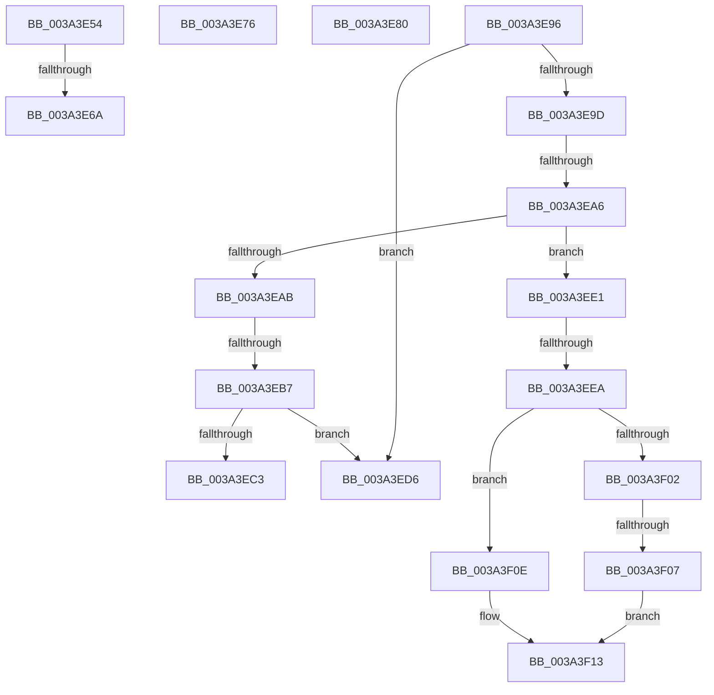

# sub_003A3E54

- RVA: `0x003A3E54`–`0x003A3F1C` (길이 `200` bytes)
- VA: `0x00000001403A3E54`
- 실행 섹션: `.text`
- PDB 이름 있음: `아니요`; PDB Function 태그: `아니요`
- unwind 정보 RVA: `0x00082358`
- 디코드: `49`개 명령, `200/200` bytes 표시
- 미해석 바이트: `0` (있으면 어셈블리에 `.byte`로 보존)

> 이 문서는 커널 이미지의 기계어와 PDB 기호를 분석해 생성했습니다. 4번과 5번은 함수 원형과 자료형을 바이너리 사용 방식에서 추정한 C 해석이며 원본 소스 복구 결과는 아닙니다.

## 1. Dependencies

- 직접 호출 지점: **3**; 고유 호출 대상: **3**
- 직접 호출자로 확인된 함수: **0**
- RIP 상대 이미지 참조: **1**

### Outgoing calls
- `0x003A3E87` → [KeQueryPerformanceCounter](../37/KeQueryPerformanceCounter_function_0037E7E0.md) (function, `0x0037E7E0`)
- `0x003A3F07` → [guard_dispatch_icall](../6B/guard_dispatch_icall_function_006BAAD0.md) (function, `0x006BAAD0`)
- `0x003A3F0E` → [KiIpiUpdateThreadTag](KiIpiUpdateThreadTag_function_003A3FE0.md) (function, `0x003A3FE0`)

### Direct callers
- 이 함수 시작 RVA로 연결되는 직접 call은 확인되지 않았습니다. 간접 호출은 완전히 역산할 수 없습니다.

### Static image references
- `0x003A3EAB` → RVA `0x00FC6A87` (`ALMOSTRO`; read)

## 2. Other-region calls and transfers

- 다른 실행 섹션으로 향하는 call: **0**
- call이 아닌 외부 분기/꼬리 이동: **11**
  - `0x003A3E64` → [sub_003A3B13 + 0x2B1](Unknown_function_003A3B13.md) (`tail-transfer`)
  - `0x003A3E71` → [sub_003A3B13 + 0x2B1](Unknown_function_003A3B13.md) (`tail-transfer`)
  - `0x003A3E7B` → [sub_003A3B13 + 0x126](Unknown_function_003A3B13.md) (`tail-transfer`)
  - `0x003A3E91` → [sub_003A3B13 + 0x101](Unknown_function_003A3B13.md) (`tail-transfer`)
  - `0x003A3EA0` → [sub_006E6498](../6E/Unknown_function_006E6498.md) (`tail-transfer`)
  - `0x003A3EB1` → [sub_003A3F33 + 0x35](Unknown_function_003A3F33.md) (`tail-transfer`)
  - `0x003A3ED1` → [sub_003A3B13 + 0x29B](Unknown_function_003A3B13.md) (`tail-transfer`)
  - `0x003A3EDC` → [sub_003A3B13 + 0x29B](Unknown_function_003A3B13.md) (`tail-transfer`)
  - `0x003A3EE4` → [sub_003A3B13 + 0x29B](Unknown_function_003A3B13.md) (`tail-transfer`)
  - `0x003A3F05` → [sub_003A3F33](Unknown_function_003A3F33.md) (`tail-transfer`)
  - `0x003A3F17` → [sub_003A3B13 + 0x29B](Unknown_function_003A3B13.md) (`tail-transfer`)

## 3. Assembly (complete function range)

```asm
003A3E54  B8 FF FF FF FF                  mov eax, 0xffffffff
003A3E59  F0 0F C1 85 84 2D 00 00         lock xadd dword ptr [rbp + 0x2d84], eax
003A3E61  83 F8 01                        cmp eax, 1
003A3E64  0F 85 5A FF FF FF               jne 0x1403a3dc4
003A3E6A  44 89 A5 80 2D 00 00            mov dword ptr [rbp + 0x2d80], r12d
003A3E71  E9 4E FF FF FF                  jmp 0x1403a3dc4
003A3E76  4C 89 64 24 78                  mov qword ptr [rsp + 0x78], r12
003A3E7B  E9 B9 FD FF FF                  jmp 0x1403a3c39
003A3E80  BB 1E 00 00 00                  mov ebx, 0x1e
003A3E85  33 C9                           xor ecx, ecx
003A3E87  E8 54 A9 FD FF                  call 0x14037e7e0
003A3E8C  48 89 44 24 68                  mov qword ptr [rsp + 0x68], rax
003A3E91  E9 7E FD FF FF                  jmp 0x1403a3c14
003A3E96  8B CB                           mov ecx, ebx
003A3E98  83 E9 01                        sub ecx, 1
003A3E9B  74 39                           je 0x1403a3ed6
003A3E9D  83 E9 01                        sub ecx, 1
003A3EA0  0F 84 F2 25 34 00               je 0x1406e6498
003A3EA6  83 E9 01                        sub ecx, 1
003A3EA9  75 36                           jne 0x1403a3ee1
003A3EAB  38 0D D6 2B C2 00               cmp byte ptr [rip + 0xc22bd6], cl
003A3EB1  0F 85 B1 00 00 00               jne 0x1403a3f68
003A3EB7  0F 20 E1                        mov rcx, cr4
003A3EBA  48 F7 C1 80 00 02 00            test rcx, 0x20080
003A3EC1  74 13                           je 0x1403a3ed6
003A3EC3  48 8B C1                        mov rax, rcx
003A3EC6  48 0F BA F8 07                  btc rax, 7
003A3ECB  0F 22 E0                        mov cr4, rax
003A3ECE  0F 22 E1                        mov cr4, rcx
003A3ED1  E9 D8 FE FF FF                  jmp 0x1403a3dae
003A3ED6  0F 20 D8                        mov rax, cr3
003A3ED9  0F 22 D8                        mov cr3, rax
003A3EDC  E9 CD FE FF FF                  jmp 0x1403a3dae
003A3EE1  83 F9 02                        cmp ecx, 2
003A3EE4  0F 85 C4 FE FF FF               jne 0x1403a3dae
003A3EEA  49 8B 46 28                     mov rax, qword ptr [r14 + 0x28]
003A3EEE  48 8B CD                        mov rcx, rbp
003A3EF1  4D 8B 4E 20                     mov r9, qword ptr [r14 + 0x20]
003A3EF5  4D 8B 46 18                     mov r8, qword ptr [r14 + 0x18]
003A3EF9  49 8B 56 10                     mov rdx, qword ptr [r14 + 0x10]
003A3EFD  49 3B C2                        cmp rax, r10
003A3F00  74 0C                           je 0x1403a3f0e
003A3F02  49 3B C3                        cmp rax, r11
003A3F05  74 2C                           je 0x1403a3f33
003A3F07  E8 C4 6B 31 00                  call 0x1406baad0
003A3F0C  EB 05                           jmp 0x1403a3f13
003A3F0E  E8 CD 00 00 00                  call 0x1403a3fe0
003A3F13  4D 8B 7E 28                     mov r15, qword ptr [r14 + 0x28]
003A3F17  E9 92 FE FF FF                  jmp 0x1403a3dae
```

## 4. C-style interpretation (structured pseudocode)

```c
__int64 __fastcall sub_003A3E54(int a1)
{
    unsigned __int64 v_stack_p68;
    unsigned __int64 v_stack_p78;

    *(unsigned int *)(v_rbp + 11648) = (unsigned int)(v_r12);
}
```

## 5. (Beta) C Style

```c
int64_t sub_003A3E54(int32_t Arg1)
{
    uint64_t v_stack_p68;
    uint64_t v_stack_p78;

    *(uint32_t *)(local_rbp + 0x2D80) = (uint32_t)(local_r12);
}
```

## 6. Execution-region graph

[열기: 2D/3D 그래프와 함수 탐색 컨트롤 패널](../../../control-panel.html?section=text&rva=0x003A3E54&view=graph)

- 2D 그래프는 위에서 아래로 흐르고, 3D 그래프는 빈 공간을 드래그해 회전합니다. Shift+드래그는 이동, 휠은 확대·축소, 함수 노드 선택은 대상 보고서 이동입니다.

### Static fallback


