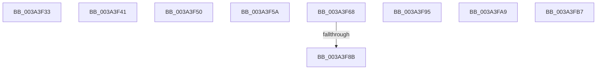

# sub_003A3F33

- RVA: `0x003A3F33`–`0x003A3FD7` (길이 `164` bytes)
- VA: `0x00000001403A3F33`
- 실행 섹션: `.text`
- PDB 이름 있음: `아니요`; PDB Function 태그: `아니요`
- unwind 정보 RVA: `0x0008238C`
- 디코드: `32`개 명령, `164/164` bytes 표시
- 미해석 바이트: `0` (있으면 어셈블리에 `.byte`로 보존)

> 이 문서는 커널 이미지의 기계어와 PDB 기호를 분석해 생성했습니다. 4번과 5번은 함수 원형과 자료형을 바이너리 사용 방식에서 추정한 C 해석이며 원본 소스 복구 결과는 아닙니다.

## 1. Dependencies

- 직접 호출 지점: **7**; 고유 호출 대상: **5**
- 직접 호출자로 확인된 함수: **0**
- RIP 상대 이미지 참조: **2**

### Outgoing calls
- `0x003A3F33` → [KiIpiGenericCallTarget](KiIpiGenericCallTarget_function_003A4000.md) (function, `0x003A4000`)
- `0x003A3F41` → [RtlGetSystemTimePrecise](../37/RtlGetSystemTimePrecise_function_0037EDD0.md) (function, `0x0037EDD0`)
- `0x003A3F5A` → [KiSetUserTbFlushPending](../6B/KiSetUserTbFlushPending_function_006B20C0.md) (function, `0x006B20C0`)
- `0x003A3F8B` → [KiSetUserTbFlushPending](../6B/KiSetUserTbFlushPending_function_006B20C0.md) (function, `0x006B20C0`)
- `0x003A3F9F` → [PerfInfoLogIpiReceive](PerfInfoLogIpiReceive_function_003A40F0.md) (function, `0x003A40F0`)
- `0x003A3FA9` → [KiSetUserTbFlushPending](../6B/KiSetUserTbFlushPending_function_006B20C0.md) (function, `0x006B20C0`)
- `0x003A3FB7` → [EtwpGetHostPerfCounter](EtwpGetHostPerfCounter_function_003A4134.md) (function, `0x003A4134`)

### Direct callers
- 이 함수 시작 RVA로 연결되는 직접 call은 확인되지 않았습니다. 간접 호출은 완전히 역산할 수 없습니다.

### Static image references
- `0x003A3FC4` → RVA `0x003A3FE0` (`KiIpiUpdateThreadTag`; read)
- `0x003A3FCB` → RVA `0x003A4000` (`KiIpiGenericCallTarget`; read)

## 2. Other-region calls and transfers

- 다른 실행 섹션으로 향하는 call: **0**
- call이 아닌 외부 분기/꼬리 이동: **9**
  - `0x003A3F3C` → [sub_003A3B13 + 0x29B](Unknown_function_003A3B13.md) (`tail-transfer`)
  - `0x003A3F4B` → [sub_003A3B13 + 0x10F](Unknown_function_003A3B13.md) (`tail-transfer`)
  - `0x003A3F55` → [sub_003A3B13 + 0x145](Unknown_function_003A3B13.md) (`tail-transfer`)
  - `0x003A3F63` → [sub_003A3B13 + 0x1E2](Unknown_function_003A3B13.md) (`tail-transfer`)
  - `0x003A3F85` → [sub_003A3B13 + 0x29B](Unknown_function_003A3B13.md) (`tail-transfer`)
  - `0x003A3F90` → [sub_003A3B13 + 0x29B](Unknown_function_003A3B13.md) (`tail-transfer`)
  - `0x003A3FA4` → [sub_003A3B13 + 0x2BC](Unknown_function_003A3B13.md) (`tail-transfer`)
  - `0x003A3FB2` → [sub_003A3B13 + 0x267](Unknown_function_003A3B13.md) (`tail-transfer`)
  - `0x003A3FD2` → [sub_003A3B13 + 0x145](Unknown_function_003A3B13.md) (`tail-transfer`)

## 3. Assembly (complete function range)

```asm
003A3F33  E8 C8 00 00 00                  call 0x1403a4000
003A3F38  4D 8B 7E 28                     mov r15, qword ptr [r14 + 0x28]
003A3F3C  E9 6D FE FF FF                  jmp 0x1403a3dae
003A3F41  E8 8A AE FD FF                  call 0x14037edd0
003A3F46  48 89 44 24 70                  mov qword ptr [rsp + 0x70], rax
003A3F4B  E9 D2 FC FF FF                  jmp 0x1403a3c22
003A3F50  C6 44 24 30 00                  mov byte ptr [rsp + 0x30], 0
003A3F55  E9 FE FC FF FF                  jmp 0x1403a3c58
003A3F5A  E8 61 E1 30 00                  call 0x1406b20c0
003A3F5F  8B 54 24 38                     mov edx, dword ptr [rsp + 0x38]
003A3F63  E9 8D FD FF FF                  jmp 0x1403a3cf5
003A3F68  0F 20 D8                        mov rax, cr3
003A3F6B  0F 22 D8                        mov cr3, rax
003A3F6E  65 48 8B 04 25 88 01 00 00      mov rax, qword ptr gs:[0x188]
003A3F77  48 8B 88 B8 00 00 00            mov rcx, qword ptr [rax + 0xb8]
003A3F7E  80 B9 60 01 00 00 00            cmp byte ptr [rcx + 0x160], 0
003A3F85  0F 85 23 FE FF FF               jne 0x1403a3dae
003A3F8B  E8 30 E1 30 00                  call 0x1406b20c0
003A3F90  E9 19 FE FF FF                  jmp 0x1403a3dae
003A3F95  4D 8B C7                        mov r8, r15
003A3F98  48 8D 4C 24 68                  lea rcx, [rsp + 0x68]
003A3F9D  8B D3                           mov edx, ebx
003A3F9F  E8 4C 01 00 00                  call 0x1403a40f0
003A3FA4  E9 26 FE FF FF                  jmp 0x1403a3dcf
003A3FA9  E8 12 E1 30 00                  call 0x1406b20c0
003A3FAE  8B 54 24 38                     mov edx, dword ptr [rsp + 0x38]
003A3FB2  E9 C3 FD FF FF                  jmp 0x1403a3d7a
003A3FB7  E8 78 01 00 00                  call 0x1403a4134
003A3FBC  48 89 84 24 80 00 00 00         mov qword ptr [rsp + 0x80], rax
003A3FC4  4C 8D 15 15 00 00 00            lea r10, [rip + 0x15]
003A3FCB  4C 8D 1D 2E 00 00 00            lea r11, [rip + 0x2e]
003A3FD2  E9 81 FC FF FF                  jmp 0x1403a3c58
```

## 4. C-style interpretation (structured pseudocode)

```c
__int64 __fastcall sub_003A3F33(void)
{
    __int64 result;
    unsigned __int8 v_stack_p30;
    unsigned int v_stack_p38;
    unsigned __int64 v_stack_p68;
    unsigned __int64 v_stack_p70;
    unsigned __int64 v_stack_p80;

    result = KiIpiGenericCallTarget(a1, a2, a3, a4);
}
```

## 5. (Beta) C Style

```c
void sub_003A3F33(void)
{
    int64_t result;
    uint8_t v_stack_p30;
    uint32_t v_stack_p38;
    uint64_t v_stack_p68;
    uint64_t v_stack_p70;
    uint64_t v_stack_p80;

    result = KiIpiGenericCallTarget(a1, a2, a3, a4);
}
```

## 6. Execution-region graph

[열기: 2D/3D 그래프와 함수 탐색 컨트롤 패널](../../../control-panel.html?section=text&rva=0x003A3F33&view=graph)

- 2D 그래프는 위에서 아래로 흐르고, 3D 그래프는 빈 공간을 드래그해 회전합니다. Shift+드래그는 이동, 휠은 확대·축소, 함수 노드 선택은 대상 보고서 이동입니다.

### Static fallback


