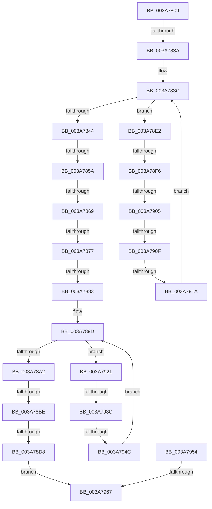

# sub_003A7809

- RVA: `0x003A7809`–`0x003A7974` (길이 `363` bytes)
- VA: `0x00000001403A7809`
- 실행 섹션: `.text`
- PDB 이름 있음: `아니요`; PDB Function 태그: `아니요`
- unwind 정보 RVA: `0x00089BB4`
- 디코드: `80`개 명령, `363/363` bytes 표시
- 미해석 바이트: `0` (있으면 어셈블리에 `.byte`로 보존)

> 이 문서는 커널 이미지의 기계어와 PDB 기호를 분석해 생성했습니다. 4번과 5번은 함수 원형과 자료형을 바이너리 사용 방식에서 추정한 C 해석이며 원본 소스 복구 결과는 아닙니다.

## 1. Dependencies

- 직접 호출 지점: **1**; 고유 호출 대상: **1**
- 직접 호출자로 확인된 함수: **0**
- RIP 상대 이미지 참조: **0**

### Outgoing calls
- `0x003A793F` → [RtlEqualUnicodeString](../../page/93/RtlEqualUnicodeString_function_00932A20.md) (function, `0x00932A20`)

### Direct callers
- 이 함수 시작 RVA로 연결되는 직접 call은 확인되지 않았습니다. 간접 호출은 완전히 역산할 수 없습니다.

### Static image references
- 디코드된 RIP-relative 메모리 참조가 없습니다.

## 2. Other-region calls and transfers

- 다른 실행 섹션으로 향하는 call: **1**
  - `0x003A793F` → [RtlEqualUnicodeString](../../page/93/RtlEqualUnicodeString_function_00932A20.md) (`.text` → `PAGE`)
- call이 아닌 외부 분기/꼬리 이동: **14**
  - `0x003A7834` → [sub_003A7BCB](Unknown_function_003A7BCB.md) (`tail-transfer`)
  - `0x003A7854` → [sub_003A7982](Unknown_function_003A7982.md) (`tail-transfer`)
  - `0x003A7863` → [sub_003A7B62 + 0x20](Unknown_function_003A7B62.md) (`tail-transfer`)
  - `0x003A7871` → [sub_003A7B62 + 0x20](Unknown_function_003A7B62.md) (`tail-transfer`)
  - `0x003A787D` → [sub_003A7B62](Unknown_function_003A7B62.md) (`tail-transfer`)
  - `0x003A78B8` → [sub_003A7D1C](Unknown_function_003A7D1C.md) (`tail-transfer`)
  - `0x003A78D2` → [sub_003A7982 + 0xD6](Unknown_function_003A7982.md) (`tail-transfer`)
  - `0x003A78F0` → [sub_003A7BCB + 0x32](Unknown_function_003A7BCB.md) (`tail-transfer`)
  - `0x003A78FF` → [sub_003A7BCB + 0x32](Unknown_function_003A7BCB.md) (`tail-transfer`)
  - `0x003A7909` → [sub_003A7BCB + 0x32](Unknown_function_003A7BCB.md) (`tail-transfer`)
  - `0x003A7914` → [sub_003A7BCB + 0x32](Unknown_function_003A7BCB.md) (`tail-transfer`)
  - `0x003A7936` → [sub_003A7C9B](Unknown_function_003A7C9B.md) (`tail-transfer`)
  - `0x003A7946` → [sub_003A7982 + 0xCF](Unknown_function_003A7982.md) (`tail-transfer`)
  - `0x003A7961` → [sub_003A7982 + 0x81](Unknown_function_003A7982.md) (`tail-transfer`)

## 3. Assembly (complete function range)

```asm
003A7809  4C 89 AC 24 90 00 00 00         mov qword ptr [rsp + 0x90], r13
003A7811  4C 8B AE 08 03 00 00            mov r13, qword ptr [rsi + 0x308]
003A7818  4C 89 7C 24 40                  mov qword ptr [rsp + 0x40], r15
003A781D  4C 8B BC 24 B8 00 00 00         mov r15, qword ptr [rsp + 0xb8]
003A7825  4C 89 6C 24 30                  mov qword ptr [rsp + 0x30], r13
003A782A  41 89 1F                        mov dword ptr [r15], ebx
003A782D  45 8B 4D 00                     mov r9d, dword ptr [r13]
003A7831  45 85 C9                        test r9d, r9d
003A7834  0F 84 91 03 00 00               je 0x1403a7bcb
003A783A  8B CB                           mov ecx, ebx
003A783C  3B CF                           cmp ecx, edi
003A783E  0F 82 9E 00 00 00               jb 0x1403a78e2
003A7844  48 89 9C 24 80 00 00 00         mov qword ptr [rsp + 0x80], rbx
003A784C  B9 28 00 00 00                  mov ecx, 0x28
003A7851  4D 85 E4                        test r12, r12
003A7854  0F 84 28 01 00 00               je 0x1403a7982
003A785A  48 8B C7                        mov rax, rdi
003A785D  48 F7 E1                        mul rcx
003A7860  48 85 D2                        test rdx, rdx
003A7863  0F 85 19 03 00 00               jne 0x1403a7b82
003A7869  48 8D 68 10                     lea rbp, [rax + 0x10]
003A786D  48 83 FD 10                     cmp rbp, 0x10
003A7871  0F 82 0B 03 00 00               jb 0x1403a7b82
003A7877  44 8B FB                        mov r15d, ebx
003A787A  44 3B FF                        cmp r15d, edi
003A787D  0F 83 DF 02 00 00               jae 0x1403a7b62
003A7883  49 8B 75 08                     mov rsi, qword ptr [r13 + 8]
003A7887  45 8B F7                        mov r14d, r15d
003A788A  49 C1 E6 04                     shl r14, 4
003A788E  4D 03 F4                        add r14, r12
003A7891  48 89 9C 24 80 00 00 00         mov qword ptr [rsp + 0x80], rbx
003A7899  49 83 C5 08                     add r13, 8
003A789D  49 3B F5                        cmp rsi, r13
003A78A0  75 7F                           jne 0x1403a7921
003A78A2  48 8B 74 24 30                  mov rsi, qword ptr [rsp + 0x30]
003A78A7  8B BC 24 98 00 00 00            mov edi, dword ptr [rsp + 0x98]
003A78AE  48 83 C6 20                     add rsi, 0x20
003A78B2  4C 8B 2E                        mov r13, qword ptr [rsi]
003A78B5  4C 3B EE                        cmp r13, rsi
003A78B8  0F 85 5E 04 00 00               jne 0x1403a7d1c
003A78BE  0F B6 C3                        movzx eax, bl
003A78C1  84 C0                           test al, al
003A78C3  48 8B CB                        mov rcx, rbx
003A78C6  48 0F 45 8C 24 80 00 00 00      cmovne rcx, qword ptr [rsp + 0x80]
003A78CF  48 85 C9                        test rcx, rcx
003A78D2  0F 85 80 01 00 00               jne 0x1403a7a58
003A78D8  B8 25 02 00 C0                  mov eax, 0xc0000225
003A78DD  E9 85 00 00 00                  jmp 0x1403a7967
003A78E2  8B C1                           mov eax, ecx
003A78E4  48 03 C0                        add rax, rax
003A78E7  45 0F B7 04 C4                  movzx r8d, word ptr [r12 + rax*8]
003A78EC  66 45 85 C0                     test r8w, r8w
003A78F0  0F 84 07 03 00 00               je 0x1403a7bfd
003A78F6  41 0F B7 54 C4 02               movzx edx, word ptr [r12 + rax*8 + 2]
003A78FC  66 85 D2                        test dx, dx
003A78FF  0F 84 F8 02 00 00               je 0x1403a7bfd
003A7905  66 44 3B C2                     cmp r8w, dx
003A7909  0F 87 EE 02 00 00               ja 0x1403a7bfd
003A790F  49 39 5C C4 08                  cmp qword ptr [r12 + rax*8 + 8], rbx
003A7914  0F 84 E3 02 00 00               je 0x1403a7bfd
003A791A  FF C1                           inc ecx
003A791C  E9 1B FF FF FF                  jmp 0x1403a783c
003A7921  48 89 B4 24 80 00 00 00         mov qword ptr [rsp + 0x80], rsi
003A7929  48 8D 4E 20                     lea rcx, [rsi + 0x20]
003A792D  44 0F 20 C0                     mov rax, cr8
003A7931  49 8B D6                        mov rdx, r14
003A7934  3C 02                           cmp al, 2
003A7936  0F 83 5F 03 00 00               jae 0x1403a7c9b
003A793C  41 B0 01                        mov r8b, 1
003A793F  E8 DC B0 58 00                  call 0x140932a20
003A7944  84 C0                           test al, al
003A7946  0F 85 05 01 00 00               jne 0x1403a7a51
003A794C  48 8B 36                        mov rsi, qword ptr [rsi]
003A794F  E9 49 FF FF FF                  jmp 0x1403a789d
003A7954  4C 8B BC 24 B8 00 00 00         mov r15, qword ptr [rsp + 0xb8]
003A795C  48 8B F3                        mov rsi, rbx
003A795F  85 C0                           test eax, eax
003A7961  0F 89 9C 00 00 00               jns 0x1403a7a03
003A7967  4C 8B 7C 24 40                  mov r15, qword ptr [rsp + 0x40]
003A796C  4C 8B AC 24 90 00 00 00         mov r13, qword ptr [rsp + 0x90]
```

## 4. C-style interpretation (structured pseudocode)

```c
__int64 __fastcall sub_003A7809(__int64 a1, __int64 a2, __int64 a3, __int64 a4, __int64 a5, __int64 a6, __int64 a7, __int64 a8, __int64 a9, __int64 a10, __int64 a11, __int64 a12, __int64 a13, __int64 a14, __int64 a15, __int64 a16, __int64 a17, __int64 a18, unsigned int a19, __int64 a20, __int64 a21, __int64 a22, __int64 a23)
{
    __int64 result;
    __int64 v_r13;
    __int64 v_r14;
    __int64 v_rsi;
    unsigned __int64 v_stack_p30;
    unsigned __int64 v_stack_p40;
    unsigned __int64 v_stack_p80;
    unsigned __int64 v_stack_p90;
    unsigned __int64 v_stack_pB8;

    v_stack_p90 = v_r13;
    v_stack_p40 = v_r15;
    v_stack_p30 = *(unsigned __int64 *)(v_rsi + 776);
    *(unsigned int *)(a23) = (unsigned int)(v_rbx);
loc_003A783C:
    if (((unsigned int)((unsigned int)((unsigned int)(v_rbx)))) < ((unsigned int)(v_rdi))) goto loc_003A78E2;
    v_stack_p80 = v_rbx;
    v_r14 = ((unsigned int)((unsigned int)((unsigned int)((unsigned int)(v_rbx))))) << (4);
    v_r14 = (v_r14) + (v_r12);
    v_stack_p80 = v_rbx;
    v_r13 = (*(unsigned __int64 *)(v_rsi + 776)) + (8);
loc_003A789D:
    if ((*(unsigned __int64 *)(*(unsigned __int64 *)(v_rsi + 776) + 8)) != v_r13) goto loc_003A7921;
    v_rsi = (a6) + (32);
    a1 = v_rbx;
    if ((unsigned __int8)((unsigned __int8)(v_rbx)) != 0) { a1 = a16; }
    goto loc_003A7967;
loc_003A78E2:
    result = ((unsigned int)((unsigned int)(a1))) + ((unsigned int)((unsigned int)(a1)));
    a1 = (unsigned int)((a1) + 1);
    goto loc_003A783C;
loc_003A7921:
    v_stack_p80 = v_rsi;
    result = RtlEqualUnicodeString(v_rsi + 32, v_r14, 1, (unsigned int)(*(unsigned int *)(*(unsigned __int64 *)(v_rsi + 776))));
    goto loc_003A789D;
loc_003A7967:
    return result;
}
```

## 5. (Beta) C Style

```c
int64_t sub_003A7809(int64_t Arg1, int64_t Arg2, int64_t Arg3, int64_t Arg4, uint64_t Arg5, void *Arg6, uint64_t Arg7, int64_t Arg8, uint64_t Arg9, uint64_t Arg10, uint64_t Arg11, uint64_t Arg12, uint64_t Arg13, uint64_t Arg14, uint64_t Arg15, int64_t Arg16, uint64_t Arg17, int64_t Arg18, uint32_t Arg19, uint64_t Arg20, uint64_t Arg21, uint64_t Arg22, void *Arg23)
{
    uint8_t *arg6 = (uint8_t *)Arg6;
    uint8_t *arg23 = (uint8_t *)Arg23;

    int64_t result;
    int64_t local_r13;
    int64_t local_r14;
    int64_t local_rsi;
    uint64_t v_stack_p30;
    uint64_t v_stack_p40;
    uint64_t v_stack_p80;
    uint64_t v_stack_p90;
    uint64_t v_stack_pB8;

    v_stack_p90 = local_r13;
    v_stack_p40 = local_r15;
    v_stack_p30 = *(uint64_t *)(local_rsi + 0x308);
    *(uint32_t *)(arg23) = (uint32_t)(local_rbx);
loc_003A783C:
    if (((uint32_t)((uint32_t)((uint32_t)(local_rbx)))) < ((uint32_t)(local_rdi))) goto loc_003A78E2;
    v_stack_p80 = local_rbx;
    local_r14 = ((uint32_t)((uint32_t)((uint32_t)((uint32_t)(local_rbx))))) << (4);
    local_r14 = (local_r14) + (local_r12);
    v_stack_p80 = local_rbx;
    local_r13 = (*(uint64_t *)(local_rsi + 0x308)) + (8);
loc_003A789D:
    if ((*(uint64_t *)(*(uint64_t *)(local_rsi + 0x308) + 0x8)) != local_r13) goto loc_003A7921;
    local_rsi = (Arg6) + (32);
    Arg1 = local_rbx;
    if ((uint8_t)((uint8_t)(local_rbx)) != 0) { Arg1 = Arg16; }
    goto loc_003A7967;
loc_003A78E2:
    result = ((uint32_t)((uint32_t)(Arg1))) + ((uint32_t)((uint32_t)(Arg1)));
    Arg1 = (uint32_t)((Arg1) + 1);
    goto loc_003A783C;
loc_003A7921:
    v_stack_p80 = local_rsi;
    result = RtlEqualUnicodeString(local_rsi + 32, local_r14, 1, (uint32_t)(*(uint32_t *)(*(uint64_t *)(local_rsi + 0x308))));
    goto loc_003A789D;
loc_003A7967:
    return result;
}
```

### 관측된 메모리 오프셋

구조체 형식이 확인되지 않은 접근은 인자 기준의 오프셋으로만 기록했습니다.

| 기준 인자 | 오프셋 표현 | 폭 (bit) | 접근 |
|---|---:|---:|---|
| `Arg6` | `+ 0x0` | `64` | `R` |
| `Arg23` | `+ 0x0` | `32` | `W` |

## 6. Execution-region graph

[열기: 2D/3D 그래프와 함수 탐색 컨트롤 패널](../../../control-panel.html?section=text&rva=0x003A7809&view=graph)

- 2D 그래프는 위에서 아래로 흐르고, 3D 그래프는 빈 공간을 드래그해 회전합니다. Shift+드래그는 이동, 휠은 확대·축소, 함수 노드 선택은 대상 보고서 이동입니다.

### Static fallback


