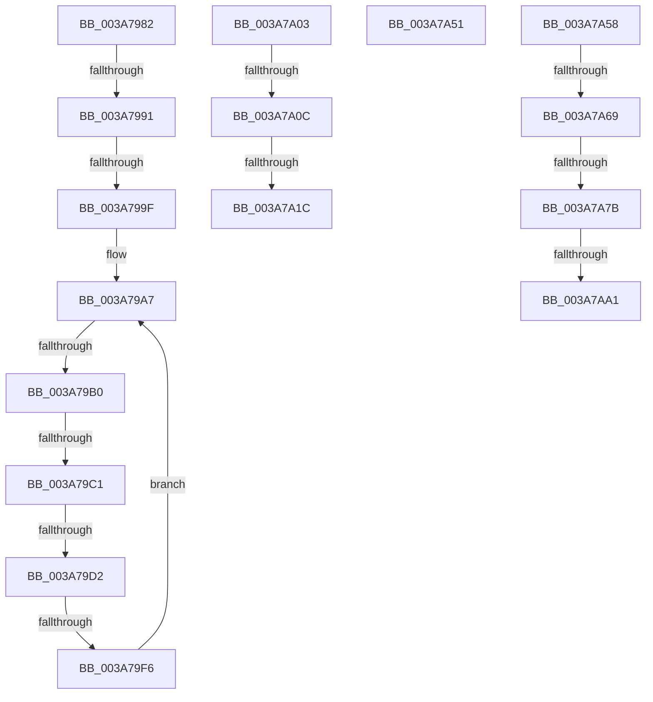

# sub_003A7982

- RVA: `0x003A7982`–`0x003A7AB1` (길이 `303` bytes)
- VA: `0x00000001403A7982`
- 실행 섹션: `.text`
- PDB 이름 있음: `아니요`; PDB Function 태그: `아니요`
- unwind 정보 RVA: `0x00089BE0`
- 디코드: `66`개 명령, `303/303` bytes 표시
- 미해석 바이트: `0` (있으면 어셈블리에 `.byte`로 보존)

> 이 문서는 커널 이미지의 기계어와 PDB 기호를 분석해 생성했습니다. 4번과 5번은 함수 원형과 자료형을 바이너리 사용 방식에서 추정한 C 해석이며 원본 소스 복구 결과는 아닙니다.

## 1. Dependencies

- 직접 호출 지점: **4**; 고유 호출 대상: **3**
- 직접 호출자로 확인된 함수: **0**
- RIP 상대 이미지 참조: **0**

### Outgoing calls
- `0x003A79E9` → [AuthzBasepGetSecurityAttributeValueCopyoutBufferSize](AuthzBasepGetSecurityAttributeValueCopyoutBufferSize_function_003A8430.md) (function, `0x003A8430`)
- `0x003A7A29` → [memset](../6C/memset_function_006C6C40.md) (function, `0x006C6C40`)
- `0x003A7A44` → [AuthzBasepCopyoutSecurityAttributes](AuthzBasepCopyoutSecurityAttributes_function_003A8100.md) (function, `0x003A8100`)
- `0x003A7A8F` → [AuthzBasepGetSecurityAttributeValueCopyoutBufferSize](AuthzBasepGetSecurityAttributeValueCopyoutBufferSize_function_003A8430.md) (function, `0x003A8430`)

### Direct callers
- 이 함수 시작 RVA로 연결되는 직접 call은 확인되지 않았습니다. 간접 호출은 완전히 역산할 수 없습니다.

### Static image references
- 디코드된 RIP-relative 메모리 참조가 없습니다.

## 2. Other-region calls and transfers

- 다른 실행 섹션으로 향하는 call: **0**
- call이 아닌 외부 분기/꼬리 이동: **14**
  - `0x003A798B` → [sub_003A7B62 + 0x20](Unknown_function_003A7B62.md) (`tail-transfer`)
  - `0x003A7999` → [sub_003A7B62 + 0x20](Unknown_function_003A7B62.md) (`tail-transfer`)
  - `0x003A79AA` → [sub_003A7B62 + 0x8](Unknown_function_003A7B62.md) (`tail-transfer`)
  - `0x003A79BB` → [sub_003A7B62 + 0x20](Unknown_function_003A7B62.md) (`tail-transfer`)
  - `0x003A79CC` → [sub_003A7B62 + 0x20](Unknown_function_003A7B62.md) (`tail-transfer`)
  - `0x003A79F0` → [sub_003A7809 + 0x153](Unknown_function_003A7809.md) (`tail-transfer`)
  - `0x003A7A06` → [sub_003A7BCB + 0x32](Unknown_function_003A7BCB.md) (`tail-transfer`)
  - `0x003A7A16` → [sub_003A7B62 + 0x13](Unknown_function_003A7B62.md) (`tail-transfer`)
  - `0x003A7A4C` → [sub_003A7809 + 0x15E](Unknown_function_003A7809.md) (`tail-transfer`)
  - `0x003A7A53` → [sub_003A7809 + 0xB8](Unknown_function_003A7809.md) (`tail-transfer`)
  - `0x003A7A63` → [sub_003A7B62 + 0x20](Unknown_function_003A7B62.md) (`tail-transfer`)
  - `0x003A7A75` → [sub_003A7B62 + 0x20](Unknown_function_003A7B62.md) (`tail-transfer`)
  - `0x003A7A9B` → [sub_003A7809 + 0x14B](Unknown_function_003A7809.md) (`tail-transfer`)
  - `0x003A7AAC` → [sub_003A7809 + 0x71](Unknown_function_003A7809.md) (`tail-transfer`)

## 3. Assembly (complete function range)

```asm
003A7982  49 8B C1                        mov rax, r9
003A7985  48 F7 E1                        mul rcx
003A7988  48 85 D2                        test rdx, rdx
003A798B  0F 85 F1 01 00 00               jne 0x1403a7b82
003A7991  48 8D 68 10                     lea rbp, [rax + 0x10]
003A7995  48 83 FD 10                     cmp rbp, 0x10
003A7999  0F 82 E3 01 00 00               jb 0x1403a7b82
003A799F  49 8B 75 08                     mov rsi, qword ptr [r13 + 8]
003A79A3  4D 8D 75 08                     lea r14, [r13 + 8]
003A79A7  49 3B F6                        cmp rsi, r14
003A79AA  0F 84 BA 01 00 00               je 0x1403a7b6a
003A79B0  48 8D 4D 01                     lea rcx, [rbp + 1]
003A79B4  48 83 E1 FE                     and rcx, 0xfffffffffffffffe
003A79B8  48 3B CD                        cmp rcx, rbp
003A79BB  0F 82 C1 01 00 00               jb 0x1403a7b82
003A79C1  0F B7 56 20                     movzx edx, word ptr [rsi + 0x20]
003A79C5  48 8D 04 0A                     lea rax, [rdx + rcx]
003A79C9  48 3B C1                        cmp rax, rcx
003A79CC  0F 82 B0 01 00 00               jb 0x1403a7b82
003A79D2  48 8D 04 11                     lea rax, [rcx + rdx]
003A79D6  48 8B CE                        mov rcx, rsi
003A79D9  48 8D 94 24 80 00 00 00         lea rdx, [rsp + 0x80]
003A79E1  48 89 84 24 80 00 00 00         mov qword ptr [rsp + 0x80], rax
003A79E9  E8 42 0A 00 00                  call 0x1403a8430
003A79EE  85 C0                           test eax, eax
003A79F0  0F 88 66 FF FF FF               js 0x1403a795c
003A79F6  48 8B 36                        mov rsi, qword ptr [rsi]
003A79F9  48 8B AC 24 80 00 00 00         mov rbp, qword ptr [rsp + 0x80]
003A7A01  EB A4                           jmp 0x1403a79a7
003A7A03  48 85 DB                        test rbx, rbx
003A7A06  0F 84 F1 01 00 00               je 0x1403a7bfd
003A7A0C  8B AC 24 B0 00 00 00            mov ebp, dword ptr [rsp + 0xb0]
003A7A13  48 3B EB                        cmp rbp, rbx
003A7A16  0F 82 59 01 00 00               jb 0x1403a7b75
003A7A1C  48 8B 8C 24 A8 00 00 00         mov rcx, qword ptr [rsp + 0xa8]
003A7A24  44 8B C5                        mov r8d, ebp
003A7A27  33 D2                           xor edx, edx
003A7A29  E8 12 F2 31 00                  call 0x1406c6c40
003A7A2E  4C 8B 8C 24 A8 00 00 00         mov r9, qword ptr [rsp + 0xa8]
003A7A36  44 8B C7                        mov r8d, edi
003A7A39  49 8B D4                        mov rdx, r12
003A7A3C  48 89 6C 24 20                  mov qword ptr [rsp + 0x20], rbp
003A7A41  49 8B CD                        mov rcx, r13
003A7A44  E8 B7 06 00 00                  call 0x1403a8100
003A7A49  41 89 37                        mov dword ptr [r15], esi
003A7A4C  E9 16 FF FF FF                  jmp 0x1403a7967
003A7A51  B0 01                           mov al, 1
003A7A53  E9 69 FE FF FF                  jmp 0x1403a78c1
003A7A58  48 8D 55 01                     lea rdx, [rbp + 1]
003A7A5C  48 83 E2 FE                     and rdx, 0xfffffffffffffffe
003A7A60  48 3B D5                        cmp rdx, rbp
003A7A63  0F 82 19 01 00 00               jb 0x1403a7b82
003A7A69  44 0F B7 41 20                  movzx r8d, word ptr [rcx + 0x20]
003A7A6E  49 8D 04 10                     lea rax, [r8 + rdx]
003A7A72  48 3B C2                        cmp rax, rdx
003A7A75  0F 82 07 01 00 00               jb 0x1403a7b82
003A7A7B  49 8D 04 10                     lea rax, [r8 + rdx]
003A7A7F  48 8D 94 24 80 00 00 00         lea rdx, [rsp + 0x80]
003A7A87  48 89 84 24 80 00 00 00         mov qword ptr [rsp + 0x80], rax
003A7A8F  E8 9C 09 00 00                  call 0x1403a8430
003A7A94  4C 8B 6C 24 30                  mov r13, qword ptr [rsp + 0x30]
003A7A99  85 C0                           test eax, eax
003A7A9B  0F 88 B3 FE FF FF               js 0x1403a7954
003A7AA1  48 8B AC 24 80 00 00 00         mov rbp, qword ptr [rsp + 0x80]
003A7AA9  41 FF C7                        inc r15d
003A7AAC  E9 C9 FD FF FF                  jmp 0x1403a787a
```

## 4. C-style interpretation (structured pseudocode)

```c
__int64 __fastcall sub_003A7982(__int64 a1, __int64 a2, __int64 a3, __int64 a4, __int64 a5, __int64 a6, __int64 a7, __int64 a8, __int64 a9, __int64 a10, __int64 a11, __int64 a12, __int64 a13, __int64 a14, __int64 a15, __int64 a16)
{
    __int64 result;
    unsigned __int64 v_stack_p20;
    unsigned __int64 v_stack_p30;
    unsigned __int64 v_stack_p80;
    unsigned __int64 v_stack_pA8;
    unsigned int v_stack_pB0;

loc_003A79A7:
    a1 = (a4 + 16 + 1) & (-2);
    v_stack_p80 = a1 + *(unsigned __int16 *)(*(unsigned __int64 *)(v_r13 + 8) + 32) * 1;
    result = AuthzBasepGetSecurityAttributeValueCopyoutBufferSize(*(unsigned __int64 *)(v_r13 + 8), a16, a3, a4);
    goto loc_003A79A7;
}
```

## 5. (Beta) C Style

```c
int64_t sub_003A7982(int64_t Arg1, int64_t Arg2, int64_t Arg3, void *Arg4, uint64_t Arg5, uint64_t Arg6, uint64_t Arg7, uint64_t Arg8, uint64_t Arg9, uint64_t Arg10, uint64_t Arg11, uint64_t Arg12, uint64_t Arg13, uint64_t Arg14, uint64_t Arg15, int64_t Arg16)
{
    uint8_t *arg4 = (uint8_t *)Arg4;

    int64_t result;
    uint64_t v_stack_p20;
    uint64_t v_stack_p30;
    uint64_t v_stack_p80;
    uint64_t v_stack_pA8;
    uint32_t v_stack_pB0;

loc_003A79A7:
    Arg1 = (Arg4 + 16 + 1) & (-2);
    v_stack_p80 = Arg1 + *(uint16_t *)(*(uint64_t *)(local_r13 + 0x8) + 0x20) * 1;
    result = AuthzBasepGetSecurityAttributeValueCopyoutBufferSize(*(uint64_t *)(local_r13 + 0x8), Arg16, Arg3, Arg4);
    goto loc_003A79A7;
}
```

### 관측된 메모리 오프셋

구조체 형식이 확인되지 않은 접근은 인자 기준의 오프셋으로만 기록했습니다.

| 기준 인자 | 오프셋 표현 | 폭 (bit) | 접근 |
|---|---:|---:|---|
| `Arg4` | `+ 0x10` | `64` | `R` |

## 6. Execution-region graph

[열기: 2D/3D 그래프와 함수 탐색 컨트롤 패널](../../../control-panel.html?section=text&rva=0x003A7982&view=graph)

- 2D 그래프는 위에서 아래로 흐르고, 3D 그래프는 빈 공간을 드래그해 회전합니다. Shift+드래그는 이동, 휠은 확대·축소, 함수 노드 선택은 대상 보고서 이동입니다.

### Static fallback


