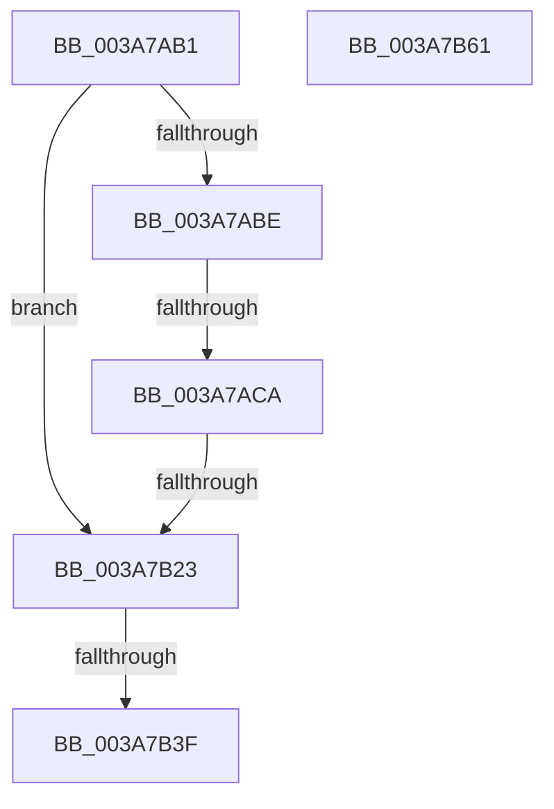

# sub_003A7AB1

- RVA: `0x003A7AB1`–`0x003A7B62` (길이 `177` bytes)
- VA: `0x00000001403A7AB1`
- 실행 섹션: `.text`
- PDB 이름 있음: `아니요`; PDB Function 태그: `아니요`
- unwind 정보 RVA: `0x00089BF8`
- 디코드: `42`개 명령, `177/177` bytes 표시
- 미해석 바이트: `0` (있으면 어셈블리에 `.byte`로 보존)

> 이 문서는 커널 이미지의 기계어와 PDB 기호를 분석해 생성했습니다. 4번과 5번은 함수 원형과 자료형을 바이너리 사용 방식에서 추정한 C 해석이며 원본 소스 복구 결과는 아닙니다.

## 1. Dependencies

- 직접 호출 지점: **4**; 고유 호출 대상: **4**
- 직접 호출자로 확인된 함수: **0**
- RIP 상대 이미지 참조: **1**

### Outgoing calls
- `0x003A7AE1` → [ExAcquireResourceSharedLite](../21/ExAcquireResourceSharedLite_function_00211BC0.md) (function, `0x00211BC0`)
- `0x003A7AFD` → [SepGetProcUniqueLuidAndIndexFromAttributeInfo](../30/SepGetProcUniqueLuidAndIndexFromAttributeInfo_function_00300A78.md) (function, `0x00300A78`)
- `0x003A7B08` → [ExReleaseResourceLite](../25/ExReleaseResourceLite_function_0025FA10.md) (function, `0x0025FA10`)
- `0x003A7B16` → [KeLeaveCriticalRegionThread](../25/KeLeaveCriticalRegionThread_function_0025EFF0.md) (function, `0x0025EFF0`)

### Direct callers
- 이 함수 시작 RVA로 연결되는 직접 call은 확인되지 않았습니다. 간접 호출은 완전히 역산할 수 없습니다.

### Static image references
- `0x003A7AB1` → RVA `0x00E67E20` (`.data`; read)

## 2. Other-region calls and transfers

- 다른 실행 섹션으로 향하는 call: **0**
- call이 아닌 외부 분기/꼬리 이동: **3**
  - `0x003A7AC4` → [sub_003A7D4D](Unknown_function_003A7D4D.md) (`tail-transfer`)
  - `0x003A7B1D` → [sub_003A7C07](Unknown_function_003A7C07.md) (`tail-transfer`)
  - `0x003A7B39` → [sub_003A7CA5](Unknown_function_003A7CA5.md) (`tail-transfer`)

## 3. Assembly (complete function range)

```asm
003A7AB1  8B 05 69 03 AC 00               mov eax, dword ptr [rip + 0xac0369]
003A7AB7  83 E0 03                        and eax, 3
003A7ABA  3C 03                           cmp al, 3
003A7ABC  75 65                           jne 0x1403a7b23
003A7ABE  44 0F 20 C0                     mov rax, cr8
003A7AC2  3C 02                           cmp al, 2
003A7AC4  0F 83 83 02 00 00               jae 0x1403a7d4d
003A7ACA  65 48 8B 04 25 88 01 00 00      mov rax, qword ptr gs:[0x188]
003A7AD3  B2 01                           mov dl, 1
003A7AD5  66 FF 88 E4 01 00 00            dec word ptr [rax + 0x1e4]
003A7ADC  90                              nop
003A7ADD  48 8B 4E 30                     mov rcx, qword ptr [rsi + 0x30]
003A7AE1  E8 DA A0 E6 FF                  call 0x140211bc0
003A7AE6  48 8B 8E 08 03 00 00            mov rcx, qword ptr [rsi + 0x308]
003A7AED  4C 8D 84 24 80 00 00 00         lea r8, [rsp + 0x80]
003A7AF5  48 8D 94 24 88 00 00 00         lea rdx, [rsp + 0x88]
003A7AFD  E8 76 8F F5 FF                  call 0x140300a78
003A7B02  48 8B 4E 30                     mov rcx, qword ptr [rsi + 0x30]
003A7B06  8B E8                           mov ebp, eax
003A7B08  E8 03 7F EB FF                  call 0x14025fa10
003A7B0D  65 48 8B 0C 25 88 01 00 00      mov rcx, qword ptr gs:[0x188]
003A7B16  E8 D5 74 EB FF                  call 0x14025eff0
003A7B1B  85 ED                           test ebp, ebp
003A7B1D  0F 89 E4 00 00 00               jns 0x1403a7c07
003A7B23  83 BC 24 B0 00 00 00 10         cmp dword ptr [rsp + 0xb0], 0x10
003A7B2B  48 8B 84 24 B8 00 00 00         mov rax, qword ptr [rsp + 0xb8]
003A7B33  C7 00 10 00 00 00               mov dword ptr [rax], 0x10
003A7B39  0F 82 66 01 00 00               jb 0x1403a7ca5
003A7B3F  48 8B 8C 24 A8 00 00 00         mov rcx, qword ptr [rsp + 0xa8]
003A7B47  0F 57 C0                        xorps xmm0, xmm0
003A7B4A  8B C3                           mov eax, ebx
003A7B4C  0F 11 01                        movups xmmword ptr [rcx], xmm0
003A7B4F  66 C7 01 01 00                  mov word ptr [rcx], 1
003A7B54  48 83 C4 48                     add rsp, 0x48
003A7B58  41 5E                           pop r14
003A7B5A  41 5C                           pop r12
003A7B5C  5F                              pop rdi
003A7B5D  5E                              pop rsi
003A7B5E  5D                              pop rbp
003A7B5F  5B                              pop rbx
003A7B60  C3                              ret
003A7B61  CC                              int3
```

## 4. C-style interpretation (structured pseudocode)

```c
__int64 __fastcall sub_003A7AB1(__int64 a1, __int64 a2, __int64 a3, __int64 a4, __int64 a5, __int64 a6, __int64 a7, __int64 a8, __int64 a9, __int64 a10, __int64 a11, __int64 a12, __int64 a13, __int64 a14, __int64 a15, __int64 a16, __int64 a17, __int64 a18, __int64 a19, __int64 a20, __int64 a21, unsigned int a22, __int64 a23)
{
    __int64 result;
    __int64 v_rsp;

    result = (unsigned int)(((unsigned int)(*(unsigned int *)(v_rip + 11273065))) & (3));
    if (((unsigned __int8)(result)) != 3) goto loc_003A7B23;
    result = ExAcquireResourceSharedLite(*(unsigned __int64 *)(v_rsi + 48), 1, a3, a4);
    result = SepGetProcUniqueLuidAndIndexFromAttributeInfo(*(unsigned __int64 *)(v_rsi + 776), a17, a16, a4);
    result = ExReleaseResourceLite(*(unsigned __int64 *)(v_rsi + 48), a17, a16, a4);
    result = KeLeaveCriticalRegionThread(*(unsigned __int64 *)(gs_base + (0 + 392)), a17, a16, a4);
loc_003A7B23:
    *(unsigned int *)(a23) = 16;
    *(unsigned __int64 *)(a21) = v_xmm0;
    *(unsigned __int16 *)(a21) = 1;
    v_rsp = (v_rsp) + (72);
    return (unsigned int)((unsigned int)(v_rbx));
}
```

## 5. (Beta) C Style

```c
int64_t sub_003A7AB1(int64_t Arg1, int64_t Arg2, int64_t Arg3, int64_t Arg4, uint64_t Arg5, uint64_t Arg6, uint64_t Arg7, uint64_t Arg8, uint64_t Arg9, uint64_t Arg10, uint64_t Arg11, uint64_t Arg12, uint64_t Arg13, uint64_t Arg14, uint64_t Arg15, int64_t Arg16, int64_t Arg17, uint64_t Arg18, uint64_t Arg19, uint64_t Arg20, void *Arg21, uint32_t Arg22, void *Arg23)
{
    uint8_t *arg21 = (uint8_t *)Arg21;
    uint8_t *arg23 = (uint8_t *)Arg23;

    int64_t result;
    int64_t local_rsp;

    result = (uint32_t)(((uint32_t)(*(uint32_t *)(v_rip + 0xAC0369))) & (3));
    if (((uint8_t)(result)) != 3) goto loc_003A7B23;
    result = ExAcquireResourceSharedLite(*(uint64_t *)(local_rsi + 0x30), 1, Arg3, Arg4);
    result = SepGetProcUniqueLuidAndIndexFromAttributeInfo(*(uint64_t *)(local_rsi + 0x308), Arg17, Arg16, Arg4);
    result = ExReleaseResourceLite(*(uint64_t *)(local_rsi + 0x30), Arg17, Arg16, Arg4);
    result = KeLeaveCriticalRegionThread(*(uint64_t *)(gs_base + (0 + 0x188)), Arg17, Arg16, Arg4);
loc_003A7B23:
    *(uint32_t *)(arg23) = 16;
    *(uint64_t *)(arg21) = v_xmm0;
    *(uint16_t *)(arg21) = 1;
    local_rsp = (local_rsp) + (72);
    return (uint32_t)((uint32_t)(local_rbx));
}
```

### 관측된 메모리 오프셋

구조체 형식이 확인되지 않은 접근은 인자 기준의 오프셋으로만 기록했습니다.

| 기준 인자 | 오프셋 표현 | 폭 (bit) | 접근 |
|---|---:|---:|---|
| `Arg21` | `+ 0x0` | `16` | `W` |
| `Arg21` | `+ 0x0` | `128` | `R` |
| `Arg23` | `+ 0x0` | `32` | `W` |

## 6. Execution-region graph

[열기: 2D/3D 그래프와 함수 탐색 컨트롤 패널](../../../control-panel.html?section=text&rva=0x003A7AB1&view=graph)

- 2D 그래프는 위에서 아래로 흐르고, 3D 그래프는 빈 공간을 드래그해 회전합니다. Shift+드래그는 이동, 휠은 확대·축소, 함수 노드 선택은 대상 보고서 이동입니다.

### Static fallback


