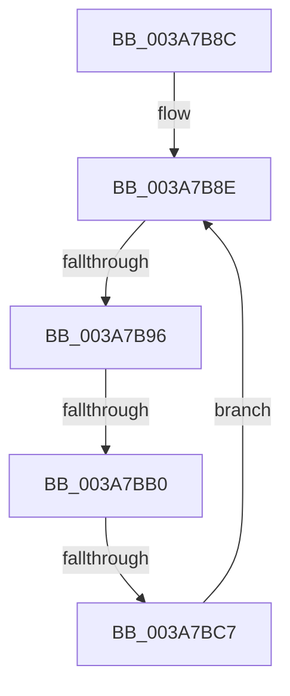

# sub_003A7B8C

- RVA: `0x003A7B8C`–`0x003A7BCB` (길이 `63` bytes)
- VA: `0x00000001403A7B8C`
- 실행 섹션: `.text`
- PDB 이름 있음: `아니요`; PDB Function 태그: `아니요`
- unwind 정보 RVA: `0x00089C24`
- 디코드: `17`개 명령, `63/63` bytes 표시
- 미해석 바이트: `0` (있으면 어셈블리에 `.byte`로 보존)

> 이 문서는 커널 이미지의 기계어와 PDB 기호를 분석해 생성했습니다. 4번과 5번은 함수 원형과 자료형을 바이너리 사용 방식에서 추정한 C 해석이며 원본 소스 복구 결과는 아닙니다.

## 1. Dependencies

- 직접 호출 지점: **2**; 고유 호출 대상: **2**
- 직접 호출자로 확인된 함수: **0**
- RIP 상대 이미지 참조: **0**

### Outgoing calls
- `0x003A7BA3` → [SepPotentialGlobalTableAttribute](SepPotentialGlobalTableAttribute_function_003A8828.md) (function, `0x003A8828`)
- `0x003A7BBA` → [AuthzBasepSecurityAttributePresent](AuthzBasepSecurityAttributePresent_function_003A88B0.md) (function, `0x003A88B0`)

### Direct callers
- 이 함수 시작 RVA로 연결되는 직접 call은 확인되지 않았습니다. 간접 호출은 완전히 역산할 수 없습니다.

### Static image references
- 디코드된 RIP-relative 메모리 참조가 없습니다.

## 2. Other-region calls and transfers

- 다른 실행 섹션으로 향하는 call: **0**
- call이 아닌 외부 분기/꼬리 이동: **3**
  - `0x003A7B90` → [sub_003A7AB1](Unknown_function_003A7AB1.md) (`tail-transfer`)
  - `0x003A7BAA` → [sub_003A7809](Unknown_function_003A7809.md) (`tail-transfer`)
  - `0x003A7BC1` → [sub_003A7809](Unknown_function_003A7809.md) (`tail-transfer`)

## 3. Assembly (complete function range)

```asm
003A7B8C  8B EB                           mov ebp, ebx
003A7B8E  3B EF                           cmp ebp, edi
003A7B90  0F 83 1B FF FF FF               jae 0x1403a7ab1
003A7B96  44 8B F5                        mov r14d, ebp
003A7B99  49 C1 E6 04                     shl r14, 4
003A7B9D  4D 03 F4                        add r14, r12
003A7BA0  49 8B CE                        mov rcx, r14
003A7BA3  E8 80 0C 00 00                  call 0x1403a8828
003A7BA8  84 C0                           test al, al
003A7BAA  0F 84 59 FC FF FF               je 0x1403a7809
003A7BB0  48 8B 8E 08 03 00 00            mov rcx, qword ptr [rsi + 0x308]
003A7BB7  49 8B D6                        mov rdx, r14
003A7BBA  E8 F1 0C 00 00                  call 0x1403a88b0
003A7BBF  84 C0                           test al, al
003A7BC1  0F 85 42 FC FF FF               jne 0x1403a7809
003A7BC7  FF C5                           inc ebp
003A7BC9  EB C3                           jmp 0x1403a7b8e
```

## 4. C-style interpretation (structured pseudocode)

```c
__int64 __fastcall sub_003A7B8C(void)
{
    __int64 result;
    __int64 v_r14;
    __int64 v_rbp;

loc_003A7B8E:
    v_r14 = ((unsigned int)((unsigned int)((unsigned int)((unsigned int)(v_rbx))))) << (4);
    v_r14 = (v_r14) + (v_r12);
    result = SepPotentialGlobalTableAttribute(v_r14, a2, a3, a4);
    result = AuthzBasepSecurityAttributePresent(*(unsigned __int64 *)(v_rsi + 776), v_r14, a3, a4);
    v_rbp = (unsigned int)(((unsigned int)((unsigned int)(v_rbx))) + 1);
    goto loc_003A7B8E;
}
```

## 5. (Beta) C Style

```c
void sub_003A7B8C(void)
{
    int64_t result;
    int64_t local_r14;
    int64_t local_rbp;

loc_003A7B8E:
    local_r14 = ((uint32_t)((uint32_t)((uint32_t)((uint32_t)(local_rbx))))) << (4);
    local_r14 = (local_r14) + (local_r12);
    result = SepPotentialGlobalTableAttribute(local_r14, a2, a3, a4);
    result = AuthzBasepSecurityAttributePresent(*(uint64_t *)(local_rsi + 0x308), local_r14, a3, a4);
    local_rbp = (uint32_t)(((uint32_t)((uint32_t)(local_rbx))) + 1);
    goto loc_003A7B8E;
}
```

## 6. Execution-region graph

[열기: 2D/3D 그래프와 함수 탐색 컨트롤 패널](../../../control-panel.html?section=text&rva=0x003A7B8C&view=graph)

- 2D 그래프는 위에서 아래로 흐르고, 3D 그래프는 빈 공간을 드래그해 회전합니다. Shift+드래그는 이동, 휠은 확대·축소, 함수 노드 선택은 대상 보고서 이동입니다.

### Static fallback


